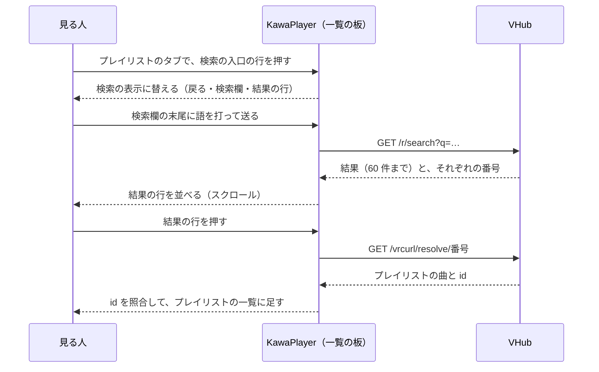
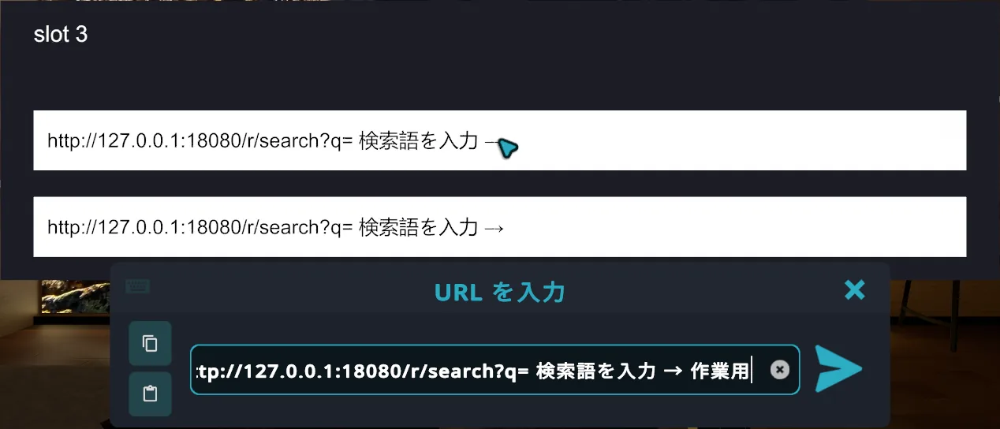

# VHub のプレイリスト検索：作る API と KawaPlayer の計画

| 項目 | 内容 |
| --- | --- |
| 文書の種類 | 計画（決定） |
| 関連する issue | #145（この文書の親）、#300（VHub Library。この検索の番号の仕組みを使う）、#258（スクリーンの UI）、VHub 側の #269（この計画で置き換える） |
| もとにした記録 | [current-api.md](current-api.md)（VHub の公開 API の今、VRChat の制約、検索の経緯） |
| 日付 | 2026-10-21（2026-10-22 にレビューを受けて改訂、2026-11-11 に決定と段階 0 の結果を反映して改訂） |
| 状態 | 決定（8 章）。段階 0 は済み（6.3）。実装はまだ |

## 要旨

KawaPlayer の中で VHub のプレイリストを文字で検索し、そのまま読み込めるようにする。#145 の最初の計画は人気・新着の一覧を見せるものだったが、VHub はその一覧と、一覧からプレイリストを読み込むプールを 2026-10-08 に廃止した。そこで、#145 を「人気・新着をやめて、検索を作る」に改め、VHub に作る API と、KawaPlayer の作りを計画する。

検索語は、入力欄に URL の前半と案内文を入れておき、見る人に末尾へ打ってもらう。サーバーは、届いた `q=` より後ろのエスケープを 1 回戻してから、案内文を区切り文字で取り除く。結果のプレイリストは、使い回し型の小さなプール（`resolve`、4,096 個）に割り当てる。KawaPlayer はその番号の URL を焼き込んでおき、選んだ結果を今の PlaylistLoader の流れで読み込む。使い回す番号の URL は取得にだけ使い、どのプレイリストかは、応答の `id` から作る識別（`default/{id}`）で見分けて同期する。URL 欄から読み込んだときも同じ識別を使うので、どちらの入口から読み込んでも、あとから誰が更新しても、別のプレイリストと取り違えない。経路は、ボット対策の例外がある `/r/` と `/vrcurl/` の下に置く。着手の前に、VRChat の中で入力のしかた（カーソルの位置、日本語、URL の届き方）を確かめる。

2026-11-11 に、8 章の事項を決めた。探し方は VHub の Web にある検索をそのまま使い、プレイリストの名前と曲名で探す。結果は、スクリーンの一覧の板の中に、プレイリストと同じ形の行で出す。サムネイルは作らない。番号の仕組み（`resolve` プールと識別）は VHub Library（#300）も使うので、検索を先に実装する。同じ日に段階 0 を済ませ、入力欄の末尾に打てることと、打った文字の届き方を確かめた（6.3）。

**キーワード：** VHub、検索、URL Pool、VRCUrlInputField、LRU、計画

## 目次

1. はじめに
2. 前提
3. 方式の検討
4. 提案する API（VHub 側）
5. KawaPlayer 側の作り
6. 確かめること
7. 進め方
8. 決めたこと
9. 危うい点
10. 参考文献
付録 A. 要求と応答の例

---

## 1. はじめに

VhubPlaylistViewer はサポートを終え、プレイリストを探す機能を KawaPlayer 本体に移すことになった（#145）。今の KawaPlayer では、VHub の Web で探し、「VRChat用URL」をコピーして URL 欄に貼るしかない。VR の中では、この手順が重い。

#145 は、もともと次の 2 段階だった。

- **段階 1:** 人気・新着の一覧を全画面のページで見せ、選んだプレイリストを読み込む。
- **段階 2:** 文字で検索する（別の issue）。

段階 1 の前提だった人気・新着の一覧と `playlist` プールは、VHub で廃止された（[current-api.md](current-api.md) の 1・2・4 章）。この文書では、#145 を検索の実装に改め、段階 2 を先に作る。

## 2. 前提

[current-api.md](current-api.md) から、計画に効くことを抜き出す。

**表 1** 計画の前提

| 前提 | 中身 |
| --- | --- |
| VHub で今使える経路 | resolve（`/r/default/{id}`）、曲の中継（`/vrcurl/default/{i}`）、`/r/default/_validate` の 3 つ。検索と一覧は廃止済み |
| 実行中の `VRCUrl` | 焼き込んだものか、`VRCUrlInputField.GetUrl()` だけ。入力欄の文字は Udon から書けないが、`SetUrl()` で入れ直せる |
| 入力欄の案内 | placeholder は出ない。案内は入力欄の文字そのものに入れる |
| 読み込み | 文字列・画像は redirect を追わない。それぞれ 5 秒に 1 回まで。見る人の「Allow Untrusted URLs」が要る |
| ボット対策 | ブラウザー以外の要求が通るのは `/r/` と `/vrcurl/` だけ |
| VHub の Web の検索 | VHub の Web には、公開のプレイリストを名前と曲名で探す検索がある。2026-05 に廃止したのは VRChat 向けの検索の経路で、Web の検索は動いている |
| スクリーンの UI | 1.4.0 で作り直した（#258）。左のアイコン列と全画面のページはなくなり、下の帯と、右端の一覧の板になった。一覧の板は Playlist Panel と共通の部品である |
| KawaPlayer の読み込み | `PlaylistLoader` が resolve の JSON を読み、権限の確認と同じプレイリストの見分けをして、曲を足す |

## 3. 方式の検討

### 3.1 検索語の渡し方

**表 2** 検索語の渡し方

| 案 | 中身 | 見る人の手間 | 判断 |
| --- | --- | --- | --- |
| A. フルの URL を打つ | 入力欄は空。見る人が `https://…/search?q=…` を全部打つ | 重い（60 文字ほど） | 採らない（VHub #103 で検索を廃止した理由そのもの） |
| **B. 前半を入れておき、末尾に打つ** | `SetUrl()` で「URL の前半 ＋ 案内文 ＋ `→`」を入れておく。見る人は末尾に検索語を打つ。送ったら初期値に戻す | 検索語だけ | **採る**。ほかのワールドの検索の部品で実際に使われている（[current-api.md](current-api.md) の 6 章） |
| C. 文字ごとの URL を焼く | 文字ごとの `VRCUrl` を焼き込んだボタンのキーボードを作り、サーバーで文字をつなぐ | 日本語は打てない | 採らない（VHub のプレイリスト名の多くは日本語） |

- 案内文は言語ごとに違う。`VRCUrl` は実行中に作れないので、言語ごとの初期値（9 言語、9 個）を焼き込んでおき、UI の言語に合うものを `SetUrl()` で入れる。
- サーバーは、案内文を言語によらず取り除けるように、エスケープを戻した文字列の、**区切り文字 `→`（U+2192）の最後のものより後ろ**を検索語にする。見る人が案内文を消していても、`→` がなければ全体を使う。取り出しの順は 4.1 に書く。

### 3.2 結果からプレイリストを読み込む方法

検索の結果は実行中にしか分からないので、選んだプレイリストを読み込む `VRCUrl` を、何らかの形で焼き込んでおく必要がある。

**表 3** 結果の読み込み方

| 案 | 中身 | 良い点 | 悪い点 | 判断 |
| --- | --- | --- | --- | --- |
| A. プレイリストごとの永久の番号 | 以前の `playlist` プールと同じ。プレイリスト 1 つに番号 1 つを永久に割り当てる | 番号が変わらない | 焼き込んだ数よりプレイリストが増えると、新しいものが読めない。作り直しが要る | 採らない |
| **B. 使い回し型の小さなプール** | 検索で返したプレイリストを `resolve` プールに割り当て、番号を返す。いちばん長く使われていない番号から使い回す。`/vrcurl/resolve/{i}` は resolve と同じ JSON を 200 で返す | 焼き込む数が固定で足りる。プレイリストが増えても読める | 使い回しで番号の中身が変わることがある（応答の `id` で照合して防ぐ。5.2） | **採る** |
| C. 検索の応答に曲まで入れる | 結果ごとに曲の一覧も返す。選んだら、もう 1 回読み込まずに足す | 選んだらすぐ足せる | 応答が大きい（60 件 × 曲）。検索のたびに全曲を `default` プールに登録することになり、サーバーが重い | 採らない |

- B の番号は、同じプレイリストには同じ番号を使う（今の `default` プールと同じ逆引き）。今の公開のプレイリストは数百件なので、4,096 個あれば、実際にはほとんど使い回されない。
- 使い回しで番号の中身が変わっても取り違えないように、番号の URL は取得にだけ使い、どのプレイリストかは応答の `id` で見分ける。結果の行を押したときだけでなく、読み込んだあとの更新でも、枠を書き換える前に照合する（5.2）。

### 3.3 件数と、結果の見せ方

検索語は見る人が打つので、ページの番号を URL に足すことはできない（次のページのたびに打ち直すことになる）。そこで、**1 回の応答で上位 60 件まで返す。** 60 件を超える分は、検索語を絞ってもらう（応答の `truncated` で案内する）。

結果は、一覧の板の中にプレイリストと同じ形の行で出し、スクロールで最後まで見る（5.1）。KawaPlayer の中でのページ送りは置かない。

- 改訂の前は、全画面のページに 4 列のカードを並べ、20 件ずつ送る案だった。20 件という数は、画像シートの 4 列 × 5 行（3.4 の B）に合わせたもので、画像シートをやめたので理由がなくなった。
- 60 件という数は、たたき台である。段階 0 で、60 件の応答の読み取りは 2 ms 未満と分かり、読み取りの時間では問題にならない（6.3）。よくある語が何件に一致するかは、段階 1 で数えてから確定する（6.1）。

### 3.4 サムネイル

**表 4** サムネイル

| 案 | 中身 | 判断 |
| --- | --- | --- |
| **A. 出さない** | 名前・作者・曲数を文字で出す | **採る** |
| B. 検索ごとの画像シート | 結果のサムネイルを 1 枚にまとめ、使い回し型の `sheet` プールに割り当てて番号を返す。KawaPlayer は 1 回の画像の読み込みで、`Sprite.Create` で切り分ける | 採らない（2026-11-11）。画像の取得が複雑になる。経路とプールがもう 1 組要り、画像の読み込みの 5 秒に 1 回の枠も使う |
| C. 1 件ずつ読む | 画像は 5 秒に 1 枚なので、20 件で約 100 秒かかる | 採らない |

### 3.5 経路の置き場所

ボット対策の例外は `/r/` と `/vrcurl/` だけなので、新しい経路はこの下に置く。

- 検索: `GET /r/search?q=…`。今の resolve（`/r/{pool}/{playlistId}`）は 2 つの区切りを持つので、1 つだけの `/r/search` とはぶつからない。
- 結果の読み込み: `GET /vrcurl/resolve/{i}`。
- 例外を広げて `/api/vrc/search` に置く案もあるが、運用の設定を変えずに済む上の置き方にした（D1）。

## 4. 提案する API（VHub 側）

### 4.1 `GET /r/search?q=<検索語>`（検索）

**表 5** 検索の要求

| 項目 | 決まり |
| --- | --- |
| `q` | 必須で、**最後の引数**。届いた要求の `q=` より後ろ全部を、検索語の元にする（`&` もそのまま含め、クエリの分解をしない）。取り出しの順は表の下に書く |
| 案内文 | エスケープを戻した文字列に `→`（U+2192）があれば、最後の `→` より後ろだけを残す |
| 整え方 | 前後の空白を除く。大文字と小文字、全角と半角などの扱いは、Web の検索に合わせる（この経路だけの正規化は足さない） |
| 長さ | Web の検索の上限にそろえる（今は 100 文字）。0 文字は 400 `Empty query`、超えたら 400 `Query too long`（黙って切らない） |
| 一致 | **Web の検索と同じ。** 検索語を、プレイリストの名前か、曲名のどちらかに含むプレイリスト（大文字と小文字は区別しない） |
| 対象 | 公開で、曲が 1 件以上のプレイリストだけ |
| 並び | Web の検索と同じ（resolve された回数の多い順 → `id` の順） |
| 件数 | 最大 60 件（3.3）。61 件目があるかだけを見て、一致した数は数えない |

検索語は、次の順で取り出す。順が大事である。送るときに `→` が `%E2%86%92` になると、エスケープを戻す前の文字列には `→` がないので、先に案内文を取り除こうとすると、案内文まで検索語に残る。

1. 届いた要求の対象（フレームワークがクエリを分けたりデコードしたりする前の、生の文字列）から、`?q=` より後ろを取り出す。
2. パーセントのエスケープを **1 回だけ** 戻す（UTF-8）。
   - `%` と 16 進 2 桁の並びだけを戻す。それ以外の `%`（`100%` の `%` など）は、その文字のまま残す。ただし VRChat は、16 進 2 桁の続かない `%` を含む URL を読み込まない（段階 0、6.3）。KawaPlayer が送る前に止めるので（5.1）、この決まりは、ほかから届いた要求のためのものになる。
   - `+` は空白にせず、`+` のまま残す（フォームの書き方としては読まない。`C++` を検索できるように）。段階 0 で、VRChat は空白を `%20` で、`+` を `+` のまま送ると確かめた（6.3）。
   - 戻した結果が UTF-8 として正しくなければ、400 `Invalid query`。
3. 最後の `→` より後ろだけを残す。`→` がなければ全体を使う。
4. 前後の空白を除く（表 5）。
5. 長さを確かめる（表 5）。

`#` は、サーバーだけでは扱えない。

- 生の `#` は fragment（文書の中の位置の印）の始まりで、要求を送る前に切り離され、ふつうはサーバーに届かない（RFC 3986 の 3.5 節）。`%23` なら、クエリの文字として届く。
- 段階 0 で確かめた結果、VRChat は `#` を `%23` にせず、`#` から後ろを送らなかった（`c#major` は `c` で届いた。6.3）。
- そこで、`#` は検索に使えないことにし、KawaPlayer が送る前に止めて案内する（5.1）。届かなかった後ろを黙って捨てた結果は見せない。

**表 6** 検索の応答（200）

| 項目 | 型 | 中身 |
| --- | --- | --- |
| `ok` | bool | `true` |
| `query` | string | 取り出した検索語（画面に「○○ の検索結果」と出す） |
| `truncated` | bool | 60 件で切ったか（61 件目があったか） |
| `items[]` | array | 下の形の結果 |
| `items[].id` | string | プレイリストの ID（照合用） |
| `items[].name` | string | プレイリストの名前 |
| `items[].ownerName` | string | 作った人の表示名 |
| `items[].trackCount` | int | 曲の数 |
| `items[].resolveIndex` | int | `/vrcurl/resolve/{i}` の `i` |
| `items[].updatedAt` | string | 更新の日時（ISO 8601） |
| `items[].matchedTrack` | string（ないこともある） | 名前には検索語がなく、曲名で一致したときに、一致した曲名を 1 つ（プレイリストの並びでいちばん前のもの）。名前で一致したときは入れない |

- **エラー:** 400（検索語が空・長すぎる）、429 `Rate limit exceeded`、500。どれも今と同じ `{ "ok": false, "error": "…" }` の形。
- **回数の制限:** 1 つの IP につき 1 分あたり 20 回（resolve とは別に数える）。VRChat の文字列の読み込みは 1 つのクライアントにつき 5 秒に 1 回なので、1 人なら 1 分に 12 回までで、届かない。ただし、VRChat の制限はクライアントごとで、サーバーの制限は IP ごとである。同じ外向きの IP を使う人（同じ家や会場から入った人、携帯回線などで IP を分け合う人）の検索は、合わせて数えられる。何人までなら続けて検索できるかを、D8 の判断の材料にする（6.2）。
- **キャッシュ:** 検索語ごとに 60 秒。
- **副作用:** 返す結果を `resolve` プールに登録する（4.2）。

探し方を Web の検索と同じにするのは、Web で探したときとワールドで探したときに、同じ結果を出すためである（D4）。Web の検索にある分類（カテゴリー・ジャンル・タグ）での絞り込みは、検索欄から渡せないので使わない。改訂の前は、プレイリストの名前だけを、語を空白で分けた AND の部分一致で探す案だった。

- 曲名でも探すので、短い語では一致が増え、60 件で切られる場面が増える。
- 一致した数（改訂の前の `total`）は返さない。Web の検索は、数えるための問い合わせを足さない作りにしている。
- 名前には検索語がなく、曲名だけで一致したプレイリストも結果に出る。なぜ出たのかが分かるように、一致した曲名を 1 つ応答に入れ（`matchedTrack`）、KawaPlayer が行に出す（D9）。Web の検索も、一致した曲を結果に出している。入れるのは 1 つだけにして、応答を大きくしない。

### 4.2 `GET /vrcurl/resolve/{i}`（結果の読み込み）

| 項目 | 決まり |
| --- | --- |
| プール | `resolve`。容量 4,096（KawaPlayer が焼き込む数と同じにする） |
| 割り当て | 検索の結果を返すときに登録する。同じプレイリストには同じ番号。いっぱいなら、いちばん長く使われていない番号を使い回す |
| 応答（あり） | 200。`/r/default/{id}` と同じ JSON（`pool` と `id` を含む。KawaPlayer はこれで識別を作る、5.2）。文字列の読み込みは redirect を追わないので、302 にしない |
| 応答（なし） | 404 `{ "ok": false, "error": "Not found" }` |
| 公開の状態 | 応答の前に、キャッシュを読むより先に、今の公開の状態を確かめる。割り当てたあとで非公開になった・消されたプレイリストは、404 にする。今の resolve のキャッシュは公開かどうかを持たないので、キャッシュだけで答えない |
| 割り当ての入口 | 検索の結果からだけでなく、ほかの経路からも呼べる作りにする。VHub Library（#300）は、自分の一覧に載せた公開のプレイリストを、同じプールに割り当てる |
| 回数の制限 | resolve と同じ（60 回/分/IP） |
| 副作用 | 番号の最後に使った時刻を更新する。resolve と同じく、resolve された回数を数える |

### 4.3 `GET /r/resolve/_validate`

Editor が焼き込む前に確かめるため、`_validate` で `resolve` プールも許可し、`{ "ok": true, "pool": "resolve", "poolSize": 4096 }` を返す。KawaPlayer の Editor は、この `poolSize` の数だけ焼き込む。

### 4.4 画像シート（取りやめ）

改訂の前は、段階 3 として、検索の応答に画像シートの番号を足し、`GET /vrcurl/sheet/{i}` で JPEG を返す案を置いていた。サムネイルを作らないと決めたので（3.4、D6）、この経路とプールは作らない。

## 5. KawaPlayer 側の作り

### 5.1 部品

結果は、スクリーンの一覧の板（`Prefabs/UI/ListPanel.prefab`）の中に出す。図にすると、次の流れになる。結果を出したあとも検索の表示は残り、戻るボタンでプレイリストの一覧に戻る。



**図 1** 一覧の板の中の検索の流れ

**表 7** KawaPlayer の変更

| 部品 | 変更 |
| --- | --- |
| 検索の入口 | 一覧の板のプレイリストのタブに、入口の行を置く。今は同じ一覧の末尾に、VHub の VRChat用URL を足す「＋」の行がある。入口の行の位置（たたき台は一覧の先頭）は、実装のときに画面で確かめて決める |
| 検索の表示 | 入口を押すと、同じ板の中で検索の表示に替わる。上に戻るボタンと検索欄、下に結果の行、状態の表示（読み込み中・0 件・60 件で切った・エラー）。戻るボタンで、プレイリストの一覧に戻る。一覧の 2 つのページ（プレイリスト、曲）と同じく、ページごとの Canvas で切り替える |
| 結果の行 | プレイリストの行と同じ形（1 行の高さ 68）で、名前・作者・曲数を文字で出す。曲名だけで一致した結果には、一致した曲名（`matchedTrack`）も出す（D9）。長い曲名は行の端で切る。置き方は、実装のときに画面で確かめて決める。`LoopScroll` でスクロールし、ページ送りは置かない。行を押すと読み込み、結果は出したままにして、続けて足せるようにする |
| 検索欄 | `VRCUrlInputField`。検索の表示を出したときと送ったあとに、言語に合う初期値を `SetUrl()` で入れる（段階 0 で、無効のあいだに入れた値は、表示したときに消えると確かめた。出すたびに入れ直す）。送られた URL が検索の形でなく、`/r/default/{id}` なら、そのプレイリストを読み込む（URL を貼っても使える）。送る前に `GetUrl().Get()` の文字列で検索語を見て、空なら送らない（5 秒に 1 回の読み込みを使わない）。`#` か `%` を含む検索語も、送らずに案内する（段階 0 で、`#` から後ろは届かず、`%` は VRChat が読み込みを断ると分かった。4.1、6.3）。VRChat の入力の窓は 45 文字ほどしか見えず、本番の初期値（50 文字）では先頭が隠れるので、案内文は短く保つ |
| 結果の読み込み | 結果の行を押すと、`_resolvePool[resolveIndex]` を、結果の識別（`default/` ＋ `items[].id`）とともに `PlaylistLoader` に渡す。権限（`BeforeUserLoadPlaylist`）と満杯のときの確認は、URL 欄と同じ流れを通す。照合と同じプレイリストの見分けは 5.2。この入口は、検索の結果の行のほかからも呼べる形にする（VHub Library、#300） |
| プレイリストの枠 | `DynamicPlaylist` は、取得の URL（`SourceUrl`）に並べて、識別（`SourceKey`、文字列）を同期する。中身は読まず、入れたモジュールから受け取った値を持つだけ |
| 更新 | 更新ボタンは、枠の取得の URL と識別を `PlaylistLoaderUI` に渡す。`PlaylistLoaderUI` は、`/vrcurl/resolve/{i}` の形の URL も更新に受け付ける |
| 焼き込み | Editor で `_resolvePool`（`/vrcurl/resolve/{i}` × 4,096）と、検索欄の初期値（9 言語）を作る。`_validate` で確かめてから作る |
| 文言 | 9 言語。案内文、状態の表示、エラー |
| ガイド | `docs/guide/vhub.md`・`playing.md` に検索の使い方を足す |
| タブレット | タブレットの KawaPlayer アプリはスクリーンと同じ UI なので、同じ検索が出る。大きさを確かめる |
| Playlist Panel | 検索は出さない。一覧の板は共通の部品だが、Playlist Panel にはダイアログがなく、結果やエラーを伝えられない。入口の行は、「＋」の行と同じ条件（URL の受け手とダイアログのある UI）でだけ出す |

- 検索の結果は、その人の画面だけのもので、同期しない。読み込んだプレイリストは、取得の URL と識別とともに、今と同じく全員に届く。
- 焼き込む数は 4,096 個増える（今の `_redirectPool` は 100,000 個）。
- `DynamicPlaylist` の同期する項目が増える。同期する項目が変わると、違うビルドのあいだでは同じインスタンスに入れないので、PC と Android の両方を作り直す必要がある。このことは、リリースノートの「更新する前に」に書く。
- 一覧の板（core）は、結果を「出す文字と、押したときに返す番号」の行として受け取って出すだけにし、VHub の URL や応答の形を知らない。それを知るのは、5.2 の識別と同じく、PlaylistLoader モジュールだけにする。受け渡しの形は、実装の PR で決める。
- 改訂の前は、全画面のページ（左のアイコン列の検索アイコンから開く）に 4 列のカードを並べる案だった。1.4.0 の UI にその入口はなく、結果を一覧の板の行で出すことに決めた（2026-11-11）。

### 5.2 取得の URL と、プレイリストの識別

今の KawaPlayer は、プレイリストを取得の URL で見分けている（[current-api.md](current-api.md) の 5 章）。`PlaylistLoader.LoadIntoSlot()` は取得の URL から重複のキーを作り、その URL を `DynamicPlaylist.Fill()` に渡す。枠が同期するのは取得の URL だけで、更新ボタンはそれを読み直す。入口が `/r/default/{id}` しかない今はこれで足りるが、検索では同じプレイリストに 2 つの入口ができ、片方の URL は使い回される。

**表 8** 入口ごとの取得の URL

| 入口 | 取得の URL | 今の重複のキー | 指す中身 |
| --- | --- | --- | --- |
| URL 欄に「VRChat用URL」を貼る | `/r/default/A` | `default/A` | いつも A |
| 検索の結果の行を押す | `/vrcurl/resolve/12` | `/vrcurl/resolve/12` | 今は A。使い回されると、あとで B を指すことがある |

このままでは、同じプレイリストが 2 つの枠に入る。また、`12` が B に使い回されたあとに A の枠を更新すると、B の曲が A の更新として入る。更新のときには検索の結果（その人の画面だけのもの）がないので、結果の行を押したときの照合だけでは防げない。実行中に文字列から `VRCUrl` を作れないので、検索の結果から `/r/default/A` の URL を作ることもできない。そこで、**取得の URL と、どのプレイリストかの識別を分ける。**

1. **識別は応答から作る。** どの入口から読み込んでも、resolve の応答の `pool` と `id` から識別（`{pool}/{id}`。たとえば `default/A`）を作る。URL 欄と検索は、この同じ処理を通る。応答に `pool` か `id` がなければ、壊れた応答として扱う。
2. **読み込む前に、どのプレイリストのつもりかを決める。** 満杯のときの確認（どの枠を置き換えるか）も、この識別で先に見積もる。
   - URL 欄: URL のパスから（`/r/default/A` なら `default/A`。今の `GetSourceKey` と同じ）。URL 欄に打たれた `/vrcurl/resolve/{i}` は受け付けない（使い回す番号で、人に渡す URL ではない）。
   - 検索の結果の行: 検索の結果から（`default/` ＋ `items[].id`）。
   - VHub Library（#300）の一覧の項目: 一覧の応答から（同じ入口を通す）。
   - 更新: 枠が同期している識別。
3. **枠を書き換える前に照合する。** 応答の識別が 2 で決めたものと違えば、どの枠にも書かない。更新なら、枠は前の中身のまま残る。「このプレイリストは、もう一度検索すると読み込めます」と案内する。結果の行を押したときも、更新のときも、同じ照合を通す。
4. **同じプレイリストは識別で見分ける。** 応答の識別と同じ識別の枠があれば、その枠を更新として使う。URL 欄から検索、検索から URL 欄のどちらの順でも、1 件のままになる。
5. **使い回さない URL を残す。** 同じ識別の枠を更新するとき、枠の取得の URL が `/r/…` で、新しい取得の URL が `/vrcurl/resolve/…` なら、`/r/…` のまま残す。逆なら `/r/…` に替える。使い回さない URL を持つ枠は、更新で照合に落ちることがない。
6. **識別も同期する。** 枠は、取得の URL と並べて識別を同期する（5.1）。検索した人が抜けたあとも、途中から入った人も、同期した取得の URL と識別で更新でき、照合も同じように働く。

満杯のときの確認と削除の確認は、今は取得の URL で「確認したときと同じ中身か」を確かめている（`PlaylistLoader`・`PlaylistLoaderUI`・`DefaultUrlSettingsUI`・`UIController`）。取得の URL が同じでも中身は変わりうるので、これも識別で比べる。3 の照合があるので、枠の識別はいつもその枠の中身と合っている。

識別の受け持ちは、次のように分ける。core は識別を、中身の分からない文字列として扱い、VHub の URL や応答の形を知らない。VHub の形を知るのは、今の `PlaylistUrlUtils` と同じく、PlaylistLoader モジュールだけにする。

**表 9** 識別の受け持ち

| 部品 | 受け持つこと |
| --- | --- |
| `DynamicPlaylist`（core） | 取得の URL と識別を、入れたモジュールから受け取って持ち、同期する |
| `UIController`（core） | 更新のときに、枠の取得の URL と識別を、そのまま更新の受け手に渡す。削除の確認は識別で比べる |
| `PlaylistLoader`・`PlaylistLoaderUI`（モジュール） | URL の見分け（`/vrcurl/resolve/{i}` の形を足す）、読み込む前の識別、応答からの識別、照合、識別での見分け、残す取得の URL の選び方 |
| `DefaultUrl`（モジュール） | 置き換えの確認を識別で比べる。プレイリストとして自動再生するのは、今と同じ `/r/default/{id}` だけにする（`IsOwnPlaylistUrl` に `/vrcurl/resolve/{i}` を含めない。使い回す番号を保存すると、あとで別のプレイリストを自動再生しかねない） |

## 6. 確かめること

開発環境（Unity と VRChat の Build & Test）で証明できるものを、作る前（段階 0）と作ったあと（段階 2）に確かめる。

### 6.1 段階 0（作る前）

**表 10** 段階 0 で確かめること

| 確かめること | 方法 |
| --- | --- |
| 検索語がどう届くか | 手元の HTTP サーバーを立て、`SetUrl()` で初期値を入れた入力欄に、英字・空白・日本語・`&`・`#`・`%`・`+` を打って送る。届いた要求の行で、`→`・空白・日本語・`#`・`%`・`+` のエスケープのされ方を、サーバーのログで見る。`#` が `%23` で届かなければ、`#` を検索に使えないことにする。空白が `+` で届けば、`+` の扱いを決め直す（4.1） |
| 日本語を打てるか | Build & Test（デスクトップ）で、入力欄に日本語（IME）を打てるか |
| カーソルの位置 | 入力欄を選んだときに、カーソルが末尾にあるか。末尾にないなら、案内文を前に置く今の案で打てるか |
| 応答の読み込みの重さ | 60 件の応答を `VRCJson` で読む時間を、Udon の中で測る（D5 の 60 件を確かめる材料） |
| 一致する件数 | 名前と曲名の検索で、よくある短い語が何件に一致するかを、VHub の側で数える（集計だけ）。60 件で切られる語が多ければ、件数を決め直す（D5） |

VR のキーボード（とくに Quest）での日本語の入力は、開発環境では確かめられない。2026-10-15 の決まりに沿って省き、9 章の危うい点に残す。

この表の 4 つは、2026-11-11 に確かめた。結果は 6.3 にある。一致する件数だけは、VHub の側の作業なので、段階 1 で数える。

### 6.2 段階 2（作ったあと）

識別（5.2）は、入口の順・使い回し・人の出入りで崩れやすいので、次を確かめる。使い回しは本物の VHub では起こせないので、番号の割り当てを変えられる手元の HTTP サーバーを VHub の代わりに使う（`PlaylistLoader` の取得先を、そのサーバーに向けて焼き込む）。段階 0 で、VRChat のクライアントは、この PC の `http://127.0.0.1` からも文字列を読み込めた（6.3）。

**表 11** 段階 2 で確かめること

| 確かめること | 方法 |
| --- | --- |
| URL 欄 → 検索 | `/r/default/A` を読み込んだあと、検索の結果の行で A を読み込む。1 件のままで、更新と出て、枠の取得の URL は `/r/default/A` のまま |
| 検索 → URL 欄 | 検索の結果の行で A を読み込んだあと、`/r/default/A` を読み込む。1 件のままで、枠の取得の URL が `/r/default/A` に替わる |
| 使い回されたあとの更新 | 検索の結果の行で A を読み込んだあと、番号 12 を B に割り当て直してから、A の枠を更新する。A の曲のまま残り、検索し直す案内が出る |
| 抜けた人・途中から入った人の更新 | Build & Test の 2〜3 クライアントで、検索して読み込んだ人が抜けたあとに、残った人と途中から入った人が A の枠を更新する。同期した識別で照合され、使い回されたあとでも B を書き込まない |
| 同じ IP の複数人 | Build & Test の複数のクライアント（同じ PC なので同じ IP）で続けて検索し、429 の出方と案内を見る。段階 1 の VHub の API か、同じ制限を入れた手元のサーバーで（D8 の材料） |
| 識別の処理 | 応答からの識別、照合、識別での見分け、残す取得の URL の選び方を、エディターのテストで確かめる（`VRCUrl` のほかは実物のコードで） |
| Web と同じ結果 | 同じ語で、VHub の Web の検索と同じプレイリストが、同じ順で出る。曲名だけで一致したものも出て、その行に一致した曲名が出る。名前で一致した行には出ない（段階 1 の VHub の API で） |
| 結果の行 | 60 件の結果を、スクロールで最後までたどれる。60 件で切ったときに案内が出る。行を押しても結果は出たままで、続けて足せる |
| 公開をやめたプレイリスト | 結果に出たあとで非公開にしたプレイリストの行を押すと、読み込まれず、案内が出る（4.2） |
| 一覧の板の退行 | プレイリスト・キュー・履歴のタブ、プレイリストのヘッダーと「＋」が、今と同じに動く。Playlist Panel には検索の入口が出ない。タブレットの KawaPlayer アプリで、検索の表示が崩れない |

### 6.3 段階 0 の結果（2026-11-11）

VRChat のテスト用クライアント 1 台（デスクトップ、Build & Test と同じ引数で起動）で確かめた。Room N の写しに、初期値を入れた `VRCUrlInputField` と記録用の U# を置き、この PC の代役のサーバー（`http://127.0.0.1`）に検索語を送らせた。入力は、テスト用クライアントの窓へのクリックと文字の送信で行った。仕掛けと記録は [evidence~/stage0/](evidence~/stage0/) にある。



**図 2** 入力欄をクリックすると開く VRChat の入力の窓。カーソルは末尾に入り、案内文の後ろに打てる（「作業用」と打ったところ）

**表 12** 段階 0 の結果

| 確かめたこと | 結果 | 計画への影響 |
| --- | --- | --- |
| カーソルの位置 | クリックすると入力の窓が開き、カーソルは末尾に入る。何も押さずに打った語が、案内文の後ろに付く | D7 のまま進める |
| 入力の窓の見え方 | 見えるのは 45 文字ほど。長くなると先頭から隠れ、末尾（打っている語）は見える | 本番の初期値（50 文字）では先頭が隠れる。案内文は短く保つ（5.1） |
| 初期値だけを送る | 空白は `%20`、日本語と `→` は UTF-8 のパーセントエスケープで届く | 4.1 の取り出しの順（エスケープを戻してから `→` を探す）のまま |
| 英字（`disco`、`Night Drive`） | そのまま届く。大文字と小文字は変わらない | なし |
| 空白 | `%20` で届く（`+` にならない） | 4.1 の `+` の決まりのまま |
| 日本語（`作業用`） | UTF-8 のパーセントエスケープで届く | なし |
| 全角の英字と全角の空白 | 全角のまま届く | 半角との同一視は、Web の検索に合わせる（4.1） |
| `&` と `=`（`a&b=c`） | エスケープされずに、そのまま届く | 「`q=` より後ろ全部を検索語の元にする」決まり（4.1）が要る |
| `+`（`c++`） | `+` のまま届く | `+` を空白にしない決まり（4.1）のまま |
| `#`（`c#major`） | `c` だけが届く。`#` から後ろは送られない | `#` を含む検索語は、KawaPlayer が送る前に止める（5.1） |
| `%`（`100% ok`） | VRChat が読み込みを断る（`Malformed URL`）。要求は送られない | `%` を含む検索語も、KawaPlayer が送る前に止める（5.1） |
| 案内文のない初期値（`…?q=`） | 同じように末尾に打てて、届く | なし |
| 無効のあいだに値を入れた入力欄 | 入れた直後は読めるが、表示したときに空になる。表示してから入れた値は、非表示にして出し直しても残る | 検索の表示を出すたびに、初期値を入れ直す（5.1） |
| 60 件の応答（約 12,000 文字）の読み取り | `VRCJson` の解析は 0.11〜0.21 ms、60 件の項目の取り出しは 0.6〜1.7 ms | 60 件（D5）は、読み取りの時間では問題にならない |
| 手元のサーバー | VRChat は、この PC の `http://127.0.0.1` からも文字列を読み込めた | 6.2 の手元のサーバーが使える |

確かめていないことは、次のとおりである。

- **IME での日本語の変換:** 文字を直接送ったので、日本語が届く形は分かったが、変換の操作は試していない。人の手で 1 回確かめる。
- **VR のキーボードと Quest:** 開発環境では確かめられない（9 章）。読み取りの時間も、Quest では測っていない。
- **一致する件数（D5）:** VHub の側で数える（6.1、段階 1）。

## 7. 進め方

**表 13** 段階

| 段階 | 中身 | 場所 |
| --- | --- | --- |
| 0 | 入力のしかたの確認（6.1）。**済み**（2026-11-11、結果は 6.3） | KawaPlayer（開発環境） |
| 1 | 検索の API と `resolve` プール（4.1〜4.3）。VHub #269 を、この計画に書き直す（画像シートは作らない） | VHub |
| 2 | 一覧の板の検索（検索欄と結果の行）、結果の読み込みと識別（5 章）。確かめることは 6.2 | KawaPlayer |

- 改訂の前の段階 3（画像シート）は取りやめた（3.4）。
- 段階 2 は、ワールドの中でできることが増える新しい機能なので、minor 版にあたる。1.4.0 は 2026-11-07 に公開したので、その次の minor 版になる。
- **VHub Library（#300）より先に実装する。** Library は、この検索が作る番号の仕組み（`/vrcurl/resolve/{i}`、`_resolvePool`、識別 `SourceKey`、読み込む前後の照合）をそのまま使う。Library の PoC（#301）は、段階 2 のあとに始める。そのために、番号の割り当て（4.2）と、識別を受け取る入口（5.1）を、検索のほかからも呼べる形で作る。

## 8. 決めたこと

2026-11-11 に、次のとおり決めた。D9 は、D4 の決定で新しく出た事項である。

**表 14** 決めたこと

| # | 決めること | 決定 | 採らなかった案・補足 |
| --- | --- | --- | --- |
| D1 | 検索の経路 | `GET /r/search?q=…` | `/api/vrc/search` に置き、ボット対策の例外を広げる案は採らない。同じ日に本番で確かめ、VRChat からの取得が届くのは `/r/` と `/vrcurl/` の下だけだった。経路とプールの名前は、VHub の側で届くことを確かめてから確定する（名前によっては、手前の保護で止まる） |
| D2 | 結果の読み込み方 | 使い回し型の `resolve` プール（3.2 の B） | 永久の番号（A）、応答に曲まで入れる（C）は採らない。VHub Library（#300）も、このプールを使う |
| D3 | `resolve` プールの大きさ | 4,096 | 公開のプレイリストは 1,000 件弱で、月に 100 件前後増えている |
| D4 | 何で探すか | **VHub の Web の検索を再利用する。** プレイリストの名前と曲名で探す（4.1） | 改訂の前のすすめ（名前だけを、この経路のための検索で探す）は採らない |
| D5 | 件数 | 1 回で 60 件（**仮**）。KawaPlayer の中でのページ送りは置かない（3.3） | 60 はたたき台。段階 0 で、60 件の読み取りは 2 ms 未満と分かった（6.3）。一致する件数を段階 1 で数えてから確定する（6.1）。20 件ずつのページ送りは採らない |
| D6 | サムネイル | **作らない**（3.4） | 画像シートを段階 3 で作る案は採らない |
| D7 | 案内文と区切り文字 | 言語ごとの案内文 ＋ `→`、9 言語の初期値を焼き込む | 段階 0 で、カーソルが末尾に入り、案内文の後ろに打てると確かめた（6.3）。決め直しは要らない |
| D8 | 検索の回数の制限 | 20 回/分/IP | 曲名でも探すことになり、検索が重くなるので、段階 1 で負荷を測って確かめる。同じ IP の複数人の検索が合わせて数えられることも材料にする（4.1） |
| — | 結果の出し方 | 一覧の板の中に、行で出す（5.1） | 全画面のページとカードは採らない |
| — | 検索欄と入口 | プレイリストのタブに入口の行を置き、押すと同じ板の中で検索の表示に替わる（5.1） | VHub Library（#302）の入口の並べ方は、Library の側で決める |
| — | Playlist Panel | 検索は出さない（5.1） | ダイアログがなく、結果やエラーを伝えられない |
| — | 実装の順 | 検索が先、VHub Library はそのあと（7 章） | — |
| D9 | 曲名だけで一致した結果の見せ方 | 一致した曲名を 1 つ応答に入れ（`items[].matchedTrack`）、行に出す（4.1、5.1） | 何も出さない案は採らない（名前に検索語がないプレイリストが、理由の分からないまま並ぶ） |

## 9. 危うい点

**表 15** 危うい点

| 危うい点 | 影響 | 備え |
| --- | --- | --- |
| VR のキーボードで日本語を打てない | VR の人は英字でしか検索できない | 開発環境では確かめられない。段階 0 では、日本語の文字を直接送って届く形だけを確かめた。IME での変換は、人の手で確かめる。英字の名前・URL を貼る使い方を残す。VR の人からの報告を Discord で集める |
| `resolve` の番号の使い回し | 結果を出してから時間がたつと、別のプレイリストを指すことがある。読み込んだあとの更新でも起こる | 取得の URL と識別を分け、結果の行を押したときも更新のときも、枠を書き換える前に応答の `id` で照合する。違えば前の中身のまま、検索し直す案内を出す（5.2） |
| 曲名でも探すので、一致が増える | 短い語では 60 件で切られ、探しているものが出ない。検索も重くなる | 段階 1 で、よくある語の一致の件数と負荷を測り、件数（D5）と回数の制限（D8）を確かめる。切ったときは、語を足して絞るよう案内する |
| 一覧の板は Playlist Panel と共通の部品 | 検索を足すと、Playlist Panel や今のタブに影響が出ることがある | 入口は「＋」と同じ条件でだけ出す。板の退行を確かめる（6.2） |
| 検索を待つ VHub Library | 検索の実装が遅れると、Library の PoC も遅れる | 番号の仕組み（段階 1 の `resolve` プールと、段階 2 の識別）を先に作る |
| `#` と `%` は検索に使えない | `#` から後ろは届かない。`%` を含むと、VRChat が読み込みを断る（段階 0 で確認、6.3） | KawaPlayer が送る前に止めて案内する（4.1、5.1） |
| 同期する項目が増える | PC と Android の片方だけ作り直すと、同じインスタンスに入れない | リリースノートの「更新する前に」に、両方を作り直すよう書く（5.1） |
| 「Allow Untrusted URLs」がオフ | 検索も読み込みもできない | 今の PlaylistLoader と同じく、理由を画面に出す |
| 検索の経路への大量の要求 | サーバーが重くなる | 回数の制限、検索語ごとのキャッシュ、公開のプレイリストだけ |
| ボット対策の設定 | 経路を `/r/`・`/vrcurl/` の外に置くと、ワールドから呼べない | 3.5 の置き方にする |
| 案内文を消された・書き換えられた | 検索語が取れない | `→` がなければ `q=` より後ろ全体を使う。0 文字なら 400 で案内する |

## 10. 参考文献

1. [current-api.md](current-api.md)（この計画のもとにした記録）
2. VHub PlayList 公開 API リファレンス（VHub のリポジトリ `docs/api/public-api.md`、`5cd25f7`）
3. VHub #103（検索の廃止）、#269（画像シートと検索の作り直しの提案）、#287（VhubPlaylistViewer 用の経路の廃止）
4. KawaPlayer #145（この計画の親）、#300（VHub Library。計画は [300-vhub-library](../300-vhub-library/README.md)）、#258（スクリーンの UI。計画は [258-screen-ui](../258-screen-ui/README.md)）
5. [URL Pool 方式のプレイリストローダー](../url-pool/README.md)
6. VRChat Creators：[String Loading](https://creators.vrchat.com/worlds/udon/string-loading/)、[Image Loading](https://creators.vrchat.com/worlds/udon/image-loading/)
7. [RFC 3986](https://www.rfc-editor.org/rfc/rfc3986.html)（URI の書き方。3.5 節が fragment）

## 付録 A. 要求と応答の例

検索欄の初期値（日本語。`→` の後ろに空白を 1 つ置き、見る人はその後ろに打つ）:

```
https://playlist.vrc-hub.com/r/search?q= 検索語を入力 →
```

見る人が末尾に「disco」と打って送ったときの要求（エスケープのされ方は段階 0 で確かめる。ここでは空白と日本語と `→` がエスケープされたとする）:

```
GET /r/search?q=%20%E6%A4%9C%E7%B4%A2%E8%AA%9E%E3%82%92%E5%85%A5%E5%8A%9B%20%E2%86%92%20disco
```

サーバーでの検索語の取り出し（4.1 の順）:

```
1. ?q= より後ろ        %20%E6%A4%9C%E7%B4%A2%E8%AA%9E%E3%82%92%E5%85%A5%E5%8A%9B%20%E2%86%92%20disco
2. エスケープを 1 回戻す  " 検索語を入力 → disco"
3. 最後の → より後ろ     " disco"
4. 前後の空白を除く    "disco"
```

応答:

```jsonc
{
  "ok": true,
  "query": "disco",
  "truncated": false,
  "items": [
    { "id": "1PFtjGIDlFrjdMMkJlT9F", "name": "DISCO", "ownerName": "…", "trackCount": 24, "resolveIndex": 12, "updatedAt": "2026-10-20T03:00:00.000Z" },
    { "id": "…", "name": "作業用BGM", "ownerName": "…", "trackCount": 8, "resolveIndex": 13, "updatedAt": "2026-10-18T10:00:00.000Z", "matchedTrack": "Midnight Disco" }   // 曲名だけで一致
  ]
}
```

結果を選んだときの読み込み（識別は応答の `pool` と `id` から `default/1PFtjGIDlFrjdMMkJlT9F`。結果の行から決めた識別と同じなので、枠に書く。5.2）:

```
GET /vrcurl/resolve/12   →   200 { "ok": true, "id": "1PFtjGIDlFrjdMMkJlT9F", "pool": "default", "name": "DISCO", "tracks": [ … ] }
```

あとで番号 12 が別のプレイリストに使い回されてから、この枠を更新したとき:

```
GET /vrcurl/resolve/12   →   200 { "ok": true, "id": "9xQe…", "pool": "default", "name": "…", "tracks": [ … ] }
```

応答の識別（`default/9xQe…`）が枠の識別（`default/1PFtjGIDlFrjdMMkJlT9F`）と違うので、枠は書き換えず、検索し直す案内を出す。
