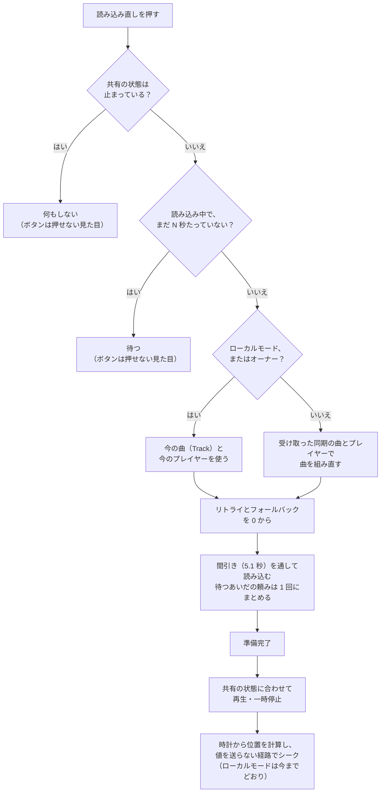
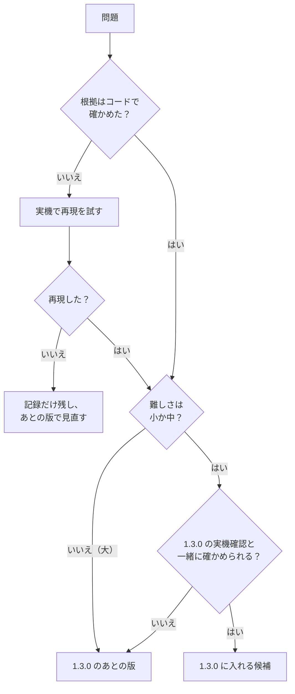

# 再生の同期：直す方針の決め方

| 項目 | 内容 |
| --- | --- |
| 文書の種類 | 計画（方針を決めるための資料） |
| 関連する issue | #228（この文書の親）、#215（自分の画面だけ止まったときの読み込み直し） |
| もとにした比較 | [comparison.md](comparison.md)（KawaPlayer `803126b` と VizVid（VVMW）`834bd5e` の、機能ごとの仕様と比較） |
| 日付 | 2026-10-14 |
| 状態 | レビュー中。§5.4 の「決めること」に答えていただき、方針を決める |

## 要旨

KawaPlayer では、エラーや読み込み中のまま自分の画面だけ止まると、読み込み直しを押しても戻せない（#215）。同じ場面を VizVid（VVMW）がどう扱っているかを機能ごとに比べ（[comparison.md](comparison.md)）、その結果から KawaPlayer の問題を 8 件挙げた（うち 2 件は実機での再現が要る）。方針としては、位置の基準（ネットワークの時計）は KawaPlayer のまま残し、自分の画面だけの復旧の作りを VVMW から取り入れることを提案する。この文書は、問題ごとの選択肢、難しさの見積もり、1.3.0 に入れるかの決め方、決めていただくこと、確かめ方をまとめる。

**キーワード：** 再生の同期、読み込み直し、rate limit、バッファ、方針、1.3.0

## 目次

1. はじめに
2. 比べて分かったこと
3. 問題の一覧
4. 提案
5. 方針の決め方
6. 確かめ方
7. 進め方
8. まとめ
9. 参考文献

---

## 1. はじめに

### 1.1 背景

スクリーンの左の列の **読み込み直し** は、自分の画面で今の動画を読み込み直し、ほかの人と同じ位置から再生し直すボタンである。映像や音が止まったとき、ずれが直らないとき、ライブ配信で遅れたときに使う。

ところが、自分の画面がエラーや読み込み中で止まっているときには、このボタンは何もしない（#215）。ほかの人が再生を続けていても、止まった人は次の曲になるまで見られない。いちばん戻したい場面で戻せないことになる。

直す前に、同期の作りが成熟している VizVid（以下 VVMW）と比べた。すると、位置の決め方、共有する状態の分け方、読み込みの間引き、バッファの扱いなどで、作りが大きく違うことが分かった。#215 だけを直すより、先に全体の方針を決めたほうがよいと考え、この文書を書いた。

### 1.2 目的

方針を決めていただくための材料を、次の 3 つにまとめる。

1. KawaPlayer の問題を洗い出し、それぞれの根拠と影響を示す（§3）。
2. 問題ごとの選択肢とおすすめを示す（§4）。
3. 難しさを見積もり、決めることを質問の形で並べる（§5）。

この文書では実装しない。決まったことは、子の issue に分けて作る（#228）。

### 1.3 読み方と、2 つの文書の分け方

- **この文書（方針）：** 何を直すか、どう直すか、どう決めるかを書く。決まった時点で固まる記録である。
- **[comparison.md](comparison.md)（仕様と比較）：** KawaPlayer と VVMW が今どう動くかを、機能ごとに並べた事実の記録である。調べた時点（`803126b`・`834bd5e`）のもので、実装すると KawaPlayer の動きは変わる。変わったあとの KawaPlayer の仕様は、実装の PR で `docs/analysis/` に別に書く。

急ぐときは、§2（比べて分かったこと）、§4.1（基本の方針）、§5.4（決めること）を読めば足りる。場面の記号（S1〜S11）は、比較の文書の表 1 のものである。

---

## 2. 比べて分かったこと

詳しくは [comparison.md](comparison.md) にある。方針に関わる事実を、短くまとめる。

- **位置の基準：** KawaPlayer はネットワークの時計を、VVMW はオーナーの実際の再生位置を基準にする。KawaPlayer では、後から入った人も止まった人も、オーナーに頼まずに位置を計算できる（[比較の §5](comparison.md#5-位置の決め方)）。
- **自分の画面だけの復旧：** KawaPlayer の読み込み直しは、エラーや読み込み中の画面からは何もしない。VVMW は、共有する状態と自分の読み込みの状態を分けており、どの状態からでも、同期している URL で読み直せる（[比較の §7](comparison.md#7-自分の画面だけの復旧読み込み直し)）。
- **読み込み直しのときの送信：** どちらも読み込み中は値を送らない。ただし、オーナーが読み直すと、どちらも値を送る（KawaPlayer は準備完了のあとの位置合わせ、VVMW は準備完了のあとの再生）。VVMW は、位置を合わせる前（0 秒の位置）の開始の時刻を書き、0.5 秒後に直すことを Unity で確かめた。送る値は送るときに計算し直すので、それがほかの人に届くかは、複数のクライアントで確かめる（同じく §7）。
- **VVMW の予約の読み込み：** VVMW で読み込み直しを続けて押すと、予約は 1 つにまとまるが、予約の読み込みは読み込み直しの印が消えたあとに走り、0 秒から再生した。オーナーの画面は本当に 0 秒から再生するので、全員が先頭に戻る値を送ることになる（Unity で確認。[比較の §8](comparison.md#8-読み込みの間引き)）。
- **権限とローカルモード：** KawaPlayer の読み込み直しは、PermissionManagement があると Editor 以上でなければ押せない。ローカルモード（`IsLocal`）では、同期する曲の値が空のことがある（同じく §7）。
- **読み込みの間引き：** VRChat は、1 人が新しい URL を読めるのを、すべての動画プレイヤーを合わせて 5 秒に 1 回に限る [3]。KawaPlayer が間隔をあけるのはリトライだけで、VVMW はすべての読み込みを並べる（[比較の §8](comparison.md#8-読み込みの間引き)）。
- **ずれとバッファ：** KawaPlayer は 5 秒ごとに 0.3 秒以上でシークし、バッファを区別しない。VVMW は 0.5 秒ごとに 0.9 秒以上でシークし、バッファ中はシークしない。モデルでは、KawaPlayer がシークを繰り返すおそれがある（[比較の §6](comparison.md#6-ずれの補正とバッファ)、図 5）。
- **オーナーの交代：** 次のオーナーの画面が読み込み中だと、準備完了で位置 0 が送られ、全員が先頭に戻るおそれがある。準備完了で位置 0 を送るところは Unity で確かめたが、オーナーの交代そのものは再現していない（[比較の §10](comparison.md#10-オーナーが替わるとき)）。
- **Unity で確かめたこと：** P1（エラーと読み込み中で読み込み直しが効かない）、P2（ボタンが押せるまま）、P3（オーナーの読み込み直しで同期する時刻が書き換わる）、P7 の経路を、テスト用の Unity（ClientSim、1 クライアント）で確かめた。VVMW でも、読み込み直しと間引きを動かして確かめた（[比較の付録 D](comparison.md#付録-dunity-での確認2026-10-14)）。
- **KawaPlayer の良いところ：** 時計が基準であること、何度試しても直らない Access Denied をリトライしないこと、エラーの詳細を見られることは、VVMW より優れている（[比較の §13](comparison.md#13-まとめそれぞれの良いところ)）。

---

## 3. 問題の一覧

**表 1** KawaPlayer の問題

| ID | 問題 | 場面 | 影響 | 根拠 |
| --- | --- | --- | --- | --- |
| P1 | 自分の画面だけ止まると、読み込み直しで戻せない | S6・S7 | 止まった人は、次の曲まで見られない。回線やサイトの一時的な失敗で、誰にでも起きる | コード、Unity で確認 |
| P2 | 読み込み直しが、押せるのに何も起きない | S6・S7 | 壊れているように見える | コード、Unity で確認 |
| P3 | オーナーの読み込み直しが、共有の値を送る | S8 | 送る位置は時計と合うので、害は小さい。「自分だけ」が守られない | コード（レビュー）、Unity で確認 |
| P4 | 読み込み直しに権限が要る | S8 | 権限を絞ったワールドでは、多くの人が自分の画面を戻せない | コード |
| P5 | 読み込みの間引きがリトライだけ | S11 | P1 を直すと、連打で rate limit に当たる。曲の早い切り替えでも起きうる | コード（頻度は実機） |
| P6 | 時刻合わせがバッファに弱いおそれ | S4・S5 | 回線の遅い人で、シークの繰り返しで映像が止まるおそれ（比較の図 5） | モデル（実機で測る） |
| P7 | オーナーが替わると、全員が先頭に戻るおそれ | S9 | 起きれば全員に効く。条件は限られる | 位置 0 を送る経路は Unity で確認。オーナーの交代は再現が要る |
| P8 | 全員を読み直させる手段がない | S10 | イベントやライブで全員がずれたとき、一人ずつ押すしかない | 機能の差 |

P1〜P5 は、どれも「自分の画面だけの復旧」に関わり、同じ経路（`Reload` から読み込み、準備完了まで）を通る。まとめて直すのが自然である。P6 と P7 は、直す前に実機で確かめる必要がある。P8 は新しい機能で、誰が押せるかを先に決める必要がある。

P3 を直すのは、VVMW に合わせるためではない（VVMW も、オーナーが読み直すと値を送る）。「読み込み直しは自分だけ」を、KawaPlayer として守るためである。

KawaPlayer に「オーナーへの送り直しの依頼」がないことは、問題に数えない。受け取った時刻から位置を戻すためには要らないからである（[比較の §11](comparison.md#11-オーナーへの依頼と全員の読み込み直し)）。状態そのものを取り直す役目（VVMW では、初めの同期や、欠けた状態の取り直しにも使っている）は、今回は扱わない。

---

## 4. 提案

### 4.1 基本の方針

**位置の基準は KawaPlayer のまま残し、自分の画面だけの復旧の作りを VVMW から取り入れる。**

時計を基準にする作りは、後から入った人も止まった人も、オーナーに頼まずに位置を計算できる点で、VVMW より簡単で強い。取り入れたいのは、VVMW の「全員が共有する状態」と「自分の読み込みの状態」を分ける考え方である。KawaPlayer では、自分の画面の復旧を **「受け取った共有の状態を、自分の画面にもう一度当て直すこと」** として作るのが素直である。`OnDeserialization` が曲の版の変化を見て読み込むところを、版を見ずに通す形になる。

ただし、これが当てはまるのは、共有の値を受け取る側（オーナーではない人）だけである。ローカルモード（`IsLocal`）では共有の値を送らないので、同期する曲の値（`_url` など）は空のことがある。オーナーも、新しい曲を始めた直後は、送るための値（`OnPreSerialization` が今の曲から作る）がまだ古いことがある。Unity（ClientSim、1 クライアント）では、オーナーの手元の `_url` は再生中もずっと空だった（比較の付録 D の 6）。VVMW の `LocalSync` は、オーナーでも同期する URL を読み直すので、送らない ClientSim では前の URL を読み直した（比較の付録 D の V1）。VRChat でも、送る前なら同じことが起きる。オーナーが今の曲を使うのは、これを避けるためでもある。そのため、**オーナーではない人は受け取った同期の曲を、ローカルモードとオーナーは今の曲（`Track`）を** 読み直す（図 1）。

### 4.2 自分の画面だけの復旧（P1〜P5）

**図 1** 提案する、自分の画面だけの復旧の流れ。

**表 2** P1〜P5 の選択肢（★ がおすすめ）

| 問題 | 選択肢 | 利用者から見える違い | 手間・危険 |
| --- | --- | --- | --- |
| P1 戻せない | ★A：図 1 の経路を足す。`Controller.Reload` から通す。オーナーではない人は受け取った同期の曲を、ローカルモードとオーナーは今の曲を読み直す | 止まった画面を、読み込み直しで戻せる | 中。`AfterVideoReady`、速度と画質の変更の自動の読み込み直し、ローカルモードも確かめる |
| | B：入口の条件（`!Stopped && !IsLoading`）を外すだけ | 戻せるが、P3・P5 が残る | 小。オーナーが押すと値を送り、連打で rate limit に当たる |
| P2 ボタン | ★A：共有が止まっているとき、読み込み中で N 秒たっていないときは、押せない見た目にする | 押せるかどうかが見て分かる | 小 |
| | B：押したら短い説明を出す | 押せば理由が分かる | 小。翻訳が 9 言語要る |
| P3 オーナーが送る | ★A：復旧の位置合わせは、`ActiveHandler.Time` に直接入れ、`SetTime` を通さない。プレイヤーの番号は、同期している値を使う | 変わらない（送らなくなる） | 小 |
| P4 権限 | ★A：読み込み直しを権限の対象から外す | 権限がなくても、自分の画面を戻せる | 小。全員の読み込み直し（P8）を作るなら、そちらは Editor 以上に |
| | B：今のまま | 権限のない人は戻せない | なし |
| | C：ワールドの制作者が選べるようにする | 制作者しだい | 中。インスペクターの欄と翻訳が要る |
| P5 間引き | ★A：読み込み直しとリトライに、5.1 秒の間引きをかける（`Controller` ごと）。予約してまとめた読み込みも、終わるまで読み込み直しとして扱う | 連打しても断られない。最後に押した分だけ読む | 小。防ぐのは、この `Controller` の読み込み直しとリトライどうしの重なりだけ。ほかの `Controller` や、ふだんの曲の切り替えとの重なりは防がない |
| | B：`Controller` のすべての読み込みにかける | 曲を早く切り替えても断られない。読み込みが最大 5 秒遅れる | 中。ふだんの再生の動きが変わる |
| | C：ワールドで 1 つにする（VVMW と同じ） | KawaPlayer を 2 台置いても断られない | 大。新しいオブジェクトと、ビルドでの結び付けが要る |

速度と最大の画質を変えると、KawaPlayer は自動で `Reload` を呼ぶ（`Controller.UpdateSpeed`・`MaxResolution`）。読み込み中に受け付けない N 秒の決まりや間引きが、この自動の読み込み直しを落とさないようにする（たとえば、待っているあいだの頼みとしてまとめる）。

**VVMW から学ぶこと：** VVMW では、予約してまとめた読み込みが、読み込み直しの印が消えたあとに走り、新しい再生として 0 秒から再生された。オーナーなら、全員が先頭に戻る値を送ることになる（比較の §8、付録 D の V1・V3）。KawaPlayer では、読み込み直しの印を、予約した最後の読み込みが終わるまで残す。復旧の準備完了では、オーナーでも位置 0 を送らない（P3 の、送らない位置合わせと同じ）。

読み込み中に読み直しを受け付けるまでの時間 N は、レビューの提案に従い、10 秒を仮の値にして、実機で決める。VVMW のように待たずに受け付けると、遅いだけの正常な読み込み（VHub のリダイレクトを経るときなど）も、押せば最初からになってしまう。

### 4.3 確かめてから決めるもの（P6・P7）

- **P6 時刻合わせ：** まず実機で、回線を遅くしたときに、比較の図 5 の繰り返しが起きるかを測る。起きるなら、次の 3 つを組み合わせて直す。どれも VVMW の考え方である。
  - 位置が進んでいないあいだはシークしない
  - 境目を、シークの手間より大きくする（例：0.3 秒を 0.9 秒に）
  - 確かめる間隔を短くする（例：5 秒を 1 秒に）
- **P7 オーナーの交代：** オーナーの画面で読み込み直しではない読み込みが終わると、位置 0 を送ることは Unity で確かめた（比較の付録 D の 5）。残るのは、VRChat が読み込み中の人にオーナーを渡す場面の再現で、複数のクライアントで試す。再現したら、準備完了のときに位置 0 を送るのを、オーナー自身がその曲を始めたとき（曲の版を自分で増やしたとき）だけにする。直す手間は小さい。

### 4.4 あとに回すもの（P8）

全員の読み込み直し（VVMW の `GlobalSync` にあたるもの）は、イベントやライブで役に立つ。ただし、誰でも全員の再生を止められる。作るなら、PermissionManagement の Editor 以上に限り、読み込みの間引きも通す。1.3.0 のあとに、子の issue で扱う。

### 4.5 取り入れないもの

- **オーナーへの送り直しの依頼（`OwnerSync`）：** 受け取った時刻から位置を戻すためには要らない。状態そのものを取り直す役目（初めの同期や、欠けた状態の取り直し）は、今回は扱わない。
- **オーナーの位置を基準にする時刻の作り：** 今の作りを変えるほどの利点がなく、既存のワールドでの動きが大きく変わる。

VVMW は MIT ライセンスである。取り入れるのは考え方で、コードは KawaPlayer の作りに合わせて書く。参考にしたことは、コードのコメントと PR に書く。

---

## 5. 方針の決め方

### 5.1 判断の基準

問題ごとに、次の 4 つで判断する。

1. **影響：** 誰に、どのくらいの頻度で、どのくらい困るか。
2. **根拠の確かさ：** コードで確かめたか、実機での再現が要るか。
3. **難しさ：** 実装と確認にかかる手間（§5.2）。
4. **互換の危険：** 既存のワールドを壊さないか。たとえば、出荷したプレハブの UdonBehaviour を足したり減らしたりしない、U# が SDK 3.10.2 でコンパイルできる、といった CLAUDE.md の約束を守れるか。

### 5.2 難しさの見積もり

難しさは 3 段階の目安で、確認の手間を含む。**小** は半日ほど、**中** は複数のクライアントでの確認を含めて 1〜2 日、**大** は測定と調整を含めて 3 日以上である。

**表 3** 難しさの見積もり

| ID | 難しさ | 内訳 |
| --- | --- | --- |
| P1 | 中 | `Controller` に復旧の経路を足す（オーナーではない人と、ローカルモード・オーナーで分ける）。速度と画質の自動の読み込み直しも合わせる。2 クライアントとローカルモードで確かめる |
| P2 | 小 | `UIController` のボタンの見た目 |
| P3 | 小 | P1 の中で、送らない位置合わせと、同期しているプレイヤーの番号を使う |
| P4 | 小（決めることあり） | `PermissionManagementUI` から読み込み直しを外す |
| P5 | 小（A）／中（B）／大（C） | 表 2 の選択肢による |
| P6 | 大 | 回線を遅くした測定、直し方の調整、Quest での確認 |
| P7 | 再現：小〜中。直す：小 | 3 クライアントで再現を試す |
| P8 | 中 | ネットワークのイベント、権限、間引き |

P1〜P5 を 1 つの PR にまとめると、全体では **中** になる。

**図 2** 問題ごとの影響と、直す難しさ（目安）。オレンジは実機での再現が要るもので、位置は仮である。

### 5.3 1.3.0 に入れるかの決め方

計画で見積もった難しさで決める（2026-10-14 に決定）。この文書では、次の手順を提案する。

**図 3** 1.3.0 に入れるかの決め方。

この手順に当てはめると、次のようになる。

- **1.3.0 の候補：** P1〜P5（#215 を広げて 1 つの PR に。全体で中）。
- **オーナーの交代を再現できれば候補：** P7（位置 0 を送る経路は Unity で確かめた。直す手間は小さい）。
- **1.3.0 のあと：** P6（大）、P8（中だが、新しい機能で、権限の設計が先）。

### 5.4 決めていただくこと

**表 4** 決めること（★ がおすすめ）

| ID | 質問 | 選択肢 | 理由 |
| --- | --- | --- | --- |
| D1 | 基本の方針は「位置の基準は KawaPlayer のまま、復旧は VVMW から」でよいか | ★はい ／ いいえ | §2・§4.1 |
| D2 | #215 の範囲を P1〜P5 に広げ、1 つの PR にするか | ★はい ／ P1 だけ | 同じ経路を通るので、分けると確かめる回数が増える |
| D3 | 読み込み直しを、PermissionManagement の対象から外すか | ★外す ／ 外さない ／ 制作者が選ぶ | 自分の画面にしか効かない操作なので |
| D4 | 読み込み中に読み直しを受け付けるまでの時間 N | ★10 秒を仮にして、実機で決める | 正常な読み込みを最初からにしないため |
| D5 | 読み込みの間引きの範囲 | ★読み込み直しとリトライだけ ／ すべての読み込み ／ ワールドで 1 つ | まずは動きを変えない範囲で |
| D6 | 1.3.0 に入れるもの | ★P1〜P5。P7 は再現できて小さければ | 図 3 |
| D7 | P6 と P8 を、1.3.0 のあとの子の issue にするか | ★はい（P8 を作るなら Editor 以上に限る） | §4.3・§4.4 |

---

## 6. 確かめ方

### 6.1 環境

- **複数のクライアント：** VRChat SDK の Build & Test で「Number of Clients」を 2 以上（最大 8）にすると、1 台の PC で複数の VRChat が別々のプレイヤーとして動く [2]。表示名は同じになる。最初に入ったクライアントがマスターになり、オブジェクトのオーナーになる。
- **Quest：** 実機で、PC と同じインスタンスに入る。
- **遅い回線：** OS の通信を絞る道具で、1 つのクライアントだけを遅くする。
- **ライブ：** テスト用の配信の URL を使う。
- **1 人だけを止める：** テスト用のシーンにだけ、「この画面だけエラーにする」「この画面だけ読み込み中にする」ボタンを置く。パッケージには入れない。

### 6.2 場面と期待する結果

**表 5** 確かめる場面

| ID | 問題 | 手順 | 期待する結果 |
| --- | --- | --- | --- |
| T1 | P1 | A が再生中に、B の画面だけエラーにし、B が読み込み直しを押す | B が、A と同じ位置から再生に戻る |
| T2 | P1 | B の画面だけ読み込み中のまま止め、N 秒たってから押す | B が読み直して、再生に戻る。N 秒前は押せない見た目 |
| T3 | P3 | オーナーの A が読み込み直しを押す | B と C の側で、値の受け取り（`OnDeserialization`）が起きない |
| T4 | P4 | PermissionManagement で権限のない B が押す | 押せて、B の画面だけ戻る（D3 で「外す」の場合） |
| T5 | P5 | B が読み込み直しを 1 秒おきに 5 回押す | RateLimited のエラーが出ない（「詳細」の記録で数える） |
| T6 | P2 | 全員が止まっているときに見る | 読み込み直しが押せない見た目 |
| T7 | P7 | A が再生中に、B の画面を読み込み中にして A を抜けさせる | B の準備完了で、C が先頭に戻らない（今の作りで再現するかを先に見る） |
| T8 | P6 | B の回線だけを遅くして 5 分見る | 映像が止まる回数と、ずれの秒数を記録する（直す前と後で比べる） |
| T9 | P1・P6 | Quest で T1 と T8 | PC と同じ結果 |
| T10 | S10 | ライブで、遅れた B が読み込み直しを押す | B が配信の今に追いつく |
| T11 | P1 | 全員が一時停止しているときに、B が自分だけ止まった画面を読み込み直す | B も一時停止で、同じ位置に戻る |
| T12 | P1・P5 | B の読み込み直しが間引きで待っているあいだに、オーナーが曲を替える・止める | 古い曲を読まない。全員が止まったときは何もしない |
| T13 | P1・P5 | 再生中と読み込み中に、速度と最大の画質を変える | 自動の読み込み直しが、今までどおり効く |
| T14 | P1 | ローカルモード（`IsLocal`）の KawaPlayer で、エラーのあとに読み込み直しを押す | 今の曲を読み直して戻る（同期する曲の値が空でも） |
| T15 | P1・P3 | オーナーが新しい曲を始めた直後（送る前）に、自分の画面だけエラーにして押す | 今の曲を読み直す。前の曲を読まない |
| T16 | P5 | オーナーが読み込み直しを 1.5 秒おきに 3 回押す | 予約は 1 つにまとまる。予約の読み込みのあとも、同じ位置から再生し、全員が先頭に戻らない（VVMW では戻った） |

### 6.3 測るもの

確かめるあいだだけ、`EnsureVideoTime` に 1 行のログを足す（計算した位置、実際の位置、ずれ、シークしたか）。このログから、次の数を出す。

- 1 分あたりのシークの回数と、止まった時間の合計
- ずれの秒数の中央値と最大値
- RateLimited のエラーの回数（「詳細」の記録で数える）
- 読み込み直しで戻れた割合

結果は #228 か、それぞれの子の issue に残す。

### 6.4 Unity で確かめたこと（2026-10-14）

実機の前に、テスト用の Unity（ClientSim、1 クライアント）で、今の KawaPlayer の動きを確かめた。手順と結果は [比較の付録 D](comparison.md#付録-dunity-での確認2026-10-14) にある。VVMW でも、エラーからの `LocalSync`、オーナーの読み込み直し、間引きを確かめた（同じく表 D2）。そこで見つかった予約の読み込みの問題を、表 2 の P5 と T16 に足した。

**表 6** Unity での確認と、残る確認

| 問題 | Unity で確かめたこと | 残る確認 |
| --- | --- | --- |
| P1 | エラーと読み込み中で、読み込み直しを押しても読み込みが始まらない | 直したあと、T1・T2・T11〜T15 を同じやり方で回す。ほかの人の画面は複数のクライアントで |
| P2 | エラーと読み込み中でも、ボタンが押せる状態のまま | 直したあと、T6 |
| P3 | オーナーの読み込み直しで、準備完了のあとの位置合わせが同期する時刻を書き換える | 直したあと、T3 を複数のクライアントで（ほかの人の側で受け取りが起きないこと） |
| P7 | 読み込み直しではない読み込みが終わると、オーナーが位置 0 を書き込む | T7（VRChat が読み込み中の人にオーナーを渡す場面）を複数のクライアントで |
| P4・P5・P6・P8 | 試していない。P5 は、VVMW の間引きを試して、予約した読み込みが 0 秒から再生する落とし穴を見つけた（比較の付録 D の V3） | P4 は PermissionManagement を入れて、P5・P6 は実機で（P5 は T16 も）、P8 は作ってから |

---

## 7. 進め方

**表 7** 進め方

| 順 | 中身 | 版 | 始める条件 |
| --- | --- | --- | --- |
| 1 | この文書のレビューと、§5.4 の決定 | — | 今 |
| 2 | #215 を広げて P1〜P5 を作る。変わったあとの KawaPlayer の仕様を `docs/analysis/` に書く | 1.3.0 の候補 | D1〜D5 が決まったら |
| 3 | P7 の再現を試し、再現すれば直す | 小さければ 1.3.0 の候補 | 2 と並べて |
| 4 | P6 を測り、直し方を決めて直す | 1.3.0 のあと | 子の issue を立てたら |
| 5 | P8（全員の読み込み直し） | 1.3.0 のあと | 必要と決まったら |

---

## 8. まとめ

KawaPlayer と VVMW を機能ごとに比べると、位置の基準は KawaPlayer（時計が基準）のほうが簡単で強く、自分の画面だけの復旧は VVMW のほうが整っていた。#215 の問題は、復旧の入口の条件だけでなく、値を送る経路、権限、ローカルモード、読み込みの間引きにまたがっている。そこで、P1〜P5 を 1 つの経路として作り直すことを提案する。時刻合わせ（P6）とオーナーの交代（P7）は、実機で確かめてから決める。§5.4 の決めることに答えていただければ、子の issue に分けて実装に入れる。

---

## 9. 参考文献

1. [comparison.md](comparison.md)：再生の同期の仕様：KawaPlayer と VizVid（VVMW）の機能ごとの比較（この計画のもとにした記録）。
2. VRChat, “Using Build & Test”. <https://creators.vrchat.com/worlds/udon/using-build-test/>
3. VRChat, “Video Players — Rate Limiting”. <https://creators.vrchat.com/worlds/udon/video-players/#rate-limiting>
4. JLChnToZ, VizVid（VVMW）, develop `834bd5e`. <https://github.com/JLChnToZ/VVMW/tree/834bd5ec453297b713399a5fbba1bd52a81b4f82>
5. Mega-Gorilla, KawaPlayer, develop `803126b`. <https://github.com/Mega-Gorilla/KawaPlayer/tree/803126b47baee38f8175e3fbcf9d1a70ca9bfa4c>
6. #215 読み込み直しが、エラーや読み込み中で止まった自分の画面を直せない。
7. #228 同期の作りを VVMW と比べ、直す方針を決める。
