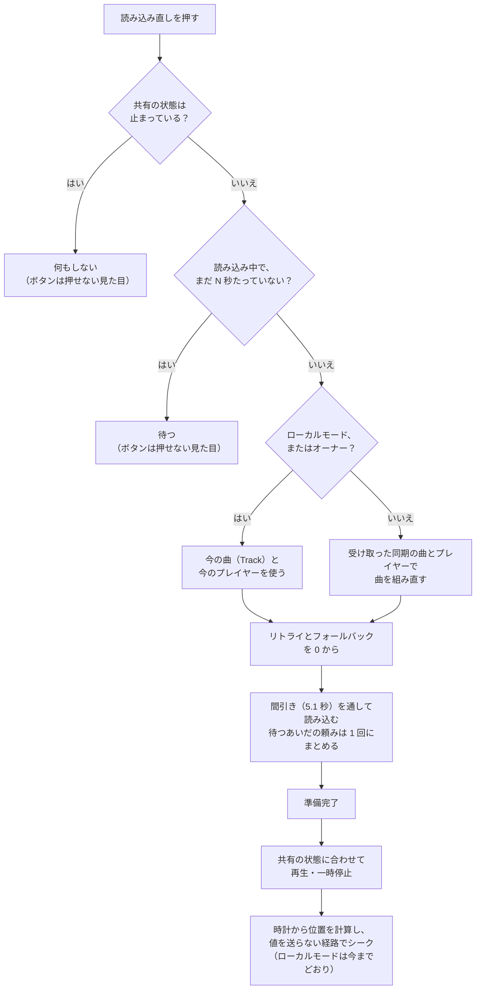

# 再生の同期：直す方針

| 項目 | 内容 |
| --- | --- |
| 文書の種類 | 方針（決まったことの記録） |
| 関連する issue | #228（この文書の親）、#215（きっかけ。子の issue に立て直して閉じる） |
| もとにした比較 | [comparison.md](comparison.md)（KawaPlayer `803126b` と VizVid（VVMW）`834bd5e` の、機能ごとの仕様と比較） |
| 日付 | 2026-10-14 |
| 状態 | 方針はすべて決まった（2026-10-14）。レビュー中 |

## 要旨

KawaPlayer では、エラーや読み込み中のまま自分の画面だけ止まると、読み込み直しを押しても戻せない（#215）。同じ場面を VizVid（VVMW）がどう扱っているかを機能ごとに比べ（[comparison.md](comparison.md)）、テスト用の Unity と VRChat（Build & Test、同じ PC の 2〜3 クライアント）で今の動きを確かめて、KawaPlayer の問題を 9 件挙げた。方針は次のとおり決まった。位置の基準（ネットワークの時計）は KawaPlayer のまま残し、時計の取り方はサーバーの時刻に替える。自分の画面だけの復旧の作りは VVMW から取り入れ、時刻合わせも VVMW に合わせる。9 件はすべて 1.3.0 に入れる。この文書は、問題、直し方とその理由、確かめ方、進め方をまとめる。

**キーワード：** 再生の同期、読み込み直し、rate limit、バッファ、方針、1.3.0

## 目次

1. はじめに
2. 比べて分かったこと
3. 問題の一覧
4. 直し方
5. 決まったこと
6. 確かめ方
7. 進め方
8. まとめ
9. 参考文献

---

## 1. はじめに

### 1.1 背景

スクリーンの左の列の **読み込み直し** は、自分の画面で今の動画を読み込み直し、ほかの人と同じ位置から再生し直すボタンである。映像や音が止まったとき、ずれが直らないとき、ライブ配信で遅れたときに使う。

ところが、自分の画面がエラーや読み込み中で止まっているときには、このボタンは何もしない（#215）。ほかの人が再生を続けていても、止まった人は次の曲になるまで見られない。いちばん戻したい場面で戻せないことになる。

直す前に、同期の作りが成熟している VizVid（以下 VVMW）と比べた。すると、位置の決め方、共有する状態の分け方、読み込みの間引き、バッファの扱いなどで、作りが大きく違うことが分かった。#215 だけを直すより、先に全体の方針を決めたほうがよいと考え、この文書を書いた。

### 1.2 目的

決まった方針を、実装の前に次の 3 つにまとめて残す。

1. KawaPlayer の問題と、その根拠と影響（§3）。
2. 問題ごとの直し方と、そう決めた理由（§4・§5）。
3. 確かめ方と進め方（§6・§7）。

この文書では実装しない。実装は、子の issue A〜F に分けて行う（§7）。

### 1.3 読み方と、2 つの文書の分け方

- **この文書（方針）：** 何を直すか、どう直すかと、そう決めた理由を書く。決まった時点で固まる記録である。
- **[comparison.md](comparison.md)（仕様と比較）：** KawaPlayer と VVMW が今どう動くかを、機能ごとに並べた事実の記録である。調べた時点（`803126b`・`834bd5e`）のもので、実装すると KawaPlayer の動きは変わる。変わったあとの KawaPlayer の仕様は、実装の PR で `docs/analysis/` に別に書く。

急ぐときは、§4.1（基本の方針）、§5（決まったこと）、§7（進め方）を読めば足りる。場面の記号（S1〜S11）は、比較の文書の表 1 のものである。

---

## 2. 比べて分かったこと

詳しくは [comparison.md](comparison.md) にある。方針に関わる事実を、短くまとめる。

- **位置の基準：** KawaPlayer はネットワークの時計を、VVMW はオーナーの実際の再生位置を基準にする。KawaPlayer では、後から入った人も止まった人も、オーナーに頼まずに位置を計算できる。ただし、KawaPlayer が使う時計（`GetNetworkDateTime`）は、VRChat で日時の同期に失敗したクライアントで、ずれたまま直らなかった。VVMW が使うサーバーの時刻（`GetServerTimeInMilliseconds`）は、同じクライアントでも合っていた（[比較の §5](comparison.md#5-位置の決め方)）。
- **自分の画面だけの復旧：** KawaPlayer の読み込み直しは、エラーや読み込み中の画面からは何もしない。VVMW は、共有する状態と自分の読み込みの状態を分けており、どの状態からでも、同期している URL で読み直せる（[比較の §7](comparison.md#7-自分の画面だけの復旧読み込み直し)）。
- **読み込み直しのときの送信：** どちらも読み込み中は値を送らない。ただし、オーナーが読み直すと、どちらも時刻を書いて送信を要求する（KawaPlayer は準備完了のあとの位置合わせ、VVMW は準備完了のあとの再生）。VVMW がそのとき書く開始の時刻は、Unity（Unity Video Player）では 0.5 秒だけ位置を合わせる前の値だったが、VRChat の AVPro では初めから正しく、ほかの人の画面も動かなかった。KawaPlayer の書き換えも、VRChat でほかの人の画面を動かさなかった（同じく §7）。
- **VVMW の予約の読み込み：** VVMW で読み込み直しを続けて押すと、予約は 1 つにまとまるが、予約の読み込みは読み込み直しの印が消えたあとに走り、0 秒から再生した。オーナーが押すと、VRChat（2 クライアント）では、ほかの人の画面も先頭に戻った（[比較の §8](comparison.md#8-読み込みの間引き)）。
- **権限とローカルモード：** KawaPlayer の読み込み直しは、PermissionManagement があると Editor 以上でなければ押せない。ローカルモード（`IsLocal`）では、同期する曲の値が空のことがある（同じく §7）。
- **読み込みの間引き：** VRChat は、1 人が新しい URL を読めるのを、すべての動画プレイヤーを合わせて 5 秒に 1 回に限る [3]。KawaPlayer が間隔をあけるのはリトライだけで、VVMW はすべての読み込みを並べる（[比較の §8](comparison.md#8-読み込みの間引き)）。
- **ずれとバッファ：** KawaPlayer は 5 秒ごとに 0.3 秒以上でシークし、バッファを区別しない。VVMW は 0.5 秒ごとに 0.9 秒以上でシークし、バッファ中はシークしない。モデルでは、KawaPlayer がシークを繰り返すおそれがある（[比較の §6](comparison.md#6-ずれの補正とバッファ)、図 5）。
- **オーナーの交代：** 次のオーナーの画面が、読み込み直しではない読み込みの途中だと、その準備完了で位置 0 が送られ、全員が先頭に戻る。VRChat の 3 クライアントで再現した（[比較の §10](comparison.md#10-オーナーが替わるとき)）。
- **Unity と VRChat で確かめたこと：** P1（エラーと読み込み中で読み込み直しが効かない）、P2（ボタンが押せるまま）、P3（オーナーの読み込み直しで同期する時刻が書き換わる）、P7 の経路を、テスト用の Unity（ClientSim、1 クライアント）で確かめた。そのあと VRChat の Build & Test で、ほかの人の画面（P3、VVMW の予約の読み込み）、オーナーの交代（P7）、時計のずれ（P9）を確かめた（[比較の付録 D](comparison.md#付録-dunity-での確認2026-10-14)・[付録 E](comparison.md#付録-evrchat-での確認2026-10-14)）。
- **KawaPlayer の良いところ：** 時計が基準であること、何度試しても直らない Access Denied をリトライしないこと、エラーの詳細を見られることは、VVMW より優れている（[比較の §13](comparison.md#13-まとめそれぞれの良いところ)）。

---

## 3. 問題の一覧

**表 1** KawaPlayer の問題

| ID | 問題 | 場面 | 影響 | 根拠 |
| --- | --- | --- | --- | --- |
| P1 | 自分の画面だけ止まると、読み込み直しで戻せない | S6・S7 | 止まった人は、次の曲まで見られない。回線やサイトの一時的な失敗で、誰にでも起きる | コード、Unity で確認 |
| P2 | 読み込み直しが、押せるのに何も起きない | S6・S7 | 壊れているように見える | コード、Unity で確認 |
| P3 | オーナーの読み込み直しが、共有の値を送る | S8 | 送る位置は時計と合うので、害は小さい。「自分だけ」が守られない | コード（レビュー）、Unity・VRChat で確認 |
| P4 | 読み込み直しに権限が要る | S8 | 権限を絞ったワールドでは、多くの人が自分の画面を戻せない | コード |
| P5 | 読み込みの間引きがリトライだけ | S11 | P1 を直すと、連打で rate limit に当たる。曲の早い切り替えでも起きうる | コード（頻度は実機） |
| P6 | 時刻合わせがバッファに弱いおそれ | S4・S5 | 回線の遅い人で、シークの繰り返しで映像が止まるおそれ（比較の図 5） | モデル（実機で測る） |
| P7 | オーナーが替わると、全員が先頭に戻る | S9 | 全員に効く。新しいオーナーの画面が、読み込み直しではない読み込み（リトライ、後から入った直後など）の途中のときに起きる | Unity で確認、VRChat の 3 クライアントで再現 |
| P8 | 全員を読み直させる手段がない | S10 | イベントやライブで全員がずれたとき、一人ずつ押すしかない | 機能の差 |
| P9 | 時計の同期に失敗したクライアントが、ずれたまま直らない | S2・S4 | その人の画面だけ、PC の時計のずれの分（今回は 2.15 秒）ずっとずれる。5 秒ごとの確かめでも直らない。その人がオーナーとして曲を始めると、ほかの人はその分だけ先から再生する（推測） | VRChat で 1 回観察（6 回の起動のうち 1 回）。原因は推測（比較の §5） |

P1〜P5 は、どれも「自分の画面だけの復旧」に関わり、同じ経路（`Reload` から読み込み、準備完了まで）を通るので、まとめて直す。

P3 を直すのは、VVMW に合わせるためではない（VVMW も、オーナーが読み直すと値を送る）。「読み込み直しは自分だけ」を、KawaPlayer として守るためである。

KawaPlayer に「オーナーへの送り直しの依頼」がないことは、問題に数えない。受け取った時刻から位置を戻すためには要らないからである（[比較の §11](comparison.md#11-オーナーへの依頼と全員の読み込み直し)）。状態そのものを取り直す役目（VVMW では、初めの同期や、欠けた状態の取り直しにも使っている）は、今回は扱わない。

---

## 4. 直し方

### 4.1 基本の方針

**位置の基準は KawaPlayer のまま残し、自分の画面だけの復旧の作りを VVMW から取り入れる。**

時計を基準にする作りは、後から入った人も止まった人も、オーナーに頼まずに位置を計算できる点で、VVMW より簡単で強い。ただし、時計の取り方は直す（§4.5）。取り入れるのは、VVMW の「全員が共有する状態」と「自分の読み込みの状態」を分ける考え方である。KawaPlayer では、自分の画面の復旧を **「受け取った共有の状態を、自分の画面にもう一度当て直すこと」** として作る。`OnDeserialization` が曲の版の変化を見て読み込むところを、版を見ずに通す形になる。

ただし、これが当てはまるのは、共有の値を受け取る側（オーナーではない人）だけである。ローカルモード（`IsLocal`）では共有の値を送らないので、同期する曲の値（`_url` など）は空のことがある。オーナーも、新しい曲を始めた直後は、送るための値（`OnPreSerialization` が今の曲から作る）がまだ古いことがある。Unity（ClientSim、1 クライアント）では、オーナーの手元の `_url` は再生中もずっと空だった（比較の付録 D の 6）。VVMW の `LocalSync` は、オーナーでも同期する URL を読み直すので、送らない ClientSim では前の URL を読み直した（比較の付録 D の V1）。VRChat でも、送る前なら同じことが起きる。オーナーが今の曲を使うのは、これを避けるためでもある。そのため、**オーナーではない人は受け取った同期の曲を、ローカルモードとオーナーは今の曲（`Track`）を** 読み直す（図 1）。

### 4.2 自分の画面だけの復旧（P1〜P5）

**図 1** 自分の画面だけの復旧の流れ（N は 15 秒）。

**表 2** P1〜P5 の直し方

| 問題 | 直し方 | 利用者から見える違い | 注意 |
| --- | --- | --- | --- |
| P1 戻せない | 図 1 の経路を足す。`Controller.Reload` から通す。オーナーではない人は受け取った同期の曲を、ローカルモードとオーナーは今の曲を読み直す | 止まった画面を、読み込み直しで戻せる | `AfterVideoReady`、速度と画質の変更の自動の読み込み直し、ローカルモードも確かめる |
| P2 ボタン | 共有が止まっているとき、読み込み中で N 秒たっていないときは、押せない見た目にする | 押せるかどうかが見て分かる | — |
| P3 オーナーが送る | 復旧の位置合わせは、`ActiveHandler.Time` に直接入れ、`SetTime` を通さない。プレイヤーの番号は、同期している値を使う | 変わらない（送らなくなる） | — |
| P4 権限 | 読み込み直しを PermissionManagement の対象から外す | 権限がなくても、自分の画面を戻せる | 全員の読み込み直し（P8）は Editor 以上のまま（§4.4） |
| P5 間引き | 読み込み直しとリトライに、5.1 秒の間引きをかける（`Controller` ごと）。待つあいだの頼みは 1 回にまとめ、予約してまとめた読み込みも、終わるまで読み込み直しとして扱う | 連打しても断られない。最後に押した分だけ読む | 防ぐのは、この `Controller` の読み込み直しとリトライどうしの重なりだけ。ほかの `Controller` や、ふだんの曲の切り替えとの重なりは防がない |

速度と最大の画質を変えると、KawaPlayer は自動で `Reload` を呼ぶ（`Controller.UpdateSpeed`・`MaxResolution`）。読み込み中に受け付けない N 秒の決まりや間引きが、この自動の読み込み直しを落とさないようにする（たとえば、待っているあいだの頼みとしてまとめる）。

**VVMW から学ぶこと：** VVMW では、予約してまとめた読み込みが、読み込み直しの印が消えたあとに走り、新しい再生として 0 秒から再生された。オーナーが押すと、VRChat では全員が先頭に戻った（比較の §8、付録 D の V1・V3、付録 E の E2）。KawaPlayer では、読み込み直しの印を、予約した最後の読み込みが終わるまで残す。復旧の準備完了では、オーナーでも位置 0 を送らない（P3 の、送らない位置合わせと同じ）。

**読み込み中に読み直しを受け付けるまでの時間 N は 15 秒にする。** VVMW のように待たずに受け付けると、遅いだけの正常な読み込み（VHub のリダイレクトを経るときなど）も、押せば最初からになってしまう。VRChat の確認では、正常な読み込みが 4.2〜8.1 秒かかった（比較の付録 E。archive.org の mp4、AVPro、速い PC）。VRChat は URL を yt-dlp で解決するだけで 3〜5 秒かかっており、YouTube や VHub の曲はもっと長くなる見込みなので、余裕をとる。短すぎると遅いだけの読み込みをやり直させ、長すぎても止まった人が数秒長く待つだけである。エラーで止まったときは、N に関係なくすぐに押せる。N は 5.1 秒の間引きより長いので、N のあとの読み込みが間引きで待たされることもない。N は `Controller` に保存される値にせず、コードの定数にする（保存される値は、既存のワールドに古い値が残る。§4.3 の `_syncMargin`・`_syncFrequency` と同じ問題）。値は T2 で確かめる。

### 4.3 時刻合わせとオーナーの交代（P6・P7）

- **P6 時刻合わせ：** VVMW の考え方に合わせ、次の 3 つを一緒に入れる。
  - **確かめる間隔：** 5 秒を 1 秒にする
  - **シークする境目：** 0.3 秒を 0.9 秒にする（速度の分も考える）
  - **バッファ中：** 位置が進んでいないあいだはシークしない

  今の「5 秒ごと、0.3 秒以上でシーク。バッファを区別しない」では、シークの手間が 0.3 秒を超えると、5 秒ごとのシークの繰り返しになる（比較の図 5）。VRChat でも、オーナーの読み込み直しの 5 秒後に、オーナー自身がもう一度シークして値を送り直した（比較の付録 E の E4）。間隔だけを短くするとシークが増えるので、3 つは一緒に入れる。その代わり、0.9 秒より小さなずれは直さなくなる。回線のよいときは、もともと大きくずれない（VRChat の 3 クライアントでは、0.02 秒以内で合っていた）。回線を遅くした測定（T8）は、直したあとの確認に使う。境目と間隔は `Controller` に保存される値（`_syncMargin`・`_syncFrequency`）なので、既存のワールドに保存された値をどう扱うかは、子の issue D で決める。
- **P7 オーナーの交代：** 準備完了のときに位置 0 を送るのを、オーナー自身がその曲を始めたとき（曲の版を自分で増やしたとき）だけにする。VRChat の 3 クライアントで再現した場面（比較の §10、付録 E の E5）を、直したあとに同じやり方で確かめる（T7）。

### 4.4 全員の読み込み直し（P8）

全員の読み込み直し（VVMW の `GlobalSync` にあたるもの）を足す。イベントやライブで全員がずれたときに役に立つが、誰でも全員の再生を止められるので、PermissionManagement の Editor 以上に限り、読み込みの間引きも通す。自分の画面にしか効かない読み込み直し（P4）とは、権限の扱いを分ける。

### 4.5 時計の取り方（P9）

同期する時刻を、`GetNetworkDateTime` から VRChat のサーバーの時刻（`GetServerTimeInMilliseconds`）に替える（`Controller.Sync`）。差は `Networking.CalculateServerDeltaTime` で計算する（ミリ秒の値は 32 ビットで一巡するので、そのまま引き算しない）。この関数の引数は秒なので、ミリ秒の値は 0.001 を掛けて渡す [11]。一巡、負の値、まだ値がない状態も扱う。

VRChat で、日時の同期に失敗したクライアントだけ、KawaPlayer が 2.15 秒ずれたまま直らなかった。同じクライアントの VVMW（`GetServerTimeInMilliseconds`）は合っていた（比較の §5、付録 E の E6）。**PC と Quest で同じ形にそろえる：** 同じワールドでも、PC と Quest（Android）の版は別々にビルドしてアップロードし、同じインスタンスでも、それぞれが自分の版を読む [9]。片方だけを新しい時計の形で出すと、同じ同期する値を、PC は日時、Quest はサーバーの時刻として、違う意味で読むことになる。同期する値の型・数・順序が同じなら、VRChat の互換性の判定 [10] はこの意味の違いを見分けられない。型や数を変えれば、古い版で始まったインスタンスに、新しい版の人は入れなくなる。そこで子の issue F では、次を実装と公開の条件にする。

- 対応するすべてのプラットフォームを、同じ同期の形でビルドし、そろえて公開する。KawaPlayer を入れたワールドの制作者にも、PC と Quest の両方を作り直すよう、リリースノートで案内する
- 古い形との混在をどう扱うかを決める（同期する値の型を変えて互換性の判定で分けるか、混在を非対応として案内するか）。古い形と完全に互換にすることまでは求めない
- PC と Quest が同じインスタンスで、ふつうの再生、一時停止、オーナーの交代のあとも、同じ時計の形で動くことを確かめる（T19）

確かめ方は T17・T19。タブレットの訪問者の記録は、表示する日時として `GetNetworkDateTime` を使っており、この話とは別である。

### 4.6 取り入れないもの

- **オーナーへの送り直しの依頼（`OwnerSync`）：** 受け取った時刻から位置を戻すためには要らない。状態そのものを取り直す役目（初めの同期や、欠けた状態の取り直し）は、今回は扱わない。
- **オーナーの位置を基準にする時刻の作り：** 今の作りを変えるほどの利点がなく、既存のワールドでの動きが大きく変わる。

VVMW は MIT ライセンスである。取り入れるのは考え方で、コードは KawaPlayer の作りに合わせて書く。参考にしたことは、コードのコメントと PR に書く。

---

## 5. 決まったこと

**表 3** 決まったこと（2026-10-14）

| ID | 決まったこと | 理由 |
| --- | --- | --- |
| D1 | 位置の基準（ネットワークの時計）は KawaPlayer のまま残し、自分の画面だけの復旧の作りを VVMW から取り入れる（§4.1） | 時計が基準なら、後から入った人も止まった人も、オーナーに頼まずに位置を計算できる |
| D2 | #215 を閉じ、この文書をもとに子の issue A〜F を立て直す（§7） | #215 の本文は、この方針と食い違う（オーナーにも同期の曲を読ませる案）。P1・P3・P5 は同じ経路を通るので、1 つの PR にする |
| D3 | 読み込み直しを PermissionManagement の対象から外す。全員の読み込み直し（P8）は Editor 以上に限る（§4.4） | 読み込み直しは自分の画面にしか効かないが、P8 は全員に効く |
| D4 | 読み込み中に読み直しを受け付けるまでの時間 N は 15 秒（コードの定数）（§4.2） | VRChat で、正常な読み込みが最長 8.1 秒かかった |
| D5 | 読み込みの間引きは、読み込み直しとリトライだけ（§4.2 の表 2） | すべての読み込みにかけると、ふだんの曲の切り替えまで最大 5 秒遅れる |
| D6・D7 | P1〜P9 をすべて実装してから、1.3.0 をリリースする | 同期の問題を 1.3.0 でまとめて直す |
| D8 | 時計をサーバーの時刻（`GetServerTimeInMilliseconds`）に替える（§4.5） | 日時の同期に失敗したクライアントでも、VVMW の時計は合っていた |
| D9 | 時刻合わせを VVMW に合わせる。間隔 1 秒、境目 0.9 秒、バッファ中は待つ（§4.3） | 今の境目 0.3 秒は、シークの手間より小さいおそれがある |

---

## 6. 確かめ方

### 6.1 環境

- **複数のクライアント：** VRChat SDK の Build & Test で「Number of Clients」を 2 以上（最大 8）にすると、1 台の PC で複数の VRChat が別々のプレイヤーとして動く [2]。表示名は同じになる。最初に入ったクライアントがマスターになり、オブジェクトのオーナーになる。2026-10-14 には、同じ引数で 3 つまで起動し、試すためのスクリプトで操作と記録をした（比較の付録 E）。
- **Quest：** 実機で、PC と同じインスタンスに入る。
- **遅い回線：** OS の通信を絞る道具で、1 つのクライアントだけを遅くする。
- **ライブ：** テスト用の配信の URL を使う。
- **1 人だけを止める：** テスト用のシーンにだけ、「この画面だけエラーにする」「この画面だけ読み込み中にする」ボタンを置く。パッケージには入れない。付録 E では、スクリプトが自分のプレイヤーを止めてから `ErrorRetry` を呼び、読み込み直しではない読み込みを起こした。

### 6.2 場面と期待する結果

**表 4** 確かめる場面

| ID | 問題 | 手順 | 期待する結果 |
| --- | --- | --- | --- |
| T1 | P1 | A が再生中に、B の画面だけエラーにし、B が読み込み直しを押す | B が、A と同じ位置から再生に戻る |
| T2 | P1 | B の画面だけ読み込み中のまま止め、N 秒（15 秒）たってから押す。あわせて、YouTube と VHub の曲で、読み込みの開始から準備完了までの秒数をログに出す | B が読み直して、再生に戻る。N 秒前は押せない見た目。正常な読み込みがよく 12 秒を超えるなら、N を延ばす |
| T3 | P3 | オーナーの A が読み込み直しを押す | B と C の側で、値の受け取り（`OnDeserialization`）が起きない |
| T4 | P4 | PermissionManagement で権限のない B が押す | 押せて、B の画面だけ戻る |
| T5 | P5 | B が読み込み直しを 1 秒おきに 5 回押す | RateLimited のエラーが出ない（「詳細」の記録で数える） |
| T6 | P2 | 全員が止まっているときに見る | 読み込み直しが押せない見た目 |
| T7 | P7 | A が再生中に、B の画面を読み込み中にして A を抜けさせる | B の準備完了で、C が先頭に戻らない（今の作りでは戻った。比較の付録 E の E5） |
| T8 | P6 | B の回線だけを遅くして 5 分見る | 映像が止まる回数と、ずれの秒数を記録する（直す前と後で比べる） |
| T9 | P1・P6 | Quest で T1 と T8 | PC と同じ結果 |
| T10 | S10 | ライブで、遅れた B が読み込み直しを押す | B が配信の今に追いつく |
| T11 | P1 | 全員が一時停止しているときに、B が自分だけ止まった画面を読み込み直す | B も一時停止で、同じ位置に戻る |
| T12 | P1・P5 | B の読み込み直しが間引きで待っているあいだに、オーナーが曲を替える・止める | 古い曲を読まない。全員が止まったときは何もしない |
| T13 | P1・P5 | 再生中と読み込み中に、速度と最大の画質を変える | 自動の読み込み直しが、今までどおり効く |
| T14 | P1 | ローカルモード（`IsLocal`）の KawaPlayer で、エラーのあとに読み込み直しを押す | 今の曲を読み直して戻る（同期する曲の値が空でも） |
| T15 | P1・P3 | オーナーが新しい曲を始めた直後（送る前）に、自分の画面だけエラーにして押す | 今の曲を読み直す。前の曲を読まない |
| T16 | P5 | オーナーが読み込み直しを 1.5 秒おきに 3 回押す | 予約は 1 つにまとまる。予約の読み込みのあとも、同じ位置から再生し、全員が先頭に戻らない（VVMW では、VRChat で全員が先頭に戻った） |
| T17 | P9 | 日時の同期に失敗したクライアント（VRChat のログに `Failed to sync network DateTime` が出たもの）と、成功したクライアントで再生する。§6.3 のログで、同じ共有の値から計算した目標の位置を、同じサーバーの時刻どうしで比べる。失敗を起こす方法は、実装のときに調べる | 目標の位置に、PC の時計に由来する一定の差が残らない（クライアントどうしの差が 0.1 秒以内。時計がそろった付録 E の 2 回目では、実際の位置でも 0.02 秒以内だった。今は、PC の時計のずれの分（2.15 秒）残る）。実際の映像のずれ（バッファやシークのあとの遅れ）は、D9 で許す 0.9 秒の範囲の話として、T8 で別に測る |
| T18 | P8 | Editor 以上の A が全員の読み込み直しを押す。権限のない B も押す。全員が止まっているとき、一時停止のとき、続けて押したときも試す | A の操作で、全員が読み直して同じ位置から再生に戻る（一時停止なら一時停止のまま、全員が止まっているときは何もしない）。B の操作は断られる。続けて押しても、間引きで RateLimited のエラーが出ない。自分だけの読み込み直し（T1）の動きは変わらない |
| T19 | P9 | PC と Quest が同じインスタンスで、ふつうの再生、一時停止、オーナーの交代（PC から Quest、Quest から PC）を行う | どの場面でも、PC と Quest の目標の位置が 0.1 秒以内でそろう（同じ時計の形で動いている） |

### 6.3 測るもの

確かめるあいだだけ、`EnsureVideoTime` に 1 行のログを足す（計算した目標の位置、実際の位置、ずれ、シークしたか、そのときのサーバーの時刻）。サーバーの時刻があれば、クライアントをまたいで目標の位置を比べられる（T17・T19）。このログから、次の数を出す。

- 1 分あたりのシークの回数と、止まった時間の合計
- ずれの秒数の中央値と最大値
- RateLimited のエラーの回数（「詳細」の記録で数える）
- 読み込み直しで戻れた割合

結果は #228 か、それぞれの子の issue に残す。

### 6.4 Unity と VRChat で確かめたこと（2026-10-14）

実機の前に、テスト用の Unity（ClientSim、1 クライアント）で、今の KawaPlayer と VVMW の動きを確かめた（[比較の付録 D](comparison.md#付録-dunity-での確認2026-10-14)）。そのあと、VRChat の Build & Test（同じ PC の 2〜3 クライアント）で、ほかの人の画面、オーナーの交代、時計を確かめた（[比較の付録 E](comparison.md#付録-evrchat-での確認2026-10-14)）。VVMW の予約の読み込みで見つかった問題は、表 2 の P5 と T16 に入れた。

**表 5** Unity と VRChat での確認と、残る確認

| 問題 | 確かめたこと | 残る確認 |
| --- | --- | --- |
| P1 | エラーと読み込み中で、読み込み直しを押しても読み込みが始まらない | 直したあと、T1・T2・T11〜T15 を同じやり方で回す。ほかの人の画面は複数のクライアントで |
| P2 | エラーと読み込み中でも、ボタンが押せる状態のまま | 直したあと、T6 |
| P3 | オーナーの読み込み直しで、準備完了のあとの位置合わせが同期する時刻を書き換える（Unity）。VRChat では、ほかの人が値を受け取ったが、画面は動かなかった（E3） | 直したあと、T3 を複数のクライアントで（ほかの人の側で受け取りが起きないこと） |
| P5 | VVMW の予約の読み込みで、オーナーが 0 秒から再生し直し（Unity）、VRChat ではほかの人も先頭に戻った（E2）。KawaPlayer の 2 回目と 3 回目は、読み込み中なので何もしなかった（E4） | 直したあと、T5・T16 |
| P6 | VRChat で、オーナーの読み込み直しの 5 秒後に、オーナー自身がもう一度シークした（E4）。回線を遅くした測定はしていない | T8・T9 |
| P7 | 読み込み直しではない読み込みが終わると、オーナーが位置 0 を書き込む（Unity）。VRChat の 3 クライアントで、オーナーの交代から全員が先頭に戻るまでを再現した（E5） | 直したあと、T7 を同じやり方で |
| P9 | VRChat で、日時の同期に失敗したクライアントだけ、KawaPlayer が 2.15 秒ずれたまま直らなかった（E6） | 直したあと、T17・T19 |
| P4・P8 | 試していない | P4 は PermissionManagement を入れて T4、P8 は作ってから T18 |

---

## 7. 進め方

**表 6** 進め方

| 順 | 中身 | 版 | 始める条件 |
| --- | --- | --- | --- |
| 1 | この文書のレビュー。マージの直前に子の issue A〜F を立て、#215 を閉じる（D2） | — | 今 |
| 2 | 子の issue A（P1・P2・P3・P5、1 つの PR）と B（P4）。変わったあとの KawaPlayer の仕様を `docs/analysis/` に書く | 1.3.0 | この文書をマージしたら |
| 3 | 子の issue C（P7）。準備完了で位置 0 を送る条件を変える | 1.3.0 | この文書をマージしたら |
| 4 | 子の issue D（P6）。時刻合わせを直し、回線を遅くして確かめる | 1.3.0 | この文書をマージしたら |
| 5 | 子の issue E（P8）。全員の読み込み直し | 1.3.0 | この文書をマージしたら |
| 6 | 子の issue F（P9）。時計の取り方。PC と Quest を同じ同期の形でそろえて公開する条件も含む（§4.5） | 1.3.0 | この文書をマージしたら |

---

## 8. まとめ

KawaPlayer と VVMW を機能ごとに比べると、位置の基準は KawaPlayer（時計が基準）のほうが簡単で強く、自分の画面だけの復旧は VVMW のほうが整っていた。#215 の問題は、復旧の入口の条件だけでなく、値を送る経路、権限、ローカルモード、読み込みの間引きにまたがっている。VRChat の Build & Test では、オーナーの交代で全員が先頭に戻ること（P7）を再現し、時計の同期に失敗したクライアントがずれ続けること（P9）を見つけた。

方針は次のとおり決まった。P1〜P5 は 1 つの経路として作り直し、読み込み直しは権限の対象から外し、読み込み中は 15 秒待ってから受け付け、間引きは読み込み直しとリトライにかける。時刻合わせは VVMW に合わせ（1 秒ごと、0.9 秒、バッファ中は待つ）、時計はサーバーの時刻にする。P1〜P9 はすべて 1.3.0 に入れる。この文書をマージする直前に子の issue（A〜F）を立てて #215 を閉じ、実装に入る。

---

## 9. 参考文献

1. [comparison.md](comparison.md)：再生の同期の仕様：KawaPlayer と VizVid（VVMW）の機能ごとの比較（この方針のもとにした記録）。
2. VRChat, “Using Build & Test”. <https://creators.vrchat.com/worlds/udon/using-build-test/>
3. VRChat, “Video Players — Rate Limiting”. <https://creators.vrchat.com/worlds/udon/video-players/#rate-limiting>
4. JLChnToZ, VizVid（VVMW）, develop `834bd5e`. <https://github.com/JLChnToZ/VVMW/tree/834bd5ec453297b713399a5fbba1bd52a81b4f82>
5. Mega-Gorilla, KawaPlayer, develop `803126b`. <https://github.com/Mega-Gorilla/KawaPlayer/tree/803126b47baee38f8175e3fbcf9d1a70ca9bfa4c>
6. #215 読み込み直しが、エラーや読み込み中で止まった自分の画面を直せない。
7. #228 同期の作りを VVMW と比べ、直す方針を決める。
8. VRChat Feedback, “Expose accurate time data via an Udon API”（`GetNetworkDateTime` は手元の時計に左右されない、という利用者の報告）. <https://feedback.vrchat.com/udon/p/expose-accurate-time-data-via-an-udon-api>
9. VRChat, “Cross-Platform Setup — Uploading Content”. <https://creators.vrchat.com/platforms/android/cross-platform-setup/#uploading-content>
10. VRChat, “Network Compatibility”. <https://creators.vrchat.com/worlds/udon/networking/compatibility/>
11. VRChat, “VRChat API — Networking”（UdonSharp）. <https://udonsharp.docs.vrchat.com/vrchat-api/#networking>
