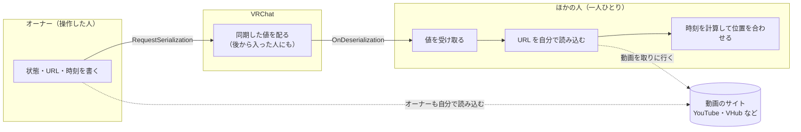
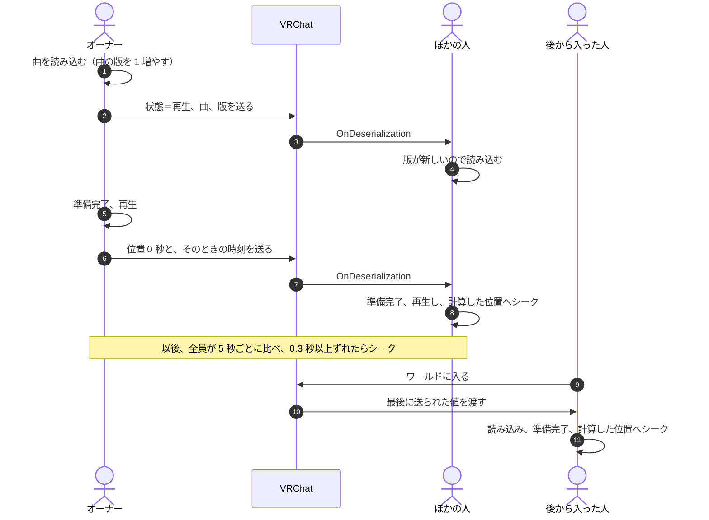
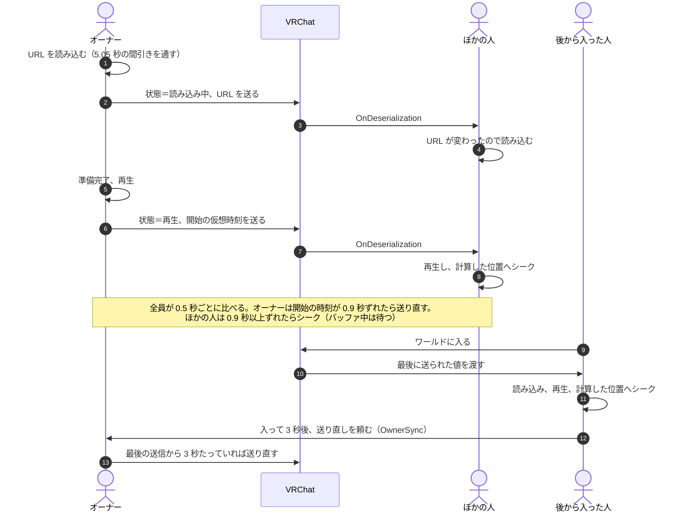
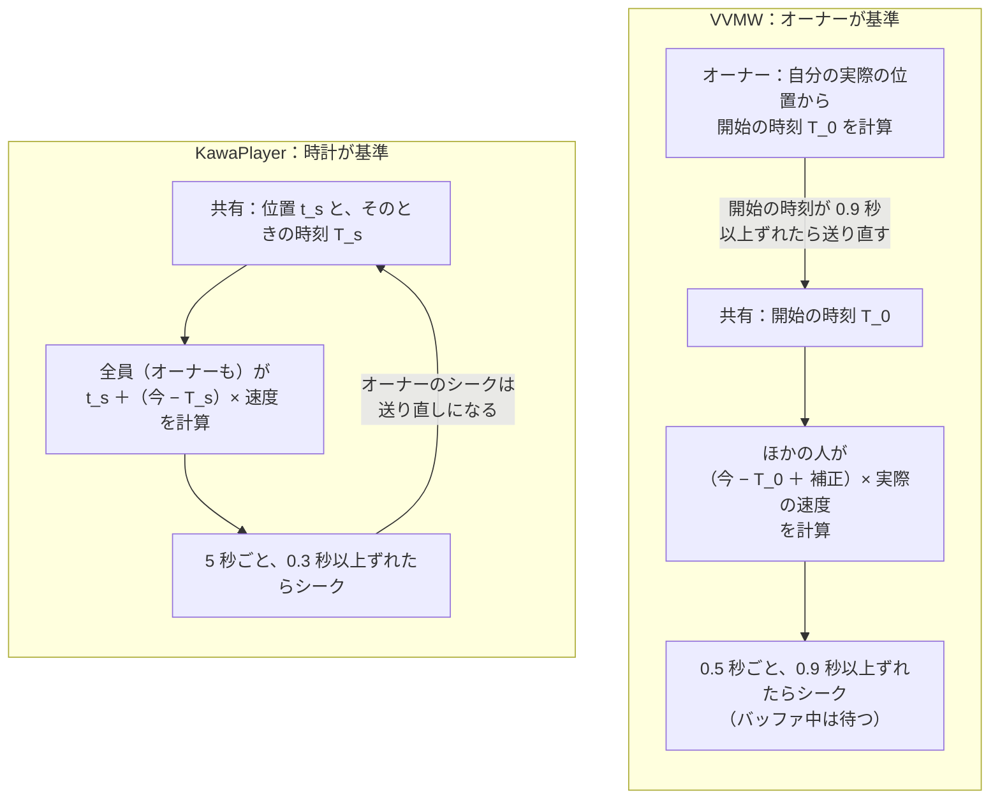
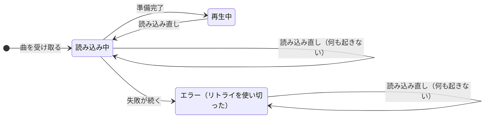
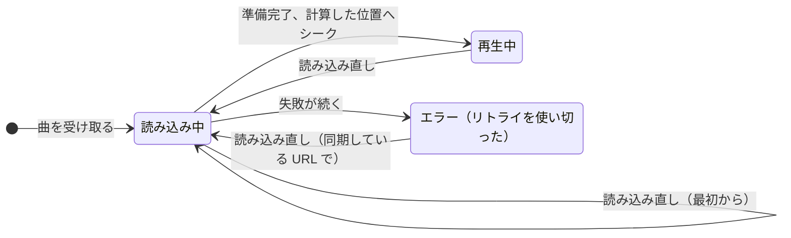
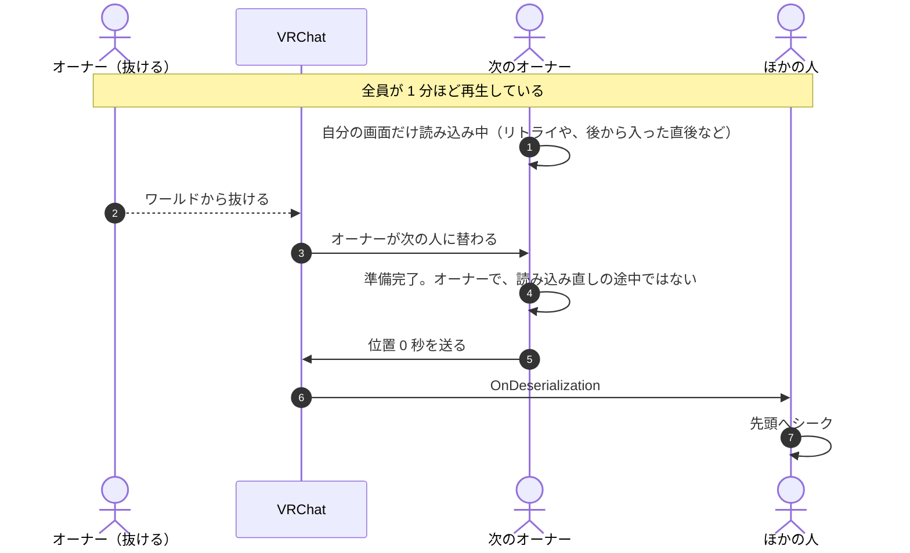
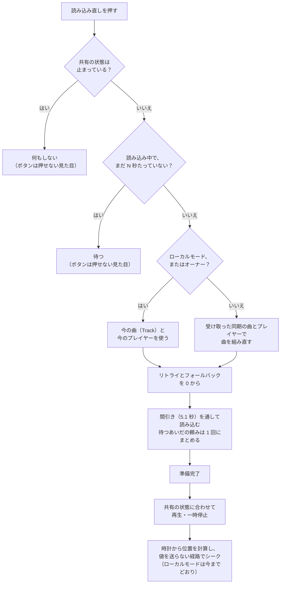
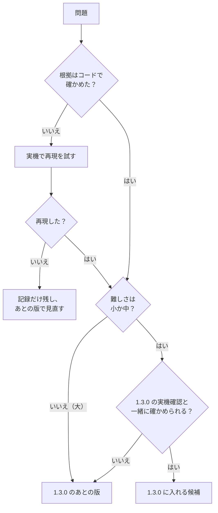

# 再生の同期：KawaPlayer と VizVid（VVMW）の比較と、直す方針の決め方

| 項目 | 内容 |
| --- | --- |
| 文書の種類 | 計画（方針を決めるための資料） |
| 関連する issue | #228（この文書の親）、#215（自分の画面だけ止まったときの読み込み直し） |
| 調べたもの | KawaPlayer develop `803126b`、VizVid（VVMW）develop `834bd5e`（1.8.2） |
| 日付 | 2026-10-14 |
| 状態 | レビュー中。§8.4 の「決めること」に答えていただき、方針を決める |

## 要旨

KawaPlayer では、エラーや読み込み中のまま自分の画面だけ止まると、読み込み直しを押しても戻せない（#215）。この文書は、同じ場面を VizVid（VVMW）がどう扱っているかを、両者のコードを読んで場面ごとに比べ、KawaPlayer を直す方針を決めるための材料をまとめる。両者のいちばん大きな違いは時刻の基準で、KawaPlayer はネットワークの時計を、VVMW はオーナーの実際の再生位置を基準にする。復旧では、VVMW は「全員が共有する状態」と「自分の読み込みの状態」を分けており、自分の画面だけを、同期している URL から読み直せる。比べた結果から 8 件の問題を挙げた（うち 2 件は実機での再現が要る）。方針としては、時刻の作りは KawaPlayer のまま残し、復旧の作りを VVMW から取り入れることを提案する。最後に、問題ごとの難しさの見積もり、1.3.0 に入れるかの決め方、確かめ方を示す。

**キーワード：** 再生の同期、オーナー、後から入った人、読み込み直し、rate limit、バッファ、VRChat、UdonSharp

## 目次

1. はじめに
2. 前提：VRChat で動画を同期する仕組み
3. 方法
4. 二つの作り
5. 結果：場面ごとの比較
6. 考察：問題の一覧
7. 提案
8. 方針の決め方
9. 確かめ方
10. 進め方
11. まとめ
12. 参考文献
13. 付録 A：コードの場所 ／ 付録 B：用語 ／ 付録 C：図 8 のモデル

---

## 1. はじめに

### 1.1 背景

スクリーンの左の列の **読み込み直し** は、自分の画面で今の動画を読み込み直し、ほかの人と同じ位置から再生し直すボタンである。映像や音が止まったとき、ずれが直らないとき、ライブ配信で遅れたときに使う。

ところが、自分の画面がエラーや読み込み中で止まっているときには、このボタンは何もしない（#215）。ほかの人が再生を続けていても、止まった人は次の曲になるまで見られない。いちばん戻したい場面で戻せないことになる。

直す前に、同期の作りが成熟している VizVid（以下 VVMW）を調べた。すると、時刻の決め方、共有する状態の分け方、読み込みの間引き、バッファの扱いなどで、作りが大きく違うことが分かった。#215 だけを直すより、先に全体の方針を決めたほうがよいと考え、この文書を書いた。

### 1.2 目的

方針を決めていただくための材料を、次の 3 つにまとめる。

1. 両者の作りの違いを、場面ごとに図と表で示す（§4・§5）。
2. KawaPlayer の問題を洗い出し、それぞれの根拠と影響を示す（§6）。
3. 選択肢と難しさを示し、決めることを質問の形で並べる（§7・§8）。

この文書では実装しない。決まったことは、子の issue に分けて作る（#228）。

### 1.3 範囲

**対象：** 動画の再生の同期（状態・時刻・曲・プレイヤー）、自分の画面だけの復旧、読み込みの間引き、後から入った人、オーナーの交代、ライブ配信。

**対象外：** 曲の一覧（キュー・履歴・読み込んだプレイリスト）の同期、タブレットの画面（画像アプリなど）の同期、PlaylistLoader の文字列の読み込み。どれも別の UdonBehaviour が別に同期しており、今回の症状とは関係しない。問題が見つかれば、別に扱う。

### 1.4 読み方

急ぐときは、§6（問題の一覧）、§7.1（基本の方針）、§8.4（決めること）を読めば足りる。図は GitHub の上で描かれる。図 7・図 8・図 11 は SVG の画像で、OS やブラウザーの明暗の設定に合わせて色が変わる。

---

## 2. 前提：VRChat で動画を同期する仕組み

### 2.1 オーナーと手動の同期

VRChat では、同期する UdonBehaviour ごとに **オーナー** が 1 人いる。同期する値を書けるのはオーナーだけで、`RequestSerialization` で送ると、ほかの人の側で `OnDeserialization` が呼ばれる。後から入った人には、最後に送られた値が届く。

KawaPlayer も VVMW も、操作した人がまずオーナーになり、それから値を書いて送る（KawaPlayer の `TakeOwnership`、VVMW の `RequestSync`）。

### 2.2 動画はそれぞれが読み込む

共有するのは、URL・状態・時刻だけである。動画そのものは、一人ひとりが自分で読み込む。そのため、読み込みにかかる時間、エラー、バッファの遅れは人によって違う。「自分の画面だけ止まる」のはこのためである。

### 2.3 読み込みの回数の制限（rate limit）

VRChat は、1 人が新しい URL を読み込めるのを 5 秒に 1 回に限る。この制限は、ワールドのすべての動画プレイヤーに共通で、後から入った人にもかかる [1]。

### 2.4 ネットワークの時刻

両者とも、全員に共通のネットワークの時刻（`Networking.GetNetworkDateTime`・`GetServerTimeInMilliseconds`）を使う。オーナーが「この時刻に、この位置だった」と送れば、受け取った人はそこから今の位置を計算できる。

**図 1** 同期の全体像。共有するのは値だけで、動画は一人ひとりが読み込む。

---

## 3. 方法

両者のコードを、表紙に書いたコミットで読み、表 1 の 11 の場面ごとに、誰が何を送り、受け取った人がどう動くかを比べた。

調べ物は 2 つある。この文書を書いた実装の担当の調べ物と、レビューでの独立した調べ物である。両方をこの文書にまとめた。レビューで見つかった点（オーナーの読み込み直しが値を送ること、VVMW のオーバーレイの制限など）は、本文で示す。

**表 1** 比べた場面

| 記号 | 場面 |
| --- | --- |
| S1 | オーナーが曲を再生する |
| S2 | 後から入った人 |
| S3 | 一時停止・シーク・速度の変更 |
| S4 | 再生中の時刻のずれを直す |
| S5 | 自分だけバッファで遅れる |
| S6 | 自分だけエラーになる（リトライを使い切ったあと） |
| S7 | 自分だけ読み込み中のまま進まない |
| S8 | 読み込み直しを押す |
| S9 | オーナーが抜ける・替わる |
| S10 | ライブ配信 |
| S11 | 続けて読み込む（曲の早い切り替え、読み込み直しの連打） |

**制約：** Play や実機では確かめていない。コードから読める動きと、推測とを分けて書く。図 8 は実測ではなくモデルである（付録 C）。確かめ方は §9 に示す。

---

## 4. 二つの作り

### 4.1 KawaPlayer

**表 2** KawaPlayer が同期する主な値（`Controller`）

| 値 | 意味 |
| --- | --- |
| `_syncedState` | 止まっている・再生・一時停止の 3 つ |
| `_url`・`_title`・`_trackExtension` | 今の曲 |
| `_handlerIndex` | 使うプレイヤー（AVPro・Unity・画像） |
| `_trackVersion` | 曲の版。オーナーが新しい曲を読むたびに 1 増える |
| `_syncedVideoTime`・`_networkDataTimeTicks` | ある時点の再生位置と、そのときのネットワーク時刻 |
| `_speed`・`_loop`・`_repeat` | 速度・ループ・区間リピート |
| `_handlerFromTrack` | プレイヤーが曲によって切り替わったか（#182） |

位置は、共有した位置 $t_s$ と時刻 $T_s$ から、誰でも次の式で計算する。 $v$ は速度、 $d$ は自分だけの遅延の補正（`LocalDelay`）である。

$$t_{\mathrm{play}} = t_s + (T_{\mathrm{now}} - T_s) \cdot v + d \qquad t_{\mathrm{pause}} = t_s + d$$

オーナーは、再生・一時停止・準備完了（位置 0）・ループ・シーク・速度の変更のたびに $t_s$ と $T_s$ を送る。再生中は、全員が（オーナーも）5 秒ごとに計算した位置と比べ、0.3 秒以上ずれていればシークする（`EnsureVideoTime`）。オーナーのシークは `SetTime` を通るので、そのたびに値を送り直す。

自分の画面の状態（読み込み中・止まっている・エラー）はプレイヤーごとに持つ。読み込み直しのあいだは `_reloading` を立て、再生・一時停止・準備完了の知らせから値を送らない。

**図 2** KawaPlayer の再生の開始と、後から入った人（S1・S2）。

### 4.2 VVMW

**表 3** VVMW が同期する主な値（`Core`）

| 値 | 意味 |
| --- | --- |
| `state` | 止まっている・読み込み中・再生・一時停止の 4 つ |
| `pcUrl`・`questUrl` | 今の URL（PC 用と Quest 用） |
| `activePlayer` | 使うプレイヤー |
| `time` | 再生中は「再生を始めた仮想のサーバー時刻」、一時停止中は位置 |
| `ownerNetworkTime` | 送ったときのオーナーのサーバー時刻（受け取りの遅れの計算に使う） |
| `syncedSpeed`・`loop`・`rangeLoopStart/End` | 速度・ループ・区間ループ |

位置は、共有した仮想の開始時刻 $T_0$ から計算する。 $o$ は自分だけの補正（`syncOffset`）、 $\ell$ は受け取りの遅れ（`syncLatency`）、 $p$ は演者の遅れの補正（`PerformerLatency`。演者がいなければ 0）である。 $v_a$ は、指定した速度ではなく、オーナーが送った **実際の** 速度（`syncedActualSpeed`）である。補正の項にも速度が掛かる。最後に、ループならくり返しの中に、そうでなければ 0 から長さのあいだに収める（`CalcVideoTime`）。

$$t_{\mathrm{play}} = \left(T_{\mathrm{now}} - T_0 + o + \ell - p\right) v_a \qquad t_{\mathrm{pause}} = t_s$$

違うのは、オーナーの役目である。オーナーは 0.5 秒ごとに、自分の実際の位置から $T_0$ を計算し直し、送った値と 0.9 秒以上ずれていれば送り直す。この 0.9 秒は開始の時刻の差で、ほかの人が比べる再生位置の差とは単位が違う（速度が 1 でなければ、位置の差は速度の分だけ変わる）。つまり **オーナーの実際の位置が基準** になる。ほかの人は 0.5 秒ごとに比べ、0.9 秒以上ずれていればシークする。ただし、再生中なのに位置が進んでいなければ「バッファ中」とみなし、シークしない。

自分の画面の状態として `isLoading`・`isError`・`isLocalReloading` を持つ。読み込み直しの読み込み中は、送る値を書かず（`OnPreSerialization` が何もしない）、再生・一時停止でも共有の状態を変えない。ただし、この印は準備完了で外してから再生する（`OnVideoReady`）。動画プレイヤーの `Play` は再生の知らせ（`OnVideoPlay`）をその場で呼ぶので、読み直したのがオーナーなら、ここで状態と開始の時刻を送る。位置を合わせる（`Time = videoTime`）のは再生のあとなので、送る開始の時刻は位置を合わせる前のものになり、0.5 秒後の確かめで送り直すまで、ほかの人がずれるおそれもある。どちらも、ソースから読んだ経路で、実機では確かめていない。

このほか、KawaPlayer にない仕組みが 3 つある。

- **オーナーへの送り直しの依頼（`OwnerSync`）：** オーナーではない人が、オーナーに値を送り直してもらう。オーナーは、最後に送ってから 3 秒は応じない。頼むのは、後から入って 3 秒たったとき、読み込み直しを 0.5 秒以内に 2 回押したとき、自分の準備ができたのに共有の状態がまだ「止まっている」か「読み込み中」のとき、受け取った値が欠けていたときである。
- **全員の読み込み直し（`GlobalSync`）：** 全員に読み込み直しをさせる。UI がロックされていると使えない。
- **読み込みの間引き（`RateLimitResolver`）：** ワールドに 1 つ置き、すべての読み込みを 5.05 秒おきに並べる（§5.2）。

**図 3** VVMW の再生の開始と、後から入った人（S1・S2）。

### 4.3 時刻の基準の違い

**図 4** 時刻の基準。KawaPlayer はオーナーも時計に合わせる。VVMW はオーナーの位置に全員が合わせる。

この違いには、次のような結果がある。

- **KawaPlayer：** 位置は時計だけで決まるので、後から入った人も、止まった画面を戻す人も、オーナーに頼まずに位置を計算できる。位置を知るためには、オーナーへの送り直しの依頼は要らない。
- **VVMW：** オーナーが遅れれば、全員がオーナーに合わせて遅れる。演奏やパフォーマンスで、演者に全員を合わせたいときに向く（VVMW には演者の遅れを補う機能もある）。その代わり、オーナーが最後に送ってから位置がずれると、送り直してもらわないと分からない。`OwnerSync` は、このためと、初めの同期や欠けた状態を取り直すために使われている。

---

## 5. 結果：場面ごとの比較

**表 4** 場面ごとの動き

| 場面 | KawaPlayer | VVMW |
| --- | --- | --- |
| S1 再生の開始 | オーナーが曲を読み、版を 1 増やして送る。準備ができたら位置 0 を送る | オーナーが URL を読み、状態＝読み込み中で送る。再生を始めたら開始の時刻を送る |
| S2 後から入った人 | 最後の値で読み込み、時計から位置を計算する | 同じ。加えて、入って 3 秒後にオーナーへ送り直しを頼む |
| S3 一時停止・シーク・速度 | 操作した人がオーナーになって送る。AVPro の速度の変更は、次のフレームで読み込み直す（止まっている・読み込み中は効かない） | 同じくオーナーになって送る。AVPro の速度の変更は、1 秒まとめてから読み込み直す |
| S4 時刻のずれ | 5 秒ごと、0.3 秒以上でシーク（オーナーも） | 0.5 秒ごと、位置が 0.9 秒以上ずれたらシーク。オーナーは、計算し直した開始の時刻が 0.9 秒以上ずれたら送り直す |
| S5 バッファ | 区別しない | 位置が進まなければ待つ。明けたら、遅れの分を見込んで合わせる |
| S6 自分だけエラー | 止まったまま。読み込み直しも効かない | 読み込み直しで戻せる |
| S7 読み込み中のまま | 読み込み直しが効かない | いつでも読み直せる（待つ時間の決まりはない） |
| S8 読み込み直し | 手元の曲で読み直す。オーナーなら、位置合わせで値を送る。権限が要る | 同期している URL で読み直す。読み込み中は値を送らない（オーナーなら、準備完了のあとの再生で送る）。権限は要らない。0.5 秒以内の 2 回目はオーナーへの依頼になる |
| S9 オーナーの交代 | 聞き手に知らせるだけ | 自分の読み込み直しの印を外す |
| S10 ライブ | 時刻を合わせない。読み込み直しが、追いつく手段 | 同じ |
| S11 続けて読み込む | 5.1 秒あけるのはリトライだけ | すべての読み込みを 5.05 秒おきに並べる |
| エラーとリトライ | 最大 5 回。Access Denied と Invalid URL はしない。1 回目の Player Error からフォールバック | 最大 3 回、5.5 秒おき。Invalid URL はしない。2 回目の失敗からフォールバック。全員が止まったら中止 |

### 5.1 自分だけ止まったとき（S6・S7・S8）

KawaPlayer の `Controller.Reload` は、自分の画面が止まっているか読み込み中なら何もしない（`if (!Stopped && !IsLoading)`）。エラーになると `_stopped` が立つので、読み込み直しは効かない。リトライを使い切ったあとは、ほかの人が再生していても、`ApplySyncedState` も準備ができていないプレイヤーには何もしない。

**図 5** 今の KawaPlayer の、自分の画面の状態と読み込み直し。エラーと読み込み中からは戻れない。

VVMW の `LocalSync` は、自分の画面の状態を見ない。共有の状態が「止まっている」でなければ、同期している URL（`pcUrl`・`questUrl`）を読み直す。リトライの回数と、試したフォールバックの記録は 0 からにする。準備ができたら、共有の状態に合わせて再生か一時停止にし、計算した位置へシークする。読み込み中は値を送らない。ただし、読み直したのがオーナーなら、準備完了のあとの再生で値を送る（§4.2）。

**図 6** VVMW の、自分の画面の状態と読み込み直し。どの状態からも読み直せる。

VVMW にも限りがある。読み込み中に押すと、遅いだけの正常な読み込みも最初からやり直しになる。読み込みが一定時間続いたら自動で直す、といった決まりもない。VR の手元のオーバーレイ（F9 など）からの読み込み直しは再生中のときだけで、エラーからは戻せない（`OverlayControl.ReloadCore` の `IsPlaying`）。

### 5.2 続けて読み込むとき（S11）

**図 7** 読み込みの間引き。上は、#215 で入口だけを緩めた場合の仮定。下は VVMW の `RateLimitResolver` の方式。

VVMW は、読み込もうとすると、前の読み込みから 5.05 秒たつまでの待ち時間を返し、その枠を予約する。待っているあいだに次の頼みが来ても予約は増やさず、時間が来たとき、その時点の URL を読む。間に何度押されても、読むのは最後の 1 回だけである。

KawaPlayer で 5.1 秒あけるのは、エラーのあとのリトライだけである。今は読み込み中に読み込み直しが効かないので連打は起きないが、#215 で入口を緩めると、図 7 の上のように rate limit に当たる。曲を早く切り替えたときにも、ほかの人の画面で同じことが起きうる。

### 5.3 時刻合わせとバッファ（S4・S5）

**図 8** バッファのあとの時刻合わせ（モデル）。通信が 8〜12 秒で止まり、シーク 1 回ごとに 0.6 秒の読み直しがかかると仮定した、1 人の見る人のずれ。前提は付録 C。

このモデルから、次のことが言える。

- **境目がシークの手間より小さいと、繰り返しになる：** シークのあとの読み直しで 0.6 秒遅れると、KawaPlayer の境目 0.3 秒を超えるので、5 秒後にまたシークする。シークのたびに 0.6 秒止まり、5 秒ごとに映像が止まる。
- **VVMW は 1 回で落ち着く：** 境目が 0.9 秒なので、0.6 秒の遅れはそのままにする。バッファ中（8〜12 秒）にもシークしない。
- **VVMW も万能ではない：** シークの手間が 0.9 秒を超えれば、VVMW も同じように繰り返す。シークの手間は動画の種類（AVPro・HLS・ライブ）と回線で変わるので、実機で測るまで、どちらがよいかは決められない（§9）。

VVMW の作者は、バッファ中にシークすると読みかけのバッファが捨てられ、止まったまま抜け出せなくなると書いている（`Core_Timing.cs` のコメント）。1.4.1 で「通信が遅いときや高ビットレートの動画での、バッファ中の同期の改善」として入った [4]。

### 5.4 オーナーが替わるとき（S9）

KawaPlayer の `AfterVideoReady` は、オーナーが読み込み直しの途中でなければ、準備ができた時点で位置 0 を送る。新しい曲を始めたオーナーのための処理である。しかし、オーナーが抜けたとき、次のオーナーになった人の画面が読み込み中（読み込み直し以外）だと、その人の準備完了で位置 0 が送られ、全員が先頭に戻るおそれがある。

**図 9** オーナーが替わるときのおそれ（コードから推測。再現していない）。

VVMW でも、新しいオーナーが再生を始めると、自分の位置から開始の時刻を計算して送るので、同じことが起きうる。どちらも、実機で再現できるかを先に確かめる（§9 の T7）。

### 5.5 そのほかの違い

- **権限：** KawaPlayer の読み込み直しは、PermissionManagement があると Editor 以上でなければ押せない（`PermissionManagementUI.BeforeUserReloadVideo`）。自分の画面だけの操作なのに、権限のない人は止まった画面を戻せない。VVMW の自分だけの読み込み直しには制限がなく、UI のロックで止まるのは全員の読み込み直しだけである。
- **オーナーの読み込み直し：** KawaPlayer では、オーナーが読み込み直すと、準備完了のあとの位置合わせ（`EnsureVideoTime` から `SetTime`）が `RequestSerialization` まで届く（レビューで発見）。送る位置は時計と合っているので、見た目の害は小さい。それでも、「読み込み直しは自分だけ」という約束は守られていない。再生の知らせ（`AfterVideoPlayed`）は `Play()` の中ですぐに呼ばれ、まだ `_reloading` が立っているので送らない。このほか、読み込み直しでプレイヤーが替わると、同期する `_handlerFromTrack` も書き換える（`ResolveAndLoadTrack`）。VVMW も、オーナーが読み直すと準備完了のあとに値を送る（§4.2）。P3 を直すのは VVMW に合わせるためではなく、「読み込み直しは自分だけ」を KawaPlayer として守るためである。
- **速度の変更：** AVPro は速度を変えると読み直す必要がある。KawaPlayer は次のフレームで `Reload` を呼ぶが、読み込み中や止まっているときは効かない。VVMW は 1 秒まとめてから読み直す。#215 で `Reload` を変えると、この経路の動きも変わるので、一緒に確かめる。
- **入口：** KawaPlayer は、スクリーンもタブレットの KawaPlayer アプリも、同じ `UIController.Reload` を通る。直せば両方に効く。

### 5.6 KawaPlayer のほうが優れている点

- **時計が基準：** オーナーに頼まずに、誰でも位置を計算できる（§4.3）。後から入った人も、止まった画面を戻す人も、オーナーの都合に左右されない。
- **むだなリトライをしない：** Access Denied（許可の問題）は、何度試しても直らないのでリトライしない。VVMW は 3 回試す。
- **エラーの詳細：** 直近 5 件のエラーと、問い合わせ用の 1 行を「詳細」で見られる（#168）。VVMW は状態の文だけである。

---

## 6. 考察：問題の一覧

**表 5** KawaPlayer の問題

| ID | 問題 | 場面 | 影響 | 根拠 |
| --- | --- | --- | --- | --- |
| P1 | 自分の画面だけ止まると、読み込み直しで戻せない | S6・S7 | 止まった人は、次の曲まで見られない。回線やサイトの一時的な失敗で、誰にでも起きる | コード |
| P2 | 読み込み直しが、押せるのに何も起きない | S6・S7 | 壊れているように見える | コード |
| P3 | オーナーの読み込み直しが、共有の値を送る | S8 | 送る位置は時計と合うので、害は小さい。「自分だけ」が守られない | コード（レビュー） |
| P4 | 読み込み直しに権限が要る | S8 | 権限を絞ったワールドでは、多くの人が自分の画面を戻せない | コード |
| P5 | 読み込みの間引きがリトライだけ | S11 | P1 を直すと、連打で rate limit に当たる。曲の早い切り替えでも起きうる | コード（頻度は実機） |
| P6 | 時刻合わせがバッファに弱いおそれ | S4・S5 | 回線の遅い人で、シークの繰り返しで映像が止まるおそれ（図 8） | モデル（実機で測る） |
| P7 | オーナーが替わると、全員が先頭に戻るおそれ | S9 | 起きれば全員に効く。条件は限られる | コードから推測（再現が要る） |
| P8 | 全員を読み直させる手段がない | S10 | イベントやライブで全員がずれたとき、一人ずつ押すしかない | 機能の差 |

P1〜P5 は、どれも「自分の画面だけの復旧」に関わり、同じ経路（`Reload` から読み込み、準備完了まで）を通る。まとめて直すのが自然である。P6 と P7 は、直す前に実機で確かめる必要がある。P8 は新しい機能で、誰が押せるかを先に決める必要がある。

KawaPlayer に「オーナーへの送り直しの依頼」がないことは、問題に数えない。受け取った時刻から位置を戻すためには要らないからである（§4.3）。状態そのものを取り直す役目（VVMW では、初めの同期や、欠けた状態の取り直しにも使っている）は、今回は扱わない。

---

## 7. 提案

### 7.1 基本の方針

**時刻の作りは KawaPlayer のまま残し、復旧の作りを VVMW から取り入れる。**

時計を基準にする作りは、後から入った人も止まった人も、オーナーに頼まずに位置を計算できる点で、VVMW より簡単で強い。取り入れたいのは、VVMW の「全員が共有する状態」と「自分の読み込みの状態」を分ける考え方である。KawaPlayer では、自分の画面の復旧を **「受け取った共有の状態を、自分の画面にもう一度当て直すこと」** として作るのが素直である。`OnDeserialization` が曲の版の変化を見て読み込むところを、版を見ずに通す形になる。

ただし、これが当てはまるのは、共有の値を受け取る側（オーナーではない人）だけである。ローカルモード（`IsLocal`）では共有の値を送らないので、同期する曲の値（`_url` など）は空のことがある。オーナーも、新しい曲を始めた直後は、送るための値（`OnPreSerialization` が今の曲から作る）がまだ古いことがある。そのため、**オーナーではない人は受け取った同期の曲を、ローカルモードとオーナーは今の曲（`Track`）を** 読み直す（図 10）。

### 7.2 自分の画面だけの復旧（P1〜P5）

**図 10** 提案する、自分の画面だけの復旧の流れ。

**表 6** P1〜P5 の選択肢（★ がおすすめ）

| 問題 | 選択肢 | 利用者から見える違い | 手間・危険 |
| --- | --- | --- | --- |
| P1 戻せない | ★A：図 10 の経路を足す。`Controller.Reload` から通す。オーナーではない人は受け取った同期の曲を、ローカルモードとオーナーは今の曲を読み直す | 止まった画面を、読み込み直しで戻せる | 中。`AfterVideoReady`、速度と画質の変更の自動の読み込み直し、ローカルモードも確かめる |
| | B：入口の条件（`!Stopped && !IsLoading`）を外すだけ | 戻せるが、P3・P5 が残る | 小。オーナーが押すと値を送り、連打で rate limit に当たる |
| P2 ボタン | ★A：共有が止まっているとき、読み込み中で N 秒たっていないときは、押せない見た目にする | 押せるかどうかが見て分かる | 小 |
| | B：押したら短い説明を出す | 押せば理由が分かる | 小。翻訳が 9 言語要る |
| P3 オーナーが送る | ★A：復旧の位置合わせは、`ActiveHandler.Time` に直接入れ、`SetTime` を通さない。プレイヤーの番号は、同期している値を使う | 変わらない（送らなくなる） | 小 |
| P4 権限 | ★A：読み込み直しを権限の対象から外す | 権限がなくても、自分の画面を戻せる | 小。全員の読み込み直し（P8）を作るなら、そちらは Editor 以上に |
| | B：今のまま | 権限のない人は戻せない | なし |
| | C：ワールドの制作者が選べるようにする | 制作者しだい | 中。インスペクターの欄と翻訳が要る |
| P5 間引き | ★A：読み込み直しとリトライに、5.1 秒の間引きをかける（`Controller` ごと） | 連打しても断られない。最後に押した分だけ読む | 小。防ぐのは、この `Controller` の読み込み直しとリトライどうしの重なりだけ。ほかの `Controller` や、ふだんの曲の切り替えとの重なりは防がない |
| | B：`Controller` のすべての読み込みにかける | 曲を早く切り替えても断られない。読み込みが最大 5 秒遅れる | 中。ふだんの再生の動きが変わる |
| | C：ワールドで 1 つにする（VVMW と同じ） | KawaPlayer を 2 台置いても断られない | 大。新しいオブジェクトと、ビルドでの結び付けが要る |

速度と最大の画質を変えると、KawaPlayer は自動で `Reload` を呼ぶ（`Controller.UpdateSpeed`・`MaxResolution`）。読み込み中に受け付けない N 秒の決まりや間引きが、この自動の読み込み直しを落とさないようにする（たとえば、待っているあいだの頼みとしてまとめる）。

読み込み中に読み直しを受け付けるまでの時間 N は、レビューの提案に従い、10 秒を仮の値にして、実機で決める。VVMW のように待たずに受け付けると、遅いだけの正常な読み込み（VHub のリダイレクトを経るときなど）も、押せば最初からになってしまう。

### 7.3 確かめてから決めるもの（P6・P7）

- **P6 時刻合わせ：** まず実機で、回線を遅くしたときに図 8 の繰り返しが起きるかを測る。起きるなら、次の 3 つを組み合わせて直す。どれも VVMW の考え方である。
  - 位置が進んでいないあいだはシークしない
  - 境目を、シークの手間より大きくする（例：0.3 秒を 0.9 秒に）
  - 確かめる間隔を短くする（例：5 秒を 1 秒に）
- **P7 オーナーの交代：** まず再現を試す。再現したら、準備完了のときに位置 0 を送るのを、オーナー自身がその曲を始めたとき（曲の版を自分で増やしたとき）だけにする。直す手間は小さい。

### 7.4 あとに回すもの（P8）

全員の読み込み直し（VVMW の `GlobalSync` にあたるもの）は、イベントやライブで役に立つ。ただし、誰でも全員の再生を止められる。作るなら、PermissionManagement の Editor 以上に限り、読み込みの間引きも通す。1.3.0 のあとに、子の issue で扱う。

### 7.5 取り入れないもの

- **オーナーへの送り直しの依頼（`OwnerSync`）：** 受け取った時刻から位置を戻すためには要らない（§4.3）。状態そのものを取り直す役目（初めの同期や、欠けた状態の取り直し）は、今回は扱わない。
- **オーナーの位置を基準にする時刻の作り：** 今の作りを変えるほどの利点がなく、既存のワールドでの動きが大きく変わる。

VVMW は MIT ライセンスである。取り入れるのは考え方で、コードは KawaPlayer の作りに合わせて書く。参考にしたことは、コードのコメントと PR に書く。

---

## 8. 方針の決め方

### 8.1 判断の基準

問題ごとに、次の 4 つで判断する。

1. **影響：** 誰に、どのくらいの頻度で、どのくらい困るか。
2. **根拠の確かさ：** コードで確かめたか、実機での再現が要るか。
3. **難しさ：** 実装と確認にかかる手間（§8.2）。
4. **互換の危険：** 既存のワールドを壊さないか。たとえば、出荷したプレハブの UdonBehaviour を足したり減らしたりしない、U# が SDK 3.10.2 でコンパイルできる、といった CLAUDE.md の約束を守れるか。

### 8.2 難しさの見積もり

難しさは 3 段階の目安で、確認の手間を含む。**小** は半日ほど、**中** は複数のクライアントでの確認を含めて 1〜2 日、**大** は測定と調整を含めて 3 日以上である。

**表 7** 難しさの見積もり

| ID | 難しさ | 内訳 |
| --- | --- | --- |
| P1 | 中 | `Controller` に復旧の経路を足す（オーナーではない人と、ローカルモード・オーナーで分ける）。速度と画質の自動の読み込み直しも合わせる。2 クライアントとローカルモードで確かめる |
| P2 | 小 | `UIController` のボタンの見た目 |
| P3 | 小 | P1 の中で、送らない位置合わせと、同期しているプレイヤーの番号を使う |
| P4 | 小（決めることあり） | `PermissionManagementUI` から読み込み直しを外す |
| P5 | 小（A）／中（B）／大（C） | 表 6 の選択肢による |
| P6 | 大 | 回線を遅くした測定、直し方の調整、Quest での確認 |
| P7 | 再現：小〜中。直す：小 | 3 クライアントで再現を試す |
| P8 | 中 | ネットワークのイベント、権限、間引き |

P1〜P5 を 1 つの PR にまとめると、全体では **中** になる。

**図 11** 問題ごとの影響と、直す難しさ（目安）。オレンジは実機での再現が要るもので、位置は仮である。

### 8.3 1.3.0 に入れるかの決め方

計画で見積もった難しさで決める（2026-10-14 に決定）。この文書では、次の手順を提案する。

**図 12** 1.3.0 に入れるかの決め方。

この手順に当てはめると、次のようになる。

- **1.3.0 の候補：** P1〜P5（#215 を広げて 1 つの PR に。全体で中）。
- **再現できて小さければ候補：** P7。
- **1.3.0 のあと：** P6（大）、P8（中だが、新しい機能で、権限の設計が先）。

### 8.4 決めていただくこと

**表 8** 決めること（★ がおすすめ）

| ID | 質問 | 選択肢 | 理由 |
| --- | --- | --- | --- |
| D1 | 基本の方針は「時刻は KawaPlayer のまま、復旧は VVMW から」でよいか | ★はい ／ いいえ | §4.3・§7.1 |
| D2 | #215 の範囲を P1〜P5 に広げ、1 つの PR にするか | ★はい ／ P1 だけ | 同じ経路を通るので、分けると確かめる回数が増える |
| D3 | 読み込み直しを、PermissionManagement の対象から外すか | ★外す ／ 外さない ／ 制作者が選ぶ | 自分の画面にしか効かない操作なので |
| D4 | 読み込み中に読み直しを受け付けるまでの時間 N | ★10 秒を仮にして、実機で決める | 正常な読み込みを最初からにしないため |
| D5 | 読み込みの間引きの範囲 | ★読み込み直しとリトライだけ ／ すべての読み込み ／ ワールドで 1 つ | まずは動きを変えない範囲で |
| D6 | 1.3.0 に入れるもの | ★P1〜P5。P7 は再現できて小さければ | 図 12 |
| D7 | P6 と P8 を、1.3.0 のあとの子の issue にするか | ★はい（P8 を作るなら Editor 以上に限る） | §7.3・§7.4 |

---

## 9. 確かめ方

### 9.1 環境

- **複数のクライアント：** VRChat SDK の Build & Test で「Number of Clients」を 2 以上（最大 8）にすると、1 台の PC で複数の VRChat が別々のプレイヤーとして動く [2]。表示名は同じになる。最初に入ったクライアントがマスターになり、オブジェクトのオーナーになる。
- **Quest：** 実機で、PC と同じインスタンスに入る。
- **遅い回線：** OS の通信を絞る道具で、1 つのクライアントだけを遅くする。
- **ライブ：** テスト用の配信の URL を使う。
- **1 人だけを止める：** テスト用のシーンにだけ、「この画面だけエラーにする」「この画面だけ読み込み中にする」ボタンを置く。パッケージには入れない。

### 9.2 場面と期待する結果

**表 9** 確かめる場面

| ID | 問題 | 手順 | 期待する結果 |
| --- | --- | --- | --- |
| T1 | P1 | A が再生中に、B の画面だけエラーにし、B が読み込み直しを押す | B が、A と同じ位置から再生に戻る |
| T2 | P1 | B の画面だけ読み込み中のまま止め、N 秒たってから押す | B が読み直して、再生に戻る。N 秒前は押せない見た目 |
| T3 | P3 | オーナーの A が読み込み直しを押す | B と C の側で、値の受け取り（`OnDeserialization`）が起きない |
| T4 | P4 | PermissionManagement で権限のない B が押す | 押せて、B の画面だけ戻る（D3 で「外す」の場合） |
| T5 | P5 | B が読み込み直しを 1 秒おきに 5 回押す | RateLimited のエラーが出ない（「詳細」の記録で数える） |
| T6 | P2 | 全員が止まっているときに見る | 読み込み直しが押せない見た目 |
| T7 | P7 | A が再生中に、B の画面を読み込み中にして A を抜けさせる | B の準備完了で、C が先頭に戻らない（今の作りで再現するかを先に見る） |
| T8 | P6 | B の回線だけを遅くして 5 分見る | 映像が止まる回数と、ずれの秒数を記録する（直す前と後で比べる） |
| T9 | P1・P6 | Quest で T1 と T8 | PC と同じ結果 |
| T10 | S10 | ライブで、遅れた B が読み込み直しを押す | B が配信の今に追いつく |
| T11 | P1 | 全員が一時停止しているときに、B が自分だけ止まった画面を読み込み直す | B も一時停止で、同じ位置に戻る |
| T12 | P1・P5 | B の読み込み直しが間引きで待っているあいだに、オーナーが曲を替える・止める | 古い曲を読まない。全員が止まったときは何もしない |
| T13 | P1・P5 | 再生中と読み込み中に、速度と最大の画質を変える | 自動の読み込み直しが、今までどおり効く |
| T14 | P1 | ローカルモード（`IsLocal`）の KawaPlayer で、エラーのあとに読み込み直しを押す | 今の曲を読み直して戻る（同期する曲の値が空でも） |
| T15 | P1・P3 | オーナーが新しい曲を始めた直後（送る前）に、自分の画面だけエラーにして押す | 今の曲を読み直す。前の曲を読まない |

### 9.3 測るもの

確かめるあいだだけ、`EnsureVideoTime` に 1 行のログを足す（計算した位置、実際の位置、ずれ、シークしたか）。このログから、次の数を出す。

- 1 分あたりのシークの回数と、止まった時間の合計
- ずれの秒数の中央値と最大値
- RateLimited のエラーの回数（「詳細」の記録で数える）
- 読み込み直しで戻れた割合

結果は #228 か、それぞれの子の issue に残す。

---

## 10. 進め方

**表 10** 進め方

| 順 | 中身 | 版 | 始める条件 |
| --- | --- | --- | --- |
| 1 | この文書のレビューと、§8.4 の決定 | — | 今 |
| 2 | #215 を広げて P1〜P5 を作る | 1.3.0 の候補 | D1〜D5 が決まったら |
| 3 | P7 の再現を試し、再現すれば直す | 小さければ 1.3.0 の候補 | 2 と並べて |
| 4 | P6 を測り、直し方を決めて直す | 1.3.0 のあと | 子の issue を立てたら |
| 5 | P8（全員の読み込み直し） | 1.3.0 のあと | 必要と決まったら |

---

## 11. まとめ

KawaPlayer と VVMW を場面ごとに比べると、時刻の作りは KawaPlayer（時計が基準）のほうが簡単で強く、自分の画面だけの復旧は VVMW のほうが整っていた。#215 の問題は、復旧の入口の条件だけでなく、値を送る経路、権限、読み込みの間引きにまたがっている。そこで、P1〜P5 を 1 つの経路として作り直すことを提案する。時刻合わせ（P6）とオーナーの交代（P7）は、実機で確かめてから決める。§8.4 の決めることに答えていただければ、子の issue に分けて実装に入れる。

---

## 12. 参考文献

1. VRChat, “Video Players — Rate Limiting”. <https://creators.vrchat.com/worlds/udon/video-players/#rate-limiting>
2. VRChat, “Using Build & Test”. <https://creators.vrchat.com/worlds/udon/using-build-test/>
3. JLChnToZ, VizVid（VVMW）, develop `834bd5e`. <https://github.com/JLChnToZ/VVMW/tree/834bd5ec453297b713399a5fbba1bd52a81b4f82>
4. VizVid の CHANGELOG（1.0.32「読み込み直しの 2 回押しでオーナーに同期を頼む」「後から入った人の流れの改善」、1.1.0「rate limit を減らす読み込みの扱い」、1.4.1「バッファ中の同期の改善」）. <https://github.com/JLChnToZ/VVMW/blob/834bd5ec453297b713399a5fbba1bd52a81b4f82/CHANGELOG.md>
5. Mega-Gorilla, KawaPlayer, develop `803126b`. <https://github.com/Mega-Gorilla/KawaPlayer/tree/803126b47baee38f8175e3fbcf9d1a70ca9bfa4c>
6. #215 読み込み直しが、エラーや読み込み中で止まった自分の画面を直せない。
7. #228 同期の作りを VVMW と比べ、直す方針を決める。

---

## 付録 A：コードの場所

**表 A1** KawaPlayer（`803126b`）

| 場所 | 中身 |
| --- | --- |
| [Controller.cs L27–L40](https://github.com/Mega-Gorilla/KawaPlayer/blob/803126b47baee38f8175e3fbcf9d1a70ca9bfa4c/Runtime/Internal/Controller.cs#L27-L40) | 同期する値 |
| [Controller.cs L73–L79](https://github.com/Mega-Gorilla/KawaPlayer/blob/803126b47baee38f8175e3fbcf9d1a70ca9bfa4c/Runtime/Internal/Controller.cs#L73-L79) | 5 秒ごとの位置合わせ（`Update`） |
| [Controller.cs L354–L357](https://github.com/Mega-Gorilla/KawaPlayer/blob/803126b47baee38f8175e3fbcf9d1a70ca9bfa4c/Runtime/Internal/Controller.cs#L354-L357) | `Reload` の入口の条件 |
| [Controller.cs L405–L416](https://github.com/Mega-Gorilla/KawaPlayer/blob/803126b47baee38f8175e3fbcf9d1a70ca9bfa4c/Runtime/Internal/Controller.cs#L405-L416) | 速度の変更と、AVPro の読み直し |
| [Controller.cs L462–L481](https://github.com/Mega-Gorilla/KawaPlayer/blob/803126b47baee38f8175e3fbcf9d1a70ca9bfa4c/Runtime/Internal/Controller.cs#L462-L481) | `SetTime`（オーナーなら送る） |
| [Controller.cs L526–L546](https://github.com/Mega-Gorilla/KawaPlayer/blob/803126b47baee38f8175e3fbcf9d1a70ca9bfa4c/Runtime/Internal/Controller.cs#L526-L546) | `ResolveAndLoadTrack`（版を増やして送る、`_handlerFromTrack`） |
| [Controller.Sync.cs L70–L85](https://github.com/Mega-Gorilla/KawaPlayer/blob/803126b47baee38f8175e3fbcf9d1a70ca9bfa4c/Runtime/Internal/Controller.Sync.cs#L70-L85) | `EnsureVideoTime`（時計から位置を計算） |
| [Controller.Sync.cs L95–L133](https://github.com/Mega-Gorilla/KawaPlayer/blob/803126b47baee38f8175e3fbcf9d1a70ca9bfa4c/Runtime/Internal/Controller.Sync.cs#L95-L133) | `OnDeserialization` |
| [Controller.Events.cs L78–L100](https://github.com/Mega-Gorilla/KawaPlayer/blob/803126b47baee38f8175e3fbcf9d1a70ca9bfa4c/Runtime/Internal/Controller.Events.cs#L78-L100) | `AfterVideoReady`（オーナーなら位置 0 を送る） |
| [Controller.Events.cs L171–L247](https://github.com/Mega-Gorilla/KawaPlayer/blob/803126b47baee38f8175e3fbcf9d1a70ca9bfa4c/Runtime/Internal/Controller.Events.cs#L171-L247) | リトライと 5.1 秒の間隔 |
| [BaseVideoPlayerHandler.cs L206–L211](https://github.com/Mega-Gorilla/KawaPlayer/blob/803126b47baee38f8175e3fbcf9d1a70ca9bfa4c/Runtime/Internal/Handlers/BaseVideoPlayerHandler.cs#L206-L211) | `Play`（再生の知らせはその場で呼ぶ） |
| [UIController.cs L651–L660](https://github.com/Mega-Gorilla/KawaPlayer/blob/803126b47baee38f8175e3fbcf9d1a70ca9bfa4c/Runtime/Internal/UI/UIController.cs#L651-L660) | 読み込み直しのボタン |
| [PermissionManagementUI.cs L48–L70](https://github.com/Mega-Gorilla/KawaPlayer/blob/803126b47baee38f8175e3fbcf9d1a70ca9bfa4c/Modules/PermissionManagement/PermissionManagementUI.cs#L48-L70) | 読み込み直しの権限 |

**表 A2** VVMW（`834bd5e`、`Packages/idv.jlchntoz.vvmw/Runtime/VVMW/`）

| 場所 | 中身 |
| --- | --- |
| [Core.cs L226–L241](https://github.com/JLChnToZ/VVMW/blob/834bd5ec453297b713399a5fbba1bd52a81b4f82/Packages/idv.jlchntoz.vvmw/Runtime/VVMW/Core.cs#L226-L241) | 後から入った人の送り直しの依頼 |
| [Core.cs L368–L410](https://github.com/JLChnToZ/VVMW/blob/834bd5ec453297b713399a5fbba1bd52a81b4f82/Packages/idv.jlchntoz.vvmw/Runtime/VVMW/Core.cs#L368-L410) | エラーとリトライ |
| [Core.cs L450–L502](https://github.com/JLChnToZ/VVMW/blob/834bd5ec453297b713399a5fbba1bd52a81b4f82/Packages/idv.jlchntoz.vvmw/Runtime/VVMW/Core.cs#L450-L502) | `GlobalSync`・`LocalSync`・`ReloadUrlCore` |
| [Core.cs L564–L594](https://github.com/JLChnToZ/VVMW/blob/834bd5ec453297b713399a5fbba1bd52a81b4f82/Packages/idv.jlchntoz.vvmw/Runtime/VVMW/Core.cs#L564-L594) | 準備完了のあとの当て直し |
| [Core.cs L674–L780](https://github.com/JLChnToZ/VVMW/blob/834bd5ec453297b713399a5fbba1bd52a81b4f82/Packages/idv.jlchntoz.vvmw/Runtime/VVMW/Core.cs#L674-L780) | 送る値と、受け取ったときの動き |
| [Core_Timing.cs L190–L284](https://github.com/JLChnToZ/VVMW/blob/834bd5ec453297b713399a5fbba1bd52a81b4f82/Packages/idv.jlchntoz.vvmw/Runtime/VVMW/Core_Timing.cs#L190-L284) | 0.5 秒ごとの時刻合わせとバッファの扱い |
| [Core_Timing.cs L367–L405](https://github.com/JLChnToZ/VVMW/blob/834bd5ec453297b713399a5fbba1bd52a81b4f82/Packages/idv.jlchntoz.vvmw/Runtime/VVMW/Core_Timing.cs#L367-L405) | `OwnerSync` |
| [RateLimitResolver.cs L13–L41](https://github.com/JLChnToZ/VVMW/blob/834bd5ec453297b713399a5fbba1bd52a81b4f82/Packages/idv.jlchntoz.vvmw/Runtime/VVMW/RateLimitResolver.cs#L13-L41) | 読み込みの間引き |
| [VideoPlayerHandler.cs L272–L317](https://github.com/JLChnToZ/VVMW/blob/834bd5ec453297b713399a5fbba1bd52a81b4f82/Packages/idv.jlchntoz.vvmw/Runtime/VVMW/VideoPlayerHandler.cs#L272-L317) | 間引きを通した読み込みと、頼みのまとめ |
| [UIHandler.cs L521–L527](https://github.com/JLChnToZ/VVMW/blob/834bd5ec453297b713399a5fbba1bd52a81b4f82/Packages/idv.jlchntoz.vvmw/Runtime/VVMW/UIHandler.cs#L521-L527) | 読み込み直しのボタンを出す条件 |
| [OverlayControl.cs L297–L304](https://github.com/JLChnToZ/VVMW/blob/834bd5ec453297b713399a5fbba1bd52a81b4f82/Packages/idv.jlchntoz.vvmw/Runtime/VVMW/OverlayControl.cs#L297-L304) | オーバーレイの読み込み直し（再生中だけ） |

## 付録 B：用語

| 用語 | 意味 |
| --- | --- |
| オーナー | 同期する値を書ける、ただ 1 人のプレイヤー。操作した人がなる |
| 共有の状態 | 全員が同じ値を持つ状態（止まっている・再生・一時停止、曲、位置） |
| 自分の画面の状態 | 一人ひとりの読み込みの状態（読み込み中・エラーなど）。人によって違う |
| 読み込み直し | 自分の画面だけで、今の曲を読み込み直すこと |
| 間引き | 読み込みの頼みを、間隔をあけて並べること |
| バッファ | 動画のデータが足りず、再生が進まないこと |
| rate limit | VRChat の、5 秒に 1 回という読み込みの制限 |
| ライブ | 長さのない配信。位置を合わせられない |

## 付録 C：図 8 のモデル

図 8 は、次の前提で 1 人の見る人のずれを計算したもので、実測ではない。計算と図は `images/figures.py` で作り直せる。

- 0 秒から等速で再生する。期待する位置は経過時間と同じ。
- 8〜12 秒のあいだ、通信が止まって位置が進まない。
- シークすると、その時点から 0.6 秒、読み直しで位置が進まない。
- **KawaPlayer：** 前の確認から 5 秒を超えたら確かめ、0.3 秒以上ずれていればシークする（`Update` と `EnsureVideoTime`）。
- **VVMW：** 0.5 秒ごとに確かめる。前の確認から位置が進んでいなければバッファ中とみなし、シークしない。それ以外は、0.9 秒以上ずれていればシークする。バッファ明けの見込みの足し方は、`SyncTime` と同じにした。

前提を変えると結果も変わる。シークの手間が 0.3 秒より小さければ KawaPlayer も落ち着き、0.9 秒より大きければ VVMW も繰り返す。どちらになるかは、実機で測る（§9 の T8）。
