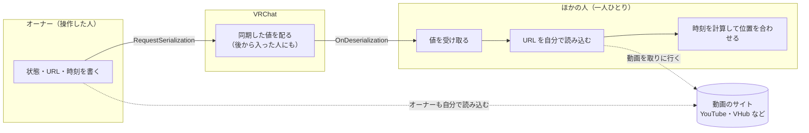
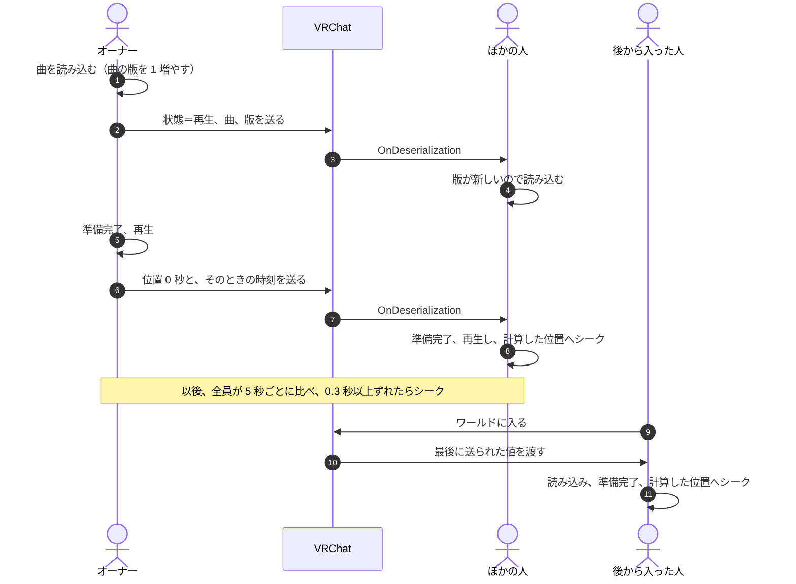
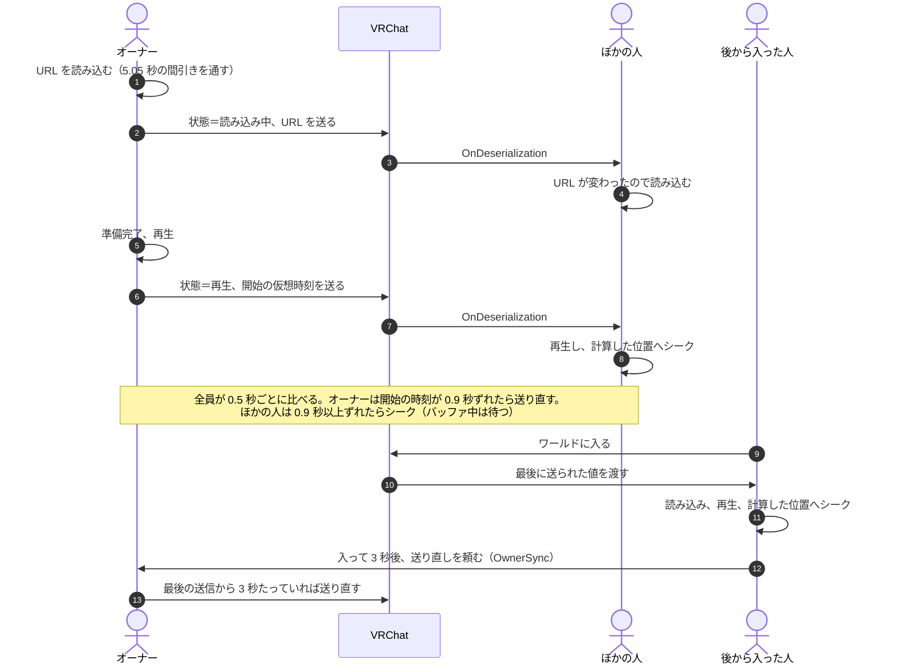
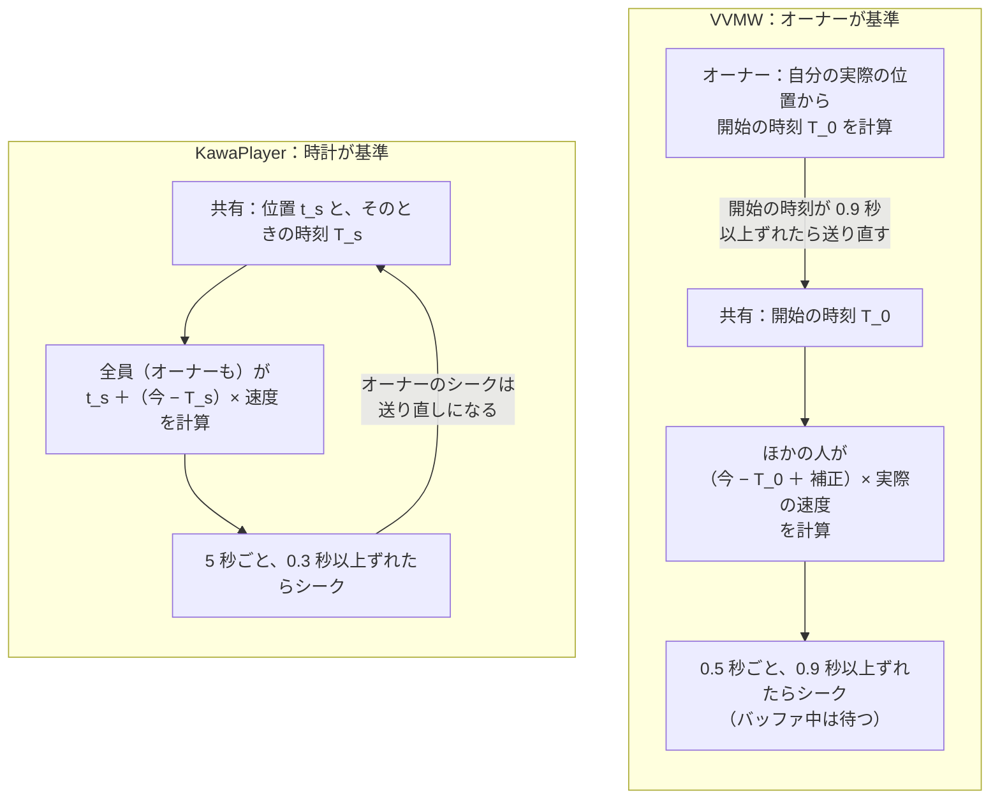
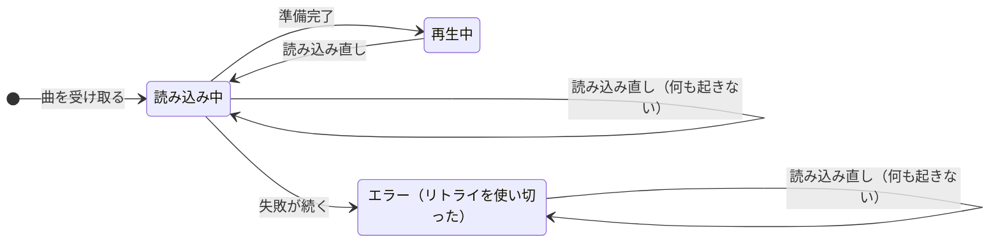
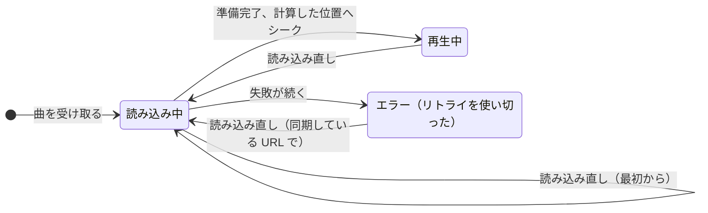
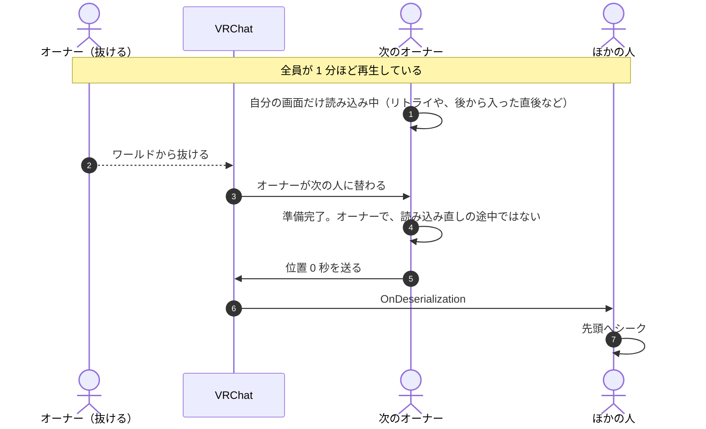

# 再生の同期の仕様：KawaPlayer と VizVid（VVMW）の機能ごとの比較

| 項目 | 内容 |
| --- | --- |
| 文書の種類 | 仕様と比較の記録（調べた時点のもの） |
| 時点 | KawaPlayer develop `803126b`、VizVid（VVMW）develop `834bd5e`（1.8.2） |
| 関連 | #228。この比較をもとにした方針は [README.md](README.md) |
| 日付 | 2026-10-14 |
| 注意 | #228 の実装が入ると、KawaPlayer の動きは変わる。変わったあとの KawaPlayer の仕様は、実装の PR で `docs/analysis/` に別に書く |

## 要旨

KawaPlayer と VizVid（VVMW）が、動画の再生をどう同期しているかを、両者のコードを読んで機能ごとに比べた記録である。比べた機能は、同期する値、位置の決め方、ずれの補正とバッファ、自分の画面だけの復旧、読み込みの間引き、エラーとリトライ、オーナーの交代、オーナーへの依頼と全員の読み込み直し、速度・画質・ライブの 9 つである。いちばん大きな違いは位置の基準で、KawaPlayer はネットワークの時計を、VVMW はオーナーの実際の再生位置を基準にする。復旧では、VVMW は全員が共有する状態と自分の読み込みの状態を分けており、自分の画面だけを、同期している URL から読み直せる。KawaPlayer は、エラーや読み込み中で止まった自分の画面を、読み込み直しで戻せない。この文書は事実の記録で、直す方針は [README.md](README.md) にまとめる。

**キーワード：** 再生の同期、オーナー、位置の基準、読み込み直し、rate limit、バッファ、VRChat、UdonSharp

## 目次

1. はじめに
2. 前提：VRChat で動画を同期する仕組み
3. 比較の一覧
4. 同期する値と、再生の始まり
5. 位置の決め方
6. ずれの補正とバッファ
7. 自分の画面だけの復旧（読み込み直し）
8. 読み込みの間引き
9. エラーとリトライ
10. オーナーが替わるとき
11. オーナーへの依頼と、全員の読み込み直し
12. 一時停止・シーク・速度・画質・ライブ
13. まとめ：それぞれの良いところ
14. 参考文献
15. 付録 A：コードの場所 ／ 付録 B：用語 ／ 付録 C：図 5 のモデル

---

## 1. はじめに

### 1.1 目的

#215（読み込み直しで、止まった自分の画面を戻せない）を直す前に、同期の作りが成熟している VizVid（以下 VVMW）と、KawaPlayer の作りを比べた。この文書は、そのとき分かった事実を、機能ごとに並べて記録する。何を直すか、どう直すかの判断は、[README.md](README.md)（方針）に分けて書く。

### 1.2 範囲

**対象：** 動画の再生の同期（状態・時刻・曲・プレイヤー）、自分の画面だけの復旧、読み込みの間引き、後から入った人、オーナーの交代、ライブ配信。

**対象外：** 曲の一覧（キュー・履歴・読み込んだプレイリスト）の同期、タブレットの画面（画像アプリなど）の同期、PlaylistLoader の文字列の読み込み。どれも別の UdonBehaviour が別に同期しており、今回の症状とは関係しない。

### 1.3 調べ方

両者のコードを、表紙に書いたコミットで読み、表 1 の 11 の場面で、誰が何を送り、受け取った人がどう動くかを調べた。それを機能ごとにまとめ直したのが §4〜§12 である。実装の担当の調べ物と、レビューでの独立した調べ物の両方を含む。

**表 1** 調べた場面

| 記号 | 場面 |
| --- | --- |
| S1 | オーナーが曲を再生する |
| S2 | 後から入った人 |
| S3 | 一時停止・シーク・速度の変更 |
| S4 | 再生中の時刻のずれを直す |
| S5 | 自分だけバッファで遅れる |
| S6 | 自分だけエラーになる（リトライを使い切ったあと） |
| S7 | 自分だけ読み込み中のまま進まない |
| S8 | 読み込み直しを押す |
| S9 | オーナーが抜ける・替わる |
| S10 | ライブ配信 |
| S11 | 続けて読み込む（曲の早い切り替え、読み込み直しの連打） |

**制約：** Play や実機では確かめていない。コードから読める動きと、推測とを分けて書く。図 5 は実測ではなくモデルである（付録 C）。

---

## 2. 前提：VRChat で動画を同期する仕組み

- **オーナーと手動の同期：** 同期する UdonBehaviour ごとに **オーナー** が 1 人いる。同期する値を書けるのはオーナーだけで、`RequestSerialization` で送ると、ほかの人の側で `OnDeserialization` が呼ばれる。後から入った人には、最後に送られた値が届く。KawaPlayer も VVMW も、操作した人がまずオーナーになり、それから値を書いて送る（KawaPlayer の `TakeOwnership`、VVMW の `RequestSync`）。
- **動画はそれぞれが読み込む：** 共有するのは、URL・状態・時刻だけである。動画そのものは、一人ひとりが自分で読み込む。そのため、読み込みにかかる時間、エラー、バッファの遅れは人によって違う。「自分の画面だけ止まる」のはこのためである。
- **読み込みの回数の制限（rate limit）：** VRChat は、1 人が新しい URL を読み込めるのを 5 秒に 1 回に限る。この制限は、ワールドのすべての動画プレイヤーに共通で、後から入った人にもかかる [1]。
- **ネットワークの時刻：** 両者とも、全員に共通のネットワークの時刻（`Networking.GetNetworkDateTime`・`GetServerTimeInMilliseconds`）を使う。オーナーが「この時刻に、この位置だった」と送れば、受け取った人はそこから今の位置を計算できる。

**図 1** 同期の全体像。共有するのは値だけで、動画は一人ひとりが読み込む。

---

## 3. 比較の一覧

**表 2** 機能ごとの比較の一覧

| 機能 | KawaPlayer | VVMW | 節 |
| --- | --- | --- | --- |
| 共有する状態 | 止まっている・再生・一時停止の 3 つ | 読み込み中を足した 4 つ | §4 |
| 位置の基準 | ネットワークの時計（オーナーも時計に合わせる） | オーナーの実際の再生位置 | §5 |
| ずれの補正 | 5 秒ごと、0.3 秒以上でシーク | 0.5 秒ごと、0.9 秒以上でシーク | §6 |
| バッファ中 | 区別しない | 位置が進まなければシークしない | §6 |
| 自分の画面だけの復旧 | エラー・読み込み中からは戻せない | どの状態からも、同期している URL で戻せる | §7 |
| 読み込みの間引き | エラーのあとのリトライだけ（`Controller` ごと） | すべての読み込み（ワールドで 1 つ） | §8 |
| リトライ | 最大 5 回。Access Denied はしない | 既定で 3 回。Access Denied もする | §9 |
| オーナーの交代 | 聞き手に知らせるだけ | 自分の読み込み直しの印を外す | §10 |
| オーナーへの依頼・全員の読み込み直し | ない | ある（`OwnerSync`・`GlobalSync`） | §11 |
| 速度・画質の変更 | 次のフレームで読み込み直す（止まっている・読み込み中は効かない） | 速度は 1 秒まとめてから読み込み直す | §12 |
| ライブ | 位置を合わせない | 同じ | §12 |

---

## 4. 同期する値と、再生の始まり

**表 3** 同期する主な値（場面 S1・S2）

| 何を | KawaPlayer（`Controller`） | VVMW（`Core`） |
| --- | --- | --- |
| 状態 | `_syncedState`：止まっている・再生・一時停止 | `state`：止まっている・読み込み中・再生・一時停止 |
| 曲 | `_url`・`_title`・`_trackExtension` | `pcUrl`・`questUrl`（PC 用と Quest 用） |
| 新しい曲の印 | `_trackVersion`（オーナーが新しい曲を読むたびに 1 増える） | なし（URL が変わったかで決める） |
| プレイヤー | `_handlerIndex`、`_handlerFromTrack`（曲で切り替わったか。#182） | `activePlayer` |
| 時刻 | `_syncedVideoTime`・`_networkDataTimeTicks`（ある時点の位置と、そのときのネットワーク時刻） | `time`（再生中は再生を始めた仮想のサーバー時刻、一時停止中は位置）、`ownerNetworkTime`（送ったときのサーバー時刻） |
| 速度など | `_speed`・`_loop`・`_repeat` | `syncedSpeed`・`syncedActualSpeed`・`loop`・`rangeLoopStart/End` |
| 送る値の作り方 | `OnPreSerialization` で、今の曲（`Track`）から曲の値を作る | `OnPreSerialization` で、今の URL と再生の状態から作る |

**再生の始まり：** KawaPlayer のオーナーは、曲を読むと状態＝再生・曲・曲の版を送り、準備ができたら位置 0 とそのときの時刻を送る。VVMW のオーナーは、URL を読むと状態＝読み込み中を送り、再生を始めたら状態＝再生と開始の時刻を送る。

**後から入った人：** どちらも、VRChat が最後に送られた値を届けるので、そこから読み込んで位置を計算する。VVMW は、それに加えて、入って 3 秒後（自動再生の待ち時間を足した時間）にオーナーへ送り直しを頼む（§11）。

**図 2** KawaPlayer の再生の始まりと、後から入った人。

**図 3** VVMW の再生の始まりと、後から入った人。

**違いの要点：** KawaPlayer は、新しい曲かどうかを曲の版で決め、状態に「読み込み中」を持たない。VVMW は、URL が変わったかで決め、オーナーの読み込み中も共有する。

---

## 5. 位置の決め方

**KawaPlayer：** 共有した位置 $t_s$ と時刻 $T_s$ から、誰でも（オーナーも）次の式で計算する。 $v$ は速度、 $d$ は自分だけの遅延の補正（`LocalDelay`）である。

$$t_{\mathrm{play}} = t_s + (T_{\mathrm{now}} - T_s) \cdot v + d \qquad t_{\mathrm{pause}} = t_s + d$$

オーナーは、再生・一時停止・準備完了（位置 0）・ループ・シーク・速度の変更のたびに $t_s$ と $T_s$ を送る。オーナーも時計に合わせてシークし、そのシークは `SetTime` を通るので、そのたびに値を送り直す。

**VVMW：** 共有した仮想の開始時刻 $T_0$ から計算する。 $o$ は自分だけの補正（`syncOffset`）、 $\ell$ は受け取りの遅れ（`syncLatency`）、 $p$ は演者の遅れの補正（`PerformerLatency`。演者がいなければ 0）である。 $v_a$ は、指定した速度ではなく、オーナーが送った **実際の** 速度（`syncedActualSpeed`）である。補正の項にも速度が掛かる。最後に、ループならくり返しの中に、そうでなければ 0 から長さのあいだに収める（`CalcVideoTime`）。

$$t_{\mathrm{play}} = \left(T_{\mathrm{now}} - T_0 + o + \ell - p\right) v_a \qquad t_{\mathrm{pause}} = t_s$$

オーナーは 0.5 秒ごとに、自分の実際の位置から $T_0$ を計算し直し、送った値と 0.9 秒以上ずれていれば送り直す。この 0.9 秒は開始の時刻の差で、ほかの人が比べる再生位置の差とは単位が違う（速度が 1 でなければ、位置の差は速度の分だけ変わる）。つまり **オーナーの実際の位置が基準** になる。

**図 4** 位置の基準。KawaPlayer はオーナーも時計に合わせる。VVMW はオーナーの位置に全員が合わせる。

**違いの要点：**

- **KawaPlayer：** 位置は時計だけで決まるので、後から入った人も、止まった画面を戻す人も、オーナーに頼まずに位置を計算できる。位置を知るためには、オーナーへの送り直しの依頼は要らない。
- **VVMW：** オーナーが遅れれば、全員がオーナーに合わせて遅れる。演奏やパフォーマンスで、演者に全員を合わせたいときに向く（演者の遅れを補う機能もある）。その代わり、オーナーが最後に送ってから位置がずれると、送り直してもらわないと分からない。`OwnerSync`（§11）は、このためと、初めの同期や欠けた状態を取り直すために使われている。

---

## 6. ずれの補正とバッファ

**表 4** ずれの補正（場面 S4・S5）

| 項目 | KawaPlayer | VVMW |
| --- | --- | --- |
| 確かめる間隔 | 5 秒（`_syncFrequency`） | 0.5 秒（`_AutoSyncTime`） |
| シークする境目 | 0.3 秒（`_syncMargin`） | 位置の差が 0.9 秒（`timeDriftDetectThreshold`） |
| 確かめる人 | 全員（オーナーも時計に合わせる） | ほかの人。オーナーは開始の時刻を送り直す（§5） |
| バッファ中 | 区別しない | 再生中なのに、前に確かめたときから位置が進んでいなければ、シークしない |
| バッファが明けたあと | — | 遅れの分を見込んで、合わせる先を先にずらす |
| ライブ | 合わせない | 合わせない |

**図 5** バッファのあとの時刻合わせ（モデル）。通信が 8〜12 秒で止まり、シーク 1 回ごとに 0.6 秒の読み直しがかかると仮定した、1 人の見る人のずれ。前提は付録 C。

このモデルから、次のことが言える。

- **境目がシークの手間より小さいと、繰り返しになる：** シークのあとの読み直しで 0.6 秒遅れると、KawaPlayer の境目 0.3 秒を超えるので、5 秒後にまたシークする。シークのたびに 0.6 秒止まり、5 秒ごとに映像が止まる。
- **VVMW は 1 回で落ち着く：** 境目が 0.9 秒なので、0.6 秒の遅れはそのままにする。バッファ中（8〜12 秒）にもシークしない。
- **VVMW も万能ではない：** シークの手間が 0.9 秒を超えれば、VVMW も同じように繰り返す。シークの手間は動画の種類（AVPro・HLS・ライブ）と回線で変わるので、実機で測るまで、どちらがよいかは決められない。

VVMW の作者は、バッファ中にシークすると読みかけのバッファが捨てられ、止まったまま抜け出せなくなると書いている（`Core_Timing.cs` のコメント）。1.4.1 で「通信が遅いときや高ビットレートの動画での、バッファ中の同期の改善」として入った [3]。

---

## 7. 自分の画面だけの復旧（読み込み直し）

**表 5** 読み込み直し（場面 S6・S7・S8）

| 項目 | KawaPlayer（`Controller.Reload`） | VVMW（`Core.LocalSync`） |
| --- | --- | --- |
| 入口の条件 | 自分の画面が止まっている・読み込み中なら何もしない（`!Stopped && !IsLoading`） | 自分の画面の状態は見ない。共有の状態が「止まっている」なら何もしない |
| 読み直す曲 | 手元の曲（`Track`） | 同期している URL（`pcUrl`・`questUrl`） |
| リトライとフォールバック | 戻さない | 0 から（`retryCount`・`retryUsedPlayers`） |
| 読み込み中に値を送るか | 送らない（`_reloading`） | 送らない（`isLocalReloading`。`OnPreSerialization` が何もしない） |
| 準備完了のあと | 共有の状態が再生なら再生し、時計から位置を計算してシーク（`EnsureVideoTime`） | 共有の状態に合わせて再生・一時停止し、計算した位置へシーク |
| オーナーが押したとき | 準備完了のあとの位置合わせ（`SetTime`）で値を送る。プレイヤーが替わると `_handlerFromTrack` も書く | 準備完了で印を外してから再生するので、再生の知らせで状態と開始の時刻を送る |
| ボタン | いつも押せる | URL があるときだけ出る |
| 権限 | PermissionManagement があると Editor 以上 | 制限なし（UI のロックで止まるのは全員の読み込み直しだけ） |
| 0.5 秒以内の 2 回目 | — | オーナーへの送り直しの依頼になる（§11） |
| ほかの入口 | タブレットの KawaPlayer アプリも、同じ `UIController.Reload` を通る | VR のオーバーレイ（F9 など）は、再生中のときだけ |

**KawaPlayer：** エラーになると `_stopped` が立つので、読み込み直しは効かない。リトライを使い切ったあとは、ほかの人が再生していても、`ApplySyncedState` も準備ができていないプレイヤーには何もしない。読み込み中も効かない。

**図 6** KawaPlayer の、自分の画面の状態と読み込み直し。エラーと読み込み中からは戻れない。

**VVMW：** 共有の状態が「止まっている」でなければ、同期している URL を読み直す。準備ができたら、共有の状態に合わせて再生か一時停止にし、計算した位置へシークする。

**図 7** VVMW の、自分の画面の状態と読み込み直し。どの状態からも読み直せる。

**オーナーが押したときの送信：**

- **KawaPlayer：** 準備完了のあとの位置合わせ（`EnsureVideoTime` から `SetTime`）が `RequestSerialization` まで届く（レビューで発見）。送る位置は時計と合っているので、見た目の害は小さい。再生の知らせ（`AfterVideoPlayed`）は `Play()` の中ですぐに呼ばれ、まだ `_reloading` が立っているので送らない。
- **VVMW：** 読み込み中の印（`isLocalReloading`）は、準備完了で外してから再生する（`OnVideoReady`）。動画プレイヤーの `Play` は再生の知らせ（`OnVideoPlay`）をその場で呼ぶので、読み直したのがオーナーなら、ここで状態と開始の時刻を送る。位置を合わせる（`Time = videoTime`）のは再生のあとなので、送る開始の時刻は位置を合わせる前のものになり、0.5 秒後の確かめで送り直すまで、ほかの人がずれるおそれもある。どちらも、ソースから読んだ経路で、実機では確かめていない。

**VVMW の限り：** 読み込み中に押すと、遅いだけの正常な読み込みも最初からやり直しになる。読み込みが一定時間続いたら自動で直す、といった決まりもない。VR のオーバーレイからの読み込み直しは再生中のときだけで、エラーからは戻せない（`OverlayControl.ReloadCore` の `IsPlaying`）。

**ローカルモード：** KawaPlayer は、同期しないローカルモード（`IsLocal`）でも同じ `Reload` を使う。ローカルモードでは `OnPreSerialization` が走らないので、同期する曲の値（`_url` など）は空のことがある。

---

## 8. 読み込みの間引き

**表 6** 読み込みの間引き（場面 S11）

| 項目 | KawaPlayer | VVMW |
| --- | --- | --- |
| 間引く読み込み | エラーのあとのリトライだけ | すべての読み込み |
| 間隔 | 前の読み込みから 5.1 秒（`SAFETY_RETRY_INTERVAL`） | 5.05 秒（`RateLimitResolver`） |
| 範囲 | `Controller` ごと | ワールドで 1 つ（すべての VizVid で共有） |
| 待っているあいだの頼み | — | 予約を増やさず、時間が来たときの URL を読む |

**図 8** 読み込みの間引き。上は、#215 で入口だけを緩めた場合の仮定。下は VVMW の `RateLimitResolver` の方式。

VVMW は、読み込もうとすると、前の読み込みから 5.05 秒たつまでの待ち時間を返し、その枠を予約する。待っているあいだに次の頼みが来ても予約は増やさず、時間が来たとき、その時点の URL を読む。間に何度押されても、読むのは最後の 1 回だけである。

KawaPlayer で 5.1 秒あけるのは、エラーのあとのリトライだけである。今は読み込み中に読み込み直しが効かないので連打は起きないが、読み込み直しの入口だけを緩めると、図 8 の上のように rate limit に当たる。曲を早く切り替えたときにも、ほかの人の画面で同じことが起きうる。

---

## 9. エラーとリトライ

**表 7** エラーとリトライ

| 項目 | KawaPlayer | VVMW |
| --- | --- | --- |
| 回数 | 最大 5 回（`_maxErrorRetry`） | 既定で 3 回（`totalRetryCount`） |
| 間隔 | 前の読み込みから 5.1 秒 | 5.5 秒（`retryDelay`） |
| リトライしないエラー | Access Denied、Invalid URL | Invalid URL |
| フォールバック | 1 回目の Player Error から（`_useFallbackAfterErrors`） | 2 回目の失敗から（`fallbackRetryCount`） |
| 中止する場合 | 曲が替わったとき | 全員が止まったとき、URL が替わったとき |
| 見る人への詳細 | 直近 5 件と「詳細」ボタン（#168） | 状態の文だけ |

Access Denied は許可の問題で、何度試しても直らない。KawaPlayer はリトライしないが、VVMW は試す。

---

## 10. オーナーが替わるとき

**KawaPlayer：** オーナーが替わると、聞き手（リスナー）に知らせるだけである（`OnOwnershipTransferred`）。**VVMW：** ほかの人がオーナーになったら、自分の読み込み直しの印を外し、受け取りの遅れを 0 に戻す。

KawaPlayer の `AfterVideoReady` は、オーナーが読み込み直しの途中でなければ、準備ができた時点で位置 0 を送る。新しい曲を始めたオーナーのための処理である。しかし、オーナーが抜けたとき、次のオーナーになった人の画面が読み込み中（読み込み直し以外）だと、その人の準備完了で位置 0 が送られ、全員が先頭に戻るおそれがある。

**図 9** オーナーが替わるときのおそれ（KawaPlayer。コードから推測し、再現していない）。

VVMW でも、新しいオーナーが再生を始めると、自分の位置から開始の時刻を計算して送るので、同じことが起きうる。どちらも、実機で再現できるかは確かめていない。

---

## 11. オーナーへの依頼と、全員の読み込み直し

**表 8** KawaPlayer にない、VVMW の 2 つの仕組み

| 仕組み | KawaPlayer | VVMW |
| --- | --- | --- |
| オーナーへの送り直しの依頼 | ない | `OwnerSync`。オーナーではない人が、オーナーに値を送り直してもらう。頼むのは、後から入って 3 秒たったとき、読み込み直しを 0.5 秒以内に 2 回押したとき、自分の準備ができたのに共有の状態がまだ「止まっている」か「読み込み中」のとき、受け取った値が欠けていたとき。オーナーは、最後に送ってから 3 秒は応じない |
| 全員の読み込み直し | ない | `GlobalSync`。全員にネットワークのイベントで `LocalSync` を送る。UI がロックされていると使えない。ワールドの制作者は、自分だけか全員かを選べる独立した Re-Sync ボタンを置ける |

位置の基準が時計の KawaPlayer では、受け取った時刻から位置を戻すのに、オーナーへの依頼は要らない（§5）。VVMW は、位置のほかに、初めの同期や欠けた状態の取り直しにも `OwnerSync` を使っている。

---

## 12. 一時停止・シーク・速度・画質・ライブ

**表 9** そのほかの操作（場面 S3・S10）

| 項目 | KawaPlayer | VVMW |
| --- | --- | --- |
| 一時停止・シーク | 操作した人がオーナーになって送る | 同じ |
| 速度の変更（AVPro） | 次のフレームで `Reload` を呼ぶ（`UpdateSpeed`）。止まっている・読み込み中は効かない | 1 秒まとめてから読み込み直す（`_RequestReloadUrl`） |
| 最大の画質の変更 | 止まっていなければ、次のフレームで `Reload` を呼ぶ（`MaxResolution`） | 調べていない |
| ライブ | 位置を合わせない。読み込み直しが、遅れに追いつく手段 | 同じ |

AVPro は、速度を変えると読み込み直す必要がある。KawaPlayer の速度と画質の変更は、どちらも読み込み直しと同じ `Reload` を通る。

---

## 13. まとめ：それぞれの良いところ

**KawaPlayer**

- **時計が基準：** オーナーに頼まずに、誰でも位置を計算できる。後から入った人も、止まった画面を戻す人も、オーナーの都合に左右されない。
- **むだなリトライをしない：** 何度試しても直らない Access Denied は、リトライしない。
- **エラーの詳細：** 直近 5 件のエラーと、問い合わせ用の 1 行を「詳細」で見られる。
- **1 つの入口：** スクリーンもタブレットも、同じ `UIController.Reload` を通る。

**VVMW**

- **自分の画面だけの復旧：** 共有の状態と自分の読み込みの状態を分けており、どの状態からでも、同期している URL で読み直せる。
- **読み込みの間引き：** すべての読み込みをワールドで 1 つにまとめて 5.05 秒おきに並べるので、rate limit に当たりにくい。
- **バッファに強い時刻合わせ：** バッファ中はシークせず、境目も 0.9 秒と大きい。
- **補助の仕組み：** オーナーへの依頼、全員の読み込み直し、演者の遅れの補正がある。

---

## 14. 参考文献

1. VRChat, “Video Players — Rate Limiting”. <https://creators.vrchat.com/worlds/udon/video-players/#rate-limiting>
2. JLChnToZ, VizVid（VVMW）, develop `834bd5e`. <https://github.com/JLChnToZ/VVMW/tree/834bd5ec453297b713399a5fbba1bd52a81b4f82>
3. VizVid の CHANGELOG（1.0.32「読み込み直しの 2 回押しでオーナーに同期を頼む」「後から入った人の流れの改善」、1.1.0「rate limit を減らす読み込みの扱い」、1.4.1「バッファ中の同期の改善」）. <https://github.com/JLChnToZ/VVMW/blob/834bd5ec453297b713399a5fbba1bd52a81b4f82/CHANGELOG.md>
4. Mega-Gorilla, KawaPlayer, develop `803126b`. <https://github.com/Mega-Gorilla/KawaPlayer/tree/803126b47baee38f8175e3fbcf9d1a70ca9bfa4c>
5. #215 読み込み直しが、エラーや読み込み中で止まった自分の画面を直せない。
6. #228 同期の作りを VVMW と比べ、直す方針を決める。

---

## 付録 A：コードの場所

**表 A1** KawaPlayer（`803126b`）

| 場所 | 中身 |
| --- | --- |
| [Controller.cs L27–L40](https://github.com/Mega-Gorilla/KawaPlayer/blob/803126b47baee38f8175e3fbcf9d1a70ca9bfa4c/Runtime/Internal/Controller.cs#L27-L40) | 同期する値 |
| [Controller.cs L73–L79](https://github.com/Mega-Gorilla/KawaPlayer/blob/803126b47baee38f8175e3fbcf9d1a70ca9bfa4c/Runtime/Internal/Controller.cs#L73-L79) | 5 秒ごとの位置合わせ（`Update`） |
| [Controller.cs L323–L346](https://github.com/Mega-Gorilla/KawaPlayer/blob/803126b47baee38f8175e3fbcf9d1a70ca9bfa4c/Runtime/Internal/Controller.cs#L323-L346) | 再生・一時停止・停止 |
| [Controller.cs L354–L357](https://github.com/Mega-Gorilla/KawaPlayer/blob/803126b47baee38f8175e3fbcf9d1a70ca9bfa4c/Runtime/Internal/Controller.cs#L354-L357) | `Reload` の入口の条件 |
| [Controller.cs L405–L416](https://github.com/Mega-Gorilla/KawaPlayer/blob/803126b47baee38f8175e3fbcf9d1a70ca9bfa4c/Runtime/Internal/Controller.cs#L405-L416) | 速度の変更と、AVPro の読み直し |
| [Controller.cs L462–L481](https://github.com/Mega-Gorilla/KawaPlayer/blob/803126b47baee38f8175e3fbcf9d1a70ca9bfa4c/Runtime/Internal/Controller.cs#L462-L481) | `SetTime`（オーナーなら送る） |
| [Controller.cs L526–L546](https://github.com/Mega-Gorilla/KawaPlayer/blob/803126b47baee38f8175e3fbcf9d1a70ca9bfa4c/Runtime/Internal/Controller.cs#L526-L546) | `ResolveAndLoadTrack`（版を増やして送る、`_handlerFromTrack`） |
| [Controller.Screen.cs L83–L97](https://github.com/Mega-Gorilla/KawaPlayer/blob/803126b47baee38f8175e3fbcf9d1a70ca9bfa4c/Runtime/Internal/Controller.Screen.cs#L83-L97) | 最大の画質の変更と、読み直し |
| [Controller.Sync.cs L70–L85](https://github.com/Mega-Gorilla/KawaPlayer/blob/803126b47baee38f8175e3fbcf9d1a70ca9bfa4c/Runtime/Internal/Controller.Sync.cs#L70-L85) | `EnsureVideoTime`（時計から位置を計算） |
| [Controller.Sync.cs L88–L133](https://github.com/Mega-Gorilla/KawaPlayer/blob/803126b47baee38f8175e3fbcf9d1a70ca9bfa4c/Runtime/Internal/Controller.Sync.cs#L88-L133) | `OnPreSerialization`・`OnDeserialization` |
| [Controller.Events.cs L78–L100](https://github.com/Mega-Gorilla/KawaPlayer/blob/803126b47baee38f8175e3fbcf9d1a70ca9bfa4c/Runtime/Internal/Controller.Events.cs#L78-L100) | `AfterVideoReady`（オーナーなら位置 0 を送る） |
| [Controller.Events.cs L171–L247](https://github.com/Mega-Gorilla/KawaPlayer/blob/803126b47baee38f8175e3fbcf9d1a70ca9bfa4c/Runtime/Internal/Controller.Events.cs#L171-L247) | リトライと 5.1 秒の間隔 |
| [BaseVideoPlayerHandler.cs L206–L211](https://github.com/Mega-Gorilla/KawaPlayer/blob/803126b47baee38f8175e3fbcf9d1a70ca9bfa4c/Runtime/Internal/Handlers/BaseVideoPlayerHandler.cs#L206-L211) | `Play`（再生の知らせはその場で呼ぶ） |
| [UIController.cs L651–L660](https://github.com/Mega-Gorilla/KawaPlayer/blob/803126b47baee38f8175e3fbcf9d1a70ca9bfa4c/Runtime/Internal/UI/UIController.cs#L651-L660) | 読み込み直しのボタン |
| [PermissionManagementUI.cs L48–L70](https://github.com/Mega-Gorilla/KawaPlayer/blob/803126b47baee38f8175e3fbcf9d1a70ca9bfa4c/Modules/PermissionManagement/PermissionManagementUI.cs#L48-L70) | 読み込み直しの権限 |

**表 A2** VVMW（`834bd5e`、`Packages/idv.jlchntoz.vvmw/Runtime/VVMW/`）

| 場所 | 中身 |
| --- | --- |
| [Core.cs L226–L241](https://github.com/JLChnToZ/VVMW/blob/834bd5ec453297b713399a5fbba1bd52a81b4f82/Packages/idv.jlchntoz.vvmw/Runtime/VVMW/Core.cs#L226-L241) | 後から入った人の送り直しの依頼 |
| [Core.cs L368–L410](https://github.com/JLChnToZ/VVMW/blob/834bd5ec453297b713399a5fbba1bd52a81b4f82/Packages/idv.jlchntoz.vvmw/Runtime/VVMW/Core.cs#L368-L410) | エラーとリトライ |
| [Core.cs L450–L502](https://github.com/JLChnToZ/VVMW/blob/834bd5ec453297b713399a5fbba1bd52a81b4f82/Packages/idv.jlchntoz.vvmw/Runtime/VVMW/Core.cs#L450-L502) | `GlobalSync`・`LocalSync`・`ReloadUrlCore` |
| [Core.cs L564–L616](https://github.com/JLChnToZ/VVMW/blob/834bd5ec453297b713399a5fbba1bd52a81b4f82/Packages/idv.jlchntoz.vvmw/Runtime/VVMW/Core.cs#L564-L616) | 準備完了のあとの当て直しと、再生の知らせ（`OnVideoPlay`） |
| [Core.cs L674–L780](https://github.com/JLChnToZ/VVMW/blob/834bd5ec453297b713399a5fbba1bd52a81b4f82/Packages/idv.jlchntoz.vvmw/Runtime/VVMW/Core.cs#L674-L780) | 送る値と、受け取ったときの動き |
| [Core_Timing.cs L190–L284](https://github.com/JLChnToZ/VVMW/blob/834bd5ec453297b713399a5fbba1bd52a81b4f82/Packages/idv.jlchntoz.vvmw/Runtime/VVMW/Core_Timing.cs#L190-L284) | 0.5 秒ごとの時刻合わせ、位置の計算（`CalcVideoTime`）、バッファの扱い |
| [Core_Timing.cs L367–L405](https://github.com/JLChnToZ/VVMW/blob/834bd5ec453297b713399a5fbba1bd52a81b4f82/Packages/idv.jlchntoz.vvmw/Runtime/VVMW/Core_Timing.cs#L367-L405) | `OwnerSync` |
| [RateLimitResolver.cs L13–L41](https://github.com/JLChnToZ/VVMW/blob/834bd5ec453297b713399a5fbba1bd52a81b4f82/Packages/idv.jlchntoz.vvmw/Runtime/VVMW/RateLimitResolver.cs#L13-L41) | 読み込みの間引き |
| [VideoPlayerHandler.cs L272–L328](https://github.com/JLChnToZ/VVMW/blob/834bd5ec453297b713399a5fbba1bd52a81b4f82/Packages/idv.jlchntoz.vvmw/Runtime/VVMW/VideoPlayerHandler.cs#L272-L328) | 間引きを通した読み込み、頼みのまとめ、`Play`（再生の知らせをその場で呼ぶ） |
| [UIHandler.cs L521–L527](https://github.com/JLChnToZ/VVMW/blob/834bd5ec453297b713399a5fbba1bd52a81b4f82/Packages/idv.jlchntoz.vvmw/Runtime/VVMW/UIHandler.cs#L521-L527) | 読み込み直しのボタンを出す条件 |
| [OverlayControl.cs L297–L304](https://github.com/JLChnToZ/VVMW/blob/834bd5ec453297b713399a5fbba1bd52a81b4f82/Packages/idv.jlchntoz.vvmw/Runtime/VVMW/OverlayControl.cs#L297-L304) | オーバーレイの読み込み直し（再生中だけ） |

## 付録 B：用語

| 用語 | 意味 |
| --- | --- |
| オーナー | 同期する値を書ける、ただ 1 人のプレイヤー。操作した人がなる |
| 共有の状態 | 全員が同じ値を持つ状態（止まっている・再生・一時停止、曲、位置） |
| 自分の画面の状態 | 一人ひとりの読み込みの状態（読み込み中・エラーなど）。人によって違う |
| 読み込み直し | 自分の画面だけで、今の曲を読み込み直すこと |
| ローカルモード | KawaPlayer を同期せずに使う設定（`IsLocal`）。値を送らない |
| 間引き | 読み込みの頼みを、間隔をあけて並べること |
| バッファ | 動画のデータが足りず、再生が進まないこと |
| rate limit | VRChat の、5 秒に 1 回という読み込みの制限 |
| ライブ | 長さのない配信。位置を合わせられない |

## 付録 C：図 5 のモデル

図 5 は、次の前提で 1 人の見る人のずれを計算したもので、実測ではない。計算と図は `images/figures.py` で作り直せる。

- 0 秒から等速で再生する。期待する位置は経過時間と同じ。
- 8〜12 秒のあいだ、通信が止まって位置が進まない。
- シークすると、その時点から 0.6 秒、読み直しで位置が進まない。
- **KawaPlayer：** 前の確認から 5 秒を超えたら確かめ、0.3 秒以上ずれていればシークする（`Update` と `EnsureVideoTime`）。
- **VVMW：** 0.5 秒ごとに確かめる。前の確認から位置が進んでいなければバッファ中とみなし、シークしない。それ以外は、0.9 秒以上ずれていればシークする。バッファ明けの見込みの足し方は、`SyncTime` と同じにした。

前提を変えると結果も変わる。シークの手間が 0.3 秒より小さければ KawaPlayer も落ち着き、0.9 秒より大きければ VVMW も繰り返す。どちらになるかは、実機で測る（方針の文書の T8）。
