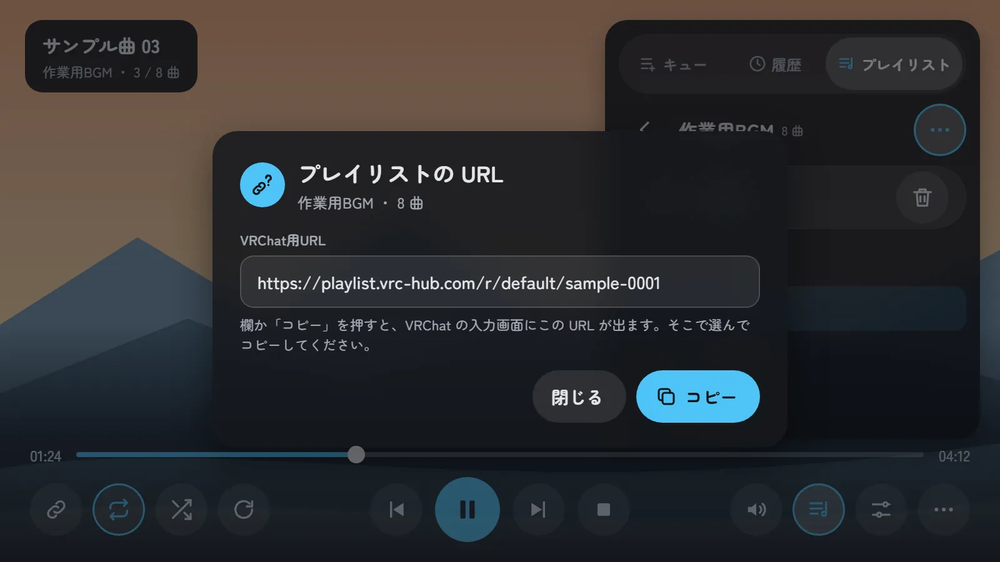
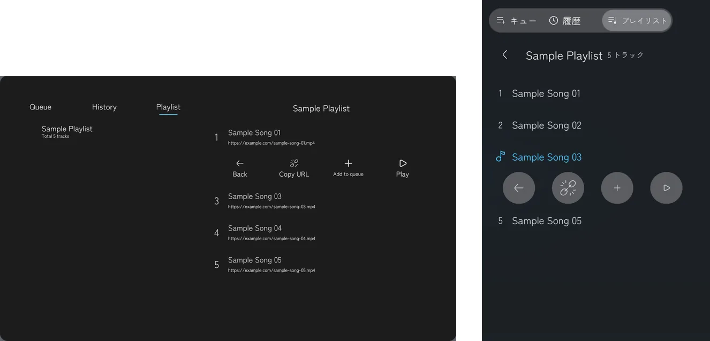

# スクリーンの UI の作り直し：決めたデザインと作り方の計画

| 項目 | 内容 |
| --- | --- |
| 文書の種類 | 計画 |
| 関連する issue | #258（この文書の親）、#256（接続口の整理）、#145・#302（一覧に入る予定の検索とライブラリ） |
| もとにした記録 | #258 のコメント：[ほかのプレイヤーの UI の例](https://github.com/Mega-Gorilla/KawaPlayer/issues/258#issuecomment-6413151020)、[外に浮かべる操作の試し](https://github.com/Mega-Gorilla/KawaPlayer/issues/258#issuecomment-6413952483)、[採用したデザイン](https://github.com/Mega-Gorilla/KawaPlayer/issues/258#issuecomment-6414804638) |
| 調べた版 | develop `f6899b5`（1.3.3） |
| 日付 | 2026-10-26 |
| 状態 | デザインは決定。8 章の D1・D3・D4・D6 は決定（2026-10-27）、D2・D7・D8 は決定（2026-10-28）、D5 は判断待ち |

## 要旨

KawaPlayer のスクリーンの UI（`Prefabs/UI/ScreenUI.prefab`）は、YamaPlayer の UI をほぼそのまま受け継いでいる。操作が左の縦の列・右の一覧・下の帯の 3 か所に散り、押す所は 40 から 50、文字はいちばん小さい所で 12 しかない（画面の単位、1600 × 900）。遠くからや VR では押しにくく、読みにくい。

5 つの案を比べ、操作をスクリーンの下の 1 か所にまとめて動画に重ねる案を採った。操作は、レーザーで画面を指して引き金を引いたときだけ出す。音量・一覧・その他はボタンの上に開く板にし、設定は全画面のページのまま、後ろの動画が透けるようにする。設定の中身は、タブレットの設定アプリを元にした 1 つの部品にして、スクリーンとタブレットで使い回す。一覧も 1 つの部品にして、スクリーンと Playlist Panel で使い回す。押す所は 84 以上、文字は 20 以上にする。84 は、Apple の visionOS の指針で押せる範囲の下限とされる 60 pt にあたる。

作り方は、今の `ScreenUI` の中で組み直す。今の部品は、新しいデザインの部品とほぼ 1 対 1 で対応する。UIController のボタンは、ビルドのときに欄が指す Button に処理が付くので、置き場所を変えても欄を付け替えずに動く。モジュールの差し込み口（uiSlots）のパスは、設定の中を除いて変えない。作業は PR に分け、帯 → 音量 → 一覧 → 設定 → 仕上げの順に進め、仕上げの途中で一覧を Playlist Panel と共通にする（P6）。

**キーワード：** スクリーンの UI、ScreenUI、UIController、押せる範囲、文字の大きさ、visionOS、計画

## 目次

1. はじめに
2. 決めたデザイン
3. 大きさの基準
4. 今の部品との対応
5. 作り方
6. 進め方
7. 確かめ方
8. 決めること
9. 危うい点
10. 参考文献

---

## 1. はじめに

#258 は、スクリーンの UI を YamaPlayer の形から脱却させ、遠くからや VR でも読みやすく、押しやすくするための issue である。進め方は、今の画面を撮って並べる → 読みにくい所を挙げる → ほかのプレイヤーと比べる → モックアップの案を作って決める → 子の issue に分けて作る、とした。

2026-10-26 に、ほかのプレイヤーの UI を集め（#258 のコメント）、Apple の Human Interface Guidelines を参考に、モックアップを 5 案作った。

- **A：** 操作をスクリーンの外に浮かべる。
- **B：** 下にまとめて重ねる。
- **C：** 動画を縮めて空いた所に出す。
- **D：** タブで切り替える 1 枚のパネル。
- **E：** 止まっているときは大きなタイル。

A は、Unity で作れることまで確かめたが、使う人から見てどこに何が出るかが分かりにくいため取りやめた。E は不要とし、止まっているときも B の形にする。この文書は、決めた B 案と、それを作る計画をまとめる。

## 2. 決めたデザイン

### 2.1 形

**表 1** 決めたデザイン

| 部分 | 決めたこと |
| --- | --- |
| 操作の出し方 | レーザーで画面を指して引き金を引いたときだけ出す。指しているだけでは何も出さない。もう一度押すと消える（今と同じ） |
| 下の帯 | 1 段目は時間とシークバー。2 段目は、左に URL・ループ・シャッフル・ReSync、中央に前・再生（一時停止）・次・停止、右に音量・一覧・設定・その他。帯の後ろは、下に向かって暗くする |
| 左上の札 | 再生中は曲名・プレイリスト名・何曲目か。止まっているときは「KawaPlayer」と版、使える URL の種類 |
| 止まっているとき | 再生中と同じ帯を出す。再生の 4 つと ReSync は押せない色にし、URL のボタンだけをテーマの色で塗る |
| 音量 | 音量のボタンを押すと、その真上に縦長の板が出る。中身は割合・縦の音量バー・ミュートのアイコンだけ |
| 一覧 | 一覧のボタンで、右の端に沿って上から下までの板（幅 600、角は丸めない）が下から滑り上がる。開いているあいだ、帯は板の左に縮み、シークバー・再生の操作（前・再生・次・停止）・音量・一覧のボタンを出す。URL・ループ・シャッフル・ReSync は下へ消え、設定とその他は薄れて消え、閉じると戻る（2026-10-28 の指示）。閉じるのは、帯の一覧のボタン（「∨」が分からない人のため）、板の右下の「∨」（帯のボタンの列に並ぶ。初めはタブの右で、P6 で移した）、板の外を押したとき。音量の板は一覧と並んで開ける。キュー・履歴・プレイリストのタブは、アイコンと文字（高さ 64）。1 曲を 1 行（曲名だけ）で見せる。初めは右上の板（高さ 660）だったが、P5 で今の形にした（2026-10-28） |
| プレイリストの操作 | プレイリスト名の右の「…」を押すと、名前の下に、横幅いっぱいの下地が出る。下地の左右に余白を取り、左に更新と URL（コピーのアイコン）、右に削除を置く。URL のボタンは、プレイリストの VRChat用URL をコピーの欄に出すダイアログを開く（実行中に読み込んだプレイリストだけ。ワールドに焼き込んだ物は、実行中には URL を持たない）。削除は、今と同じく確認のダイアログを出してから消す |
| 設定 | 全画面のページ。後ろの動画は、暗い半透明の層越しにうっすら見える。中身はタブレットの設定アプリと同じ部品で、左に分類（再生・映像・音声・言語）、右に 1 項目 1 枚の札。スクリーンとタブレットで同じ項目を出す（5.5 節） |
| その他 | Info と UI ロック |
| 色 | 配色アセット（`KawaPlayerPalette`）の役割で付ける。強調の色はテーマの色（KawaPlayer では川の青） |

### 2.2 状態ごとの絵

絵はモックアップで、画面の単位（1600 × 900）で描いた。描いたページは `images/mockups~/` にある（Google Fonts の Zen Maru Gothic を読み込む HTML。Edge の画面なしモードで 1600 × 900 に書き出した）。

**図 1** 止まっているとき。

**図 2** 再生中。シャッフルのボタンを指して、名前が出ているところ。

**図 3** 音量のボタンを押したとき。

**図 4** 一覧を開いたとき（P3 までの形。P5 で、板を右の端に沿って上から下までにし、開いているあいだは帯を板の左に縮めた。表 1）。

**図 5** プレイリスト名の右の「…」を押したとき（上）と、「URL？」を押したとき（下）。作ったダイアログは、エラーの詳細と同じコピーの欄（`Modal.ShowCopyField`）を使い、欄を押すと VRChat の入力画面が開いてコピーできる。そのため、絵の「コピー」のボタンは置かず、欄がその役をする。

**図 6** 設定を開いたとき。タブレットの設定アプリと同じ部品で、再生のページに Global の項目が並ぶ。

**図 7** 操作を隠しているとき。レーザーで指していても何も出ない。

比べるために、今の画面（操作を出したところ）を図 8 に載せる。

**図 8** 今の画面（develop `f6899b5`、ClientSim）。

## 3. 大きさの基準

### 3.1 基準にした数字

VR の中のスクリーンは、空間に浮かぶ窓を離れた所から指して操作する点で、Apple の visionOS の窓に近い。visionOS の指針は、次の数字を挙げている [1][2][3][4]。

- **押せる範囲：** 60 × 60 pt 以上。中心どうしは 60 pt 以上離す。
- **文字：** 標準 17 pt、最小 12 pt。細い字（Light・Thin）は避ける。
- **窓：** 標準は 1280 × 720 pt で、2 m 先に、幅約 3 m に見えるように置く。

KawaPlayer のスクリーンは、プレハブのままで幅 2.67 m あり、2 m から見ると visionOS の標準の窓とほぼ同じ見え方になる。このとき、画面の単位の 1 は約 0.71 pt にあたる。60 pt は約 84、12 pt は約 17、17 pt は約 24 になる。

VRChat のレーザーとデスクトップの照準は、目の動きと同じく狙いが揺れる。この数字は目安として使う。

### 3.2 今と新しいデザイン

**表 2** 押せる所と文字の大きさ（画面の単位。括弧は pt に直した値）

| 部分 | 今 | 新しいデザイン |
| --- | --- | --- |
| 左の縦の列のボタン | 40（約 28 pt） | 帯のボタン 84（約 60 pt） |
| 再生の操作 | 50（約 36 pt） | 84、再生のボタンは 104 |
| 一覧のタブ | 文字 20 | 高さ 64（押す所は 56。84 の基準より小さいが、一覧の行を多く見せるため P5 で詰めた）、文字 24。横の「∨」は 64 |
| 一覧の曲名 | 20 | 26（行の高さ 84。行を押すと出る操作のボタンも 84 なので、同じ高さにした） |
| 一覧の曲の URL | 12（約 8.5 pt） | 出さない（1 曲 1 行） |
| 時間 | 22 | 24 |
| 設定の項目名 | 30 | 30 |
| 設定の説明 | 16（約 11 pt） | 22 |
| 設定の選択肢 | 18 | 26（高さ 84） |

## 4. 今の部品との対応

今の `ScreenUI` の `Canvas/User/Main` は、新しいデザインの部品とほぼ 1 対 1 で対応する。新しく作る物は、音量の板・その他の板・プレイリストの「…」の 3 つと、設定の共通の部品（5.5 節）である。

**表 3** 新しい部品と、今の部品（パスは `Canvas/User/Main` から）

| 新しい部品 | 今の部品 | 変えること |
| --- | --- | --- |
| 左上の札 | `Top/VideoInfo`（`Title`・`Url`） | 札の形にする。`Top/UrlInput`（上の URL の入力欄）は消す（8 章の D4） |
| URL のボタン | `LeftSide/Container/UrlInput`（`VRCUrlInputField`） | 帯の左へ移し、84 にする。止まっているときはテーマの色 |
| ループ・シャッフル・ReSync | `LeftSide/Container/Loop`・`LoopOff`・`Shuffle`・`ShuffleOff`・`ReSync` | 帯の左へ移し、84 にする。名前の吹き出し（`Tooltip`）は上に出す |
| 前・再生・一時停止・次・停止 | `Bottom/Actions/Container/*` | 84 にする（再生と一時停止は 104） |
| 時間とシークバー | `Bottom/ProgressBar` | 帯の 1 段目にする。文字は 24 |
| 音量のボタンと板 | `Bottom/Volume`（`Mute`・`MuteOff`・`Slider`） | 帯にはボタンだけを置き、スライダーとミュートは縦長の板へ移す。割合の文字を足す |
| 一覧の板 | `RightSide/Playlists`（`Open`・`Main`） | `Open` の取っ手をやめ、帯の一覧のボタンで開け閉めする（Animator の `TogglePlaylist` はそのまま使う）。右の端に沿って上から下まで、幅 600 で置き、帯より手前に描く。開くと `Playlists` の層が、シークバー（`Bottom/ProgressBar`）を板の手前で終わらせ、再生の操作（`Controls/Actions`）を残りの中央へ、音量と一覧のボタン（`Controls/Right`）を板の手前へ動かし、左の組（`Controls/Left`）を下へ消し、設定とその他を薄れさせる（`CanvasGroup`）。板の外を押す受け（`Main/ListShade`）と、タブの右の「∨」（`Top/Close`）を足す |
| 一覧のタブ | `RightSide/Playlists/Main/Top/Tabs/Queue`・`History`・`Playlists` | アイコンを足し、高さ 64 にする（P3 では 84、P5 で詰めた） |
| プレイリストの更新・削除 | `RightSide/Playlists/Main/Top/Info/Actions` | 「…」の下に出す下地へ移す |
| 設定のボタン | `LeftSide/Container/Settings` | 帯の右へ移す |
| 設定のページ | `Pages/Settings`（入れ子の `SettingPanel`） | 全画面のまま、背景を半透明にする。中身は、タブレットの設定アプリを元にした共通の部品に置き換える（5.5 節） |
| Info・UI ロック | `LeftSide/Container/Info`・`Lock` | その他の板へ移す |
| 帯の後ろの暗がり | `Bottom` の `Image` | 下に向かって濃くなる絵にする |

## 5. 作り方

### 5.1 同じ ScreenUI の中で組み直す

設定の中身（5.5 節）を除き、新しいキャンバスやプレハブは作らず、今の `ScreenUI` の部品を、同じ `Canvas` の中で並べ直す。理由は次の 3 つ。

- **押せる範囲：** VRChat で UI を押せるのは、`VRCUiShape` の付いたキャンバスのコライダーの中だけである（#258 の外に浮かべる試しで確認）。新しいデザインはすべてスクリーンの中に収まるので、今のキャンバス 1 枚で足りる。
- **ボタンの処理：** UIController のボタンの処理は、ビルドと Play のときに、UIController の欄が指す Button に付く（`RegisterEventAttributeBuildProcess`）。部品を動かしても、欄が同じ部品を指していれば、そのまま動く。
- **既存のシーン：** 部品を消さずに動かせば、プレハブの中の識別子（fileID）が変わらないので、制作者がシーンで上書きした値が残る。

### 5.2 変えないもの

- **モジュールの差し込み口：** 設定の外のパス（表 4）は変えない。モジュールの定義を直さずに済み、更新したプロジェクトでもモジュールの部品がそのまま入る。設定の中のパスと、設定の行を動かす部品の差し込み口（スライドショーの `Canvas/User`）は、P4 で設定の部品と一緒に変える（5.5 節）。

**表 4** 変えないパス（`Canvas` から）

| パス | 使うモジュール |
| --- | --- |
| `Canvas/User` | 権限管理（操作の許可を確かめる部品） |

- **UdonBehaviour：** 出荷済みのプレハブで、U# の部品がすでにある物に、U# の部品を足したり外したりしない（CLAUDE.md の Key Constraints）。新しい板や「…」の開け閉めは、Animator の層を足すか、`Toggle` で物を出し入れして作る。
- **接続口（#256）：** この計画は見た目と並べ方を変えるだけで、UI から `Controller` へ操作を渡す道は変えない。#256 の窓口と、断られたときの見せ方（D2）は、新しい形の上で #256 を再開するときに決める。

### 5.3 U# を変える所

U# の変更は、次の 4 つにとどめる。どれも最低の SDK（3.10.2）で使える API だけで書く。

- **止まっているときの見た目：** URL のボタンの色を、止まっているときだけテーマの色にする。左上の札に、版と URL の種類を出す（今の `Title` と同じ文）。
- **音量の割合：** 音量の板の割合の文字を更新する。
- **板を 1 つずつ開く：** 音量・その他・一覧の板を、1 つ開いたらほかを閉じる。
- **設定の共通の部品（P4、5.5 節）：** `TabletSettingsApp` を共通の部品の U# にし、分類の名前と注意書きの訳を、タブレットではなく UIController から取る。言語を変えたときの知らせも、共通の部品が UIController から受け、タブレットに頼らない。モジュールの、設定の行を動かす部品の置き方と参照も直す。

### 5.4 同じ ScreenUI を使う物

`ScreenUI` は、KawaPlayer 本体のほかに、タブレットの KawaPlayer アプリ（`Tablet.prefab` の `Body/KawaPlayer/ScreenUI`）と Sub Screen（`SubScreen.prefab` の `Screen/ScreenUI`）にも入れ子で入っている。どれもいっしょに変わる。

- どちらも 1600 × 900 の中なので、新しいデザインは収まる。
- それぞれのプレハブが `ScreenUI` の部品に上書きを持っていれば、動かした部品で効かなくなることがある。PR ごとに上書きを読み、必要なら付け直す。

### 5.5 設定をタブレットと共通にする

設定の UI は、今は 2 つある。スクリーンの設定のページ（`SettingPanel`）と、タブレットの設定アプリ（`Tablet.prefab` の `Canvas/Display/Apps/Settings`）である。どちらも、それぞれの UIController の同じ設定の欄に配線しているのに、部品は別々に作っている。モジュールの行も、置き場所ごとに差し込み口を書いている（AudioLink アダプターは 2 つ、ピッチシフターとスライドショーはスクリーンだけ、自動再生（Owner）のカードは、スクリーンでは `SettingPanel` の中、タブレットでは差し込み口）。設定の部品を 1 つにして UI を使い回し、作る所・直す所・確かめる所を 1 つにする（D6）。

- **元にする形：** タブレットの設定アプリ。左に大きな分類、右に 1 項目 1 枚の札を置き、選択肢はボタンを並べる（図 6）。項目は表 5 のとおり。
- **置き方：** 設定の部品を 1 つのプレハブにし、スクリーンの `Pages/Settings` とタブレットの `Apps/Settings` に入れ子で入れる。どちらも 1600 × 900 なので、同じ大きさで収まる。欄は、それぞれの UI の UIController に配線する（今と同じ欄）。
- **中身：** スクリーンとタブレットで同じ項目を出す。タブレットにも、Global の項目・モジュールの行・権限のページが出る。注意書きは、両方とも「(Global) の付いた設定は、インスタンスの全員に反映されます。ほかの設定は、あなたにだけ反映されます。」にする。
- **それぞれに残す物：** スクリーンの戻るボタン（`Pages/Return`）・暗い層（`Pages/Shade`）・Info のページ（`Pages/Version`）は、共通の部品の外に置く。タブレットでは、縦向きの組み替え（`TabletScreen._layoutParts`）で、今と同じく分類が上のタブになる。
- **大きさ：** 3 章の基準（押す所 84、文字 22 以上）に合わせる。タブレットの設定アプリも同じ大きさになる。
- **残す操作：** 形を変えても、今の設定の操作は落とさない。区間リピート再生は、オン・オフだけでなく、A・B の指定（`_repeatRangeSlider`）と時刻の表示を残す。`UIController.SetRepeat` は、範囲のスライダーが有効で準備ができていないと何もしないためである。
- **消す物：** `SettingPanel.prefab` と、それにしか使っていない行のプレハブ（`Prefabs/UI/Components` の `PageToggle`・`SettingPage`・`SettingItem` など。P4 で参照を調べてから消す）。`TabletSettingsApp` は共通の部品の U# にし、訳はタブレットからではなく UIController から取る。
- **モジュールの差し込み口：** 設定の行は、設定の部品から数えたパスで 1 か所に書けば、スクリーンとタブレットの両方に入るようにする（ビルドの `YamaPlayerModuleBuildProcess.ProcessModuleUISlots` を直す）。AudioLink アダプターの差し込み口は 1 つになり、自動再生（Owner）のカードは共通の部品に入れて、タブレット用の差し込み口を消す。権限管理のタブとページは、新しい分類とページの形に合わせて直す。
- **モジュールの、行を動かす部品：** 行だけでなく、行を操作し、訳を付け、状態を更新する U# の部品も、行と同じ UIController の範囲に置き、参照を引き直す。ビルドは差し込んだ物を UIController ごとに写して参照を引き直し（`ProcessModuleUISlots`）、ボタンの処理も、そこにある U# の部品の欄から付く（`RegisterEventAttributeBuildProcess`）ので、行が見えるだけでは動くことにならない。
  - スライドショーは、行 2 つとは別に、`SlideShowerUI` を `Canvas/User` に差し込んでいる。これが行の Toggle とラベルを参照し、操作・訳・状態の更新・権限の確認をしている。タブレットの設定アプリは `Canvas/Display` の下なので、行の置き場所だけを変えると、タブレットには行を動かす部品が作られない。
  - `SlideShowerUI` を共通の設定の部品の側にまとめるか、UI ごとに置く物を増やすかは P4 で選ぶ。どちらでも、設定の外の差し込み口を変更の範囲に入れる。
  - AudioLink アダプター（タブレット用の行は自分の U# を持つ）・ピッチシフター・権限管理（`Canvas/User` と `Canvas/Display` に置く部品）も、同じ目で見直す。
- **既存のプロジェクト：** 設定の部品を置き換えるので、制作者がシーンで設定のページやタブレットの設定アプリに付けた上書きは効かなくなる。互換の方針どおり古い部品は残さず、P4 の PR とリリースノートで案内する。
- **P4 で決めたこと（#309）：** 作るときに、上で開けておいた点を次のとおりにした。
  - 共通の部品は `Prefabs/UI/Settings.prefab`、その U# は `TabletSettingsApp` を移した `SettingsPanel`（`Runtime/Internal/UI/`）。
  - 設定の中の差し込み口は、`ModuleUISlot.inSettings` を付けた口で、パスを設定の部品から数える。
  - 自動再生（Owner）のカードは、共通の部品には入れず、モジュールのテンプレートのまま `inSettings` の口 1 つで両方に入れる。カードの U# がつなぐ先（`DefaultUrlController`）はモジュールの中なので、プレハブの上書きでつなげない別のプレハブ（タブレット）にも、このほうが届く。モジュールが無いか切られているときにカードを隠す処理は要らなくなった。
  - `SlideShowerUI` は、スライドモードの間シークバーを預かるので、いつも動いている所に置く（`Canvas/User` のまま、タブレットには `Canvas/Display` の口を足す）。行 2 つだけを設定に入れる。AudioLink アダプター・ピッチシフター・自動再生は、行を動かす U# が行そのものに付く。
  - 縦向きの分類のタブは、`SettingsPanel` が並べる（`TabletScreen._layoutParts` は分類の入れ物までを持つ）。権限のタブはモジュールが足し、Admin のときだけ出るので、出る数が変わったときにも並べ直す。
  - スクリーンの戻るボタン（`Pages/Return`）は、左上の丸いボタンにした（B-5 の絵）。設定の見出しは、スクリーンではその右へずらす。
  - Network ID：ワールドのビルドの Network ID の割り当て（SDK の `AssignSceneNetworkIDs`）は、物が無くなった記録（`InvalidObject`）を無視する。置き換えで消える `RangeSlider`・`DefaultUrlSettingsUI`・`TabletSettingsApp` の記録はビルドを止めず、残る物の Udon の部品は変えていない。

**表 5** 設定の分類と項目（モジュールの行は、そのモジュールを入れたときだけ出る）

| 分類 | 項目 |
| --- | --- |
| 再生 | 動画プレイヤー（Global）、再生速度（Global）、区間リピート再生（Global）、自動再生（Global）、スライドショーの行 |
| 映像 | 輝度、ミラー反転、最大解像度 |
| 音声 | ローカル再生遅延、AudioLink アダプターの行、ピッチシフターの行 |
| 言語 | 言語 |
| 権限 | 権限管理のページ（モジュールが分類ごと足す） |

### 5.6 一覧を Playlist Panel と共通にする

一覧の UI も 2 つある。スクリーンの一覧の板（`RightSide/Playlists/Main`、P3 と P5 で作り直した）と、Playlist Panel（`Prefabs/PlaylistPanel.prefab`）である。どちらもそれぞれの UIController の一覧の欄を使うのに、Playlist Panel は YamaPlayer の見た目のまま（下線のタブ、左右 2 列、行に URL、文字のボタン）で、行の操作を出し入れするアニメーション（`TrackAction`）だけをスクリーンと共有している。そのため P5 でスクリーンの行を 84 にしたとき、Playlist Panel の行も高さだけ変わった。設定（5.5 節）と同じく、一覧を 1 つの部品にして、スクリーンと Playlist Panel で使い回す（D7）。

今の Playlist Panel には、スクリーンの一覧にある物が欠けている。

- UIController の欄を 10 個しかつないでいない（スクリーンは一覧だけで 19 個）。タブの名前の欄が無いので訳されず、見出しの曲数と「…」も無い。
- 自分のダイアログを持たないので、更新と削除のボタンは、制作者がダイアログをつないだときしか出ない。
- モジュールの UI を差し込むパスが無いので、権限管理の確認がかからない（`docs/analysis/device-connections.md` §6.1）。

**図 9** 今の Playlist Panel（左）と、一覧を共通の部品にしたあとの形（右）。ワールドでの大きさをそろえて並べた。右は、スクリーンの一覧の板（P5a、PR #314）を ClientSim で撮って切り出し、スクリーンだけにある「∨」と、透けて見えた動画の文字を消した物。Playlist Panel では、タブは横いっぱいに広がる。

- **形（D7、決定）：** スクリーンの一覧の板と同じ 1 列の一覧にし、Playlist Panel を縦長の板にする（図 9）。キャンバスは 1200 × 700 から 600 × 900 にし、倍率（0.00111）は変えずに、ワールドで読む文字の大きさを今とそろえる。ワールドでの大きさは 1.33 m × 0.78 m から 0.67 m × 1.00 m になる。
- **置き方：** 一覧を 1 つのプレハブにし（名前は P6 で決める）、スクリーンの `RightSide/Playlists/Main` と、Playlist Panel の `UI/Canvas` に入れ子で入れる。中身は、タブ、見出し（戻る・名前・曲数・…）、「…」の下地（更新・URL？・削除）、プレイリストと曲の一覧、行の操作。欄は、それぞれの UIController に配線する（今のスクリーンと同じ欄）。
- **それぞれに残す物：** スクリーンの「∨」（`Top/Close`）、板の外を押す受け（`Main/ListShade`）、開け閉めのアニメーション（`Playlists` の層）はスクリーンの物で、共通の部品の外に置く。Playlist Panel では、タブを横いっぱいに広げ、下地を不透明にする（後ろに動画が無い）。
- **見出しと下地の出し入れ：** 今は、スクリーンの `Canvas/User` の Animator の層（`ShowPlaylistTitle`・`ListActions`）が、`Main/RightSide/Playlists/Main/Top/Info` のようなスクリーンの中のパスで出し入れしている。このパスは Playlist Panel の中では合わないので、共通の部品では UIController が見出しと下地を直接出し入れする（`SetActive`）。2 つの層と、そのアニメーションは消す。U# を変えるのは、ここだけになる見込み。
- **ダイアログ（D8、決定）：** Playlist Panel にはダイアログを置かない。「…」は、今のコードどおりダイアログの無い UI では出ず、更新・URL？・削除はスクリーンとタブレットで行う。置くには、今のダイアログ（幅 900、中身の幅 820 の決め打ち）を、幅 600 の板に収まる形に作り直す必要があった。
- **権限：** Playlist Panel に空の `UI/Canvas/Modules` を置く。権限管理の差し込み口（`Canvas/Modules`）が写され、ボタンの前の確認（`BeforeUser…`）がかかる。全員リロードボタンと同じ作り。
- **消す物：** Playlist Panel の今の中身（`UI/Canvas/Control` から下）と、そこに付いた Animator（`UI.controller`。どのパスも合っておらず、何も動かしていない）。
- **Network ID：** Playlist Panel の `UI`（UIController の UdonBehaviour が付いた物）は残し、部品の構成を変えない。消える `LoopScroll` などの記録は、ビルドを止めない（5.5 節の P4 で決めたこと）。スクリーンの一覧の中身も入れ子に置き換わるので、同じく古い記録が消えるだけになる。
- **既存のプロジェクト：** 置いてある Playlist Panel の形が変わる。中心は動かないが、上下に 0.11 m ずつ伸び、左右は 0.33 m ずつ縮むので、制作者が置き直すことがある。シーンで Playlist Panel の中に付けた上書きは効かなくなる。P6 の PR とリリースノートで案内する。
- **P6 で決めたこと（#315）：** 作るときに、上で開けておいた点を次のとおりにした。
  - 共通の部品は `Prefabs/UI/ListPanel.prefab`。スクリーンでは `RightSide/Playlists/Main`、Playlist Panel では `UI/Canvas/List` に入れ子で入れる。どちらの UIController も、一覧の同じ 21 の欄をつなぐ。
  - 入れ子のプレハブは、自分の外の物を指せない。そのため、行のひな形の `IndexTrigger` が呼ぶ先（`_udon`）は、それぞれの UI が自分のインスタンスの上書きで、自分の UIController に向ける。一覧の中から UI のアニメーターへの呼び出しも無くした。
  - 「∨」はスクリーンの `RightSide/Playlists/Close` に移した。初めは一覧の右上に重ね、スクリーンではタブを 480 に縮めていた。
    - ユーザーの判断（3 つの案から案 3、2026-10-28）で、一覧の右下に移した。帯のボタンと同じ丸い 84 で、帯のボタンの列に並ぶ。
    - 一覧はその下まで続く。重なったときは「∨」が上（ユーザーの指示）。下の端の行を押して出る操作は、右端の再生の角が「∨」に少し隠れる。
    - タブはスクリーンでも Playlist Panel でも、一覧の幅いっぱいになった。
  - ボタンの形（ユーザーの判断、2026-10-28）：曲の行の操作を 5 案と、Web の事例（Apple の HIG、Material 3、Meta の視線の指針、音楽アプリ）から作り直した 5 案から、案 B にした。ほかのボタンもそれに合わせた。
    - まとまりの中のボタン（帯、その音量と More の板、一覧の見出しと下地、曲の行の操作）は、アイコンだけにする。丸い地は Selectable の対象にし、ふだんは見えず、ポインターが当たると薄い灰色の丸になる。
    - 塗りつぶしは帯の再生・一時停止だけにする。単独で置くボタン（「∨」、設定のページの戻る）は丸い地を残す。
    - 曲の行の操作は島（Surface）に載せる。再生だけトーナル（PrimaryContainer の地に Primary のアイコン）にする。丸は 64 だが、押せる範囲は 84（Image の raycast padding）。
    - URL のアイコン：URL をコピー欄に出す 3 か所（「…」の下地の URL、曲の行の URL、ダイアログのコピー欄）を、普通のコピーのアイコン（2 枚重ね。アイコン集の copy・content_copy と同じ形）にそろえた。`bar_icons.py` で描き、名前は `bar-url.png` から `bar-copy.png` に変えた（GUID は同じ）。前は「鎖＋？」と、切れた鎖に見える `copy-link.png` の 2 つで、`copy-link.png` は使われなくなったので消した。
      - 経緯：5 案から「コピー＋鎖」を選んだが、実際の大きさ（40）では見えにくかった。鎖に大きな「i」を置く形と、その配置の案、アイコン集の慣例も比べたうえで、コピーのボタンと分かるのがいちばん分かりやすい、というユーザーの結論でこの形にした。
    - 「…」の下地（更新・URL・削除）も同じ島にする（Surface、高さ 76、ボタンは 64 で押せる範囲は 84）。前は明るい灰色の高さ 100 の帯で、行の操作と形も色も違っていた。
    - ReSync は止まっているあいだ押せない。地が見えなくなったので、`UIController` がアイコンを薄くする。
  - タブの名前は `Queue`・`History`・`Playlists`（スクリーンの一覧から持ってきた `Toggle`〜`Toggle (2)` を直した）。
  - タブレットの帯（P5a から）：タブレットは設定と More を出さないので、一覧を開くと音量と一覧のボタンが一覧の下に入っていた。帯の右の組（`Controls/Right`）をボタンの幅にし、開け閉めのクリップで左端で動かす（ピボット 1⇄0、x 0⇄−784）。スクリーンの動きは前と同じ。
  - プレイリストの行は `OpenPlaylist` を呼び、ページの切り替え、行の中身、見出しの順に出す。前は行の中身を入れてから曲のページを出していたので、行のアニメーターにリセットを送るときにエラー（「Animator is not playing an AnimatorController」）が出ていた。スクリーンでも前から出ていたもので、これで止まる。
  - 「…」は Button の欄にして `TogglePlaylistActions` につなぐ。
  - Playlist Panel は、権限で断られたときの知らせを出せない（ダイアログが無いため。D8 の制約、#316 のレビュー）。断ること自体は効く。使い方ガイド（P5b）に書く。
  - Network ID：Room N の写し（Playlist Panel と本体を置き、前のビルドの記録がある物）で、ワールドのビルドが通った。最低の SDK（3.10.2）だけのプロジェクトでも、U# の 41 のプログラムがコンパイルできた。

## 6. 進め方

作業を 6 段階に分ける（P5 は P5a・P5b の 2 つの PR）。各 PR は、使い捨てのシーンの ClientSim で確かめ、画像を PR に載せる。#258 の子の issue は、この文書がマージされてから作る（P6 の #315 は、5.6 節を足したときに作った）。

**表 6** 進め方

| 順 | PR | 中身 |
| --- | --- | --- |
| P1 | 下の帯 | `Bottom` を 2 段の帯に組み直す。`LeftSide` のボタンを帯へ移す。左上の札、帯の後ろの暗がり、その他の板（Info・UI ロック）、押す所の大きさ |
| P2 | 音量の板 | 音量のボタンと縦長の板、割合の文字 |
| P3 | 一覧の板 | 帯のボタンで開け閉め、右上に幅 600、タブのアイコン、プレイリストの中の見出し（戻る・名前・曲数・…）、1 曲 1 行、「…」の下地に更新・URL？・削除、「URL？」のダイアログ |
| P4 | 設定のページ | タブレットの設定アプリを元に設定の共通の部品を作り、スクリーンの設定のページとタブレットの設定アプリに入れる（5.5 節）。`SettingPanel` と使わなくなる行のプレハブを消す。モジュールの設定の行と、それを動かす部品の差し込み口を直す。区間リピートの A・B の指定を残す。大きさを 3 章に合わせる |
| P5 | 仕上げ | 止まっているときの見た目、文字の大きさの残り、一覧の板を右の端に沿って上から下までにし、開いているあいだ帯を板の左に縮め、再生の操作・音量・一覧のボタンを残す（2026-10-28 の指示）、9 言語での収まり、使い方ガイドの画像と文（スクリーンの設定のページに加え、タブレットの設定アプリの説明と、縦・横の画像） |
| P6 | Playlist Panel | 一覧を共通の部品にし、スクリーンの一覧の板と Playlist Panel に入れる（5.6 節）。Playlist Panel を縦長の板にし、権限の差し込み口を置く。見出しと「…」の下地の出し入れを UIController に移し、2 つの層を消す |

P5 は、UI の仕上げ（P5a）と、使い方ガイドと確かめ（P5b）の 2 つの PR に分けた。P6 は P5a のあと、P5b の前に作る。P5b でガイドの画像を撮り直すので、その前に Playlist Panel の形を決めておけば、撮るのが 1 度で済む。

P1 が終わるまでは、帯と今の左の列・右の一覧が混ざった中途半端な形になるので、P1 から P6 は同じ版に入れる。

## 7. 確かめ方

**表 7** 各 PR で確かめること

| 確かめること | 方法 |
| --- | --- |
| 押せるか、処理が届くか | 使い捨てのシーンの ClientSim で、照準を合わせて ClientSim の「押す」入力を送る（#258 の試しと同じ方法） |
| 見た目 | 2 章の絵と並べて撮る。タブレットの KawaPlayer アプリと Sub Screen でも撮る。P4 は、タブレットの設定アプリ（縦向きも）でも撮る |
| 9 言語の収まり | 言語を順に切り替えて、文字が切れないか見る |
| モジュールの行 | AudioLink アダプター・ピッチシフター・スライドショー・権限管理を足して、スクリーンの設定のページとタブレットの設定アプリの両方で、行が入るだけでなく操作できるか見る。たとえば、スライドのモードと秒数を両方から変えられる、表示と言語の切り替えが行に反映される、権限管理で断られる操作は両方で断られる。プレイヤーを 2 つ置いて、参照が混ざったり、二重に配線されたりしないかも見る |
| 既存のプロジェクトの更新 | 公開版（1.3.3）を入れたプロジェクトを新しい版に上げ、シーンの上書きとモジュールが残るか見る。P4 は、そのプロジェクトでワールドをビルドできるか（Network ID）も見る。使い捨てのシーンで通ったこととは分ける |
| ワールドのビルド | P1・P4・P5 で、VRChat の Build & Test（複数のクライアント）で開いて押す。P4 は、タブレットの設定アプリを置き換えたあとも Network ID が通るかを見る |
| 最低の SDK | U# を変える PR で、SDK 3.10.2 だけのプロジェクトでコンパイルする |
| Playlist Panel（P6） | 使い捨てのシーンの ClientSim で、タブ・プレイリストを開く・見出しの戻る・行の操作・言語の切り替えを見る。権限管理を足して、断られる操作が Playlist Panel でも断られるか見る。スクリーンの一覧が今までどおり動くかも見る。公開版を入れたプロジェクトを上げて、置いてある Playlist Panel が新しい形で動き、ワールドをビルドできるか（Network ID）を見る |

## 8. 決めること

**表 8** 決めること（D1・D3・D4・D6 は 2026-10-27、D2・D7・D8 は 2026-10-28 に決定）

| 番号 | 決めること | 決めたこと・案 |
| --- | --- | --- |
| D1 | 操作が出ているときに、指したボタンの名前を出すか | **決定：出す**（図 2。今も左の列で出している） |
| D2 | AudioLink の切り替えの場所 | **決定：設定の「音声」**（今のタブレットの設定アプリと同じ。5.5 節）。一人ひとりの設定（同期しない）で、音に関わる設定（ローカル再生遅延・ピッチシフター）と並べる。P4（#313）で入れた |
| D3 | 再生中の左上の札 | **決定：操作と一緒にいつも出す** |
| D4 | 上の URL の入力欄（`Top/UrlInput`） | **決定：消して、帯の URL のボタンに 1 本化する**。UIController の `_urlInputFieldTop` と `PlayUrlTop` も消す |
| D5 | 一覧に、検索（#145）とライブラリ（#302）の入口を置く場所 | 案：プレイリストのタブの一覧の先頭に入口の行を置く。それぞれの計画が決まってから合わせる |
| D6 | 設定のページの作り | **決定：タブレットの設定アプリを元にした共通の部品にし、スクリーンとタブレットで同じ項目を出す**。UI を使い回し、コードを単純にするため（5.5 節）。作るのは P4 |
| D7 | Playlist Panel の一覧の形 | **決定：スクリーンの一覧の板と同じ共通の部品にし、Playlist Panel を 1 列の縦長の板にする**（図 9、5.6 節）。部品を 1 つの形で済ませ、見た目と操作をそろえるため。今の横長・2 列のまま中身だけそろえる案は、共通の部品に 2 つ目の並べ方が要るので採らなかった。作るのは P6 で、P5b の前 |
| D8 | Playlist Panel にダイアログを置くか | **決定：置かない**。「…」（更新・URL？・削除）は Playlist Panel では出ず、スクリーンとタブレットで行う。今のコードのままで済む。置くには、ダイアログを幅 600 の板に収まる形に作り直す必要があった（5.6 節） |

## 9. 危うい点

- **上書きの消失：** 動かすつもりで消してしまうと、制作者のシーンの上書きが効かなくなる。部品は消さずに動かす（5.1）。
- **Animator の層：** スクリーンの UI の開け閉めは、`Canvas/User` の Animator の層が持っている（`ToggleUI`・`TogglePlaylist`・`ShowPage` など）。層を足すときは、今の層の遷移を壊さないよう、P1 で今の層を一覧にしてから足す。
- **タブレットの縦向き：** タブレットの KawaPlayer アプリは横向きのままなので、縦向きの組み替え（`TabletScreen._layoutParts`）の対象にはならない。そのまま変える。設定の共通の部品は、タブレットの設定アプリでは組み替えの対象なので、入れ子にしたあとに縦の配置を取り直す（Capture Portrait）。
- **Network ID：** タブレットの `Apps/Settings` には `TabletSettingsApp` の UdonBehaviour がある。共通の部品に置き換えると、ワールドの記録した部品の構成が変わり、ビルドが止まることがある（CLAUDE.md の Key Constraints）。P4 では、先に今の Udon の部品の構成を変えない置き方を決める（たとえば、`TabletSettingsApp` のある物は残し、共通の部品をその子に入れる）。確かめるのは、公開版を入れた既存のプロジェクトを上げたうえでのビルドで、使い捨てのシーンで通ったこととは分ける。
- **文字の切れ：** 押す所と文字を大きくすると、長い言語（ウクライナ語・ロシア語など）で文字が収まらないことがある。P5 で 9 言語を確かめる。
- **見出しの出し入れを移す（P6）：** 見出しと「…」の下地を Animator の層から UIController の出し入れに移すので、P3 の見直し（F1）で決めた、詳細から離れるすべての経路（戻る・キューと履歴のタブ・プレイリストのタブの押し直し・削除）で、見出しと下地が閉じることを確かめ直す。
- **Playlist Panel の置き直し（P6）：** 形が横長から縦長に変わるので、壁や机に合わせて置いたワールドでは、はみ出したり隙間が空いたりする。直すのは制作者なので、リリースノートとガイドで、変わる大きさ（0.67 m × 1.00 m）を示す。

## 10. 参考文献

[1] Apple, Human Interface Guidelines, "Buttons" (visionOS). https://developer.apple.com/design/human-interface-guidelines/buttons

[2] Apple, Human Interface Guidelines, "Eyes". https://developer.apple.com/design/human-interface-guidelines/eyes

[3] Apple, Human Interface Guidelines, "Typography". https://developer.apple.com/design/human-interface-guidelines/typography

[4] Apple, Human Interface Guidelines, "Windows" (visionOS). https://developer.apple.com/design/human-interface-guidelines/windows

[5] Apple, Human Interface Guidelines, "Ornaments". https://developer.apple.com/design/human-interface-guidelines/ornaments

[6] Apple, Human Interface Guidelines, "Materials". https://developer.apple.com/design/human-interface-guidelines/materials
