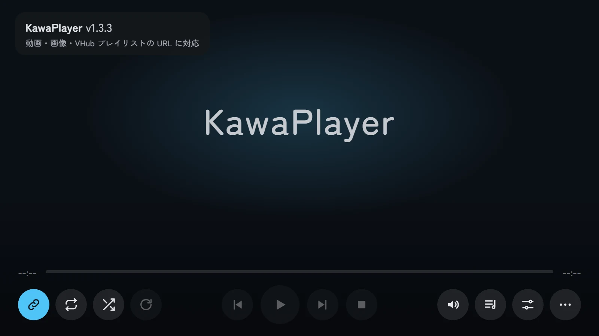
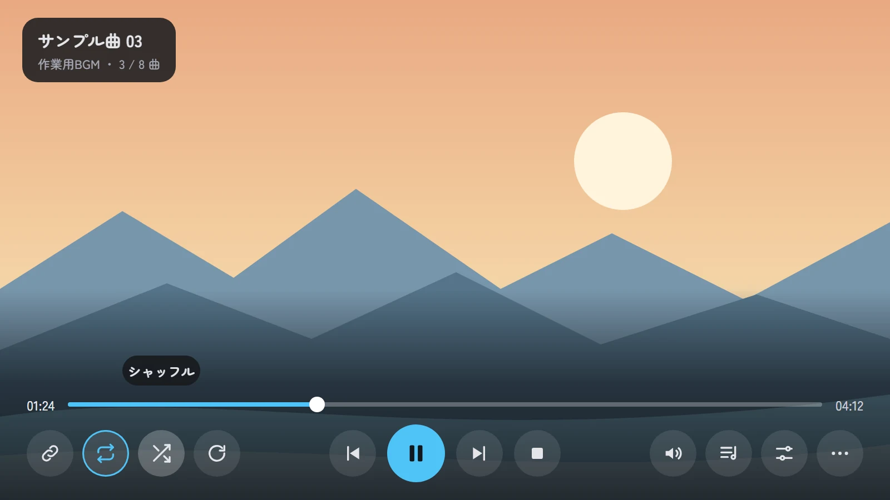
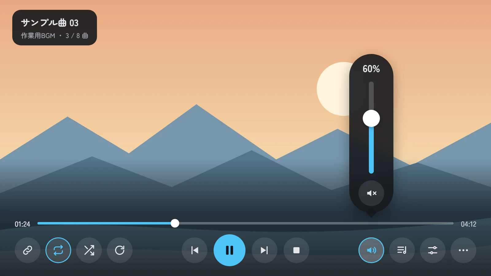
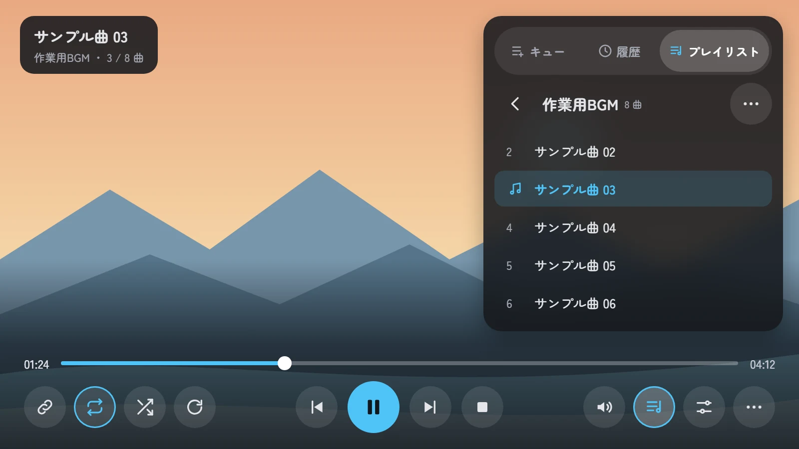
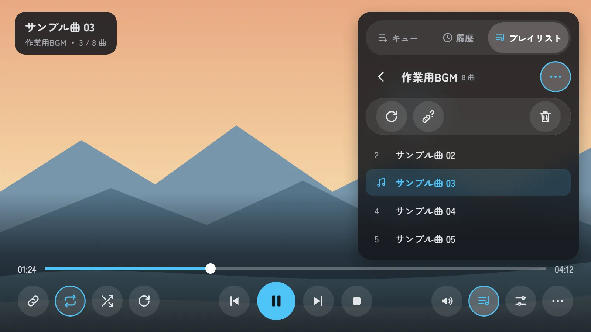
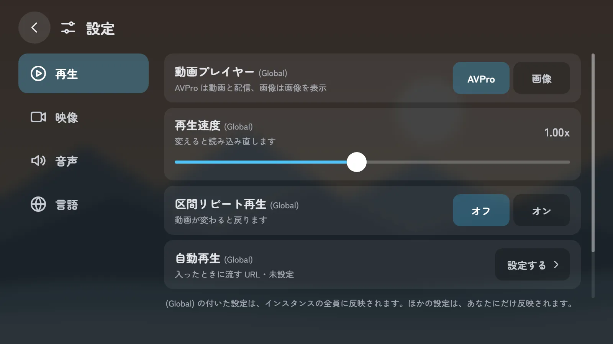
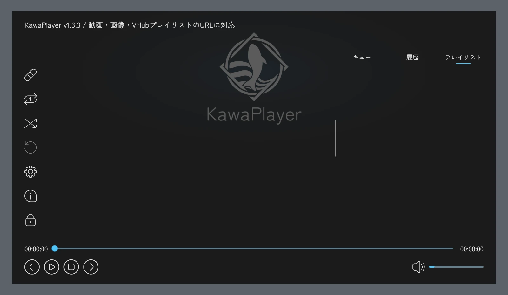

# スクリーンの UI の作り直し：決めたデザインと作り方の計画

| 項目 | 内容 |
| --- | --- |
| 文書の種類 | 計画 |
| 関連する issue | #258（この文書の親）、#256（接続口の整理）、#145・#302（一覧に入る予定の検索とライブラリ） |
| もとにした記録 | #258 のコメント：[ほかのプレイヤーの UI の例](https://github.com/Mega-Gorilla/KawaPlayer/issues/258#issuecomment-6413151020)、[外に浮かべる操作の試し](https://github.com/Mega-Gorilla/KawaPlayer/issues/258#issuecomment-6413952483)、[採用したデザイン](https://github.com/Mega-Gorilla/KawaPlayer/issues/258#issuecomment-6414804638) |
| 調べた版 | develop `f6899b5`（1.3.3） |
| 日付 | 2026-10-26 |
| 状態 | デザインは決定。8 章の D1・D3・D4 は決定（2026-10-27）、D2・D5 は判断待ち |

## 要旨

KawaPlayer のスクリーンの UI（`Prefabs/UI/ScreenUI.prefab`）は、YamaPlayer の UI をほぼそのまま受け継いでいる。操作が左の縦の列・右の一覧・下の帯の 3 か所に散り、押す所は 40 から 50、文字はいちばん小さい所で 12 しかない（画面の単位、1600 × 900）。遠くからや VR では押しにくく、読みにくい。

5 つの案を比べ、操作をスクリーンの下の 1 か所にまとめて動画に重ねる案を採った。操作は、レーザーで画面を指して引き金を引いたときだけ出す。音量・一覧・その他はボタンの上に開く板にし、設定は全画面のページのまま、後ろの動画が透けるようにする。押す所は 84 以上、文字は 20 以上にする。84 は、Apple の visionOS の指針で押せる範囲の下限とされる 60 pt にあたる。

作り方は、今の `ScreenUI` の中で組み直す。今の部品は、新しいデザインの部品とほぼ 1 対 1 で対応する。UIController のボタンは、ビルドのときに欄が指す Button に処理が付くので、置き場所を変えても欄を付け替えずに動く。モジュールの差し込み口（uiSlots）のパスは変えない。作業は 5 つの PR に分け、帯 → 音量 → 一覧 → 設定 → 仕上げの順に進める。

**キーワード：** スクリーンの UI、ScreenUI、UIController、押せる範囲、文字の大きさ、visionOS、計画

## 目次

1. はじめに
2. 決めたデザイン
3. 大きさの基準
4. 今の部品との対応
5. 作り方
6. 進め方
7. 確かめ方
8. 決めること
9. 危うい点
10. 参考文献

---

## 1. はじめに

#258 は、スクリーンの UI を YamaPlayer の形から脱却させ、遠くからや VR でも読みやすく、押しやすくするための issue である。進め方は、今の画面を撮って並べる → 読みにくい所を挙げる → ほかのプレイヤーと比べる → モックアップの案を作って決める → 子の issue に分けて作る、とした。

2026-10-26 に、ほかのプレイヤーの UI を集め（#258 のコメント）、Apple の Human Interface Guidelines を参考に、モックアップを 5 案作った。

- **A：** 操作をスクリーンの外に浮かべる。
- **B：** 下にまとめて重ねる。
- **C：** 動画を縮めて空いた所に出す。
- **D：** タブで切り替える 1 枚のパネル。
- **E：** 止まっているときは大きなタイル。

A は、Unity で作れることまで確かめたが、使う人から見てどこに何が出るかが分かりにくいため取りやめた。E は不要とし、止まっているときも B の形にする。この文書は、決めた B 案と、それを作る計画をまとめる。

## 2. 決めたデザイン

### 2.1 形

**表 1** 決めたデザイン

| 部分 | 決めたこと |
| --- | --- |
| 操作の出し方 | レーザーで画面を指して引き金を引いたときだけ出す。指しているだけでは何も出さない。もう一度押すと消える（今と同じ） |
| 下の帯 | 1 段目は時間とシークバー。2 段目は、左に URL・ループ・シャッフル・ReSync、中央に前・再生（一時停止）・次・停止、右に音量・一覧・設定・その他。帯の後ろは、下に向かって暗くする |
| 左上の札 | 再生中は曲名・プレイリスト名・何曲目か。止まっているときは「KawaPlayer」と版、使える URL の種類 |
| 止まっているとき | 再生中と同じ帯を出す。再生の 4 つと ReSync は押せない色にし、URL のボタンだけをテーマの色で塗る |
| 音量 | 音量のボタンを押すと、その真上に縦長の板が出る。中身は割合・縦の音量バー・ミュートのアイコンだけ |
| 一覧 | 一覧のボタンで、右上に板が開く（幅 600）。キュー・履歴・プレイリストのタブは、アイコンと文字。1 曲を 1 行（曲名だけ）で見せる |
| プレイリストの操作 | プレイリスト名の右の「…」を押すと、名前の下に、横幅いっぱいの下地の上に更新と削除が出る。2 つは下地の両端に分ける。削除は、今と同じく確認のダイアログを出してから消す |
| 設定 | 全画面のページ。後ろの動画は、暗い半透明の層越しにうっすら見える。左に分類（再生・映像と音声・その他）、右に 1 行 1 項目 |
| その他 | Info と UI ロック |
| 色 | 配色アセット（`KawaPlayerPalette`）の役割で付ける。強調の色はテーマの色（KawaPlayer では川の青） |

### 2.2 状態ごとの絵

絵はモックアップで、画面の単位（1600 × 900）で描いた。描いたページは `images/mockups~/` にある（Google Fonts の Zen Maru Gothic を読み込む HTML。Edge の画面なしモードで 1600 × 900 に書き出した）。

**図 1** 止まっているとき。

**図 2** 再生中。シャッフルのボタンを指して、名前が出ているところ。

**図 3** 音量のボタンを押したとき。

**図 4** 一覧を開いたとき。

**図 5** プレイリスト名の右の「…」を押したとき。

**図 6** 設定を開いたとき。

**図 7** 操作を隠しているとき。レーザーで指していても何も出ない。

比べるために、今の画面（操作を出したところ）を図 8 に載せる。

**図 8** 今の画面（develop `f6899b5`、ClientSim）。

## 3. 大きさの基準

### 3.1 基準にした数字

VR の中のスクリーンは、空間に浮かぶ窓を離れた所から指して操作する点で、Apple の visionOS の窓に近い。visionOS の指針は、次の数字を挙げている [1][2][3][4]。

- **押せる範囲：** 60 × 60 pt 以上。中心どうしは 60 pt 以上離す。
- **文字：** 標準 17 pt、最小 12 pt。細い字（Light・Thin）は避ける。
- **窓：** 標準は 1280 × 720 pt で、2 m 先に、幅約 3 m に見えるように置く。

KawaPlayer のスクリーンは、プレハブのままで幅 2.67 m あり、2 m から見ると visionOS の標準の窓とほぼ同じ見え方になる。このとき、画面の単位の 1 は約 0.71 pt にあたる。60 pt は約 84、12 pt は約 17、17 pt は約 24 になる。

VRChat のレーザーとデスクトップの照準は、目の動きと同じく狙いが揺れる。この数字は目安として使う。

### 3.2 今と新しいデザイン

**表 2** 押せる所と文字の大きさ（画面の単位。括弧は pt に直した値）

| 部分 | 今 | 新しいデザイン |
| --- | --- | --- |
| 左の縦の列のボタン | 40（約 28 pt） | 帯のボタン 84（約 60 pt） |
| 再生の操作 | 50（約 36 pt） | 84、再生のボタンは 104 |
| 一覧のタブ | 文字 20 | 高さ 84、文字 24 |
| 一覧の曲名 | 20 | 26 |
| 一覧の曲の URL | 12（約 8.5 pt） | 出さない（1 曲 1 行） |
| 時間 | 22 | 24 |
| 設定の項目名 | 30 | 30 |
| 設定の説明 | 16（約 11 pt） | 22 |
| 設定の選択肢 | 18 | 26（高さ 84） |

## 4. 今の部品との対応

今の `ScreenUI` の `Canvas/User/Main` は、新しいデザインの部品とほぼ 1 対 1 で対応する。新しく作る物は、音量の板・その他の板・プレイリストの「…」の 3 つだけである。

**表 3** 新しい部品と、今の部品（パスは `Canvas/User/Main` から）

| 新しい部品 | 今の部品 | 変えること |
| --- | --- | --- |
| 左上の札 | `Top/VideoInfo`（`Title`・`Url`） | 札の形にする。`Top/UrlInput`（上の URL の入力欄）は消す（8 章の D4） |
| URL のボタン | `LeftSide/Container/UrlInput`（`VRCUrlInputField`） | 帯の左へ移し、84 にする。止まっているときはテーマの色 |
| ループ・シャッフル・ReSync | `LeftSide/Container/Loop`・`LoopOff`・`Shuffle`・`ShuffleOff`・`ReSync` | 帯の左へ移し、84 にする。名前の吹き出し（`Tooltip`）は上に出す |
| 前・再生・一時停止・次・停止 | `Bottom/Actions/Container/*` | 84 にする（再生と一時停止は 104） |
| 時間とシークバー | `Bottom/ProgressBar` | 帯の 1 段目にする。文字は 24 |
| 音量のボタンと板 | `Bottom/Volume`（`Mute`・`MuteOff`・`Slider`） | 帯にはボタンだけを置き、スライダーとミュートは縦長の板へ移す。割合の文字を足す |
| 一覧の板 | `RightSide/Playlists`（`Open`・`Main`） | `Open` の取っ手をやめ、帯の一覧のボタンで開け閉めする（Animator の `TogglePlaylist` はそのまま使う）。右上に幅 600 で置く |
| 一覧のタブ | `RightSide/Playlists/Main/Top/Tabs/Toggle`〜`Toggle (2)` | アイコンを足し、高さ 84 にする |
| プレイリストの更新・削除 | `RightSide/Playlists/Main/Top/Info/Actions` | 「…」の下に出す下地へ移す |
| 設定のボタン | `LeftSide/Container/Settings` | 帯の右へ移す |
| 設定のページ | `Pages/Settings`（入れ子の `SettingPanel`） | 全画面のまま、背景を半透明にし、行と選択肢を大きくする |
| Info・UI ロック | `LeftSide/Container/Info`・`Lock` | その他の板へ移す |
| 帯の後ろの暗がり | `Bottom` の `Image` | 下に向かって濃くなる絵にする |

## 5. 作り方

### 5.1 同じ ScreenUI の中で組み直す

新しいキャンバスやプレハブは作らず、今の `ScreenUI` の部品を、同じ `Canvas` の中で並べ直す。理由は次の 3 つ。

- **押せる範囲：** VRChat で UI を押せるのは、`VRCUiShape` の付いたキャンバスのコライダーの中だけである（#258 の外に浮かべる試しで確認）。新しいデザインはすべてスクリーンの中に収まるので、今のキャンバス 1 枚で足りる。
- **ボタンの処理：** UIController のボタンの処理は、ビルドと Play のときに、UIController の欄が指す Button に付く（`RegisterEventAttributeBuildProcess`）。部品を動かしても、欄が同じ部品を指していれば、そのまま動く。
- **既存のシーン：** 部品を消さずに動かせば、プレハブの中の識別子（fileID）が変わらないので、制作者がシーンで上書きした値が残る。

### 5.2 変えないもの

- **モジュールの差し込み口：** 表 4 のパスは変えない。モジュールの定義を直さずに済み、更新したプロジェクトでもモジュールの行がそのまま入る。

**表 4** 変えないパス（`Canvas` から）

| パス | 使うモジュール |
| --- | --- |
| `Canvas/User` | 権限管理、スライドショー |
| `Canvas/User/Main/Pages/Settings/PageToggles` | 権限管理（権限のタブ） |
| `Canvas/User/Main/Pages/Settings/PageView` | 権限管理（権限のページ） |
| `Canvas/User/Main/Pages/Settings/PageView/PlaybackView/Viewport/Content` | スライドショー |
| `Canvas/User/Main/Pages/Settings/PageView/VideoView/Viewport/Content` | AudioLink アダプター、ピッチシフター |

- **UdonBehaviour：** 出荷済みのプレハブで、U# の部品がすでにある物に、U# の部品を足したり外したりしない（CLAUDE.md の Key Constraints）。新しい板や「…」の開け閉めは、Animator の層を足すか、`Toggle` で物を出し入れして作る。
- **接続口（#256）：** この計画は見た目と並べ方を変えるだけで、UI から `Controller` へ操作を渡す道は変えない。#256 の窓口と、断られたときの見せ方（D2）は、新しい形の上で #256 を再開するときに決める。

### 5.3 U# を変える所

U# の変更は、次の 3 つにとどめる。どれも最低の SDK（3.10.2）で使える API だけで書く。

- **止まっているときの見た目：** URL のボタンの色を、止まっているときだけテーマの色にする。左上の札に、版と URL の種類を出す（今の `Title` と同じ文）。
- **音量の割合：** 音量の板の割合の文字を更新する。
- **板を 1 つずつ開く：** 音量・その他・一覧の板を、1 つ開いたらほかを閉じる。

### 5.4 同じ ScreenUI を使う物

`ScreenUI` は、KawaPlayer 本体のほかに、タブレットの KawaPlayer アプリ（`Tablet.prefab` の `Body/KawaPlayer/ScreenUI`）と Sub Screen（`SubScreen.prefab` の `Screen/ScreenUI`）にも入れ子で入っている。どれもいっしょに変わる。

- どちらも 1600 × 900 の中なので、新しいデザインは収まる。
- それぞれのプレハブが `ScreenUI` の部品に上書きを持っていれば、動かした部品で効かなくなることがある。PR ごとに上書きを読み、必要なら付け直す。

## 6. 進め方

PR を 5 つに分ける。各 PR は、使い捨てのシーンの ClientSim で確かめ、画像を PR に載せる。#258 の子の issue は、この文書がマージされてから作る。

**表 5** 進め方

| 順 | PR | 中身 |
| --- | --- | --- |
| P1 | 下の帯 | `Bottom` を 2 段の帯に組み直す。`LeftSide` のボタンを帯へ移す。左上の札、帯の後ろの暗がり、その他の板（Info・UI ロック）、押す所の大きさ |
| P2 | 音量の板 | 音量のボタンと縦長の板、割合の文字 |
| P3 | 一覧の板 | 帯のボタンで開け閉め、右上に幅 600、タブのアイコン、「…」の下地に更新と削除 |
| P4 | 設定のページ | 半透明の背景、行と選択肢の大きさ（`SettingPanel` と行のプレハブ）、モジュールの行の見え方 |
| P5 | 仕上げ | 止まっているときの見た目、文字の大きさの残り、9 言語での収まり、使い方ガイドの画像の撮り直し |

P1 が終わるまでは、帯と今の左の列・右の一覧が混ざった中途半端な形になるので、P1 から P5 は同じ版に入れる。

## 7. 確かめ方

**表 6** 各 PR で確かめること

| 確かめること | 方法 |
| --- | --- |
| 押せるか、処理が届くか | 使い捨てのシーンの ClientSim で、照準を合わせて ClientSim の「押す」入力を送る（#258 の試しと同じ方法） |
| 見た目 | 2 章の絵と並べて撮る。タブレットの KawaPlayer アプリと Sub Screen でも撮る |
| 9 言語の収まり | 言語を順に切り替えて、文字が切れないか見る |
| モジュールの行 | AudioLink アダプター・ピッチシフター・スライドショー・権限管理を足して、設定のページに行が入るか見る |
| 既存のプロジェクトの更新 | 公開版（1.3.3）を入れたプロジェクトを新しい版に上げ、シーンの上書きとモジュールが残るか見る |
| ワールドのビルド | P1 と P5 で、VRChat の Build & Test（複数のクライアント）で開いて押す |
| 最低の SDK | U# を変える PR で、SDK 3.10.2 だけのプロジェクトでコンパイルする |

## 8. 決めること

**表 7** 決めること（D1・D3・D4 は 2026-10-27 に決定）

| 番号 | 決めること | 決めたこと・案 |
| --- | --- | --- |
| D1 | 操作が出ているときに、指したボタンの名前を出すか | **決定：出す**（図 2。今も左の列で出している） |
| D2 | AudioLink の切り替えの場所 | 案：設定の「映像と音声」（今と同じ。モジュールの差し込み口も今のまま） |
| D3 | 再生中の左上の札 | **決定：操作と一緒にいつも出す** |
| D4 | 上の URL の入力欄（`Top/UrlInput`） | **決定：消して、帯の URL のボタンに 1 本化する**。UIController の `_urlInputFieldTop` と `PlayUrlTop` も消す |
| D5 | 一覧に、検索（#145）とライブラリ（#302）の入口を置く場所 | 案：プレイリストのタブの一覧の先頭に入口の行を置く。それぞれの計画が決まってから合わせる |

## 9. 危うい点

- **上書きの消失：** 動かすつもりで消してしまうと、制作者のシーンの上書きが効かなくなる。部品は消さずに動かす（5.1）。
- **Animator の層：** スクリーンの UI の開け閉めは、`Canvas/User` の Animator の層が持っている（`ToggleUI`・`TogglePlaylist`・`ShowPage` など）。層を足すときは、今の層の遷移を壊さないよう、P1 で今の層を一覧にしてから足す。
- **タブレットの縦向き：** タブレットの KawaPlayer アプリは横向きのままなので、縦向きの組み替え（`TabletScreen._layoutParts`）の対象にはならない。そのまま変える。
- **文字の切れ：** 押す所と文字を大きくすると、長い言語（ウクライナ語・ロシア語など）で文字が収まらないことがある。P5 で 9 言語を確かめる。

## 10. 参考文献

[1] Apple, Human Interface Guidelines, "Buttons" (visionOS). https://developer.apple.com/design/human-interface-guidelines/buttons

[2] Apple, Human Interface Guidelines, "Eyes". https://developer.apple.com/design/human-interface-guidelines/eyes

[3] Apple, Human Interface Guidelines, "Typography". https://developer.apple.com/design/human-interface-guidelines/typography

[4] Apple, Human Interface Guidelines, "Windows" (visionOS). https://developer.apple.com/design/human-interface-guidelines/windows

[5] Apple, Human Interface Guidelines, "Ornaments". https://developer.apple.com/design/human-interface-guidelines/ornaments

[6] Apple, Human Interface Guidelines, "Materials". https://developer.apple.com/design/human-interface-guidelines/materials
