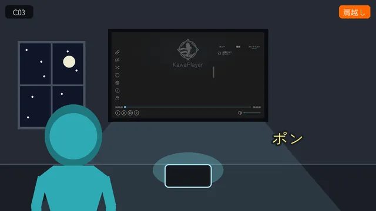

# KawaPlayer の紹介動画：絵コンテ

| 項目 | 内容 |
| --- | --- |
| 文書の種類 | 台本（絵コンテ） |
| 関連する issue | #262 |
| 日付 | 2026-10-17 |
| 状態 | レビュー中。決めることが 4 つ残る（[5 章](#5-決めること)） |

## 要旨

KawaPlayer を紹介する、約 80 秒の動画の絵コンテである。VRChat で遊ぶ人に向けて、KawaPlayer のあるワールドで何ができるか、何が楽しいかを伝える。特定の版の紹介ではない。夜の部屋を歩く MAO にカメラが寄って追い、MAO がタブレットに触れるとスクリーンが点くところから始まる。続いて、KawaPlayer らしい機能を 3 つの章で見せる：VHub のプレイリスト、タブレット、自動再生。最後に、2 人で観る部屋の引きとキャッチコピー、KawaPlayer の終わりの画面で締め、暗転のあとにクレジットを出す。ナレーションは入れず、字幕と BGM で進める。カットは 24 で、尺は 79.5 秒である。

**キーワード：** 紹介動画、絵コンテ、HyperFrames、Unity Recorder

## 目次

1. はじめに
2. 前提
3. 構成
4. 絵コンテ
5. 決めること
6. 次にやること

---

## 1. はじめに

### 1.1 目的

KawaPlayer で何ができるのか、何が楽しいのかを、文章を読まなくても分かるようにする。X や YouTube で目に留まり、KawaPlayer のあるワールドで使ってみたくなる動画を目指す。

### 1.2 見せたい人と出す場所

- **見せたい人：** VRChat で遊ぶ人。機能と、使ったときの楽しさを伝える。
- **入れないもの：** ワールド制作者向けの話（導入の手順など）と、ライブイベント向けの機能（全員リロードボタン）は入れない。ほかの動画プレイヤーにもある機能（みんなで同じ映像を観る同期など）も、章にしない（2026-10-17 のレビュー）。無料で VCC から入れられることは、終わりの画面に一行だけ出す。
- **出す場所：** X、YouTube。Booth の商品ページにも載せる。
- **GitHub：** 動画のファイルは上げず、README からリンクする（[2.2](#22-登場人物)）。

### 1.3 形

| 項目 | 内容 |
| --- | --- |
| 長さ | 約 80 秒（この絵コンテでは 79.5 秒） |
| 画面 | 16:9、1920 × 1080、30 fps |
| 声 | ナレーションなし。字幕・BGM・効果音で進める |
| 言葉 | 日本語。章札と流れる字幕に、英語の一行を添える（[5 章](#5-決めること)） |

### 1.4 参考にした構成

いくつかの紹介動画を見て、次の流れにした。

1. 映画のような始まり。キャラクターの寄りをカメラが追い、キャラクターが何かに触れたところで演出が始まる。最初の数秒で、どんな動画かと興味を持たせ、途中で離れる人を減らす。
2. 題名。
3. 機能ごとの短い場面。左下の見出しに、番号と機能の名前を出す。
4. 締めの言葉と案内。

機能は、人物どうしのやり取りで見せる。手元の操作は持つ人の目線で、会話は外から撮る。吹き出しで、ちょっとした冗談を混ぜる。

## 2. 前提

### 2.1 撮り方

カットごとに、次のどれで作るかを〔 〕に書いた。

| 印 | 作り方 |
| --- | --- |
| 〔Unity〕 | テスト用のプロジェクトにアバターを置いて動かし、Unity Recorder で撮る。KawaPlayer は Play で実際に動かす |
| 〔HyperFrames〕 | 題名、字幕、場面の切り替え、終わりの画面を、HTML で組んで書き出す |

**タブレットの画面に重ねる：** C06 の魚は HyperFrames で書き出し、Unity でタブレットの画面に重ねて撮る（動画だけの演出）。

**ワールドの移動（C19〜C21）：** 動画だけの演出（2026-10-17 のレビュー）。2 人が青い粒子になって散り、朝になった部屋で、粒子が集まって 2 人に戻る。VRChat のポータルや画面は出さない。

### 2.2 登場人物

| 人物 | 役 | 絵での描き方 |
| --- | --- | --- |
| MAO | 主役。KawaPlayer を置いたワールドで、プレイヤーを動かす人。インスタンスを作った人 | 青緑のシルエット |
| RIRIKA | 友だち。MAO と並んで観て、タブレットで写真を自慢する | ピンクのシルエット、ツインテール |
| ゲスト | ワールドに新しく入ってくる人（C14・C15） | 薄紫のシルエット |

- **アバター：** MAO と RIRIKA は購入したアバターで、利用規約で映像作品への利用が認められている。ゲストは無料のアバターで、こちらも利用規約で映像作品への利用が認められている。クレジットは、作者の指定どおりに、暗転のあとのクレジットの画面（C24）へ入れる。
- **リポジトリに置かないもの：** 利用規約が再配布を認めていないため、アバターのデータは置かない。アバターが映った絵や、撮った映像の静止画も置かない。動画のファイルも GitHub には上げない。

### 2.3 舞台

- **場所：** テスト用のワールド（KawaPlayer Testing Chamber）の部屋 1 つで通す。夜の部屋にする。C20・C21 だけは、移った先の朝の部屋にする。C16〜C18 では、床にじゅうたんを敷く（ワールドにも残す）。
- **光と色：** 夜の窓の光とスクリーンの光で照らす。全体の色は青紫に寄せる（動画だけの演出）。
- **整え方：** 観葉植物を置き、壁や床のマテリアルとテクスチャを替えて、撮影に向く部屋にする。
- **足したもの：** 動画だけの演出を除いて、実際のワールドにも入れて公開する（2026-10-17 のレビュー）。動画だけの演出（撮影用のライト、小道具など）は分けて置き、公開の前に外す。
- **素材の規約：** 部屋は購入した素材なので、映像に出してよいかを撮影の前に規約で確かめる。足す植物やテクスチャも、ワールドで配ってよく、映像に出してよいものを選ぶ。

### 2.4 画面に映すもの

- **動画・画像：** スクリーンに映す動画と画像は、この動画のために作ったサンプルにする。実在の曲や番組は映さない。
- **VHub のプレイリスト：** 撮影のために作ったサンプルを使い、撮影のあとで消す（使い方ガイドの写真と同じやり方）。
- **ロゴの魚：** ロゴから魚だけを切り出した絵をつくり、HyperFrames で泳がせる。元の絵は `Media~/logo/` にある。
- **名前：** 訪問者アプリの名前なども、サンプルにする。
- **音：** スクリーンの映像の音は使わず、BGM と効果音だけにする。

### 2.5 文字と色

- **文字：** Zen Maru Gothic（パッケージに入っている文字）。
- **字幕：** 5 種類に分けて、形と動きをそろえる（[2.7](#27-字幕)）。
- **色：** ロゴの 3 色（#6bebaa・#3fc4c6・#22a6cb）を使う。

### 2.6 絵について

- **仮の絵：** [4 章](#4-絵コンテ)の絵は仮のもので、[`images/frames.py`](images/frames.py) が描く。
- **人物：** シルエットで描く。
- **KawaPlayer の画面：** 使い方ガイドの写真から切り出す。
- **オレンジの注記：** 枠・矢印と右上の札は、カメラの動きと演出のメモで、動画には出ない。
- **字幕：** 動画に出る位置に、2.7 の形で描いた。
- **差し替えない：** issue では、HTML の構成ができたら絵をその瞬間の書き出しに差し替える予定だった。書き出しにはアバターが映るので、リポジトリの絵は仮の絵のままにする。書き出しとの見比べは、手元で行う。

### 2.7 字幕

字幕は、動画を見る人が「何ができて、何がうれしいか」をすぐ分かるように出す。形は KawaPlayer から取る。名前の「川」、ロゴの魚と波、ロゴの 3 色は水を思わせる。また、KawaPlayer は動画プレイヤーなので、再生バーも形の元にする。どの字幕もアニメーションで出し入れする（HyperFrames で組む）。

**図 1** 字幕の 5 種類（番号は表 1 の番号）

**表 1** 字幕の種類

| 種類 | 位置 | 見た目 | 出方 | 消え方 |
| --- | --- | --- | --- | --- |
| ① 再生バーの章札 | 下。動画の進みに合わせた位置 | 画面の下に、KawaPlayer の再生バーのような細い線を引く。線は動画の進みだけ、ロゴの 3 色で埋まる。章の位置にひし形の印。章の始まりに、つまみの上へ札が立つ。札には、ロゴのひし形に入れた章の番号、機能の名前、できること、英語の一行 | つまみが章の印に着くと、印が光って波紋が広がる。札が印から上へ、水面から浮かぶように立ち上がる（0.4 秒）。文字は行ごとに、下から浮かぶ（0.08 秒ずつ） | 札が印へ沈み、再生バーも薄れる（0.3 秒） |
| ② 水滴の名前 | その人のそば | その人の色の水滴に頭文字。横に名前と小さな読み。名前の下にその人の色の波線 | 上から水滴が落ちて、水面で跳ねる。波紋が広がり、波線が左から描かれる（0.5 秒） | 水滴が波紋に溶け、名前が薄れる（0.3 秒） |
| ③ 波紋の注記 | 指で触れたところ | 触れたところに波紋。そこから細い線を引き、ひし形の点の先に短い言葉 | 触れた瞬間に波紋が 2〜3 重に広がる。線が伸び、言葉が現れる（0.3 秒） | 線が縮み、言葉が薄れる（0.2 秒） |
| ④ 泡の吹き出し | 話す人の頭の上 | その人の色をうっすら混ぜた泡に、その人の色の縁と光。頭から小さな泡が 3 つ続く。縁にその人の名前の札 | 頭から小さな泡が浮かび、最後に大きな泡がふくらむ（0.3 秒）。話すあいだ、上下にゆっくり揺れる | 泡がはじけて、しぶきになる（0.2 秒） |
| ⑤ 流れる字幕 | 下の中央 | 白い太字に暗い縁取り。下にロゴの 3 色の波線、線の先に小さな魚。英語は下に小さく | 文字が左から流れ込み、波に乗るように少し上下しながら止まる（1 字 0.03 秒ずつ）。そのあと波線が描かれ、魚が泳ぎ着く | 文字が右へ流れて薄れ、魚が泳ぎ去る（0.3 秒） |

**参考の動画との違い：** 参考の動画では、名前と動作は画面の隅の札に出ていた。この動画では、名前はその人のそばに、動作は触れたところに出す。見る人の目が、人物と操作から離れないようにするためである。章の見出しも、隅の帯ではなく、動画の進みを表す再生バーから立てる。

**言葉の決まり：**

- **遊ぶ人の言葉で書く：** できることと、うれしいことを書く。しくみは書かない。
- **使わない言葉：** 同期、モジュール、読み込み、プレイヤーの種類、権限など、作る人の言葉は使わない。インスタンス、URL のように VRChat で遊ぶ人が知っている言葉は使ってよい。
- **短く：** 1 つの字幕は 1〜2 行、日本語で 20 字くらいまで。
- **読める長さだけ出す：** 1 秒に 6〜8 字を目安に、それに 0.5 秒を足す。
- **擬音：** 「ポン」「ピッ」などの擬音は、字幕ではなく絵の一部として、はずむように出す。

## 3. 構成

**表 2** パートごとの尺

| パート | カット | 始まり | 長さ |
| --- | --- | --- | --- |
| オープニング | C01〜C03 | 0:00 | 8.0 秒 |
| 題名 | C04 | 0:08 | 4.0 秒 |
| 01 VHub のプレイリスト | C05〜C09 | 0:12 | 16.5 秒 |
| 02 タブレット | C10〜C15 | 0:28.5 | 21.5 秒 |
| 03 自動再生 | C16〜C21 | 0:50 | 18.5 秒 |
| 締め | C22〜C24 | 1:08.5 | 11.0 秒 |
| **合計** | **24 カット** | | **79.5 秒** |

章は、遊ぶ人にとって KawaPlayer ならではの楽しさが大きい順に並べた。

1. **VHub のプレイリスト：** KawaPlayer をつくった理由なので、最初に置いた。
2. **タブレット：** KawaPlayer だけのもの。RIRIKA の小さな話で見せる：縦の写真を横持ちのまま自慢し、MAO に言われて、はずかしそうに縦に回す。縦にも横にも持てることと、画像をスクリーンに送れることが伝わる。続いて、新しく入ってきた人を 2 人が歓迎し、その人がタブレットの訪問者アプリに加わる。
3. **自動再生：** 決められるのはインスタンスを作った人だけで、使う場面が限られるので、最後に置いた。2 人が寝そべってタブレットで決め、青い粒子になって新しいインスタンスへ移ると、着いた朝の部屋ではもう流れている。

自動再生の URL は、決めた人のアカウントに、ワールドごとに残る。流れるのは、同じワールドで、その人が自分で作ったインスタンス（Friends+ など、オーナーのいる種類）に入ったときである。別のワールドや、オーナーのいない Public・Group Public のインスタンスでは流れない。そのため、C19〜C21 で移る先は、MAO が作った同じワールドの新しいインスタンスとして描く。

## 4. 絵コンテ

### オープニング

| カット | 画面 | 内容・動き | 字幕 | 音 | 尺 |
| --- | --- | --- | --- | --- | --- |
| **C01** 0:00 |  | MAO の寄り。窓のそばを歩く MAO を、カメラが横に並んで同じ速さで追う。頭は画面の上で切れる構図にし、揺れる髪と肩で見せる。手前を観葉植物の葉がぼけて流れる。夜の青紫の光。〔Unity：歩きとカメラの動きは Timeline〕 | 水滴の名前：MAO | 部屋の静かな音と足音。BGM の前奏を小さく | 3.5 秒 |
| **C02** 0:03.5 |  | 窓際のカウンターに置いたタブレットへ、MAO が手を伸ばして画面に触れる。触れたところから光の輪が広がる。〔Unity〕 | なし | 触れる音（タッ） | 2.0 秒 |
| **C03** 0:05.5 |  | カメラが手元から上へ振れ、MAO の肩越しに壁のスクリーンを映す。スクリーンが点いて待ち受けのロゴが浮かび、部屋がスクリーンの光で明るくなる。〔Unity〕 | なし | 起動の音（ポン）。BGM が本編へ | 2.5 秒 |

### 題名

| カット | 画面 | 内容・動き | 字幕 | 音 | 尺 |
| --- | --- | --- | --- | --- | --- |
| **C04** 0:08 |  | ロゴと名前。背景はロゴの 3 色のグラデーション。〔HyperFrames〕 | KawaPlayer VRChat の動画プレイヤー | BGM の区切りの一打 | 4.0 秒 |

### 01 VHub のプレイリスト

| カット | 画面 | 内容・動き | 字幕 | 音 | 尺 |
| --- | --- | --- | --- | --- | --- |
| **C05** 0:12 |  | ロゴの色の 2D の空間。KawaPlayer のロゴから魚が泳ぎ出て、浮かんだ VHub のプレイリストのページへ向かい、「VRChat用URLをコピー」に触れる。コピーした URL が小さな札になって、魚に付く。〔HyperFrames〕 | 章札：01 VHub のプレイリスト／VHub で作ったプレイリストを、URL ひとつで 泡（魚）：コピー！ | 泳ぐ音、コピーの音 | 4.0 秒 |
| **C06** 0:16 |  | 魚が URL の札を運んで、タブレットの画面に飛び込む。カメラはタブレットの画面いっぱいから引き、MAO の肩越しに、タブレットを持つ手まで見せる。〔魚は HyperFrames、Unity でタブレットの画面に重ねて撮る〕 | なし | 飛び込む音（チャポン） | 3.0 秒 |
| **C07** 0:19 |  | MAO が指でタブレットの URL 欄に触れると、魚の運んだ URL が入り、触れたところから波紋が広がる。〔Unity〕 | 波紋の注記：URL の欄をタップ | タップの音 | 2.5 秒 |
| **C08** 0:21.5 |  | 波紋がタブレットを越えて画面いっぱいに広がり、壁のスクリーンへ切り替わる。「プレイリストを追加しました」が出て、曲の一覧が並ぶ。カメラは一覧に沿って下へ。〔切り替えは HyperFrames、一覧は Unity〕 | 曲の一覧が、そのまま並ぶ | 波紋の音 | 3.5 秒 |
| **C09** 0:25 |  | 曲の一覧から再生が始まり、カメラが引くと、それが壁の KawaPlayer だと分かる。スクリーンの前で、MAO と RIRIKA が仲良く並んで観ている。〔Unity〕 | 水滴の名前：RIRIKA | BGM | 3.5 秒 |

### 02 タブレット

| カット | 画面 | 内容・動き | 字幕 | 音 | 尺 |
| --- | --- | --- | --- | --- | --- |
| **C10** 0:28.5 |  | カメラが RIRIKA に寄る（別の場面でもよい）。RIRIKA がタブレットの画像アプリで縦長（9:16）の写真を開き、横持ちのまま MAO に向けて、得意げに見せる。写真は横の画面の真ん中に小さく出ている。〔Unity〕 | 章札：02 タブレット／手元で見せて、みんなのスクリーンにも 泡（RIRIKA）：見て見て！ | キラキラの音 | 4.0 秒 |
| **C11** 0:32.5 |  | MAO が指でくるっと回す仕草をして、縦の写真だと指摘する。〔Unity〕 | 泡（MAO）：縦、縦！ | | 2.5 秒 |
| **C12** 0:35 |  | RIRIKA が MAO に向けていたタブレットを手前に引き寄せ、画面をのぞき込む。はずかしそうに縦に回すと、画面も縦の並びに変わり、写真が大きく出る。RIRIKA の肩越しに撮る。〔Unity〕 | 縦に持てば、画面も縦に | 回す音（シュッ） | 4.0 秒 |
| **C13** 0:39 |  | RIRIKA が KawaPlayer に送るボタンを押すと、壁のスクリーンに同じ写真が大きく出て、MAO が驚く。タブレットは左上の小窓で見せる。〔Unity〕 | 波紋の注記：スクリーンに送る 手元の写真を、みんなのスクリーンへ 泡（MAO）：おおー！ | | 4.5 秒 |
| **C14** 0:43.5 |  | 別の場面。ワールドに新しい人（ゲスト）が入ってくる。MAO が手を振り、RIRIKA が両手を上に伸ばして、ぴょんと跳ねて歓迎する。〔Unity〕 | 水滴の名前：ゲスト 泡（RIRIKA）：いらっしゃーい！ | 入室の音 | 3.5 秒 |
| **C15** 0:47 |  | 画面転換で RIRIKA のタブレットへ。訪問者アプリの今いる人に、入ってきたゲストが加わる（名前と時刻はサンプル）。〔Unity、転換は HyperFrames〕 | 誰が来たかも、ひと目で | 通知の音（ピコン） | 3.0 秒 |

### 03 自動再生

| カット | 画面 | 内容・動き | 字幕 | 音 | 尺 |
| --- | --- | --- | --- | --- | --- |
| **C16** 0:50 |  | 訪問者アプリから少し引くと、タブレットは床のじゅうたんの上にある。MAO は寝そべって肘をつき、背中越しに映る。向かい側では RIRIKA も寝そべって肘をつき、頭をかわいく左右に揺らしながら画面をのぞいている。〔Unity：寝そべりのポーズが要る〕 | 章札：03 自動再生／入ったときに流す動画を、決めておける | | 3.5 秒 |
| **C17** 0:53.5 |  | 真上から。MAO がホームボタンを押し、設定アプリの **再生** を選ぶ。〔Unity〕 | 波紋の注記：ホーム → 設定 → 再生 | タップの音 | 3.0 秒 |
| **C18** 0:56.5 |  | カメラがタブレットに寄る。自動再生(Global) の **URLを入力** から VHub のプレイリストの URL を入れると、設定値に出る。〔Unity〕 | 波紋の注記：流したい動画の URL を入れる 入ったときに流す動画を、決めておく （下に小さく）決められるのは、インスタンスを作った人 | 決める音 | 3.5 秒 |
| **C19** 1:00 |  | 画面転換。MAO と RIRIKA が、頭のほうから青い粒子になって散っていく。ワールドを移ることを表す、動画だけの演出。〔Unity：粒子は Unity のパーティクル〕 | MAO が作った、新しいインスタンスへ | 粒子の音（サラサラ） | 3.0 秒 |
| **C20** 1:03 |  | 朝になった部屋（MAO が作った新しいインスタンス）にカメラが移る。青い粒子が集まって、足もとから 2 人の姿に戻っていく。〔Unity〕 | 朝 | 粒子の音（キラキラ） | 2.5 秒 |
| **C21** 1:05.5 |  | 2 人がそろうと、スクリーンはもう決めたプレイリストを流している。RIRIKA が両手を上げて喜ぶ。〔Unity〕 | 入ったとたん、決めた動画が流れる 泡（RIRIKA）：もう流れてる！ | BGM | 3.0 秒 |

### 締め

| カット | 画面 | 内容・動き | 字幕 | 音 | 尺 |
| --- | --- | --- | --- | --- | --- |
| **C22** 1:08.5 |  | 夜の部屋の引き。ソファの 2 人の後ろ姿とスクリーン。カメラはゆっくり引く。〔Unity〕 | キャッチコピー（仮）：URL ひとつで、みんなの上映会。 | BGM の終わりへ | 4.0 秒 |
| **C23** 1:12.5 |  | 終わりの画面。ロゴ、「無料・VCC で導入」、Booth と入れ方のページの URL。〔HyperFrames〕 | KawaPlayer 無料・VCC で導入 Booth：booth.pm/ja/items/8155190 入れ方：playlist.vrc-hub.com/docs/developers | BGM の終わり | 4.0 秒 |
| **C24** 1:16.5 |  | 画面が暗転してから、クレジットを出す。終わりの画面と分けるため。〔HyperFrames〕 | アバター：MAO・RIRIKA・ゲスト（作者の指定の表記） BGM：（曲名・作者） | なし（BGM は C23 で終わる） | 3.0 秒 |

## 5. 決めること

1. **キャッチコピー（C22）：** 次の案から選ぶか、ほかの言葉にする。同期は章にしないので、同期を言う案は外した。
   - URL ひとつで、みんなの上映会。
   - みんなで観る時間を、もっと近くに。
   - 好きなプレイリストを、みんなのスクリーンへ。
2. **英語の一行：** 章札と流れる字幕に英語を添えるか。添えると、海外で遊ぶ人にも伝わる。そのぶん、画面の文字は増える。絵では添えた。
3. **BGM：** 権利のはっきりしたもの。商用で使えることと、YouTube の Content ID で止められないことを確かめる。
4. **縦長の短い版：** 横長の版ができてから決める。

## 6. 次にやること

1. **レビュー：** この絵コンテを PR でレビューし、[5 章](#5-決めること)を決める。
2. **部屋を整える：** テスト用のワールドの部屋に観葉植物を置き、マテリアルとテクスチャを替える（[2.3](#23-舞台)）。
3. **撮影リスト：** 〔Unity〕のカットから、撮影のリストをつくる。中身は、アバターの置き方と動き、カメラ、KawaPlayer の状態、必要なアセット。
   - **アセット：** Unity Recorder（一時的に入れて、撮り終えたら外す）と、寝そべるなどのポーズの素材。
4. **HyperFrames の構成：** リポジトリの外（`D:\Codes\videos\`）に作業のフォルダーをつくり、題名・字幕・場面の切り替え・終わりの画面を組む。
5. **確かめる：** 決めた瞬間を静止画に書き出し、この絵コンテと手元で見比べる。
