# KawaPlayer の紹介動画：絵コンテ

| 項目 | 内容 |
| --- | --- |
| 文書の種類 | 台本（絵コンテ） |
| 関連する issue | #262 |
| 日付 | 2026-10-17（v1 のレビューを入れたのは 2026-10-18。公開した v3.1 に合わせたのは 2026-10-20） |
| 状態 | 作った。v3.1 を X と YouTube で公開した（2026-10-20、[6 章](#6-公開)）。この文書は、公開した動画のとおりに書いてある。決めることは 8 つとも決まった（[5 章](#5-決めたこと)） |

## 要旨

KawaPlayer を紹介する、84.5 秒の動画の絵コンテである。VRChat で遊ぶ人に向けて、KawaPlayer のあるワールドで何ができるか、何が楽しいかを伝える。特定の版の紹介ではない。夜の部屋で窓際の机へ歩く MAO の足もとから、1 本の長回しで机のタブレットを取るところまで撮り、MAO が KawaPlayer のアプリを押すと題名になる。続いて、KawaPlayer らしい機能を 3 つの章で見せる：VHub のプレイリスト、タブレット、自動再生。最後に、ソファの 2 人が振り向いて手を振り、キャッチコピーと KawaPlayer の終わりの画面で締め、暗転のあとにクレジットを出す。ナレーションは入れず、字幕と BGM で進める。Unity で撮ったカットは 21 本で、題名・VHub・終わりの画面・クレジットは HTML で組んだ。

**キーワード：** 紹介動画、絵コンテ、HyperFrames、Unity Recorder

## 目次

1. はじめに
2. 前提
3. 構成
4. 絵コンテ
5. 決めたこと
6. 公開

---

## 1. はじめに

### 1.1 目的

KawaPlayer で何ができるのか、何が楽しいのかを、文章を読まなくても分かるようにする。X や YouTube で目に留まり、KawaPlayer のあるワールドで使ってみたくなる動画を目指す。

### 1.2 見せたい人と出す場所

- **見せたい人：** VRChat で遊ぶ人。機能と、使ったときの楽しさを伝える。
- **入れないもの：** ワールド制作者向けの話（導入の手順など）と、ライブイベント向けの機能（全員リロードボタン）は入れない。ほかの動画プレイヤーにもある機能（みんなで同じ映像を観る同期など）も、章にしない（2026-10-17 のレビュー）。無料で VCC から入れられることは、終わりの画面に一行だけ出す。
- **出す場所：** 計画では X、YouTube、Booth の商品ページ。公開したのは X と YouTube（[6 章](#6-公開)）。
- **GitHub：** 動画のファイルは上げず、README から YouTube と X の投稿へリンクする（[2.2](#22-登場人物)）。

### 1.3 形

| 項目 | 内容 |
| --- | --- |
| 長さ | 84.5 秒（BGM は 81.5 秒で終わり、クレジットは無音） |
| 画面 | 16:9、1920 × 1080、30 fps |
| 声 | ナレーションなし。字幕・BGM・効果音で進める |
| 言葉 | 日本語。章札と流れる字幕に、英語の一行を添える |

### 1.4 参考にした構成

いくつかの紹介動画を見て、次の流れにした。

1. 映画のような始まり。キャラクターをカメラが追い、キャラクターが何かに触れたところで演出が始まる。最初の数秒で、どんな動画かと興味を持たせ、途中で離れる人を減らす。
2. 題名。
3. 機能ごとの短い場面。左下の見出しに、番号と機能の名前を出す。
4. 締めの言葉と案内。

機能は、人物どうしのやり取りで見せる。手元の操作は持つ人の目線で、会話は外から撮る。吹き出しで、ちょっとした冗談を混ぜる。

この流れは変えずに、キャラクターの紹介動画（3D のアニメ調の作品の公式の動画）からカメラと演技の型を取り入れた（2026-10-18、[2.8](#28-カメラと演技の型)）。各章を「仕込み → 小さなオチ → 止め」の短い話にして、キャラクターのかわいさと笑いを足す。

## 2. 前提

### 2.1 撮り方

カットごとに、次のどれで作ったかを〔 〕に書いた。

| 印 | 作り方 |
| --- | --- |
| 〔Unity〕 | 撮影専用の Unity プロジェクト（テスト用のワールドの写し）にアバターを置いて動かし、Unity Recorder で撮る。KawaPlayer は Play で実際に動かす。2 倍の解像度で描いて縮小する |
| 〔HyperFrames〕 | 題名、字幕、場面の切り替え、終わりの画面、クレジットを、HTML で組んで書き出す |

**撮った映像の上に描く：** C06・C07 の魚と URL の札、字幕、漫符は、撮った映像の上に HyperFrames で描く（動画だけの演出）。撮影のときに、頭・指先・タブレットの角などが画面のどこにあるかをコマごとに記録し、字幕はそれを追う。

**ワールドの移動（C19・C20）：** 動画だけの演出（2026-10-17 のレビュー）。2 人が青い粒子になって消え、光の粒がレンズの前を上って白い光を抜けると、朝になった部屋で粒子が集まって 2 人に戻る。VRChat のポータルや画面は出さない。移る先の説明と「朝」の字幕は出さない（2026-10-19、ユーザー）。

### 2.2 登場人物

| 人物 | 役 | 絵での描き方 | 吹き出しの縁の色 |
| --- | --- | --- | --- |
| MAO | 主役。KawaPlayer を置いたワールドで、プレイヤーを動かす人。インスタンスを作った人 | 青緑のシルエット | 青緑（#3fc4c6） |
| RIRIKA | 友だち。MAO と並んで観て、タブレットで写真を自慢する | ピンクのシルエット、ツインテール | ピンク（#ff8ab8） |
| ゲスト | ワールドに新しく入ってくる人（C14・C15） | 薄紫のシルエット | 薄紫（#b9a4ff） |

- **アバター：** MAO と RIRIKA は購入したアバターで、利用規約で映像作品への利用が認められている。ゲストは無料のアバターで、こちらも利用規約で映像作品への利用が認められている。クレジットは、作者の指定どおりに、暗転のあとのクレジットの画面（C24）へ入れた。
- **名前の出し方：** MAO と RIRIKA の名前は字幕に出さない。話す人は、吹き出しの縁の色で分ける。ゲストだけは、入ってきたことが分かるように名前を出す（2026-10-18 のレビュー）。
- **リポジトリに置かないもの：** 利用規約が再配布を認めていないため、アバターのデータは置かない。アバターが映った絵や、撮った映像の静止画も置かない。動画のファイルも GitHub には上げない。

### 2.3 舞台

- **場所：** テスト用のワールド（KawaPlayer Testing Chamber）の部屋を、撮影専用のプロジェクトに写して、1 つの部屋で通す。夜の部屋にする。C20・C21 だけは、移った先の朝の部屋にする。C16〜C18 では、床にじゅうたんを敷く。
- **光と色：** 夜の窓の光とスクリーンの光で照らす。全体の色は青紫に寄せる。人物の光は見た目 D′（[look.md](look.md)）で、部屋の照明は焼き直していない（[5 章](#5-決めたこと)）。
- **整え方：** 観葉植物を置き、壁や床のマテリアルとテクスチャを替えて、撮影に向く部屋にした。
- **撮影用の部屋：** 撮影にだけ使うので、ワールドの公開を気にせず、家具や照明を自由に変えた（2026-10-17）。冒頭のタブレットは、窓際の机のパソコンと時計の間に置く。
- **時計：** タブレットのホームと机の時計は、撮った時刻を出す。撮る日がカットごとに違うので、夜の話としてそろう時刻に止めた：冒頭と C17 のタブレットは 22:04、机の時計は冒頭 22:04・C09 22:20・C22 22:41。
- **素材の規約：** 部屋と小物は購入した素材なので、映像に出してよいかを撮影の前に規約で確かめた。名前はクレジット（C24）に出した。

### 2.4 画面に映すもの

- **動画・画像：** スクリーンに映す動画と画像は、この動画のために作ったサンプルにする。実在の曲や番組は映さない。
- **よふかしスタディ：** **決まった（2026-10-18）。** プレイリストの 1 曲目で、MAO が夜の窓辺の机でノートに書きものをする動画。この動画のために Unity で撮った 3D の映像で、画像生成は使わない（2026-10-18、ユーザー）。いわゆる「勉強用のローファイ動画」へのオマージュで、特定のチャンネルのキャラクター・猫・ロゴは写さない。ヘッドホンは、ユーザーが用意した猫耳のヘッドホン（リポジトリには置かない）。C09 でプレイリストの 1 曲目として流し、自動再生の章（C20・C21）と締め（C22）でもスクリーンに流す（2026-10-19、ユーザー）。
- **VHub のプレイリスト：** 撮影のために作ったサンプル（「よるのまったりBGM」）を使い、撮影のあとで消す（使い方ガイドの写真と同じやり方）。
- **RIRIKA の写真：** C10〜C13 の縦長の写真は、この動画のために作った 2 人の写真。
- **ロゴの魚：** ロゴから魚だけを切り出した絵をつくり、HyperFrames で泳がせる。元の絵は `Media~/logo/` にある。
- **名前：** 訪問者アプリの名前なども、サンプルにする。
- **音：** スクリーンの映像の音は使わず、BGM と効果音だけにする。BGM と効果音は、この動画のために合成した（[5 章](#5-決めたこと)）。

### 2.5 文字と色

- **文字：** Zen Maru Gothic（パッケージに入っている文字）。
- **字幕：** 7 種類に分けて、形と動きをそろえる（[2.7](#27-字幕)）。
- **色：** ロゴの 3 色（#6bebaa・#3fc4c6・#22a6cb）を使う。

### 2.6 絵について

- **仮の絵：** [4 章](#4-絵コンテ)の絵は、公開した動画の場面を描き直した仮の絵で、[`images/frames.py`](images/frames.py) が描く。カットの中の動きは、撮影台本（[script.md](script.md)）の絵が [`images/beats.py`](images/beats.py) で描いてある。
- **人物：** シルエットで描く。
- **KawaPlayer の画面：** 使い方ガイドの写真から切り出す。そのため、絵のタブレットの時計は 2.3 の時刻と違う。
- **オレンジの注記：** 枠・矢印と右上の札は、カメラの動きと演出のメモで、動画には出ない。
- **字幕：** 動画に出る位置に、2.7 の形で描いた。
- **差し替えない：** issue では、HTML の構成ができたら絵をその瞬間の書き出しに差し替える予定だった。書き出しにはアバターが映るので、リポジトリの絵は仮の絵のままにする。書き出しとの見比べは、手元で行った。

### 2.7 字幕

字幕は、動画を見る人が「何ができて、何がうれしいか」をすぐ分かるように出す。形は KawaPlayer から取る。名前の「川」、ロゴの魚と波、ロゴの 3 色は水を思わせる。また、KawaPlayer は動画プレイヤーなので、再生バーも形の元にする。どの字幕もアニメーションで出し入れする（HyperFrames で組む）。

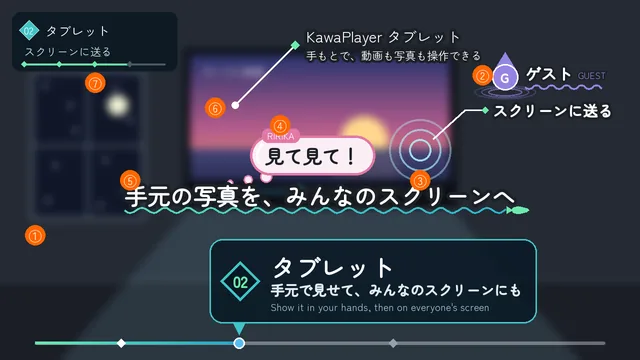

**図 1** 字幕の 7 種類（番号は表 1 の番号。説明のために 1 枚に並べた。⑦ は、章札が出ている間は出ない）

**表 1** 字幕の種類

| 種類 | 位置 | 見た目 | 出方 | 消え方 |
| --- | --- | --- | --- | --- |
| ① 再生バーの章札 | 下。動画の進みに合わせた位置 | 画面の下に、KawaPlayer の再生バーのような細い線を引く。線は動画の進みだけ、ロゴの 3 色で埋まる。章の位置にひし形の印。章の始まりに、つまみの上へ札が立つ。札には、ロゴのひし形に入れた章の番号、機能の名前、できること、英語の一行 | つまみが章の印に着くと、印が光って波紋が広がる。札が印から上へ、水面から浮かぶように立ち上がる（0.4 秒）。文字は行ごとに、下から浮かぶ（0.08 秒ずつ） | 札が印へ沈み、再生バーも薄れる（0.3 秒）。印からひし形が飛んで ⑦ になる |
| ② 水滴の名前 | その人のそば。ゲストだけに出す | その人の色の水滴に頭文字。横に名前と小さな読み。名前の下にその人の色の波線 | 上から水滴が落ちて、水面で跳ねる。波紋が広がり、波線が左から描かれる（0.5 秒） | 水滴が波紋に溶け、名前が薄れる（0.3 秒） |
| ③ 波紋の注記 | 指で触れたところ | 触れたところに波紋。そこから細い線を引き、ひし形の点の先に短い言葉 | 触れた瞬間に波紋が 2〜3 重に広がる。線が伸び、言葉が現れる（0.3 秒） | 線が縮み、言葉が薄れる（0.2 秒） |
| ④ 泡の吹き出し | 話す人の頭の上 | 白い泡に、その人の色の太い縁。頭から小さな泡が 3 つ続く。名前の札は付けず、縁の色で話す人を分ける | 頭から小さな泡が浮かび、最後に大きな泡がふくらむ（0.3 秒）。話すあいだ、上下にゆっくり揺れる | 泡がはじけて、しぶきになる（0.2 秒） |
| ⑤ 流れる字幕 | 下の中央 | 白い太字に暗い縁取り。下にロゴの 3 色の波線、線の先に小さな魚。英語は下に小さく | 文字が左から流れ込み、波に乗るように少し上下しながら止まる（1 字 0.03 秒ずつ）。そのあと波線が描かれ、魚が泳ぎ着く | 文字が右へ流れて薄れ、魚が泳ぎ去る（0.3 秒） |
| ⑥ 物の札 | 紹介する物のそば（C01〜C02b のタブレット） | 物から細い白い線を引き、ひし形の点の先に札。札には、ロゴと物の名前、下に一言 | 物に点が出て、線が伸び、ひし形がはずむ。札が下から浮かぶ（0.4 秒）。物が動くと、札も付いていく | 札と線が薄れる（0.25 秒） |
| ⑦ いま何を説明しているかのカード | 左上。題名のあとから C22 の前まで | 暗い半透明のカードに、ひし形に入れた章の番号、章の名前、いまの項目。下に章の中だけの小さな再生バーと、項目ごとのひし形 | 章札が沈むと、その印からひし形が飛んで開く。項目が変わると、文字が入れ替わり、着いた項目のひし形が光る | C22 の始まりに薄れる |

章札が出ている間は、章札が ⑦ の役をする。⑦ の項目は次のとおり（2026-10-19、ユーザー「現在何を説明しているかを常に画面に表示」）。

- **01：** VHub で URL をコピー → タブレットに URL を入れる → プレイリストが加わる → そのまま再生できる
- **02：** 写真を見せる → 縦にも横にも → スクリーンに送る → 来た人がわかる
- **03：** 流す動画を決めておく → 入ると、もう流れている

**漫符：** 字幕とは別に、絵の一部として 2D で少しだけ重ねる：星（C10 のウインク、C18 の決めたとき、C21 の得意げな MAO）、汗と回る矢印（C12）、驚きの線（C13）、キラキラ（C22 の振り向き。2 人それぞれの色の星が弧を描いて広がる）。

**参考の動画との違い：** 参考の動画では、名前と動作は画面の隅の札に出ていた。この動画では、名前の代わりに吹き出しの色で話す人を分け、動作は触れたところに出す。見る人の目が、人物と操作から離れないようにするためである。章の見出しも、隅の帯ではなく、動画の進みを表す再生バーから立てる。

**言葉の決まり：**

- **遊ぶ人の言葉で書く：** できることと、うれしいことを書く。しくみは書かない。
- **使わない言葉：** 同期、モジュール、読み込み、プレイヤーの種類、権限など、作る人の言葉は使わない。インスタンス、URL のように VRChat で遊ぶ人が知っている言葉は使ってよい。
- **短く：** 1 つの字幕は 1〜2 行、日本語で 20 字くらいまで。
- **読める長さだけ出す：** 1 秒に 6〜8 字を目安に、それに 0.5 秒を足す。
- **擬音：** 「ポン」「ピッ」などの擬音は、字幕ではなく絵の一部として、はずむように出す。

### 2.8 カメラと演技の型

キャラクターの紹介動画を、キャラクターの見せ場（戦闘とアニメの場面を除く）に絞って調べ、次の型を取り入れた（2026-10-18。すべて入れることに決めた、[5 章](#5-決めたこと)）。数値は、調べた動画で測った値の目安。

**表 2** 取り入れた型

| 型 | 決まり | 使ったカット |
| --- | --- | --- |
| 固定が基本 | 見せ場はカメラを止めて、演技で見せる。動かすときは、カットの頭が最速で、減速して止める。見ているだけのカットは、気づかないほどの寄り（1 秒に 1〜2%） | 全体、C14、C22 |
| 速い移動は引きながら | カメラを大きく動かすときは、人物から離れながら回る。近くを回ると、どう動いたか分からない（2026-10-19 のレビュー） | C01、C13 |
| ポーズと止め | 動き 0.3〜0.6 秒、止め 0.5〜1.2 秒。オチの前に止める。止めの間も、呼吸やまばたきで小さく動き続ける | C06、C10〜C14、C21 |
| 溜めと行き過ぎ | 大きな動きの前に、逆へ溜める。行き過ぎてから戻る。着地は沈んで落ち着き、止めてから切る。髪・耳・しっぽは遅れて追う | C06、C12、C14、C21、C22 |
| 二度見 | 見る → 戻る → 止め → すばやく振り向いて驚く | C13、C21 |
| 手と物をレンズへ | 広角で、差し出したタブレットや指先を大きく撮る | C06、C10 |
| 拍で寄る | オチの瞬間に、BGM の拍に合わせて寄る | C11、C13 |
| 世界の中の画面 | 画面いっぱいの映像から引いて、それが KawaPlayer の画面だと見せる | C06、C09 |
| 前景のワイプ | 光の粒が、レンズの前を横切って次へつなぐ | C19 → C20 |
| 漫符 | 星・汗・驚きの線・キラキラを、2D で少しだけ重ねる（字幕ではなく絵の一部） | C10、C12、C13、C18、C21、C22 |
| 黒帯が開く | 冒頭だけ 2.35:1 の黒帯にし、カメラがタブレットへ寄り始めると 0.6 秒で 16:9 に開く | C01・C02b |
| アイリスで締める | 最後は振り向いた 2 人を中心にアイリスで閉じ、終わりの画面のロゴへつなぐ | C22 → C23 |

**取り入れないもの：** 戦闘の速いカット割り、強い手持ちの揺れ、大きく傾けた構図、全編の黒帯（KawaPlayer の UI が小さくなるため）。長回しは冒頭（C01）と C13 だけで、どちらも 5 秒以内にした。

## 3. 構成

**表 3** パートごとの尺

| パート | カット | 始まり | 長さ |
| --- | --- | --- | --- |
| オープニング | C01・C02b | 0:00 | 8.0 秒 |
| 題名 | C04 | 0:08 | 4.0 秒 |
| 01 VHub のプレイリスト | C05〜C09 | 0:12 | 18.5 秒 |
| 02 タブレット | C10〜C15 | 0:30.5 | 21.5 秒 |
| 03 自動再生 | C16〜C21 | 0:52 | 18.2 秒 |
| 締め | C22〜C24 | 1:10.2 | 14.3 秒 |
| **合計** | **24 カット**（Unity で 21 本） | | **84.5 秒** |

カットの番号は、絵コンテ（2026-10-17）のものをそのまま使う。v1 のレビューのあと、C02 と C03 は 1 本（C02b）にまとめ、C03 の振り向いて顔を見せる場面は外した（2026-10-18）。C10 は同じ動きを 3 つの向きから撮った（C10a・C10f・C10b）。

章は、遊ぶ人にとって KawaPlayer ならではの楽しさが大きい順に並べた。

1. **VHub のプレイリスト：** KawaPlayer をつくった理由なので、最初に置いた。
2. **タブレット：** KawaPlayer だけのもの。RIRIKA の小さな話で見せる：縦の写真を横持ちのまま自慢し、MAO に言われて、はずかしそうに縦に回す。縦にも横にも持てることと、画像をスクリーンに送れることが伝わる。続いて、新しく入ってきた人を 2 人が歓迎し、その人がタブレットの訪問者アプリに加わる。
3. **自動再生：** 決められるのはインスタンスを作った人だけで、使う場面が限られるので、最後に置いた。2 人が寝そべってタブレットで決め、青い粒子になって移ると、着いた朝の部屋ではもう流れている。

自動再生の URL は、決めた人のアカウントに、ワールドごとに残る。流れるのは、同じワールドで、その人が自分で作ったインスタンス（Friends+ など、オーナーのいる種類）に入ったときである。別のワールドや、オーナーのいない Public・Group Public のインスタンスでは流れない。そのため C19〜C21 の移る先は、MAO が作った同じワールドの新しいインスタンスとして描いた。ただし、それを言う字幕は出さない（[2.1](#21-撮り方)）。

## 4. 絵コンテ

時刻は、公開した動画の時刻。カットの中の秒ごとの動きは、撮影台本（[script.md](script.md)）にある。

### オープニング

| カット | 画面 | 内容・動き | 字幕 | 音 | 尺 |
| --- | --- | --- | --- | --- | --- |
| **C01** 0:00 | 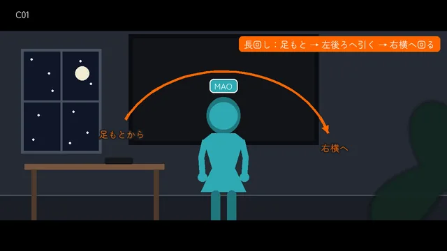 | 2.35:1 の黒帯。1 本の長回し。床から 10 cm の左前から、窓の格子の月明かりが落ちる床を、窓際の机へ歩く MAO の足を撮る。1.5 秒から、上がりながら左後ろへ引いて、全身と机と窓を見せ、背中越しを通って MAO の右横まで回り込み、3.1 秒で止まる（動き出しが最速）。MAO は机のタブレットを両手で持ち上げる。〔Unity、黒帯は HyperFrames〕 | 物の札：KawaPlayer タブレット／手もとで、動画も写真も操作できる（3.6 秒から） | 部屋の静かな音と足音。BGM の前奏を小さく | 4.4 秒 |
| **C02b** 0:04.4 | 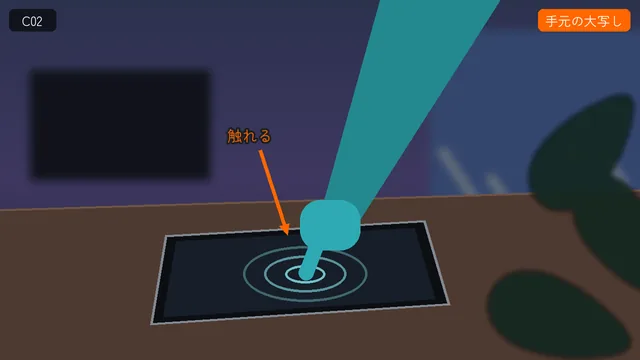 | MAO の右横から。MAO が画面の真ん中を押して画面を点け、ホームの KawaPlayer のアプリを押すと、起動画面になる。最初から 2 回のタップが見える位置（2026-10-20、ユーザー）。カメラは右側を回って画面に正対するまで寄り、黒帯は寄り始めに 0.6 秒で開く。起動画面は、題名の最初のコマと同じ並びで、そのまま題名へつなぐ。〔Unity、黒帯は HyperFrames〕 | 物の札（C01 から続く）、タップの波紋 | タップの音 2 つ、起動の音 | 3.6 秒 |

### 題名

| カット | 画面 | 内容・動き | 字幕 | 音 | 尺 |
| --- | --- | --- | --- | --- | --- |
| **C04** 0:08 | 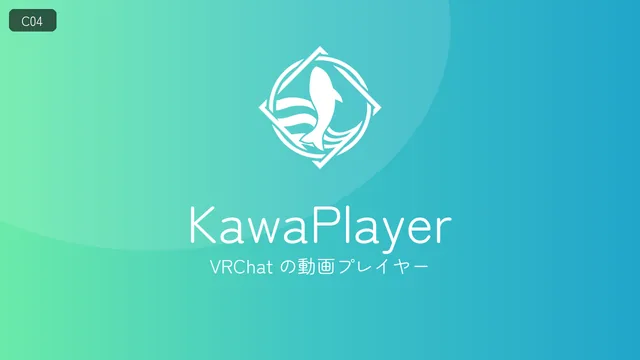 | 起動画面に重ねて、ロゴと名前が出る。ロゴは弾んで出る。背景はロゴの 3 色のグラデーション。〔HyperFrames〕 | KawaPlayer VRChat の動画プレイヤー | BGM の区切りの一打 | 4.0 秒 |

### 01 VHub のプレイリスト

| カット | 画面 | 内容・動き | 字幕 | 音 | 尺 |
| --- | --- | --- | --- | --- | --- |
| **C05** 0:12 | 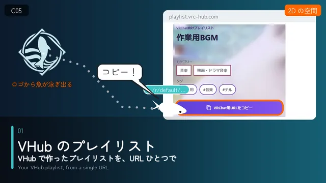 | ロゴの色の 2D の空間。KawaPlayer のロゴから魚が泳ぎ出て、浮かんだ VHub のプレイリストのページ（上の帯は、サイトのヘッダーと同じロゴと名前）へ向かい、「VRChat用URLをコピー」に触れる。コピーした URL が小さな札になって、魚に付く。〔HyperFrames〕 | 章札：01 VHub のプレイリスト／VHub で作ったプレイリストを、URL ひとつで 泡（魚）：コピー！ | 泳ぐ音、コピーの音 | 4.0 秒 |
| **C06** 0:16 | 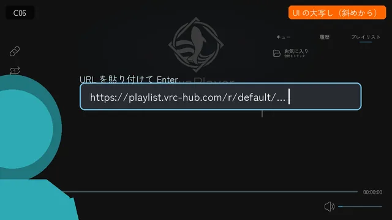 | タブレットの画面いっぱいから、MAO の肩越しまで引く。終わりに MAO が右の人差し指を立てる（少し沈んでから上がり、行き過ぎて戻る）。首を少しかしげて待つと、魚が URL の札を指先に届けて泳ぎ去る。〔Unity、魚と札は HyperFrames で上に描く〕 | なし | 泳ぐ音、届く音（キラッ） | 3.0 秒 |
| **C07** 0:19 | 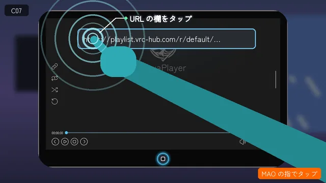 | MAO の目線。その指で、プレイヤーの URL のボタン（左端のリンクの印）を押すと、札がボタンに吸い込まれて URL が入る。「プレイリストを追加しました」が出て、一覧に「よるのまったりBGM」がポンと加わる。〔Unity〕 | 波紋の注記：URL のボタンをタップ | タップの音、入る音、通知の音、ポン | 2.7 秒 |
| **C08** 0:21.7 | 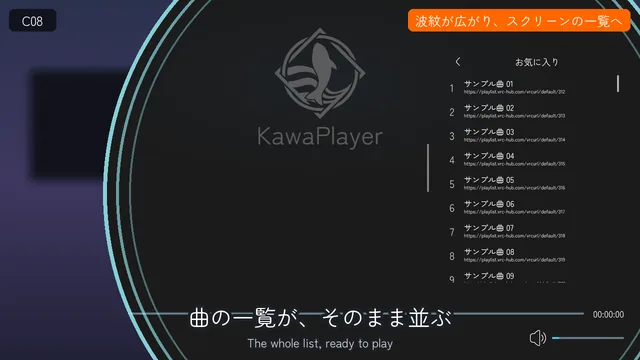 | 加わった行から波紋が画面いっぱいに広がり、壁のスクリーンへ切り替わる。カメラはスクリーンの一覧へ寄っていき、寄る途中で「よるのまったりBGM」がポンと加わる（2026-10-19、ユーザー）。開くと曲の一覧が並び、カメラは一覧に沿って下へ。加わった行と一覧を見せる間を延ばした（2026-10-20、ユーザー「すぐに次のシーンに移りすぎ」）。〔切り替えは HyperFrames、一覧は Unity〕 | URL ひとつで、プレイリストを追加 | 波紋の音、ポン | 5.3 秒 |
| **C09** 0:27 | 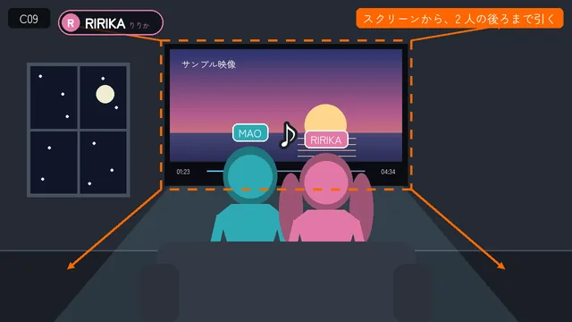 | 1 曲目「よふかしスタディ」の中の MAO から始まり、2 人の頭の上を越えて引くと、それが壁の KawaPlayer の画面で、MAO と RIRIKA が並んで観ていると分かる（引きは出だしが速く、終わりはゆっくり）。再生中も KawaPlayer の UI（題名・再生バー・一覧で光る 1 曲目）を出したままにする（2026-10-18、ユーザー）。RIRIKA が身を寄せてささやき、MAO が応える。〔Unity〕 | なし | BGM | 3.5 秒 |

### 02 タブレット

| カット | 画面 | 内容・動き | 字幕 | 音 | 尺 |
| --- | --- | --- | --- | --- | --- |
| **C10** 0:30.5 | 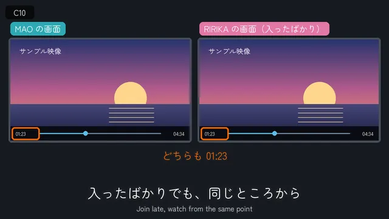 | RIRIKA がタブレットの画像アプリで縦長の写真を開き、少し引いてから、タブレットの両端を持って横持ちのまま MAO の目の前へ突き出す。1 つの動きを 3 つの向きで撮ってつなぐ：MAO の目線の広角（少し傾ける、C10a）→ RIRIKA の笑顔の寄り（C10f）→ 肩越しで、胸もとに戻してウインク（C10b）。写真は横の画面の真ん中に小さく出ている。〔Unity、星は HyperFrames〕 | 章札：02 タブレット／手元で見せて、みんなのスクリーンにも 泡（RIRIKA）：見て見て！ | キラキラの音 | 4.0 秒 |
| **C11** 0:34.5 | 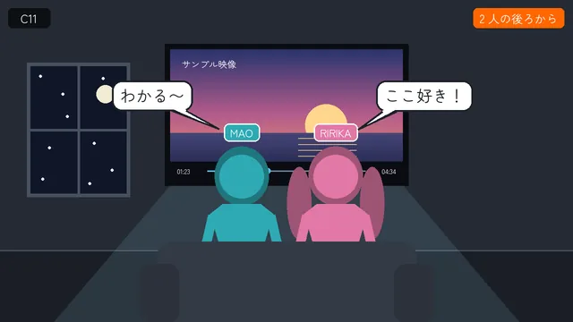 | MAO の手が一瞬沈んで上がり、目をぎゅっとつぶって笑いながら指をくるくる回す。人差し指を顔の横で 2 回突き上げ、その拍でカメラが寄る。〔Unity〕 | 泡（MAO）：縦、縦！ | | 2.5 秒 |
| **C12** 0:37 | 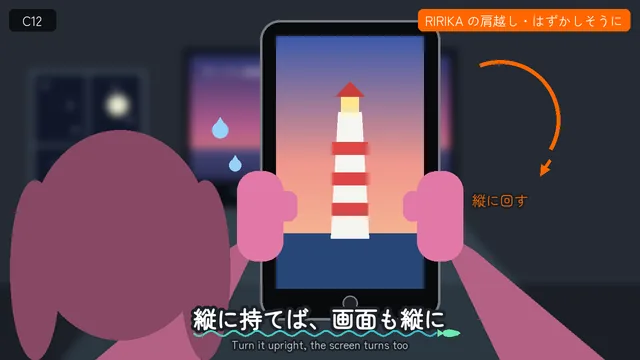 | RIRIKA は両端を持ったまま、額縁を返すようにタブレットを自分へ向け、縦に回すと画面も縦の並びに変わって、写真が大きく出る。回す前に逆へ引き、少し行き過ぎてから戻る。RIRIKA の肩越しに撮る。〔Unity、汗と回る矢印は HyperFrames〕 | 横向きでも縦向きでも、画面がついてくる | 回す音（シュッ） | 4.0 秒 |
| **C13** 0:41 |  | 1 本で撮る（2026-10-19、ユーザー）。RIRIKA の右肩越しに、まずタブレットへ寄ってから、RIRIKA が写真をタップし、「KawaPlayer に送る」を押す。カメラは右後ろへ引きながらスクリーンへ回り、2 人の後ろで止まる。壁のスクリーンに同じ写真が大きく出て、MAO が二度見する。その拍でカメラが寄る。〔Unity、驚きの線は HyperFrames〕 | 波紋の注記：写真をタップ → スクリーンに送る 手元の写真を、みんなのスクリーンへ 泡（MAO）：おおー！ | タップの音 2 つ、カメラが回る音、キラキラ、驚きのポン | 4.5 秒 |
| **C14** 0:45.5 | 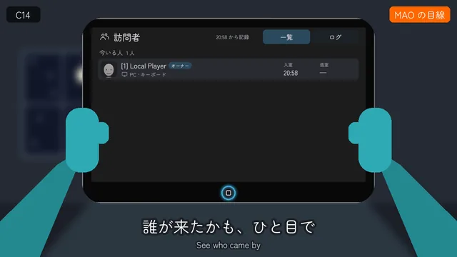 | 別の場面。ワールドに新しい人（ゲスト）が入ってくる。カメラは止めて、1 秒に 1.5% だけ寄る。MAO が手を振り、RIRIKA はしゃがんで溜めてから両手を上げて跳び、着地で沈んでもう一度小さく弾む。〔Unity〕 | 水滴の名前：ゲスト 泡（RIRIKA）：いらっしゃーい！ | 入室の音 | 3.3 秒 |
| **C15** 0:48.8 | 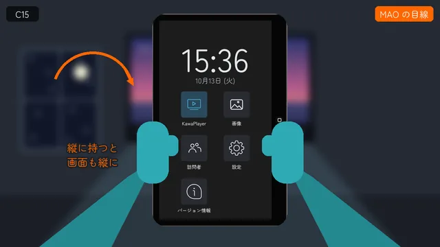 | 波の転換で、MAO の目線のタブレットへ（2026-10-19、ユーザー：RIRIKA の袖で画面が隠れていた）。訪問者アプリの今いる人が 2 人から 3 人になり、加わった行が光る。それぞれの顔の写真が出る（名前と時刻はサンプル）。〔Unity、転換と光は HyperFrames〕 | 誰が来たかも、ひと目で | 通知の音（ピコン） | 3.2 秒 |

### 03 自動再生

| カット | 画面 | 内容・動き | 字幕 | 音 | 尺 |
| --- | --- | --- | --- | --- | --- |
| **C16** 0:52 | 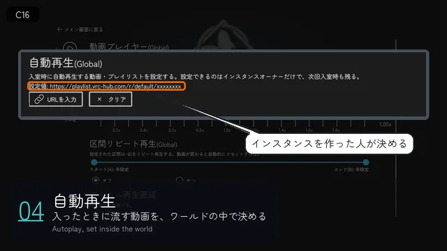 | 訪問者アプリから引くと、タブレットは床のじゅうたんの上にあり、MAO の背中越しになる（引きは出だしが速く、終わりはゆっくり）。向かいの RIRIKA も寝そべり、上げた足を交互にパタパタさせる。〔Unity〕 | 章札：03 自動再生／インスタンスに入ったときに流す動画を、決めておける | | 3.5 秒 |
| **C17** 0:55.5 | 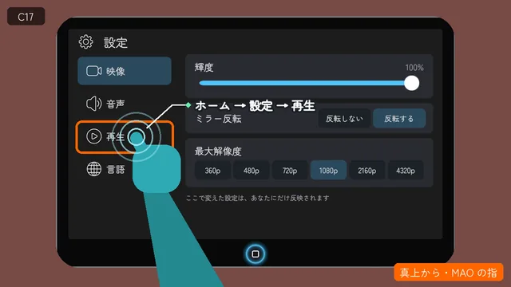 | 真上から。MAO がホームボタンを押し、設定アプリの **再生** を選ぶ。〔Unity〕 | 波紋の注記：ホーム → 設定 → 再生 | タップの音 | 3.0 秒 |
| **C18** 0:58.5 | 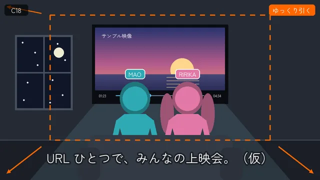 | カメラがタブレットに寄る。自動再生(Global) の **URLを入力** から VHub のプレイリストの URL を入れると、設定値に出る。〔Unity、星は HyperFrames〕 | 波紋の注記：流したい動画の URL を入れる インスタンスに入ったときに流す動画を、決めておく （下に小さく）決められるのは、インスタンスを作った人 | 決める音 | 4.2 秒 |
| **C19** 1:02.7 | 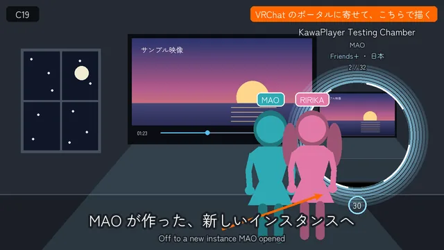 | MAO と RIRIKA が、頭のほうから青い粒子になって消える。光の粒がレンズの前を上っていき、白い光を抜けて C20 へつなぐ。ワールドを移ることを表す、動画だけの演出。〔Unity：粒子は Unity のパーティクル、光は HyperFrames〕 | なし | 粒子の音（サラサラ） | 2.3 秒 |
| **C20** 1:05 | 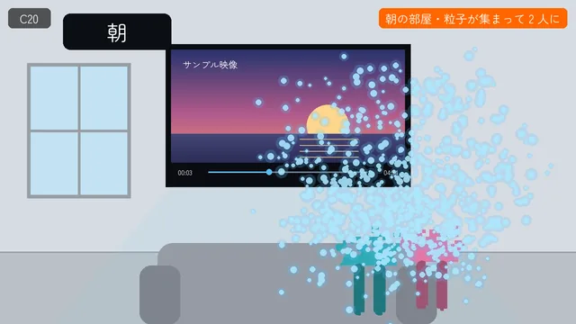 | 朝になった部屋（MAO が作った新しいインスタンス）。青い粒子が集まって、足もとから 2 人の姿に戻っていく。スクリーンには、C18 で決めたプレイリストの 1 曲目「よふかしスタディ」がもう流れている。〔Unity〕 | なし | 粒子の音（キラキラ） | 2.5 秒 |
| **C21** 1:07.5 | 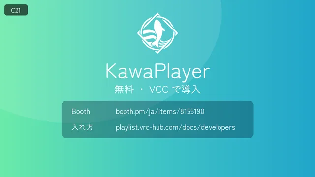 | 2 人がそろうと、スクリーンはもう流れている。RIRIKA はスクリーンを二度見してから、しゃがんで両手を上げて跳ぶ。MAO は腰に手を当てて胸を張る（2D の星）。〔Unity、星は HyperFrames〕 | 入ったとたん、決めた動画が流れる 泡（RIRIKA）：もう流れてる！ | BGM | 2.7 秒 |

### 締め

| カット | 画面 | 内容・動き | 字幕 | 音 | 尺 |
| --- | --- | --- | --- | --- | --- |
| **C22** 1:10.2 | 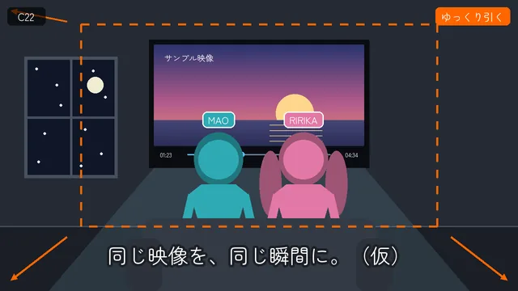 | 溶暗で夜の部屋へ。ソファの縁に座る 2 人の後ろ姿と、よふかしスタディを流すスクリーン。カメラはゆっくり引く。1.9 秒から 2 人が腰から振り向き、MAO はピースを顔の横へ上げてウインク、RIRIKA は少し遅れて手を振る（2026-10-19・2026-10-20、ユーザー）。振り向きに合わせて、2 人それぞれの色のキラキラ。ピースのところで、振り向いた 2 人を中心にアイリスで閉じる。〔Unity、キラキラとアイリスは HyperFrames〕 | キャッチコピー：URL ひとつで、みんなの上映会。 One URL. Movie night for everyone. | 振り向きの専用の音（ふわっと上がる音、ピースに合わせて鈴、きらきらの余韻、手を振るところでぽん）。BGM の終わりへ | 4.0 秒 |
| **C23** 1:14.2 |  | アイリスの穴からロゴが開く。魚がロゴに帰る。ロゴ、「無料・VCC で導入」、Booth と入れ方のページの URL。〔HyperFrames〕 | KawaPlayer VRChat の動画プレイヤー 無料・VCC で導入（FREE · INSTALL WITH VCC） Booth：booth.pm/ja/items/8155190 入れ方：playlist.vrc-hub.com/docs/developers | BGM の終わり | 4.3 秒 |
| **C24** 1:18.5 | 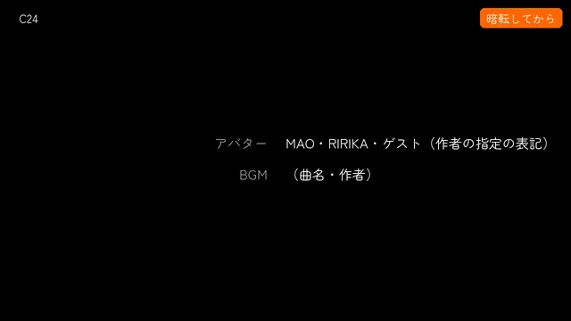 | 画面が暗転してから、クレジットを出す。終わりの画面と分けるため。使った素材（アバター・ワールドと小物・シェーダー・フォント）を作者の指定どおりに並べ、最後に「KawaPlayer は YamaPlayer（koorimizuw）を元にフォーク開発しています」（2026-10-20、ユーザー）。〔HyperFrames〕 | 素材の名前と作者（絵では省いた）、フォークの一行 | なし（BGM は C23 で終わる） | 6.0 秒 |

C01〜C24 の尺は、つなぎで重なる分を除いた長さ。C02b→C04、C07→C08、C14→C15、C19→C20、C21→C22、C22→C23 は重ねてつなぐ。

## 5. 決めたこと

v1 のレビュー（2026-10-18）のときに決めることが 8 つあった。どれも決まり、公開した動画はそのとおりに作った。

1. **キャッチコピー（C22）：** 「URL ひとつで、みんなの上映会。」英語は「One URL. Movie night for everyone.」。ほかの案（「みんなで観る時間を、もっと近くに。」「好きなプレイリストを、みんなのスクリーンへ。」）は使わなかった。
2. **英語の一行：** 添えた。章札と流れる字幕に、英語の一行を小さく出す。
3. **BGM：** この動画のために合成した曲と効果音にした（120 BPM、2 秒で 1 小節）。権利を確かめる曲がなく、Content ID で止められる心配もない。曲は 81.5 秒で終わり、C08 を延ばした分は、曲の中に 1 小節足して作り直した（2026-10-20、ユーザー：継ぎ足すと継ぎ目が聞こえた）。C22 の振り向きだけ、専用の効果音にした（2026-10-20、ユーザー）。
4. **縦長の短い版：** 作らなかった。
5. **見た目：** D をもとにした D′（2026-10-18、ユーザー「見た目比較について D に同意します」）。D から、顔に落ちる髪の影と肌の色抜けを除き、縁の光と部屋の暗さを残す（[look.md の表 5](look.md#46-キャラクターを撮るときの設定)）。2 倍の解像度で描いて縮小する。全カットをこの見た目で撮り直した。
6. **部屋の光：** 焼き直していない。人物の光は D′ のキャラクターの光で当て、部屋の照明は焼き込んだまま撮った。
7. **冒頭の机：** 窓際の机のまま。
8. **カメラと演技の型（[2.8](#28-カメラと演技の型)）：** 表 2 のすべてを入れた。漫符・黒帯・アイリスは HyperFrames で重ねた。

v2 のあと（2026-10-19〜20）のレビューで変えたことは、次のとおり。

- **冒頭：** 足もとから引いて回る長回し（C01）にし、C02b のタップが MAO の背中に隠れないよう、C01 のカメラが右横まで回ってから C02b を始める。壁のスクリーンと顔のカット（C03）は外した。時計は 22:04 に止めた。
- **いま何を説明しているか：** 左上のカード（⑦）を足した。
- **C08：** カメラが寄り始めてから、プレイリストが加わる。加わったあとの間を延ばした。
- **タブレットの持ち方：** RIRIKA が見せるとき・自分へ向けたあとの手と指を直した。C13 は 1 本で撮り、タブレットへ寄ってから RIRIKA が操作する。C15 は MAO の目線にした。
- **自動再生：** 字幕を「インスタンスに入ったとき」にし、移る先の説明と「朝」の字幕を外した。流れる動画は、よふかしスタディにした。
- **締め：** 2 人が腰から振り向いて手を振る。キラキラと専用の効果音を足した。クレジットに、使った素材とフォークの一行を足した。

## 6. 公開

- **公開：** v3.1（84.5 秒）を X と YouTube に上げた（2026-10-20）。
  - YouTube：https://youtu.be/6Lwdvkbyp14
  - X：https://x.com/Mega_Gorilla_/status/2112364799049044427
  - KawaPlayer の README から、両方へリンクする。
- **動画のファイル：** GitHub には上げない（[2.2](#22-登場人物)）。手元に、公開した v3.1 と、最初に書き出した v1 を残した。
- **撮影と編集の道具：** リポジトリの外の `D:\Codes\videos\kawaplayer-intro\` にある（撮影は `shoot/`、編集は `edit/`）。カットごとの撮り方と撮り直しの手順は `shoot/README.md`、編集の手順は `edit/README.md`。撮影の連番の画像は片付けたが、編集用の写しと字幕の位置の記録を残したので、v3.1 はそのまま書き出し直せる。
- **閉じた：** 動画づくりは、v3.1 の公開で閉じた（2026-10-20、ユーザー）。
