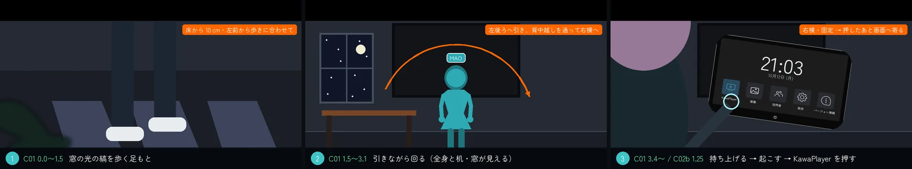
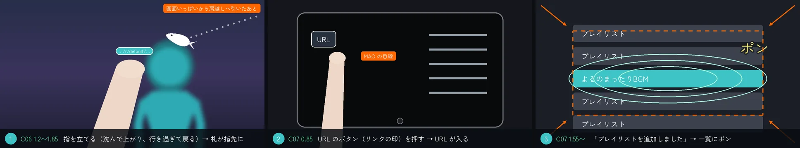
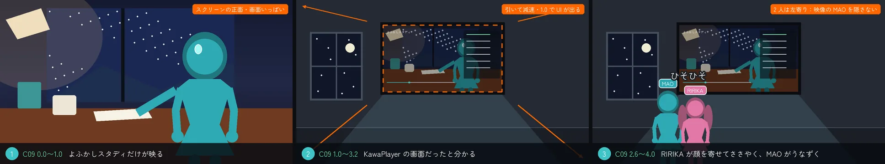
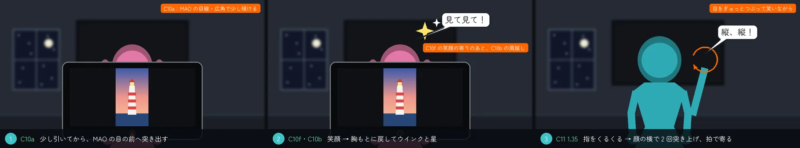
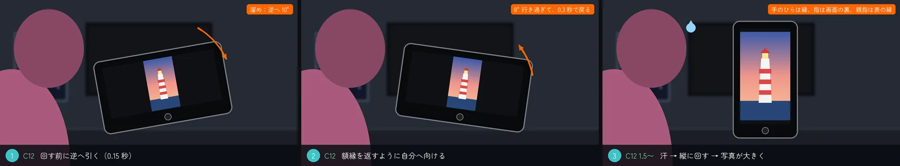
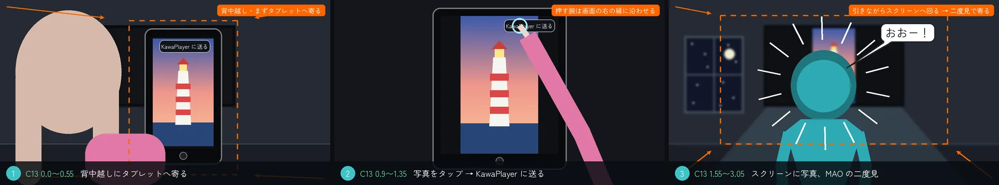
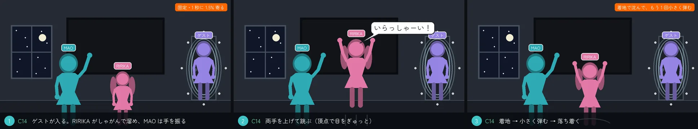
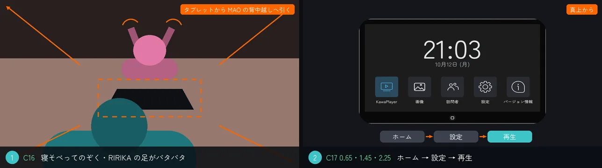
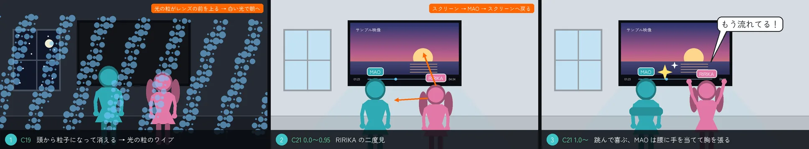
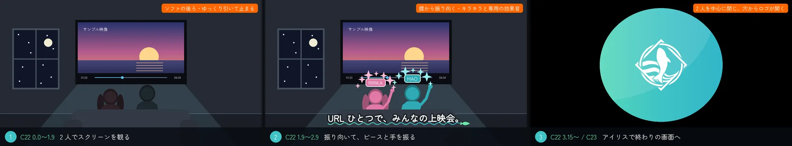

# KawaPlayer の紹介動画：撮影台本

| 項目 | 内容 |
| --- | --- |
| 文書の種類 | 台本（撮影台本、カットごと） |
| 関連する issue | #262 |
| 日付 | 2026-10-18（公開した v3.1 の撮り方に合わせたのは 2026-10-20） |
| 状態 | 撮った。公開した v3.1 は、この台本のとおりに撮って編集した。[README](README.md) の絵コンテを、カメラと演技の型（[2.8](README.md#28-カメラと演技の型)）と見た目 D′（[look.md](look.md) の表 5）で細かくしたもの |

## 要旨

絵コンテ（[README](README.md)）の 24 カットを、撮るための台本に細かくした。Unity で撮ったのは 21 本（C10 は 3 つの向きで撮った）。カットごとのカメラ（位置・レンズ・動きと止まり方）と、演技の時刻（ポーズ・止め・溜め・行き過ぎ・二度見）、上に重ねるもの（黒帯・漫符・アイリス）を書く。各章を「仕込み → 小さなオチ → 止め」の短い話にして、キャラクターのかわいさと笑いを足した。尺は 84.5 秒。

## 目次

1. 共通の決まり（1.5 絵）
2. 尺
3. カットごとの台本
4. 撮っているうちに変えたこと
5. 撮り直すとき

---

## 1. 共通の決まり

### 1.1 見た目（D′、2026-10-18 に決定）

- **顔に落ちた影を乗せない：** アバターの影の受け取りは 0。キャラクターが床に落とす影は残す。
- **色：** トーンマップは使わない。露出は上げない。
- **光：** 縁の光（リム）と部屋の暗さを残す。人物にはキャラクター用の光を当て、窓の縁の光は少し弱める。部屋の照明は焼き込んだまま。
- **描画：** 2 倍の解像度で描いて縮小する。ボケは半分に見えるので、f 値を半分にする。

### 1.2 カメラ

- **固定が基本：** 見せ場はカメラを止め、演技で見せる。
- **動かすとき：** カットの頭が最速で、減速して止まる。大きく動かすときは、人物から離れながら回る（2026-10-19 のレビュー）。
- **見ているだけのカット：** 気づかないほどの寄り。
- **拍で寄る：** オチの瞬間に、BGM の拍に合わせて寄る（C11・C13）。

**表 1** 縦の FOV と焦点距離（フィルムの高さ 24 mm）

| 縦の FOV | 16° | 22° | 27° | 30° | 34° | 38° | 44° | 50° | 55° | 60° |
| --- | --- | --- | --- | --- | --- | --- | --- | --- | --- | --- |
| 焦点距離 | 85 mm | 62 mm | 50 mm | 45 mm | 39 mm | 35 mm | 30 mm | 26 mm | 23 mm | 21 mm |

### 1.3 演技

- **ポーズと止め：** 動き 0.3〜0.6 秒、止め 0.5〜1.2 秒。止めの間も、呼吸とまばたきで小さく動く。
- **溜めと行き過ぎ：** 大きな動きの前に、逆へ溜める。行き過ぎてから戻る。着地は沈んで落ち着く。
- **二度見：** 見る → 戻る → 止め → すばやく振り向いて驚く。
- **振り向き：** 首だけで回さず、腰から回す。首から上は胸から 60° 以内（2026-10-20、ユーザー）。
- **揺れ物：** 髪・耳・しっぽは遅れて追う。
- **タブレットの持ち方：** 見せるときは、手のひらを裏の縁近くに当てて指を裏に沿わせる。自分に向けたら、手のひらを縁に当てて指は画面の裏、親指は表の縁。指先が画面から突き出ないよう、裏から少し離す（2026-10-20、ユーザー）。

### 1.4 上に重ねるもの（HyperFrames）

- **黒帯：** 冒頭だけ 2.35:1。C02b でカメラがタブレットへ寄り始めると、0.6 秒で開く（0:05.9）。
- **漫符：** 星（ウインク・決めたとき・得意）、汗と回る矢印（照れ）、驚きの線、キラキラ（振り向き）。ロゴの 3 色・人物の色と白で、小さく、短く出す。字幕（[2.7](README.md#27-字幕)）とは別の、絵の一部とする。
- **アイリス：** 最後に、振り向いた 2 人を中心に閉じ、C23 のロゴへ開く。

### 1.5 絵

カットごとの絵は、演技の流れを 2〜3 コマで並べたシルエットの仮の絵で、[`images/beats.py`](images/beats.py) が描く（絵コンテの絵と同じ部品を使う）。コマの下の帯は、カットの中の時刻と動き。オレンジの札はカメラと演出のメモで、動画には出ない。絵のないカットは、絵コンテの絵を見る。アバターが映った絵や、撮った映像の静止画は置かない（[README の 2.6](README.md#26-絵について)）。撮った絵での見比べは、非公開のページで行った。

### 1.6 時刻の書き方

カット名の横の時刻は、動画の中の時刻。各カットの演技の時刻は、そのカットの始まりからの秒。

## 2. 尺

**表 2** 尺

| パート | カット | 始まり | 長さ |
| --- | --- | --- | --- |
| オープニング | C01・C02b | 0:00 | 8.0 秒 |
| 題名 | C04 | 0:08 | 4.0 秒 |
| 01 VHub のプレイリスト | C05〜C09 | 0:12 | 18.5 秒 |
| 02 タブレット | C10〜C15 | 0:30.5 | 21.5 秒 |
| 03 自動再生 | C16〜C21 | 0:52 | 18.2 秒 |
| 締め | C22〜C24 | 1:10.2 | 14.3 秒 |
| **合計** | **24 カット** | | **84.5 秒** |

## 3. カットごとの台本

### オープニング

#### C01 窓辺へ歩く長回し（0:00〜0:04.4）

**図 1** オープニング（C01・C02b）：窓の光の縞を歩く足もと → 引きながら回る → 右横から KawaPlayer を押す

- **狙い：** 映画のような始まり。どう動いたかが分かるカメラで、部屋と人物とタブレットを 1 本で見せる。
- **画：** 2.35:1 の黒帯。窓の格子の月明かりが床に落ちる。
- **カメラ：** 1 本の長回し（2026-10-19 に作り直し）。
  - 0.0〜1.5　床から 10 cm の左前から、歩く足に合わせて撮る。
  - 1.5〜3.1　上がりながら左後ろへ引き（MAO の左 1.6 m・机から後ろ 1.0 m・高さ 1.45 m、画角 44°。全身と机・窓が見える）、背中越しを通って右横まで回り込んで止まる。動き出しが最速で、モーションブラーをかける。道のりに沿って距離で進むので、区間を足しても前の区間が急がない。
  - 右横で止めるのは、C02b のタップが MAO の背中に隠れないため（2026-10-20、ユーザー）。カメラは机や物に入らず、頭から 0.63 m 以上離れる。
- **演技：**
  - 0.0〜2.75　窓際の机へ歩く（1 秒に 1.9 歩、かかとから着地してつま先で離れる。地面についた足は滑らせない）。
  - 2.75　机の手前で止まる。
  - 3.4〜　タブレットを両手で持ち上げる。
- **時計：** タブレットと机の時計は 22:04、日付は 10月18日 (日) に止める。壁のスクリーンは UI を出す。
- **重ねるもの：** 物の札「KawaPlayer タブレット／手もとで、動画も写真も操作できる」（3.6〜、C02b の 0.75 まで。タブレットに付いていく）。
- **音：** 部屋の静けさ、足音、BGM の前奏を小さく。

#### C02b KawaPlayer を押す（0:04.4〜0:08.0）

- **カメラ：** C01 が止まった右横から（右肩越しより右へ 35 cm・前へ 30 cm・下へ 5 cm）。KawaPlayer のアイコンが髪と肩に隠れない。1.5 秒から、右側を回って画面に正対するまで寄る。右肩越しから上へ動かす案は、頭がかえって隠した。
- **演技：** C01 の持ち上げる動きの続きを撮る（C01 の 3.4 に持ち始めた動きの 1.0 秒目から）。
  - 0.45　画面の真ん中を押して、画面を点ける。
  - 1.25　ホームの KawaPlayer のアプリを押すと、起動画面になる。
- **重ねるもの：** タップの波紋 2 つ。1.5 で黒帯が開く（0.6 秒）。起動画面は題名の最初のコマと同じ並びで、題名がそこに重なって出る。
- **音：** タップの音 2 つ、起動の音。

### 題名

#### C04 題名（0:08〜0:12）

起動画面に重ねて、ロゴと名前（KawaPlayer／VRChat の動画プレイヤー）。ロゴは弾んで出る。背景はロゴの 3 色のグラデーション。〔HyperFrames〕

### 01 VHub のプレイリスト

#### C05 魚がコピーする（0:12〜0:16）

2D の VHub のページで、ロゴから泳ぎ出た魚が「VRChat用URLをコピー」に触れ、URL の札を付ける。章札「01 VHub のプレイリスト」、泡（魚）「コピー！」。〔HyperFrames〕

#### C06 魚が URL を指先へ（0:16〜0:19）

**図 2** C06・C07：指を立てて札を受け取る → URL のボタンを押す → 一覧にポン

- **カメラ：** タブレットの画面いっぱいから、MAO の肩越しまで引く。
- **演技：**
  - 1.2　右の人差し指を立てる：少し沈んでから上がり、行き過ぎて戻る。
  - 1.2〜3.0　首を少しかしげて待つ。
- **重ねるもの：** 魚が右上から入り、URL の札を指先に届けて（動画の 0:17.85）、泳ぎ去る。札は指先に残り、指先の位置を追う。
- **音：** 泳ぐ音、届く音（キラッ）。

#### C07 URL のボタンを押す（0:19〜0:21.7）

- **カメラ：** MAO の目線。縦の FOV 30°、固定。
- **演技：** 0.85 で、その指で URL のボタン（左端のリンクの印）を押す → URL が入る → 「プレイリストを追加しました」→ 一覧に「よるのまったりBGM」がポンと加わる。
- **重ねるもの：** 札がボタンに吸い込まれる。波紋の注記「URL のボタンをタップ」。
- **音：** タップ、入る音、通知、ポン。
- **つなぎ：** 加わった行から波紋が広がり、C08 へ（0.6 秒重ねる）。

#### C08 スクリーンの一覧（0:21.7〜0:27.0）

- **カメラ：** テイクの前から、スクリーンの一覧へ寄っていく。波紋が抜けたときには寄っている。
- **演技（画面）：** 寄る途中の 0.9 で「よるのまったりBGM」がポンと加わる（2026-10-19、ユーザー：寄り始めてから加わるように）。2.8 で開き、カメラは曲の一覧に沿って下る。加わった行を見せる間を 0.8 秒、一覧を下る間を 1.2 秒延ばした（2026-10-20、ユーザー「すぐに次のシーンに移りすぎ」）。
- **字幕：** 「URL ひとつで、プレイリストを追加」（One URL adds the whole playlist）。
- **音：** 波紋の音、ポン。

#### C09 画面の中の動画から引く（0:27.0〜0:30.5）

**図 3** C09：よふかしスタディの中の MAO → 引いて KawaPlayer の画面と分かる → 2 人がささやく

- **カメラ：** 1 曲目「よふかしスタディ」の中の MAO から始まり、0.45〜2.7 で 2 人の頭の上を越えて引く（出だしが速く、終わりはゆっくり）。
- **画面：** KawaPlayer の UI（題名・再生バー・一覧で光る 1 曲目）を出したままにする。
- **演技：** 2 人は息をして並んで観る。2.3 で RIRIKA が身を寄せてささやき、MAO が応える。RIRIKA の首は MAO へ 3 割だけ向ける（長い髪が背中を突き抜けないため）。
- **時計：** 引きで右端に写る机の時計は 22:20、人数 2。
- **字幕：** なし。**音：** BGM（よふかしスタディの音は使わない）。

### 02 タブレット

#### C10 見て見て！（0:30.5〜0:34.5）

**図 4** C10・C11：突き出す → 笑顔とウインク → MAO が笑いながら指摘

1 つの動きを 3 つの向きで撮り、つなぐ。

- **C10a（1.65 秒）：** MAO の目線。広角（縦の FOV 50°）で、少し傾ける。RIRIKA が少し引いてから、タブレットを MAO の目の前（カメラ）へ突き出す。
- **C10f（0.35 秒）：** RIRIKA の笑顔の寄り（横 35° から）。
- **C10b（2.0 秒）：** 肩越し。胸もとに戻して、ウインク。
- **持ち方：** 手のひらをタブレットの裏の縁近くに当て、指を裏に沿わせる。胸もとで持つ所は、体の前 20 cm（30 cm では腕が届かず、手が離れて見えた）。
- **画面：** 縦長の写真が、横の画面の真ん中に小さく出ている。
- **字幕：** 章札「02 タブレット」、泡（RIRIKA）「見て見て！」、ウインクの目の横に星。**音：** キラキラ。

#### C11 縦、縦！（0:34.5〜0:37.0）

- **カメラ：** MAO の寄り。1.35 の拍で寄る（36° → 31°）。寄りながら顔と指へ向け直す（寄るだけだと頭が切れた）。
- **演技：** 手が一瞬沈んで 0.15 秒で上がり、目をぎゅっとつぶって笑いながら指をくるくる回す。1.35 で、人差し指を顔の横で 2 回突き上げる。指は RIRIKA の髪にかからない所。
- **字幕：** 泡（MAO）「縦、縦！」。

#### C12 はずかしそうに縦に（0:37.0〜0:41.0）

**図 5** C12：逆へ引く → 返して行き過ぎる → 汗をかいて縦に回す

- **カメラ：** RIRIKA の肩越し。固定。
- **演技：** 両端を持ったまま返して、自分へ向ける。回す前に逆へ 10° 引き（0.15 秒）、0.25 秒で 8° 行き過ぎて、0.3 秒で戻る。縦に回すと、画面も縦の並びに変わって写真が大きく出る。両手は左右の縁を持ち、MAO に見せている間の持ち方から、自分へ向けたあとの持ち方へ、回すにつれて移る（2026-10-20、ユーザー：自分へ向けたあと指が写真に乗っていた）。
- **重ねるもの：** 汗（回す直前）、回る矢印（回すとき）。
- **字幕：** 「横向きでも縦向きでも、画面がついてくる」（Sideways or upright, the screen turns with it）。**音：** 回す音（シュッ）。

#### C13 スクリーンに送る（0:41.0〜0:45.5）

**図 6** C13：背中越しにタブレットへ寄る → 写真をタップして送る → 引いてスクリーンへ、MAO の二度見

1 本で撮る（2026-10-19、ユーザー）。

- **カメラ：**
  - 0.0〜0.55　RIRIKA の右肩越し（後ろ 0.45 m・右 0.52 m・高さ 1.42 m から見下ろす。背が低いので、頭の右を通さないとタブレットが見えない）。2 割近づいて、画角 34° → 30° でタブレットへ寄る。寄ってから右手が動く。
  - 1.55〜2.55　右後ろへ引きながらスクリーンへ回り、2 人の後ろで止まる。
  - 3.05　MAO の二度見の拍で寄る（46° → 40°）。
- **演技：**
  - 左手だけでタブレットを持つ（手のひらを背に、指を背に沿わせ、親指を前に）。
  - 0.9　右の人差し指で写真をタップ。写真をタップする所は、中央より右下。
  - 1.35　「KawaPlayer に送る」を押す。タップする右手は、肘を画面の右下の角の外に低く置き、前腕を画面の右の縁に沿って上げる。右肩越しでは、どちらの手でもタップする腕は画面の前に入るので、縁に寄せて覆う所を減らした（2026-10-20、ユーザー：袖が画面にかかる）。
  - 送ったあと、RIRIKA の首は半分だけスクリーンへ。
  - 3.05　MAO の二度見。
- **重ねるもの：** 驚きの線（3.05〜）。
- **字幕：** 波紋の注記「写真をタップ」「スクリーンに送る」、「手元の写真を、みんなのスクリーンへ」（From your hands to everyone's screen）、泡（MAO）「おおー！」。**音：** タップ 2 つ、カメラが回るシュッ、キラキラ、驚きのポン。

#### C14 いらっしゃーい！（0:45.5〜0:48.8）

**図 7** C14：しゃがんで溜める → 跳ぶ → 着地して弾む

- **カメラ：** 引き。固定で、1 秒に 1.5% だけ寄る。縦の FOV 42°。
- **演技：** ゲストが入ってくる。MAO が手を振る。RIRIKA はしゃがんで溜めてから両手を上げて跳び（頂点で目をぎゅっと）、着地で沈んでもう 1 回小さく弾む。
- **字幕：** 水滴の名前「ゲスト」、泡（RIRIKA）「いらっしゃーい！」。**音：** 入室の音。

#### C15 訪問者アプリ（0:48.8〜0:52.0）

- **カメラ：** MAO の目線（2026-10-19、ユーザー：RIRIKA の袖で画面が隠れていた）。
- **演技：** MAO がタブレットの左右の辺を、真ん中から 6.5 cm 下で持つ（真ん中だと親指がゲストの写真を隠した）。0.9 で、訪問者アプリの今いる人が 2 人から 3 人になる。RIRIKA は MAO の右横（画面の外）。
- **重ねるもの：** 加わった行が光る。C14 から波の転換。
- **字幕：** 「誰が来たかも、ひと目で」（See who's here at a glance）。**音：** 通知の音（ピコン）。

### 03 自動再生

#### C16 寝そべって（0:52.0〜0:55.5）

**図 8** C16・C17：タブレットから MAO の背中越しへ引く → 真上からホーム・設定・再生

- **カメラ：** じゅうたんの上のタブレットから、MAO の背中越しへ引く（出だしが速く、終わりはゆっくり）。
- **演技：** 2 人が床のじゅうたんに寝そべり、タブレットをのぞく。寝そべりは、立ちポーズを前に倒して背中を反らせて作る。RIRIKA は上げた足を交互にパタパタさせる（1 秒に 0.8 回）。
- **字幕：** 章札「03 自動再生」。

#### C17 ホーム → 設定 → 再生（0:55.5〜0:58.5）

- **カメラ：** 真上から。
- **演技：** ホーム（0.65）→ 設定（1.45）→ 再生（2.25）を押す。自動再生の URL は、撮る前に空に戻す。
- **時計：** タブレットの時計は 22:04。
- **字幕：** 波紋の注記「ホーム」「設定」「再生」。**音：** タップ 3 つ。

#### C18 URL を決める（0:58.5〜1:02.7）

- **カメラ：** タブレットに寄る。
- **演技（画面）：** 0.9 で「URLを入力」を押し、VHub の URL を入れると、2.33 で設定値に出る。最後のコマで止めて延ばす。
- **重ねるもの：** 設定値に出たところに星。
- **字幕：** 波紋の注記「流したい動画の URL を入れる」、「インスタンスに入ったときに流す動画を、決めておく」（下に小さく：決められるのは、インスタンスを作った人。Choose what plays when people join）。**音：** 決める音。

#### C19 粒子へ（1:02.7〜1:05.0）

**図 9** C19・C21：粒子になって消え、光の粒のワイプ → RIRIKA の二度見 → 喜ぶ RIRIKA と胸を張る MAO

- **カメラ：** 固定。
- **演技：** 2 人が頭のほうから青い粒子になって消える。
- **つなぎ：** 光の粒がレンズの前を上っていき（近いものほど大きくぼける）、白い光を抜けて C20 の朝へ。
- **字幕：** なし（2026-10-19、ユーザー：移る先の説明は出さない）。**音：** 粒子の音（サラサラ）。

#### C20 朝（1:05.0〜1:07.5）

- **画：** 朝の部屋。スクリーンは、C18 で決めた自動再生が流す 1 曲目「よふかしスタディ」（2026-10-19、ユーザー）。
- **演技：** 粒子が集まって、足もとから 2 人に戻る。
- **字幕：** なし（「朝」は出さない）。**音：** 粒子の音（キラキラ）。

#### C21 もう流れてる！（1:07.5〜1:10.2）

- **カメラ：** 2 人の後ろから、スクリーンへ。固定。
- **演技：**
  - RIRIKA の二度見：スクリーン → 0.4〜0.6 で MAO → 0.85〜0.95 でスクリーンへ戻る。
  - そのあと、しゃがんでから両手を上げて跳び（頂点で目をぎゅっと）、着地で小さく弾む。
  - 1.75〜2.0　MAO が腰に手を当て、胸を張る。
- **重ねるもの：** MAO の頭の横に星。
- **字幕：** 「入ったとたん、決めた動画が流れる」（Step in, and it's already playing）、泡（RIRIKA）「もう流れてる！」。**音：** BGM。

### 締め

#### C22 みんなの上映会（1:10.2〜1:14.2）

**図 10** C22・C23：ソファの 2 人 → 腰から振り向いてピースと手を振る → 2 人を中心にアイリス、穴からロゴ

- **つなぎ：** C21 から 0.6 秒の溶暗で、夜の部屋へ戻る。
- **カメラ：** ソファの縁に座る 2 人の後ろから、ゆっくり引く（縦の FOV 46° → 44°）。スクリーンはよふかしスタディ。
- **演技：** 1.9 から振り返る（2026-10-19、ユーザー：速すぎて不自然、かわいく。2026-10-20、ユーザー：関節がおかしい、腰を回して無理のない形で後ろへ手を振る）。
  - 体ごと回す：腰を座面の上で回し（腰は約 40°）、背中と胸もひねって胸は約 95°、首から上は胸から 60° 以内。頭が先に回り、少し行き過ぎて戻る。
  - MAO は左肩越しに、奥側の右手でピースを 0.5 秒で顔の横へ上げ、一度弾ませて首をかしげ、ウインク。
  - RIRIKA は 0.2 秒遅れて右肩越しに、体を 1 秒かけて回し、奥側の左手を胸の前から頬の横へ上げて、肘から 1 秒に 1.4 回、2 回半ゆっくり手を振る。目を細めて笑う。
  - 上げる手は、胸の前から相手側の頬の横へ、手のひらはカメラへ。
- **時計：** 机の時計は 22:41、人数 2。
- **重ねるもの：** 振り向きに合わせて、2 人それぞれの色のキラキラ（MAO はピースが上がるとき、RIRIKA は 0.2 秒あと）。MAO のピースのところで、振り向いた 2 人を中心にアイリスで閉じる。
- **字幕：** キャッチコピー「URL ひとつで、みんなの上映会。」（One URL. Movie night for everyone.）。**音：** 振り向きの専用の音（ふわっと上がる音、ピースに合わせて鈴、きらきらの余韻、手を振るところでぽん）。BGM の終わりへ。

#### C23 終わりの画面（1:14.2〜1:18.5）

アイリスの穴から、ロゴが開いて出る。魚がロゴに帰る。ロゴ、「無料・VCC で導入」（FREE · INSTALL WITH VCC）、Booth と入れ方の URL。〔HyperFrames〕

#### C24 クレジット（1:18.5〜1:24.5）

暗転のあとのクレジット。使った素材（アバター・小物・ワールドの素材・シェーダー・フォント）を作者の指定どおりに並べ、BGM・効果音はオリジナル。最後に「KawaPlayer は YamaPlayer（koorimizuw）を元にフォーク開発しています」。無音。〔HyperFrames〕

## 4. 撮っているうちに変えたこと

v2 のあと、v3.0（2026-10-18）と v3.1（2026-10-19〜20）のレビューで変えたこと。

**表 3** 撮っているうちに変えたこと

| カット | 変えたこと |
| --- | --- |
| C01〜C03 | 横から歩く寄りをやめ、足もとから引いて回る長回しにした。C02 と C03 は C02b にまとめ、振り向いて顔を見せる場面は外した。C01 は右横まで回り、C02b のタップを最初から見せる。時計を 22:04 に止め、壁のスクリーンの UI を出す |
| 全体 | 左上に、いま何を説明しているかのカード（README の表 1 の ⑦） |
| C08 | 寄り始めてからプレイリストが加わる。2 秒延ばした（そのあとはすべて 2 秒遅れる） |
| C09 | 2 人の頭の上を越えて引く。机の時計を 22:20 に |
| C10〜C13 | RIRIKA の持ち方（見せるときは裏に、自分に向けたら指は裏・親指は表）。C11 は笑いながら指摘する |
| C13 | 小窓をやめ、背中越しに寄ってから操作し、引いてスクリーンへ回る 1 本にした |
| C15 | MAO の目線にした（RIRIKA の袖が画面を隠した） |
| C16 | 真上をやめ、タブレットから MAO の背中越しへ引く |
| C18〜C21 | 自動再生の字幕を「インスタンスに入ったとき」に。移る先の説明と「朝」を外し、スクリーンはよふかしスタディ |
| C22 | ほぼ固定の後ろ姿から、腰から振り向いて手を振る演技に。キラキラと専用の効果音。アイリスは 2 人を中心に |
| C24 | 使った素材とフォークの一行。6 秒に延ばした |
| BGM | C08 を延ばした分、曲の中に 1 小節足して作り直した |

## 5. 撮り直すとき

撮影と編集の道具は、リポジトリの外の `D:\Codes\videos\kawaplayer-intro\` にある。

- **撮影（`shoot\`）：** カットごとの動きとカメラのスクリプト、共通の部品（歩き・持ち方・寝そべり・粒子・時計など）、撮り直しの手順と、カットごとの値（`shoot\README.md`）。直したら、同じ値で撮り直す。共通の部品を直したら、それを使うほかのカットも撮り直す。
- **編集（`edit\`）：** カットの並び、字幕の中身と時刻、効果音、場面転換。撮影のときに記録した頭やタップの位置から字幕を置く。BGM と効果音は合成で作る。
- **アバター：** データも、映った絵も、GitHub には上げない。
