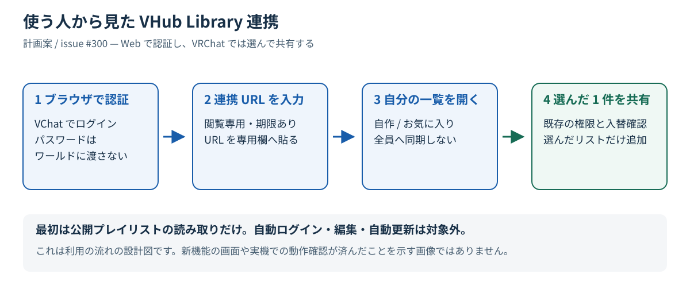
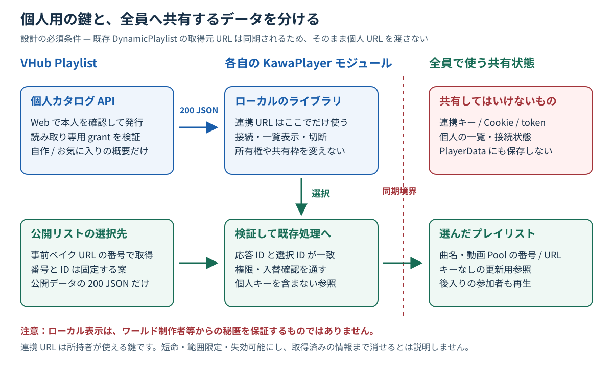
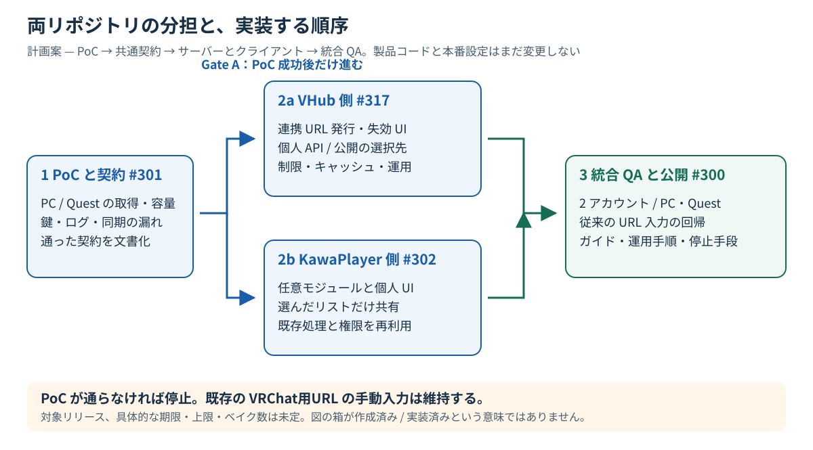

# VHub Library 連携の実装計画

**状態: 計画案・未実装。** 作成日: 2026-10-24。親は [KawaPlayer #300](https://github.com/Mega-Gorilla/KawaPlayer/issues/300)。対象リリースは未定。

ブラウザで VChat にログインし、VHub の「作成したプレイリスト」と「お気に入り」をワールドから開く。**個人ライブラリの閲覧と、選んだプレイリストを全員へ共有する操作を分ける。** ワールドに VChat / VRChat のアカウント操作権限は渡さない。

この文書の図は設計図であり、実装済みの画面や成功した実機テストの画像ではない。数値・API 経路・クラス名の案は PoC 後に確定する。

## 目次

- [1. 利用者から見た流れ](#1-利用者から見た流れ)
- [2. 初期範囲と対象外](#2-初期範囲と対象外)
- [3. 確認できた現在の仕組みと制約](#3-確認できた現在の仕組みと制約)
- [4. 個人用と共有用の境界](#4-個人用と共有用の境界)
- [5. 両リポジトリの実装計画](#5-両リポジトリの実装計画)
- [6. 通信契約のたたき台](#6-通信契約のたたき台)
- [7. 順序と判断ゲート](#7-順序と判断ゲート)
- [8. 検証チェックリスト](#8-検証チェックリスト)
- [9. 関連 issue と文書更新](#9-関連-issue-と文書更新)
- [10. 根拠と図の再生成](#10-根拠と図の再生成)

## 1. 利用者から見た流れ



図1. 最初に Web で認証し、VRChat 内では一覧から選ぶ。ログイン情報を動画 URL 欄に貼る手順ではない。

1. PC / スマートフォン等のブラウザで VHub に VChat ログインする。
2. Web の「VRChat と連携」で、許可する対象と期限を確認して連携 URL を発行する。
3. KawaPlayer の専用 URL 欄へ貼り、接続する。初期版では各訪問時の手動接続を基本とし、端末 / ワールドをまたぐ自動ログインは約束しない。
4. 自分のクライアントだけで「作成したプレイリスト」「お気に入り」を見る。ここでは Controller の所有権も共有スロットも変更しない。
5. 選んだリストの取得後、既存の再生権限と、必要なら古いリストとの入替確認を通して共有へ追加する。全員への反映と、停止中だけの自動再生は既存 PlaylistLoader の規則を使う。

閲覧をインスタンスオーナー限定にはしない。**閲覧の許可は VHub の grant、ワールドへ追加する許可は既存 KawaPlayer の権限**であり、別の判定になる。

## 2. 初期範囲と対象外

| 初期版に入れる | 初期版には入れない |
| --- | --- |
| 自分が作った公開プレイリストの概要と選択 | 非公開 / URL 限定リストの一覧出力（別途の明示的な判断が必要） |
| 公開プレイリストへの VHub のお気に入り | VChat 投稿のお気に入り、編集、削除、お気に入りの変更 |
| 読み取り専用・対象限定・期限あり・失効可能な連携 URL | 通常の Cookie、MiAuth token、Hasura JWT のワールドへの受け渡し |
| 手動で接続・更新・切断する個人 UI | 常時ポーリング、入室だけでの自動認証、永続ログイン |
| 選択した 1 件だけを既存の共有枠に追加 | ライブラリ全体の共有、全リストの全曲の先読み、サムネイル |
| 既存の default 動画 URL Pool | yt-dlp / YouTube Stream URL 解決、旧 PlaylistViewer の復活 |

公開プレイリストだけを対象にしても、**どのリストをお気に入りにしているかという組み合わせは個人用の情報**として扱う。公開の一覧 API から利用者ごとに列挙できる作りにはしない。

## 3. 確認できた現在の仕組みと制約

調査時点のソースは VHub `74834a4b3951ee4da4c92ff9771ff7d809f8f5b4`、KawaPlayer `f6899b59df89a7fc808363cf17717ed24b62845d`。実装開始時は差分を確認する。

| 確認できた事実 | 計画への影響 |
| --- | --- |
| VChat の MiAuth ログイン後、VHub の自作リストとお気に入りを実ブラウザで表示できた | 本人識別と既存の一覧取得を再利用する。実アカウントの名前・内容を文書や図に転載しない |
| `/api/me/playlists` と `/api/me/favorite-playlists` はブラウザの iron-session Cookie で本人を判定 | API をそのまま Udon へ公開せず、専用の限定 grant を作る |
| 通常の HTTP で上記 2 経路は Cloudflare challenge の HTTP 403 になった | API 自体の認証成否へは到達していない。新経路の限定例外とキャッシュ除外を別途確認する |
| `VRCStringDownloader.LoadUrl` は VRCUrl と受信先を受ける。ブラウザの認証セッションの共有を前提にできない | Cookie / 任意 header の設定を必要としない GET を使う |
| `new VRCUrl(string)` は Editor 専用。JSON から URL 文字列を取り出しても実行時に作り直せない | 個人 URL は利用者入力の VRCUrl、選択先は事前ベイク済みの番号で受け取る |
| String Loading は 5 秒に 1 回。VHub は信頼済みドメインの一覧にない | 連打をまとめ、手動更新と上限付き処理にする。Allow Untrusted URLs を案内する |
| 現在の PlaylistLoader は 1 件の応答を解析したあと共有枠へ Fill する | 個人のカタログを既存の取得経路へ直接流さない |
| DynamicPlaylist の `_sourceUrl` は UdonSynced。PlayerData も自動同期され他の Udon から読める | 個人キーを共有枠・PlayerData に入れない |
| 既存 `/r/default/{id}` は非公開でも URL を知る人へ内容を返す「URL=鍵」の仕様 | 既存の挙動は変えない。新機能は公開リストを再検証し、非公開を厳密な本人限定と誤説明しない |

新機能の Unity / VRChat 実機 PoC はまだ行っていない。ブラウザでの成功を、Quest や Udon での成功の根拠にはしない。

## 4. 個人用と共有用の境界



図2. 右側へ同期するのは、個人キーを含まない選択済みリストのデータだけ。図の URL は通信設計の分類であり、秘密を図中に埋め込んでいない。

### 4.1 ワールドはアカウントへログインしない

連携 URL は通常のログイントークンとは別の **閲覧用の鍵（grant）**。所持者は期限内に許可範囲を読めるが、アカウント設定・VChat 投稿・お気に入りの変更等はできない。IP、VRChat の表示名、`playerId` を鍵の代わりの本人確認に使わない。

キーはサーバーで乱数発行し、ハッシュだけを保存する。ブラウザで見せる生キーは発行時だけとし、再発行は別キーにする。所有者・期限・許可範囲・失効をサーバーで判定し、再起動で失効が解除されないよう永続化する。

### 4.2 共有の境界

- 個人 URL、接続状態、ライブラリ一覧はモジュールのローカル状態だけに置く。ログ・エラー・コピー欄へキーを出さない。
- `DynamicPlaylist.Fill` へ渡す source は、**キーを含まない公開プレイリストの固定取得先**。一覧を読むだけで Fill しない。
- 選択した ID と応答 ID の一致を、所有権取得・共有データ書き換え・自動再生の前に確認する。
- 共有後の更新に個人キーは不要にする。キーのない参加者と後入り参加者でも従来の共有データで再生できる。
- ローカルの「切断」は個人の入力・一覧・待ち処理を消すだけで、既に追加した共有リストや現在の動画を消さない。Web の「失効」とは別操作と説明する。

### 4.3 残るリスク

ローカル UI は通常の全員向け同期を避けるための設計であり、ワールド制作者・改造クライアント等からの秘匿を保証しない。SDK / VRChat、CDN、proxy、APM が URL を記録する可能性もある。自アプリのマスクだけで「キーはどのログにも残らない」とは説明しない。

PoC では記録される範囲を調べ、短命・範囲限定・失効で影響を抑え、利用者に説明する。grant の失効は後続のカタログ取得を止めるが、取得済み情報、共有済みリスト、公開 / URL 限定の取得先まで無効化するものではない。

## 5. 両リポジトリの実装計画

### 5.1 VHub Playlist 側 — [#317](https://github.com/kisaragi-official/vhub-playlist/issues/317)

1. **Web の入口:** 既存 VChat ログインとマイライブラリから「VRChat と連携」へ案内。対象、期限、URL 所持者が読めること、非公開が対象外であることを説明し、発行・失効・再発行を提供する。
2. **本人と grant:** 既存セッションの userId を正とし、入力された userId を信用しない。grant のテーブル・権限・上限・ハッシュ化を追加。発行 / 失効は既存の Server Actions 方針に従う。MiAuth の追加権限は求めない。
3. **個人カタログ:** grant を検証して、本人の自作・お気に入りのうち公開中のものだけを概要として返す。同じリストが両方に入る場合は entries を重複させず、所属する欄を示す。件数と切り詰めの有無を明示する。
4. **選択先:** 公開プレイリストに対する固定番号の 200 JSON 経路を新設。番号→ID は恒久対応・非 LRU・削除後も再利用しない案を PoC で確定する。旧 Viewer の経路は復活させない。
5. **曲の解決:** 選んだリストだけを解決し、既存 default 動画 Pool と曲の組み立てを再利用する。新経路では現在の公開状態を cache より先に検証 / 無効化し、公開→非公開後に共有キャッシュから返さない。既存 `/r/default` の方針は変えない。
6. **運用と文書:** grant 発行・取得・公開 resolve の回数と容量を制限。個人カタログは private/no-store、新経路の Cloudflare 限定例外と CDN 除外、ログのマスク・監視・停止手順を用意する。DB 変更は setup-db.ts で冪等にし、秘密を Hasura の利用者向け API に公開しない。

### 5.2 KawaPlayer 側 — [#302](https://github.com/Mega-Gorilla/KawaPlayer/issues/302)

1. **任意モジュール:** 仮称 VHubLibrary。通信、個人状態、入力・一覧 UI を module 内に閉じる。Controller は認証を知らず、既存の URL interceptor を上書きして取り合わない。
2. **Editor と配線:** module の追加 / 無効化、公開リスト用 VRCUrl 配列の生成、UI の build-time wiring を既存規則で作る。新 Udon は新しい子オブジェクトに置き、出荷済みオブジェクト上の UdonBehaviour 数を変えない。
3. **個人用 UI:** 専用 URL 欄と接続・手動更新・切断、自作 / お気に入り一覧、件数・上限・読み込み・エラーを用意。既存の配色・多言語化を使う。画面 / タブレットで自分の一覧を扱えるが、物理的に他人から見えないという意味ではない。
4. **応答の検証:** schema、pool、index、ID、型、件数、サイズ、名称の長さ・rich text を検証。1 件だけ取得し、接続変更・切断後の古い callback を無視する。失効を確認したら旧一覧を消して接続を要求する。
5. **選択と共有:** 応答 ID が選択 ID と一致したあと、既存の `BeforeUserLoadPlaylist`・入替確認・競合チェックへ委譲する。解析・トラック構築・Fill の別実装を増やさず、必要なら既存処理に小さな共通入口を作る。確認の重複・Controller への認証追加はしない。
6. **文書と QA:** 最小対応 SDK でのコンパイル、Prefab / Network ID、既存プロジェクト更新を確認。PC / Quest と 2 アカウントで個人分離・共有・後入り・拒否を確認し、架空データの操作画像付きガイドへ反映する。

## 6. 通信契約のたたき台

**ここは未確定の案。** PoC [#301](https://github.com/Mega-Gorilla/KawaPlayer/issues/301) で確認後、VHub の `docs/api/public-api.md` を契約の正本として更新する。製品側の定数や既存 API の保証ではない。

### 6.1 二種類の GET を分ける

| 用途 | 経路の例（案） | 認可と応答 |
| --- | --- | --- |
| 個人カタログ | `/api/vrc/library/{grant}` | キーによる限定閲覧。小さな一覧だけの 200 JSON。private/no-store。利用者が入力した VRCUrl を使う |
| 選んだ公開リスト | `/api/vrc/library-playlists/{index}` | 公開情報のみ。キー不要。事前ベイクした固定 URL から選び、既存 resolve と同じ曲の形式を 200 JSON で返す |
| 動画の再生 | 既存 `/vrcurl/default/{index}` | 変更しない。選んだ曲を再生するときだけ利用 |

個人キーは第1の経路だけで使う。第2の番号は秘密として扱わず、列挙されても個人の一覧・非公開リストを返さない。**番号を別 ID に再利用しない**ことで、共有済み source が後日別リストを指す事故を防ぐ。削除時は取得不可にし、番号不足を黙って LRU 置換で解消しない。範囲外・満杯は明示的に失敗し、既存リストを守る。

カタログでは全曲の Pool 登録をしない。公開リスト用の固定番号を割り当てる処理と、動画の resolve を分ける。将来ページ送りを足す場合も、受け取った cursor を文字列連結して VRCUrl に変換する案にはしない。

### 6.2 カタログの例（すべて架空）

```json
{
  "schemaVersion": 1,
  "resolverPool": "public-playlists-v1",
  "grantExpiresAt": "2030-01-01T01:00:00Z",
  "total": 1,
  "returned": 1,
  "truncated": false,
  "items": [
    {
      "id": "SAMPLE_PLAYLIST_ID",
      "name": "サンプル A",
      "trackCount": 12,
      "resolveIndex": 42,
      "collections": ["created", "favorites"]
    }
  ]
}
```

`total` / `returned` は両欄の重複を除いた件数。欄ごとの総件数が必要なら別フィールドを契約へ追加し、戻った配列長から全件数を推測しない。`grantExpiresAt` は表示の補助であり、サーバーが毎回期限を判定する。

選択先の成功応答は既存の `{ ok, id, pool: "default", name, tracks: [{ index, title, mode, provider? }] }` を基本にする。**応答の id が選択と違う場合は Fill より前に拒否する。** module / loader 間の共通入口でこの検証順序を守る。

### 6.3 数値と運用の未決事項

| ID | たたき台 | 決定前に確かめること |
| --- | --- | --- |
| D1 | grant 寿命 60 分、有効 grant は利用者あたり 3 件、十分なランダム性を持つ生キーをハッシュ保存 | VR / Quest の入力負担、漏れた場合の影響、サーバー時計、再発行と失効の操作性 |
| D2 | カタログ最大 100 件・64 KiB。超過は total / returned / truncated と案内で明示 | Quest のメモリ・JSON 解析時間、件数・名称の実分布、どの順で残すか。自作だけで枠を使い切らない規則 |
| D3 | 自動更新なし、手動更新。retry 連打をまとめ、回数 / 時間に上限を付ける | SDK の 5 秒制限、他 module と同時取得、長い応答待ち・遅い callback。エラー回数を無制限に積まない |
| D4 | 公開リストの固定番号は恒久対応・非 LRU・再割当なし | 現在の件数と増加、ベイク数、Quest メモリ、番号満杯と古いベイク範囲。数は測定前に決め打ちしない |
| D5 | キー単位 / 利用者単位 / IP・全体での発行・取得予算 | 再起動と replica をまたぐ制限、列挙、同一 IP の複数人。CF のチャレンジ除外を無制限化と混同しない |
| D6 | 新機能は未公開 / 無効で実装し、統合 QA 後に限定公開 | API の停止と再開、キーの失効、旧方式の手動入力が常に残ること。対象リリースは別途決定 |

曲数・共有量は既存 PlaylistLoader の `_maxTracks`（既定 200）と `_maxSyncBytes`（既定 32,768 bytes）の上限・部分取得案内を再利用し、個人カタログの D2 と混同しない。

### 6.4 エラーの扱い

| 条件 | サーバー / クライアントの扱い |
| --- | --- |
| 不正・失効・期限切れ grant | 401 JSON。理由から利用者の存在を推測させず、再接続を案内。旧個人一覧と待ち処理を無効化 |
| 非公開化・削除・選択先なし | 新公開経路は 404 JSON。既存共有データを書き換えず、一覧更新を案内 |
| 回数制限 | 429。自動連打しない。再試行は明示操作 / 上限付き。Udon がエラー応答本文や Retry-After を読めると仮定しない |
| 403 / 通信失敗 / 5xx | 失敗を表示し共有データは維持。403 を一律に Cloudflare や権限不足と断定しない |
| 未知 schema / ID 不一致 / index 範囲外 / サイズ超過 | 検証時に拒否し、所有権・Fill・再生に到達させない |
| 上限による一覧の切り詰め | 戻った数と全件数・上限を表示。全部取得できたと誤表示しない |

## 7. 順序と判断ゲート



図3. PoC が通るまで製品の契約や本番設定を確定しない。サーバーとクライアントの実装を分けても、契約・サンプルは共通にする。

1. **Gate A — [#301](https://github.com/Mega-Gorilla/KawaPlayer/issues/301):** 架空データと使い捨て環境で取得→選択→共有を試す。実装中の Unity / 本番を勝手に操作しない。PC / Quest、URL・ログ・同期の境界、固定番号の容量、API 形式、キーの期限・失効を記録し D1〜D6 を更新。
2. **製品実装 — [VHub #317](https://github.com/kisaragi-official/vhub-playlist/issues/317) / [KawaPlayer #302](https://github.com/Mega-Gorilla/KawaPlayer/issues/302):** Gate A の契約で実装する。モックの開発は並行でもよいが、未検証の方式で本番公開しない。
3. **Gate B — 親 [#300](https://github.com/Mega-Gorilla/KawaPlayer/issues/300):** 以下の統合 QA、案内・画像・運用手順、停止経路を確認してから限定公開。ユーザー向けの操作と制作者向け設定を区別する。

**No-Go:** 秘密・容量・操作性を満たさなければ親 issue へ戻す。VRChat のパスワード、表示名照合、Cookie 流用、秘密を同期する近道へ変更しない。従来の VRChat用URL の手動入力は維持する。

## 8. 検証チェックリスト

未実施。実施時に commit、SDK、端末、テストの条件と実測結果を記録する。サーバーの fake テスト、Unity Editor、PC / Quest 実機を混同しない。

| 番号 | 操作 / 条件 | 合格の目安 |
| --- | --- | --- |
| T1 | A と B が別々に接続して一覧を見る | 作成 / お気に入りが混ざらず、閲覧だけで共有枠・所有権が変わらない |
| T2 | A が B の grant を発行 / 失効しようとする | サーバーが拒否する。UI だけで隠す対処にしない |
| T3 | 個人一覧が出た状態で B が共有状態・PlayerData・ログを確認。後から C も入る | 連携キー・Cookie・個人一覧が同期されない。自アプリログはマスク。制御外ログの残余リスクを別記 |
| T4 | 閲覧権限はあるが再生権限のない人が追加を押す | 既存の権限で拒否し、Fill や再生をしない |
| T5 | 満杯・再生中・一時停止中で選択する。入替確認中に別の人が枠を変える | 既存の入替・競合確認、停止中だけの自動再生、再生継続の規則が保たれる |
| T6 | 取得中に切断、別 URL へ接続、失効。元の成功応答を遅らせる | 古い一覧を戻さず、別リストや別利用者の取得結果を適用しない |
| T7 | grant の期限切れ・失効・再起動後の再利用 | 個人一覧の後続取得を拒否。共有済みデータまで消えるとは保証しない |
| T8 | 未知 schema、長い名前、rich text、重複、ID 不一致、pool 不一致、範囲外番号 | 安全に表示 / 拒否し、共有へ誤って追加しない。恒久番号を別 ID へ再利用しない |
| T9 | 公開リストを非公開化 / 削除し、新経路の cache hit も試す | 新経路からは返さない。既存 /r の URL=鍵仕様と、取得済み情報の限界を区別 |
| T10 | 空一覧、100 件超 / サイズ超の fixture、大量発行、列挙、連打、429、5xx | 上限が働き、切り詰め・失敗が分かる。無制限 request / poll をしない |
| T11 | PC / Quest で未信頼 URL OFF / ON、通常 HTTP / SDK UA、同一 IP の複数人 | 必要な設定を案内し、成功時は JSON。CF 例外後も他経路の保護を維持 |
| T12 | 最小 SDK の既存プロジェクトを更新し、module OFF / ON、画面・タブレット、PC / Quest ビルド | コンパイル・参照・Network ID に問題なし。既存 URL 手動入力、追加・更新・削除・再生・後入りが回帰しない |

秘密を確認するテストでは、実キーをスクリーンショットや公開ログに貼らない。fixture の識別文字列で漏れを検査し、本番の個人データを使った攻撃テストはしない。

## 9. 関連 issue と文書更新

| 担当 | issue | 完了時に残すもの |
| --- | --- | --- |
| 全体・統合 QA | [KawaPlayer #300](https://github.com/Mega-Gorilla/KawaPlayer/issues/300) | この文書・図、判断・進行状況、Gate B の記録 |
| 共通契約・PoC | [KawaPlayer #301](https://github.com/Mega-Gorilla/KawaPlayer/issues/301) | 実測・Go/No-Go・D1〜D6 の決定と契約への引き継ぎ |
| Web・API・運用 | [VHub Playlist #317](https://github.com/kisaragi-official/vhub-playlist/issues/317) | public-api.md、ログイン / ライブラリの操作ガイド、運用・停止手順 |
| module・UI・共有 | [KawaPlayer #302](https://github.com/Mega-Gorilla/KawaPlayer/issues/302) | API を使う任意 module、guide の module / VHub / 操作案内と架空データの画像、実機 QA |

計画書の PR は文書だけを追加するもので、上記の実装 issue を close しない。実装時にはこの文書の「案」を判断結果・実装後の仕様へ更新し、API の契約と数字をずらさない。

## 10. 根拠と図の再生成

一次資料:

- [VHub: MiAuth login](https://github.com/kisaragi-official/vhub-playlist/blob/74834a4b3951ee4da4c92ff9771ff7d809f8f5b4/src/app/api/auth/login/route.ts)、[callback](https://github.com/kisaragi-official/vhub-playlist/blob/74834a4b3951ee4da4c92ff9771ff7d809f8f5b4/src/app/api/auth/callback/route.ts)、[Cookie session](https://github.com/kisaragi-official/vhub-playlist/blob/74834a4b3951ee4da4c92ff9771ff7d809f8f5b4/src/lib/auth/session.ts)
- [VHub: 自作の一覧](https://github.com/kisaragi-official/vhub-playlist/blob/74834a4b3951ee4da4c92ff9771ff7d809f8f5b4/src/app/api/me/playlists/route.ts)、[お気に入りの一覧](https://github.com/kisaragi-official/vhub-playlist/blob/74834a4b3951ee4da4c92ff9771ff7d809f8f5b4/src/app/api/me/favorite-playlists/route.ts)、[resolve の URL=鍵仕様](https://github.com/kisaragi-official/vhub-playlist/blob/74834a4b3951ee4da4c92ff9771ff7d809f8f5b4/src/lib/playlist-resolver.ts#L82)
- [VHub: 公開 HTTP API の現行契約](https://github.com/kisaragi-official/vhub-playlist/blob/74834a4b3951ee4da4c92ff9771ff7d809f8f5b4/docs/api/public-api.md)
- [KawaPlayer: PlaylistLoader](https://github.com/Mega-Gorilla/KawaPlayer/blob/f6899b59df89a7fc808363cf17717ed24b62845d/Modules/PlaylistLoader/PlaylistLoader.cs)、[DynamicPlaylist の取得元 URL 同期](https://github.com/Mega-Gorilla/KawaPlayer/blob/f6899b59df89a7fc808363cf17717ed24b62845d/Runtime/Internal/Playlist/DynamicPlaylist.cs#L38)
- [VRChat: External URLs](https://creators.vrchat.com/worlds/udon/external-urls/)、[String Loading](https://creators.vrchat.com/worlds/udon/string-loading/)、[PlayerData の同期](https://creators.vrchat.com/worlds/udon/persistence/player-data/#networking)、[Persistence のワールド間制限](https://creators.vrchat.com/worlds/udon/persistence/#limitations)
- [Misskey: MiAuth](https://misskey-hub.net/en/docs/for-developers/api/token/miauth/)

図は外部通信や画像生成モデルを使わない SVG。修正時は `images/figures.py` を編集し、次で図1〜3を再生成する。

```text
python docs/design/300-vhub-library/images/figures.py
```

本文・図・issue の番号を一緒に更新する。図が新機能の実装済み画面に見えないよう、「計画案」「未実装」の表示を維持する。
