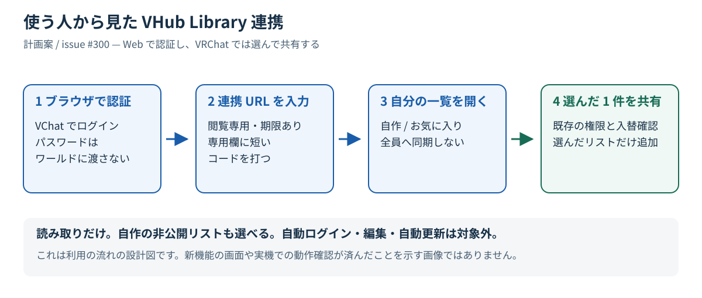
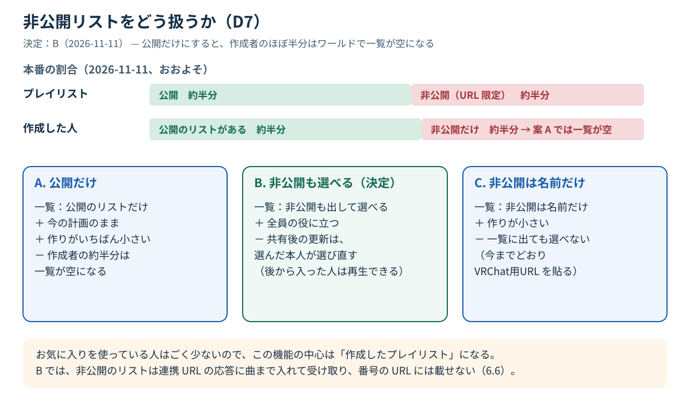
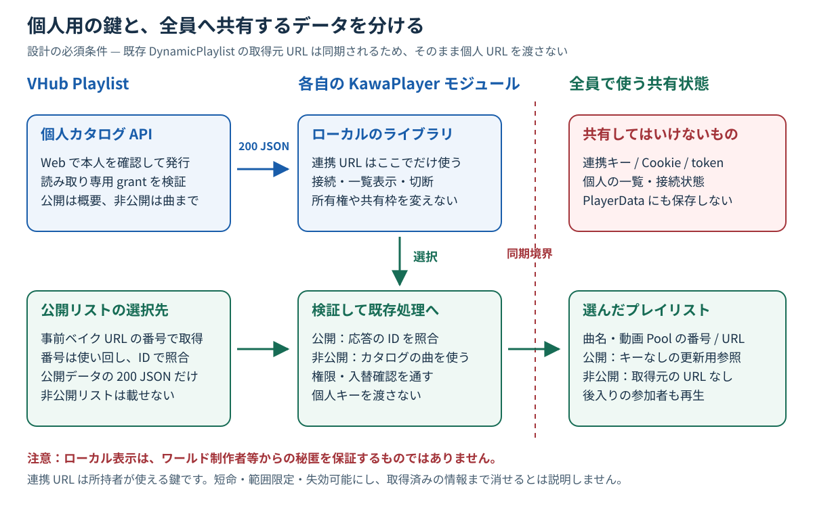
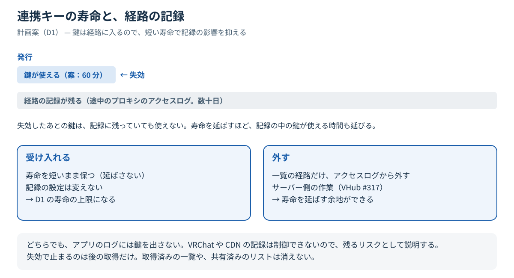
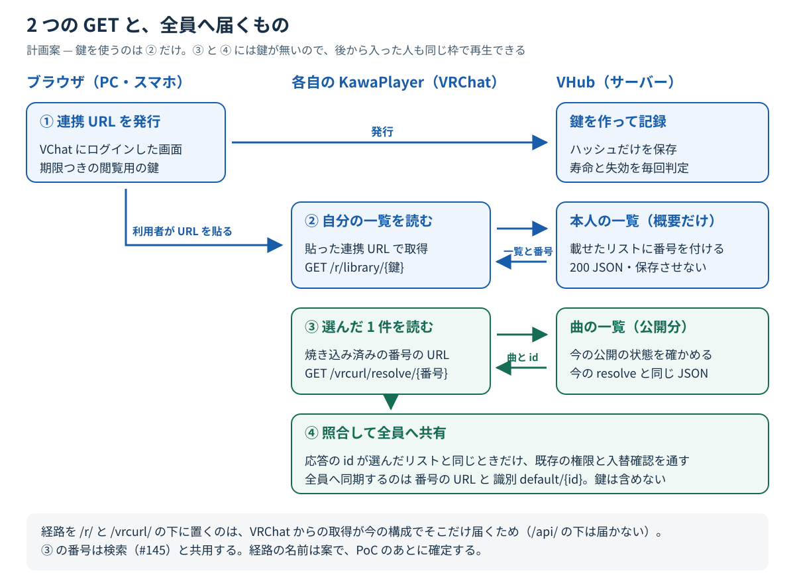
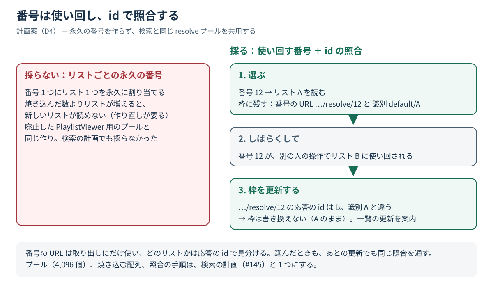
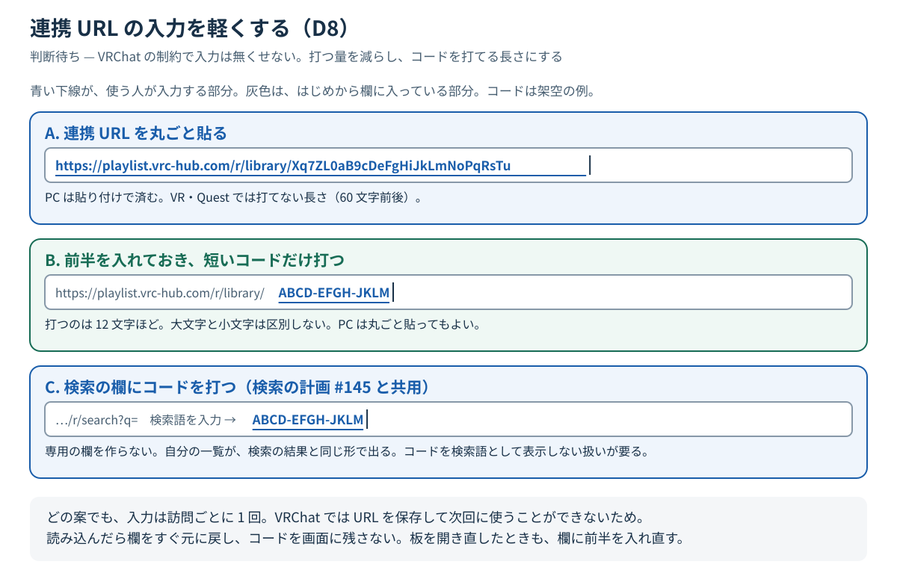
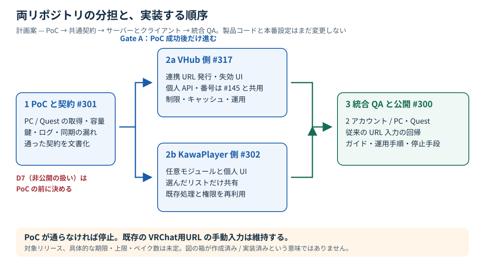

# VHub Library 連携の実装計画

**状態: 計画案・未実装。** 作成日: 2026-10-24。2026-11-11 に、本番の構成と照らして改訂した（要点の表 2）。親は [KawaPlayer #300](https://github.com/Mega-Gorilla/KawaPlayer/issues/300)。対象リリースは未定。

ブラウザで VChat にログインし、VHub の「作成したプレイリスト」と「お気に入り」をワールドから開く。**個人ライブラリの閲覧と、選んだプレイリストを全員へ共有する操作を分ける。** ワールドに VChat / VRChat のアカウント操作権限は渡さない。

この文書の図は設計図であり、実装済みの画面や成功した実機テストの画像ではない。数値・API 経路・クラス名の案は PoC 後に確定する。

## 要点

**決まったこと（2026-11-11）。** PoC（Gate A）の前に決める事項は、すべて決まった。残りは PoC の結果を見て決める。

| ID | 決めること | 案 | 詳しく |
| --- | --- | --- | --- |
| D7（決定） | 非公開（URL 限定）のリストを初期版で扱うか | **B に決定**: 非公開も選べる。連携 URL の応答に曲まで入れる | 2 章の図 2、6.6 |
| D4（決定） | 選んだリストを読む番号を、検索の計画（#145）と共用するか | **共用に決定**（使い回す番号＋ id の照合） | 6.1 の図 6 |
| D8（決定） | 連携 URL の入力をどう軽くするか | **B に決定**: 前半を入れておき、短いコードだけ打つ | 6.5 の図 7 |
| 実装の順（決定） | 検索（#145）と、どちらを先に実装するか | **検索が先に決定**。番号の仕組みは検索が作り、Library はそれを使う | 7 章 |
| D1 | 連携キーの寿命と、アクセスログでの扱い | 60 分。延ばすならログから外すことと組にする | 4.3 の図 4 |
| D2・D3・D5・D6 | 一覧の上限、更新の仕方、回数の上限、公開の仕方 | 6.3 の表 7 のとおり | 6.3 |

表 1. 決定した事項（2026-11-11）と、PoC のあとに決める事項（D1・D2・D3・D5・D6）。

**2026-11-11 の改訂。** 本番で動いている VHub と、その手前の構成を読み取りだけで確かめ、次の 4 点を直した。確かめたことは 3.2 にまとめた。

| 点 | 改訂の前 | 改訂の後 | 理由 |
| --- | --- | --- | --- |
| 経路 | `/api/vrc/library/…` など | `/r/library/{鍵}` と `/vrcurl/resolve/{番号}` | VRChat からの取得が届くのは `/r/`・`/vrcurl/` の下だけ |
| 番号の方式 | リストごとの永久の番号 | 検索と共用の使い回す番号＋ id の照合 | 永久の番号は廃止した Viewer と同じ作りで、検索の計画でも採らなかった |
| 対象範囲 | 公開だけ（非公開は後で判断） | D7 として先に決めた。B（非公開も選べる）に決定 | 作成者のほぼ半分は、公開だけだと一覧が空になる |
| ログ | 制御外のログを PoC で調べる | 鍵の寿命とログの扱いを D1・T13 に足した | アクセスログは経路を数十日残す |

表 2. 2026-11-11 の改訂の要点。

## 目次

- [要点](#要点)
- [1. 利用者から見た流れ](#1-利用者から見た流れ)
- [2. 初期範囲と対象外](#2-初期範囲と対象外)
- [3. 確認できた現在の仕組みと制約](#3-確認できた現在の仕組みと制約)
- [4. 個人用と共有用の境界](#4-個人用と共有用の境界)
- [5. 両リポジトリの実装計画](#5-両リポジトリの実装計画)
- [6. 通信契約のたたき台](#6-通信契約のたたき台)
- [7. 順序と判断ゲート](#7-順序と判断ゲート)
- [8. 検証チェックリスト](#8-検証チェックリスト)
- [9. 関連 issue と文書更新](#9-関連-issue-と文書更新)
- [10. 根拠と図の再生成](#10-根拠と図の再生成)

## 1. 利用者から見た流れ



図1. 最初に Web で認証し、VRChat 内では一覧から選ぶ。ログイン情報を動画 URL 欄に貼る手順ではない。

1. PC / スマートフォン等のブラウザで VHub に VChat ログインする。
2. Web の「VRChat と連携」で、許可する対象と期限を確認して連携 URL を発行する。
3. KawaPlayer の専用 URL 欄へ貼るか、欄に入っている前半の続きにコードを打って、接続する（入力の軽くし方は 6.5）。初期版では各訪問時の手動接続を基本とし、端末 / ワールドをまたぐ自動ログインは約束しない。
4. 自分のクライアントだけで「作成したプレイリスト」「お気に入り」を見る。ここでは Controller の所有権も共有スロットも変更しない。
5. 選んだリストの取得後、既存の再生権限と、必要なら古いリストとの入替確認を通して共有へ追加する。全員への反映と、停止中だけの自動再生は既存 PlaylistLoader の規則を使う。

閲覧をインスタンスオーナー限定にはしない。**閲覧の許可は VHub の grant、ワールドへ追加する許可は既存 KawaPlayer の権限**であり、別の判定になる。

## 2. 初期範囲と対象外

| 初期版に入れる | 初期版には入れない |
| --- | --- |
| 自分が作ったプレイリストの一覧と選択。公開のリストは概要と番号、非公開（URL 限定）のリストは曲まで受け取る（D7 の B、6.6） | 他人の非公開のリスト（お気に入りに入っていても出さない） |
| 公開プレイリストへの VHub のお気に入り | VChat 投稿のお気に入り、編集、削除、お気に入りの変更 |
| 読み取り専用・対象限定・期限あり・失効可能な連携 URL | 通常の Cookie、MiAuth token、Hasura JWT のワールドへの受け渡し |
| 手動で接続・更新・切断する個人 UI | 常時ポーリング、入室だけでの自動認証、永続ログイン |
| 選択した 1 件だけを既存の共有枠に追加 | ライブラリ全体の共有、公開リストの全曲の先読み（非公開のリストだけは、上限の範囲で曲を先に受け取る。6.6）、サムネイル |
| 既存の default 動画 URL Pool | yt-dlp / YouTube Stream URL 解決、旧 PlaylistViewer の復活 |

表 3. 初期版の範囲。

お気に入りは公開のリストだけを対象にするが、**どのリストをお気に入りにしているかという組み合わせは個人用の情報**として扱う。公開の一覧 API から利用者ごとに列挙できる作りにはしない。

**注（2026-11-11 の確認）:** 公開だけを対象にすると、この機能が役に立たない人が多い。本番では、プレイリストのほぼ半分が非公開で、作成者のほぼ半分は非公開のリストしか持っていない。その人たちは、ワールドで「作成したプレイリスト」が空になる。非公開のリストの大半は、VRChat用URL を貼る形で実際に読み込まれている。一方、お気に入りを使っている人はごく少ない。このため、非公開のリストも選べるようにする（D7 は B に決定、2026-11-11）。作りは 6.6。



図2. 非公開リストの扱い（D7）の 3 案。割合はおおよそ。B に決定した。鍵のない取得先が無いので、共有したあとの更新は、選んだ本人が選び直す形になる（6.6）。

## 3. 確認できた現在の仕組みと制約

調査時点のソースは VHub `74834a4b3951ee4da4c92ff9771ff7d809f8f5b4`、KawaPlayer `f6899b59df89a7fc808363cf17717ed24b62845d`。実装開始時は差分を確認する。

2026-11-11 に、本番で動いている VHub（`6dec2d1`）と、その手前の構成を読み取りだけで確かめた。`6dec2d1` と上のコミットとの差は画面の先読みの変更だけで、API は同じだった。確かめて分かったことは 3.2 に分けた。

### 3.1 ソースと公式仕様から

| 確認できた事実 | 計画への影響 |
| --- | --- |
| VChat の MiAuth ログイン後、VHub の自作リストとお気に入りを実ブラウザで表示できた | 本人識別と既存の一覧取得を再利用する。実アカウントの名前・内容を文書や図に転載しない |
| `/api/me/playlists` と `/api/me/favorite-playlists` はブラウザの iron-session Cookie で本人を判定 | API をそのまま Udon へ公開せず、専用の限定 grant を作る |
| 通常の HTTP で上記 2 経路は Cloudflare challenge の HTTP 403 になった | API 自体の認証成否へは到達していない。新経路の限定例外とキャッシュ除外を別途確認する |
| `VRCStringDownloader.LoadUrl` は VRCUrl と受信先を受ける。ブラウザの認証セッションの共有を前提にできない | Cookie / 任意 header の設定を必要としない GET を使う |
| `new VRCUrl(string)` は Editor 専用。JSON から URL 文字列を取り出しても実行時に作り直せない | 個人 URL は利用者入力の VRCUrl、選択先は事前ベイク済みの番号で受け取る |
| String Loading は 5 秒に 1 回。VHub は信頼済みドメインの一覧にない | 連打をまとめ、手動更新と上限付き処理にする。Allow Untrusted URLs を案内する |
| 現在の PlaylistLoader は 1 件の応答を解析したあと共有枠へ Fill する | 個人のカタログを既存の取得経路へ直接流さない |
| DynamicPlaylist の `_sourceUrl` は UdonSynced。PlayerData も自動同期され他の Udon から読める | 個人キーを共有枠・PlayerData に入れない |
| 既存 `/r/default/{id}` は非公開でも URL を知る人へ内容を返す「URL=鍵」の仕様 | 既存の挙動は変えない。新機能は公開リストを再検証し、非公開を厳密な本人限定と誤説明しない |

表 4. ソースと公式仕様から確かめたこと。

### 3.2 本番の構成から（2026-11-11）

数は割合とおおよその大きさだけを載せる。上流の設定の中身、実測の表、正確な数は、サーバーの運用の記録（[gmk01-server-docs #419](https://github.com/kisaragi-official/gmk01-server-docs/issues/419)、非公開）に残した。

| 確認できた事実 | 計画への影響 |
| --- | --- |
| Udon からの取得（Unity の UA）は、`/r/` と `/vrcurl/` の下だけが通る。`/api/` の下は、まだ無い経路も含めて challenge の HTTP 403 になった | 新しい経路は `/r/` と `/vrcurl/` の下に置く（6.1）。Cloudflare の設定を変えずに済む。経路の例を `/api/vrc/…` から改めた |
| `/api/vrc/` は、サポートを終えた PlaylistViewer の経路の置き場で、公開済みのワールドから今も呼ばれている | 同じ置き場に新しい経路を足さない |
| 経路に、管理・秘密・バックアップを思わせる語や、設定ファイルの拡張子を含むと、上流の保護で止まる（例外より先に効く） | 経路とプールの名前は VHub 側で通ることを確かめてから決める。連携キーは英数字と `-` `_` だけで作る |
| 番号で公開リストを 200 JSON で返す作りは、以前の `playlist` プール（PlaylistViewer 用、VHub #287 で廃止）と同じ。検索の計画（[145-vhub-search](../145-vhub-search/README.md) の 3.2）は、この「プレイリストごとの永久の番号」を採らず、使い回し型の `resolve` プールと識別の照合に決めている | 永久の番号を別に作らず、検索と同じ `/vrcurl/resolve/{i}` と識別を使う（5 章、6.1、D4）。`playlist` という名前の経路は、公開済みの Viewer が古い番号で呼ぶので使い回さない |
| アクセスログは、手前のプロキシとアプリの前の両方で、経路をそのまま記録する。数十日分が残る。アプリも resolve のたびに ID を記録している | 連携キーは経路に入るので、ログに残る。キーの寿命を短く保つ（D1）。新しい経路ではキーをアプリのログに出さず、プロキシのログから外すかどうかを決める（5.1 の 6） |
| 手前のプロキシに、IP ごとの回数制限がある。アプリに渡る接続元の IP は、プロキシが入れ直した値 | アプリの IP ごとの制限と合わせて二段になる。D5 の数は、これを前提に決める |
| アプリは 1 つだけ動いている。resolve のキャッシュ（60 秒）と回数制限はプロセスの中にあり、再起動で消える。公開の切り替えや削除は、同じプロセスでキャッシュを消している | 新しい経路は、キャッシュを読む前に公開の状態を確かめる（5.1 の 5）。利用者ごとの発行数は DB で数える（タグの作成数を DB で数えている前例がある） |
| ログインは Cookie だけで持ち（30 日）、サーバー側に記録がない | 連携キーは新しいテーブルで持ち、失効をサーバーで判定する（4.1 のとおり） |
| 1 人あたりの「作成（公開）＋お気に入り」は、最大でも 100 件に届かず、ほとんどの人は数件。名前は長くても 100 バイトほど | D2 の 100 件・64 KiB は、今の規模に収まる |
| 公開のプレイリストは 1,000 件弱で、月に 100 件前後増えている。KawaPlayer は動画用にすでに 100,000 個の URL を焼き込んでいる | 4,096 個の `resolve` プールで足りる。焼き込む数の増え方は小さい |
| プレイリストのほぼ半分は非公開で、その大半は VRChat から読み込まれている。お気に入りを使う人はごく少ない | 非公開のリストも対象にする（D7 は B に決定。2 章の注、6.6） |

表 5. 本番の構成から確かめたこと（2026-11-11）。

新機能の Unity / VRChat 実機 PoC はまだ行っていない。ブラウザでの成功を、Quest や Udon での成功の根拠にはしない。上の確認は、取得が通るかどうかと今の規模を見たもので、新しい経路そのものはまだ無い。

## 4. 個人用と共有用の境界



図3. 右側へ同期するのは、個人キーを含まない選択済みリストのデータだけ。公開のリストは更新用の番号の URL も同期し、非公開のリストは取得元の URL を同期しない（6.6）。図の URL は通信設計の分類であり、秘密を図中に埋め込んでいない。

### 4.1 ワールドはアカウントへログインしない

連携 URL は通常のログイントークンとは別の **閲覧用の鍵（grant）**。所持者は期限内に許可範囲を読めるが、アカウント設定・VChat 投稿・お気に入りの変更等はできない。IP、VRChat の表示名、`playerId` を鍵の代わりの本人確認に使わない。

キーはサーバーで乱数発行し、ハッシュだけを保存する。ブラウザで見せる生キーは発行時だけとし、再発行は別キーにする。所有者・期限・許可範囲・失効をサーバーで判定し、再起動で失効が解除されないよう永続化する。

### 4.2 共有の境界

- 個人 URL、接続状態、ライブラリ一覧はモジュールのローカル状態だけに置く。ログ・エラー・コピー欄へキーを出さない。
- `DynamicPlaylist.Fill` へ渡す source は、**キーを含まない公開プレイリストの取得先**（`/vrcurl/resolve/{i}`）と、応答から作る識別（`default/{id}`）。一覧を読むだけで Fill しない。
- 選択した ID と応答 ID の一致を、所有権取得・共有データ書き換え・自動再生の前に確認する。番号は使い回されるので、あとの更新でも、枠を書き換える前に識別を照合する（[145-vhub-search](../145-vhub-search/README.md) の 5.2 と同じ処理）。
- 共有後の更新に個人キーは不要にする。キーのない参加者と後入り参加者でも従来の共有データで再生できる。
- 非公開のリストは、番号の URL に載せない（番号は誰でも順に読めるため）。連携 URL の応答で受け取った曲を、そのまま共有枠へ入れる。全員へ同期するのは曲と識別（`default/{id}`）だけで、取得の URL は持たない（6.6）。
- ローカルの「切断」は個人の入力・一覧・待ち処理を消すだけで、既に追加した共有リストや現在の動画を消さない。Web の「失効」とは別操作と説明する。

### 4.3 残るリスク

ローカル UI は通常の全員向け同期を避けるための設計であり、ワールド制作者・改造クライアント等からの秘匿を保証しない。SDK / VRChat、CDN、proxy、APM が URL を記録する可能性もある。自アプリのマスクだけで「キーはどのログにも残らない」とは説明しない。

連携キーは経路に入るので、途中のプロキシのアクセスログに数十日残る（3.2）。キーの寿命を短く保てば、記録の中のキーは失効のあと使えない。寿命を延ばしたくなったら、その経路をログから外す作業と組にする（D1）。



図4. 連携キーの寿命と、経路の記録。どちらの扱いでも、アプリのログには鍵を出さない。

PoC では記録される範囲を調べ、短命・範囲限定・失効で影響を抑え、利用者に説明する。grant の失効は後続のカタログ取得を止めるが、取得済み情報、共有済みリスト、公開 / URL 限定の取得先まで無効化するものではない。

非公開のリストも応答に入るので、有効なコードが漏れたときに読まれる範囲は、公開だけのときより広い。コードの寿命・数の上限・回数制限（D1・D5・D8）を PoC で数字にして確かめる重みが増す。発行のときに、非公開を含めるかどうかを利用者が選べるようにする（5.1）。

## 5. 両リポジトリの実装計画

### 5.1 VHub Playlist 側 — [#317](https://github.com/kisaragi-official/vhub-playlist/issues/317)

1. **Web の入口:** 既存 VChat ログインとマイライブラリから「VRChat と連携」へ案内。対象、期限、URL 所持者が読めること、非公開のリストを含めるかどうか（含めると、URL を持つ人がその中身も読める）を説明して選ばせ、発行・失効・再発行を提供する。
2. **本人と grant:** 既存セッションの userId を正とし、入力された userId を信用しない。grant のテーブル・権限・上限・ハッシュ化を追加。発行 / 失効は既存の Server Actions 方針に従う。MiAuth の追加権限は求めない。 キーの文字と長さは D8 に合わせ、区切りの `-` と大文字小文字の違いを読むときに吸収する。Web では 4 文字ずつ区切って見せ、連携 URL の全体をコピーするボタンも置く。
3. **個人カタログ:** grant を検証して、本人の自作と、お気に入りのうち公開中のものを返す。公開のリストは概要と番号、自作の非公開のリストは曲まで入れる（grant が非公開を含むときだけ。件数と大きさに上限、6.6）。同じリストが両方に入る場合は entries を重複させず、所属する欄を示す。件数と切り詰めの有無を明示する。
4. **選択先:** 検索の計画（[145-vhub-search](../145-vhub-search/README.md) の 4.2）が作る `GET /vrcurl/resolve/{i}` と `resolve` プール（使い回し型、4,096 個）を共用する。カタログを返すときに、載せた公開リストを `resolve` プールへ登録し、その番号を返す。永久の番号のプールは作らない。検索と、どちらを先に実装しても、プールと経路は 1 つにする。旧 Viewer の経路（`/vrcurl/playlist/{i}` と `/api/vrc/` の一覧）は復活させず、名前も使い回さない。
5. **曲の解決:** 選んだリストだけを解決し、既存 default 動画 Pool と曲の組み立てを再利用する。`/vrcurl/resolve/{i}` は、キャッシュを読む前に今の公開の状態を確かめ、公開→非公開後に共有キャッシュから返さない（今の resolve のキャッシュは公開かどうかを持たず、`/r/default` は非公開も返すため）。既存 `/r/default` の方針は変えない。
6. **運用と文書:** grant 発行・取得・公開 resolve の回数と容量を制限。利用者ごとの発行数は DB で数える。個人カタログは private/no-store。経路は `/r/` と `/vrcurl/` の下に置き、名前が上流の保護で止まらないことを確かめる（3.2）。連携キーをアプリのログに出さない。プロキシのアクセスログには経路が数十日残るので、カタログの経路だけログから外すか、キーの寿命を短く保つことで受け入れるかを決め、監視・停止手順とともに用意する。DB 変更は setup-db.ts で冪等にし、秘密を Hasura の利用者向け API に公開しない。

### 5.2 KawaPlayer 側 — [#302](https://github.com/Mega-Gorilla/KawaPlayer/issues/302)

1. **任意モジュール:** 仮称 VHubLibrary。通信、個人状態、入力・一覧 UI を module 内に閉じる。Controller は認証を知らず、既存の URL interceptor を上書きして取り合わない。
2. **Editor と配線:** module の追加 / 無効化、UI の build-time wiring を既存規則で作る。公開リスト用の VRCUrl 配列は、検索と同じ `_resolvePool`（`/vrcurl/resolve/{i}` × 4,096）を使い、二重に焼き込まない。新 Udon は新しい子オブジェクトに置き、出荷済みオブジェクト上の UdonBehaviour 数を変えない。
3. **個人用 UI:** 専用 URL 欄と接続・手動更新・切断、自作 / お気に入り一覧、件数・上限・読み込み・エラーを用意。 URL 欄には連携 URL の前半を入れておき、決めた前半で始まる URL だけ受け付け、読み込んだら欄を元に戻す。欄を表示するたびに前半を入れ直す（6.5）。既存の配色・多言語化を使う。画面 / タブレットで自分の一覧を扱えるが、物理的に他人から見えないという意味ではない。
4. **応答の検証:** schema、pool、index、ID、型、件数、サイズ、名称の長さ・rich text を検証。1 件だけ取得し、接続変更・切断後の古い callback を無視する。失効を確認したら旧一覧を消して接続を要求する。
5. **選択と共有:** 選んだ項目の識別（`default/` ＋ `items[].id`）とともに `PlaylistLoader` へ渡し、応答の識別が一致したあと、既存の `BeforeUserLoadPlaylist`・入替確認・競合チェックへ委譲する。取得の URL と識別を分けて同期する作り（`SourceKey`）は、検索の計画の 5.2 のものを使う。解析・トラック構築・Fill の別実装を増やさず、必要なら既存処理に小さな共通入口を作る。非公開のリストは、応答で受け取った曲をその共通入口へ渡して共有枠に入れる（取得の URL なし、識別あり）。その枠の更新ボタンは働かせず、選んだ本人が選び直す形にする。確認の重複・Controller への認証追加はしない。
6. **文書と QA:** 最小対応 SDK でのコンパイル、Prefab / Network ID、既存プロジェクト更新を確認。PC / Quest と 2 アカウントで個人分離・共有・後入り・拒否を確認し、架空データの操作画像付きガイドへ反映する。

## 6. 通信契約のたたき台

**ここは未確定の案。** PoC [#301](https://github.com/Mega-Gorilla/KawaPlayer/issues/301) で確認後、VHub の `docs/api/public-api.md` を契約の正本として更新する。製品側の定数や既存 API の保証ではない。

### 6.1 二種類の GET を分ける



図5. 2 つの GET と、全員へ届くもの。鍵を使うのは ② だけで、③ と ④ には鍵が入らない。非公開のリストは ③ を通らず、② で受け取った曲を使う。

| 用途 | 経路の例（案） | 認可と応答 |
| --- | --- | --- |
| 個人カタログ | `/r/library/{grant}` | キーによる限定閲覧。公開のリストは概要と番号、非公開のリストは曲まで入れた 200 JSON。private/no-store。利用者が入力した VRCUrl を使う |
| 選んだ公開リスト | `/vrcurl/resolve/{index}`（検索の計画と共用） | 公開情報のみ。キー不要。事前ベイクした URL から選び、既存 resolve と同じ曲の形式を 200 JSON で返す |
| 選んだ非公開リスト | （取得しない） | 個人カタログの応答に入っている曲を使う。番号の URL には載せない（6.6） |
| 動画の再生 | 既存 `/vrcurl/default/{index}` | 変更しない。選んだ曲を再生するときだけ利用 |

表 6. 使う経路（案）。

経路を `/r/` と `/vrcurl/` の下に置くのは、Udon からの取得が今の構成で通るのがこの 2 つの下だけだから（3.2）。`/r/library/{grant}` は、今の `/r/{pool}/{playlistId}` と同じ 2 区切りの形に収まる。`library` は pool の名前としては使わず、resolve の対象にしない。

個人キーは第1の経路だけで使う。第2の番号は秘密として扱わず、列挙されても個人の一覧・非公開リストを返さない。番号は使い回されることがあるので、**番号の URL は取得にだけ使い、どのプレイリストかは応答の `id` で見分ける。** 選んだときも、共有したあとの更新でも、枠を書き換える前に識別を照合し、違えばどの枠にも書かない。こうして、共有済みの source があとで別のリストを指しても取り違えない。照合の手順は検索の計画の 5.2 に合わせる。



図6. 番号は使い回し、id で照合する（D4）。

カタログで曲まで用意するかは、公開かどうかで分ける。

- **公開のリスト:** カタログでは概要と番号だけを返す。曲の動画の番号（default プール）は、この時点では割り当てない。選んだときに `/vrcurl/resolve/{index}` が、今の resolve と同じ処理で割り当てて返す。
- **非公開のリスト:** 番号の URL に載せられないので、カタログの時点で曲ごとに動画の番号を割り当て、曲名と番号を応答に入れる（6.6）。選ぶ前に番号を用意するのは、この分だけである。対象は本人の自作で、grant が非公開を含むときに限り、D2 の上限に収まる分までとする。

公開リストを `resolve` プールへ登録する処理と、動画の番号の割り当ては分ける。将来ページ送りを足す場合も、受け取った cursor を文字列連結して VRCUrl に変換する案にはしない。

### 6.2 カタログの例（すべて架空）

```json
{
  "schemaVersion": 1,
  "resolverPool": "resolve",
  "grantExpiresAt": "2030-01-01T01:00:00Z",
  "total": 2,
  "returned": 2,
  "truncated": false,
  "items": [
    {
      "id": "SAMPLE_PLAYLIST_ID",
      "name": "サンプル A",
      "visibility": "public",
      "trackCount": 12,
      "resolveIndex": 42,
      "collections": ["created", "favorites"]
    },
    {
      "id": "SAMPLE_UNLISTED_ID",
      "name": "サンプル B",
      "visibility": "unlisted",
      "trackCount": 2,
      "collections": ["created"],
      "tracks": [
        { "index": 101, "title": "サンプル曲 1", "mode": 1, "provider": "youtube" },
        { "index": 102, "title": "サンプル曲 2", "mode": 1 }
      ]
    }
  ]
}
```

`total` / `returned` は両欄の重複を除いた件数。欄ごとの総件数が必要なら別フィールドを契約へ追加し、戻った配列長から全件数を推測しない。`grantExpiresAt` は表示の補助であり、サーバーが毎回期限を判定する。`visibility` は `public` か `unlisted`。`unlisted` の項目には `resolveIndex` が無く、`tracks`（resolve の `tracks` と同じ形）が入る。上限で曲を入れられなかった項目は `tracks` を省き、`tracksOmitted: true` にする。

選択先の成功応答は既存の `{ ok, id, pool: "default", name, tracks: [{ index, title, mode, provider? }] }` を基本にする。**応答の id が選択と違う場合は Fill より前に拒否する。** module / loader 間の共通入口でこの検証順序を守る。

### 6.3 数値と運用の未決事項

| ID | たたき台 | 決定前に確かめること |
| --- | --- | --- |
| D1 | grant 寿命 60 分、有効 grant は利用者あたり 3 件、十分なランダム性を持つ生キーをハッシュ保存。キーの文字と長さは D8 | VR / Quest の入力負担、漏れた場合の影響、サーバー時計、再発行と失効の操作性。**アクセスログに経路が数十日残る（3.2）ので、寿命を延ばすなら、ログから外すことと組にする** |
| D2 | カタログ最大 100 件。公開の概要は 64 KiB まで。非公開のリストの曲を入れる分は別に上限を置く（たたき台：新しい順に、応答の全体が 256 KiB に収まる分だけ）。超過は total / returned / truncated と案内で明示 | 非公開の曲を入れたときの応答の大きさと、サーバーの時間（曲ごとに動画の番号を割り当てる）。Quest のメモリ・JSON 解析時間、どの順で残すか。自作だけで枠を使い切らない規則。件数と名称は、今の規模なら収まる（3.2） |
| D3 | 自動更新なし、手動更新。retry 連打をまとめ、回数 / 時間に上限を付ける | SDK の 5 秒制限、他 module と同時取得、長い応答待ち・遅い callback。エラー回数を無制限に積まない |
| D4 | **決定（2026-11-11）: 共用する。** 公開リストの番号は、検索と共用の `resolve` プール（使い回し型、4,096 個）。永久の番号は作らない。取り違えは識別の照合で防ぐ | 検索（#145）を先に実装し、プール・`_resolvePool`・`SourceKey` を 1 つにそろえること。新しい同期の項目なので、PC と Android の作り直しが要ること。使い回しが実際に起きる頻度 |
| D5 | キー単位 / 利用者単位 / IP・全体での発行・取得予算 | 手前のプロキシの IP ごとの制限と、アプリの制限（プロセス内、再起動で消える）の二段で足りるか。利用者ごとの数は DB で数える。列挙、同一 IP の複数人。CF のチャレンジ除外を無制限化と混同しない |
| D6 | 新機能は未公開 / 無効で実装し、統合 QA 後に限定公開 | API の停止と再開、キーの失効、旧方式の手動入力が常に残ること。対象リリースは別途決定 |
| D7 | **決定（2026-11-11）: B。** 非公開（URL 限定）のリストも選べる。連携 URL の応答に、自作の非公開リストの曲まで入れる（件数と大きさに上限、6.6）。A（公開だけ）と C（名前だけ出す）は採らない | 応答の大きさと時間（D2）。共有したあとの更新を、選んだ本人が選び直す形でよいかを実機で確かめる。発行のときに非公開を含めるかを選べること。コードが漏れたときの範囲が広がるので、D1・D5・D8 の数字 |
| D8 | **連携 URL の入力をどう軽くするか。** A: 丸ごと貼る。B: 欄に前半を入れておき、短いコード（10〜12 文字、大文字小文字を区別しない）だけ打つ。C: 検索の欄と共用する（6.5）。**決定（2026-11-11）: B** | VR / Quest で実際に打てるか、貼り付けが使えるか。短いコードの推測に対する強さを、寿命（D1）・有効な数・回数制限（D5）と合わせて数字で確かめる。文字数は PoC で確定する |

表 7. 数値と運用の未決事項。

曲数・共有量は既存 PlaylistLoader の `_maxTracks`（既定 200）と `_maxSyncBytes`（既定 32,768 bytes）の上限・部分取得案内を再利用し、個人カタログの D2 と混同しない。

### 6.4 エラーの扱い

| 条件 | サーバー / クライアントの扱い |
| --- | --- |
| 不正・失効・期限切れ grant | 401 JSON。理由から利用者の存在を推測させず、再接続を案内。旧個人一覧と待ち処理を無効化 |
| 非公開化・削除・選択先なし | 新公開経路は 404 JSON。既存共有データを書き換えず、一覧更新を案内 |
| 非公開のリストの曲が上限で入らなかった | 一覧に名前を出し、選べない理由と、VRChat用URL を貼れば読み込めることを案内 |
| 非公開のリストの枠で更新を押した | 読み直さない。選んだ本人が一覧から選び直すよう案内 |
| 回数制限 | 429。自動連打しない。再試行は明示操作 / 上限付き。Udon がエラー応答本文や Retry-After を読めると仮定しない |
| 403 / 通信失敗 / 5xx | 失敗を表示し共有データは維持。403 を一律に Cloudflare や権限不足と断定しない。経路の名前やキーの文字が上流の保護に当たっても 403 になる（3.2） |
| 未知 schema / ID 不一致 / index 範囲外 / サイズ超過 | 検証時に拒否し、所有権・Fill・再生に到達させない。番号が使い回されて識別が合わないときは、一覧の更新を案内する |
| 上限による一覧の切り詰め | 戻った数と全件数・上限を表示。全部取得できたと誤表示しない |

表 8. エラーの扱い。

### 6.5 連携 URL の入力を軽くする（D8）

VRChat では、実行中に文字列から VRCUrl を作れず、入力された VRCUrl を保存して次の訪問で使うこともできない。そのため、**連携 URL は、訪問のたびに利用者が入力する。** この制約は無くせない。入力が要るのは一覧を読むこの 1 本だけで、選んだリストの読み込みと共有は、焼き込んだ番号の URL で進む（図 5）。

作れなくなる障害ではないが、使い勝手ではいちばんの弱点になる。連携 URL は 60 文字前後あり、PC は貼り付けで済むが、VR と Quest では打つことになる。



図7. 連携 URL の入力の 3 案（D8）。B に決定した。青い下線が、利用者が入力する部分。

| 案 | 利用者が入力するもの | 良い点 | 気をつける点 |
| --- | --- | --- | --- |
| A. 丸ごと貼る | 連携 URL の全体（60 文字前後） | 作りが最小。キーを長くできる | VR・Quest では実用にならない |
| **B. 前半を入れておき、短いコードだけ打つ**（決定） | コード 10〜12 文字 | 検索語を打つのと同じ手間。PC は丸ごと貼ってもよい | キーが短くなるので、寿命・回数制限・有効な数の上限で推測を防ぐ |
| C. 検索の欄と共用 | 検索の欄にコード 10〜12 文字 | 専用の欄・経路・結果の表示を、検索（#145）と共用できる | 検索語は表示してよいが、コードは表示にもログにも出せない。扱いを分ける必要がある。検索の実装が前提 |

表 9. 連携 URL の入力の案。

**決定（2026-11-11）: B で進める。** 決めた前半で始まる URL を受け付けるので、PC では A のように連携 URL を丸ごと貼ることもできる。C は初期版では採らない。検索（#145）を実装したあとで欄を共用したくなったら、改めて判断する。コードの文字数（10〜12 文字）は、PoC で推測に対する強さを確かめてから確定する。

B の作り:

- **前半を入れておく。** 入力欄に、連携 URL の前半（B なら `https://playlist.vrc-hub.com/r/library/`）を入れておき、利用者は続きにコードを打つ。検索の計画（[145-vhub-search](../145-vhub-search/README.md)）が採っている、入力欄に URL の前半を入れておく方式と同じ。
- **決めた前半で始まる URL だけ受け付ける。** それ以外の URL は読み込まない。
- **読み込んだら、欄をすぐ元に戻す。** コードを画面に残さない。エラーの文やコピー欄にも出さない。
- **欄を表示するたびに、前半を入れ直す。** 無効のまま読み込まれた入力欄には初期の値が入らないことがあるので、一覧の板を開くたびに入れ直す。
- **コードは打てる形にする。** 大文字と小文字を区別せず、見分けにくい字（0 と O、1 と I など）を使わない 10〜12 文字。Web では 4 文字ずつ区切って見せ、連携 URL の全体をコピーするボタンも置く。区切りの `-` は、サーバーが読むときに無視する。
- **短いコードの安全は、長さだけに頼らない。** 寿命（D1）、有効なコードの数の上限、IP ごとと全体の回数制限（D5）を合わせて、当て推量が現実的でないことを PoC で数字にして確かめる。足りなければ文字数を増やす。

使えない手もある。検索の応答は、次のページや画像を番号で返し、焼き込んだ番号の URL で読ませることで、2 回目からの入力を無くしている。番号の URL は誰でも順に読めるので、この手は公開の中身にしか使えない。本人の一覧や非公開のリストを番号に載せることはしない（D7 の B 案は、この手では解けない）。

### 6.6 非公開のリストの読み込みと共有（D7＝B）

非公開（URL 限定）のリストは、URL を知っている人だけが読める。番号の URL（`/vrcurl/resolve/{i}`）は誰でも順に読めるので、非公開のリストは載せられない。そこで、連携 URL の応答に曲まで入れて返し、選んだらその曲をそのまま共有枠に入れる。

| | 公開のリスト | 非公開（URL 限定）のリスト |
| --- | --- | --- |
| 一覧の応答に入るもの | 概要と番号 | 概要と曲（resolve と同じ形） |
| 選んだときの読み込み | 番号の URL をもう 1 回読む | 読まない。応答の曲を使う |
| 全員へ同期するもの | 曲、番号の URL、識別 | 曲、識別（取得の URL なし） |
| 後から入った人 | 再生できる | 再生できる |
| 更新ボタン | 番号の URL を読み直す（識別を照合） | 働かない。選んだ本人が一覧から選び直す |
| 同じリストを VRChat用URL で貼ったとき | 識別が同じなので同じ枠になる | 同じ枠になり、その枠は URL で更新できるようになる |

表 10. 公開のリストと非公開のリストの扱いの違い。

- **含めるかは利用者が選ぶ。** 連携 URL を発行するとき、非公開のリストを含めるかどうかを選べる。含めない連携 URL では、非公開のリストは一覧に出ない。
- **対象は自作だけ。** 他人の非公開のリストは、お気に入りに入っていても出さない（今の Web の一覧と同じ）。
- **上限を置く。** 曲まで入れると応答が大きくなる。新しい順に、上限（D2）に収まる分だけ曲を入れる。入らなかったリストは名前だけ出し、VRChat用URL を貼れば読み込めると案内する。今の規模では、非公開のリストは 1 人あたり多くて十数件、ほとんどの人は数件。
- **共有すると、その場の全員に届く。** 共有枠に入れた曲と識別（`default/{id}`）は全員へ同期される。今 VRChat用URL を貼って読み込むときに、URL が全員へ同期されるのと同じ範囲。共有の前の確認に、非公開のリストであることを出す。
- **サーバーの負荷を確かめる。** 曲を返すには、曲ごとに動画の番号（default プール）を割り当てる。検索の計画が「応答に曲まで入れる」案を採らなかったのは、この負荷のため。Library の一覧は本人が手動で読むときだけで、対象も本人のリストに限られるが、応答の時間は PoC で測る。

## 7. 順序と判断ゲート



図8. PoC が通るまで製品の契約や本番設定を確定しない。サーバーとクライアントの実装を分けても、契約・サンプルは共通にする。

**実装の順（決定、2026-11-11）:** 検索（#145）を先に実装する。`/vrcurl/resolve/{i}`・`_resolvePool`・`SourceKey` は検索が作り、Library はそれを使う。Library の PoC（Gate A）は、検索の番号の仕組みが動いてから始める。

1. **Gate A — [#301](https://github.com/Mega-Gorilla/KawaPlayer/issues/301):** 架空データと使い捨て環境で取得→選択→共有を試す。実装中の Unity / 本番を勝手に操作しない。PC / Quest、URL・ログ・同期の境界、番号の使い回しと識別の照合、API 形式、キーの期限・失効を記録し D1〜D8 を更新。対象範囲（D7＝B）、番号の共用（D4）、連携 URL の入力（D8＝B）は決まっている。コードの文字数は、この PoC で確かめて確定する。
2. **製品実装 — [VHub #317](https://github.com/kisaragi-official/vhub-playlist/issues/317) / [KawaPlayer #302](https://github.com/Mega-Gorilla/KawaPlayer/issues/302):** Gate A の契約で実装する。モックの開発は並行でもよいが、未検証の方式で本番公開しない。
3. **Gate B — 親 [#300](https://github.com/Mega-Gorilla/KawaPlayer/issues/300):** 以下の統合 QA、案内・画像・運用手順、停止経路を確認してから限定公開。ユーザー向けの操作と制作者向け設定を区別する。

**No-Go:** 秘密・容量・操作性を満たさなければ親 issue へ戻す。VRChat のパスワード、表示名照合、Cookie 流用、秘密を同期する近道へ変更しない。従来の VRChat用URL の手動入力は維持する。

## 8. 検証チェックリスト

未実施。実施時に commit、SDK、端末、テストの条件と実測結果を記録する。サーバーの fake テスト、Unity Editor、PC / Quest 実機を混同しない。

| 番号 | 操作 / 条件 | 合格の目安 |
| --- | --- | --- |
| T1 | A と B が別々に接続して一覧を見る（非公開のリストを含む） | 作成 / お気に入りが混ざらず、非公開のリストは本人にしか出ず、閲覧だけで共有枠・所有権が変わらない |
| T2 | A が B の grant を発行 / 失効しようとする | サーバーが拒否する。UI だけで隠す対処にしない |
| T3 | 個人一覧が出た状態で B が共有状態・PlayerData・ログを確認。後から C も入る | 連携キー・Cookie・個人一覧が同期されない。自アプリログはマスク。制御外ログの残余リスクを別記 |
| T4 | 閲覧権限はあるが再生権限のない人が追加を押す | 既存の権限で拒否し、Fill や再生をしない |
| T5 | 満杯・再生中・一時停止中で選択する。入替確認中に別の人が枠を変える | 既存の入替・競合確認、停止中だけの自動再生、再生継続の規則が保たれる |
| T6 | 取得中に切断、別 URL へ接続、失効。元の成功応答を遅らせる | 古い一覧を戻さず、別リストや別利用者の取得結果を適用しない |
| T7 | grant の期限切れ・失効・再起動後の再利用 | 個人一覧の後続取得を拒否。共有済みデータまで消えるとは保証しない |
| T8 | 未知 schema、長い名前、rich text、重複、ID 不一致、pool 不一致、範囲外番号。番号を別のリストへ使い回させてから、選択と、共有済みの枠の更新を試す | 安全に表示 / 拒否し、共有へ誤って追加しない。使い回された番号では、識別の照合でどの枠も書き換えない |
| T9 | 公開リストを非公開化 / 削除し、新経路の cache hit も試す | 新経路からは返さない。既存 /r の URL=鍵仕様と、取得済み情報の限界を区別 |
| T10 | 空一覧、100 件超 / サイズ超の fixture、大量発行、列挙、連打、429、5xx | 上限が働き、切り詰め・失敗が分かる。無制限 request / poll をしない |
| T11 | PC / Quest で未信頼 URL OFF / ON、通常 HTTP / SDK UA、同一 IP の複数人。決めた経路の名前と、発行したキーを多数、SDK UA で取得する | 必要な設定を案内し、成功時は JSON。経路の名前もキーも上流の保護で止まらない。今の例外の範囲を広げず、他経路の保護を維持 |
| T12 | 最小 SDK の既存プロジェクトを更新し、module OFF / ON、画面・タブレット、PC / Quest ビルド | コンパイル・参照・Network ID に問題なし。既存 URL 手動入力、追加・更新・削除・再生・後入りが回帰しない |
| T13 | カタログを取得したあと、アプリとプロキシのログを確かめる | アプリのログにキーが出ない。プロキシのログは、決めた扱い（外す / 短い寿命で受け入れる）のとおり |
| T14 | PC・VR・Quest で、前半の入った欄にコードを打って接続する。丸ごと貼る、前半の違う URL を入れる、板を閉じて開き直す、も試す | コードを打って接続できる。前半の違う URL は読み込まない。接続のあと欄にコードが残らず、開き直しても前半が入っている。エラーの文とコピー欄にコードが出ない |
| T15 | 非公開のリストを選んで共有する。後から別の人が入る。その枠の更新を押す。同じリストを VRChat用URL でも貼る。非公開を含めない連携 URL でも試す | 全員が再生でき、後から入った人にも届く。番号の URL には載らない。更新は読み直さず、選び直しの案内が出る。URL で貼ると同じ枠 1 件のまま、更新できるようになる。含めない連携 URL では非公開が出ない |

表 11. 検証チェックリスト。

秘密を確認するテストでは、実キーをスクリーンショットや公開ログに貼らない。fixture の識別文字列で漏れを検査し、本番の個人データを使った攻撃テストはしない。

## 9. 関連 issue と文書更新

| 担当 | issue | 完了時に残すもの |
| --- | --- | --- |
| 全体・統合 QA | [KawaPlayer #300](https://github.com/Mega-Gorilla/KawaPlayer/issues/300) | この文書・図、判断・進行状況、Gate B の記録 |
| 共通契約・PoC | [KawaPlayer #301](https://github.com/Mega-Gorilla/KawaPlayer/issues/301) | 実測・Go/No-Go・D1〜D8 の決定と契約への引き継ぎ |
| Web・API・運用 | [VHub Playlist #317](https://github.com/kisaragi-official/vhub-playlist/issues/317) | public-api.md、ログイン / ライブラリの操作ガイド、運用・停止手順 |
| module・UI・共有 | [KawaPlayer #302](https://github.com/Mega-Gorilla/KawaPlayer/issues/302) | API を使う任意 module、guide の module / VHub / 操作案内と架空データの画像、実機 QA |
| 番号のプールと識別（共用） | [KawaPlayer #145](https://github.com/Mega-Gorilla/KawaPlayer/issues/145)（[検索の計画](../145-vhub-search/README.md)） | `/vrcurl/resolve/{i}`・`_resolvePool`・`SourceKey`。検索が先に実装して作り、Library はそれを使う（決定） |
| 上流の構成・経路の受け入れ | [gmk01-server-docs #419](https://github.com/kisaragi-official/gmk01-server-docs/issues/419)（非公開） | 経路の名前の確認、連携キーのログの扱い、回数制限、キャッシュの確認 |

表 12. 関連 issue と、完了時に残すもの。

計画書の PR は文書だけを追加するもので、上記の実装 issue を close しない。実装時にはこの文書の「案」を判断結果・実装後の仕様へ更新し、API の契約と数字をずらさない。

## 10. 根拠と図の再生成

一次資料:

- [VHub: MiAuth login](https://github.com/kisaragi-official/vhub-playlist/blob/74834a4b3951ee4da4c92ff9771ff7d809f8f5b4/src/app/api/auth/login/route.ts)、[callback](https://github.com/kisaragi-official/vhub-playlist/blob/74834a4b3951ee4da4c92ff9771ff7d809f8f5b4/src/app/api/auth/callback/route.ts)、[Cookie session](https://github.com/kisaragi-official/vhub-playlist/blob/74834a4b3951ee4da4c92ff9771ff7d809f8f5b4/src/lib/auth/session.ts)
- [VHub: 自作の一覧](https://github.com/kisaragi-official/vhub-playlist/blob/74834a4b3951ee4da4c92ff9771ff7d809f8f5b4/src/app/api/me/playlists/route.ts)、[お気に入りの一覧](https://github.com/kisaragi-official/vhub-playlist/blob/74834a4b3951ee4da4c92ff9771ff7d809f8f5b4/src/app/api/me/favorite-playlists/route.ts)、[resolve の URL=鍵仕様](https://github.com/kisaragi-official/vhub-playlist/blob/74834a4b3951ee4da4c92ff9771ff7d809f8f5b4/src/lib/playlist-resolver.ts#L82)
- [VHub: 公開 HTTP API の現行契約](https://github.com/kisaragi-official/vhub-playlist/blob/74834a4b3951ee4da4c92ff9771ff7d809f8f5b4/docs/api/public-api.md)
- [KawaPlayer: PlaylistLoader](https://github.com/Mega-Gorilla/KawaPlayer/blob/f6899b59df89a7fc808363cf17717ed24b62845d/Modules/PlaylistLoader/PlaylistLoader.cs)、[DynamicPlaylist の取得元 URL 同期](https://github.com/Mega-Gorilla/KawaPlayer/blob/f6899b59df89a7fc808363cf17717ed24b62845d/Runtime/Internal/Playlist/DynamicPlaylist.cs#L38)
- [VRChat: External URLs](https://creators.vrchat.com/worlds/udon/external-urls/)、[String Loading](https://creators.vrchat.com/worlds/udon/string-loading/)、[PlayerData の同期](https://creators.vrchat.com/worlds/udon/persistence/player-data/#networking)、[Persistence のワールド間制限](https://creators.vrchat.com/worlds/udon/persistence/#limitations)
- [Misskey: MiAuth](https://misskey-hub.net/en/docs/for-developers/api/token/miauth/)
- [KawaPlayer: VHub のプレイリスト検索の計画](../145-vhub-search/README.md)（3.2 の番号の方式、4.2 の `/vrcurl/resolve/{i}`、5.2 の識別）と、[VHub の公開 API の今の記録](../145-vhub-search/current-api.md)
- 本番の構成の確認（2026-11-11）: [gmk01-server-docs #419](https://github.com/kisaragi-official/gmk01-server-docs/issues/419)（非公開）

図は外部通信や画像生成モデルを使わない SVG。修正時は `images/figures.py` を編集し、次で図1〜8を再生成する。

```text
python docs/design/300-vhub-library/images/figures.py
```

本文・図・issue の番号を一緒に更新する。図が新機能の実装済み画面に見えないよう、「計画案」「未実装」の表示を維持する。
