# KawaPlayer の使い方

KawaPlayer を、ワールドに置くところから、ワールドの中で使うところまで、1 ステップずつ画像付きで説明します。

- [ワールドに置く（ワールド制作者向け）](#ワールドに置くワールド制作者向け)
- [ワールドの中で使う（遊ぶ人向け）](#ワールドの中で使う遊ぶ人向け)

困ったときは、気軽に [Discord サーバー](https://discord.gg/tkrHek6PvN) で聞いてください。

---

## ワールドに置く（ワールド制作者向け）

### 1. 用意するもの

- VRChat Creator Companion（VCC）で作った、ワールドのプロジェクト
- VRChat SDK - Worlds 3.10.2 以上。古いときは、先に VCC の **Manage Project** で SDK を新しくしてください。

### 2. VCC に KawaPlayer のリポジトリを追加する

1. 次のリンクを開きます: **[KawaPlayer の VCC 用のページ（mega-gorilla.github.io/vpm-repos）](https://mega-gorilla.github.io/vpm-repos/)**
2. ページの上のほう、**Copy** の左にある **Add to VCC** を押します。

   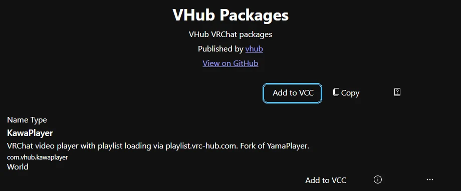

3. VCC が開いてリポジトリの追加を聞かれるので、**I Understand, Add Repository** を押します。

GitHub では VCC を開くリンク（`vcc://`）を直接押せないので、いったんこのページを開きます。ページが開けないときは、下の URL をブラウザのアドレスバーに貼って Enter を押しても、同じように VCC が開きます。

```
vcc://vpm/addRepo?url=https://mega-gorilla.github.io/vpm-repos/index.json
```

VCC が開かないときは、VCC の **Settings > Packages > Add Repository** に、次の URL を入れてください。

```
https://mega-gorilla.github.io/vpm-repos/index.json
```

**Repository Listing URL** の欄に貼って、右の **Add** を押します。

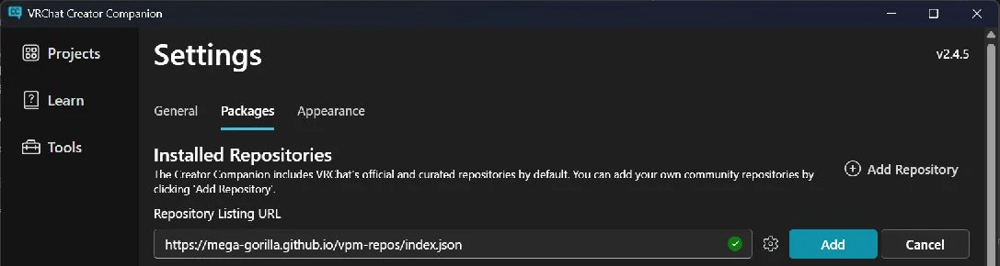

どちらの方法でも、追加できると **Settings > Packages** の一覧に **VHub Packages**（URL は `mega-gorilla.github.io`）の行が出ます。左にチェックが入っていれば、次へ進めます。


### 3. プロジェクトに KawaPlayer を入れる

VCC の **Manage Project** でワールドのプロジェクトを開き、一覧の **KawaPlayer** の **Add** を押します。新しい版が出たときも、ここから更新できます。

### 4. シーンに置く

Unity のメニューの **GameObject > KawaPlayer > Main** を選ぶと、シーンに KawaPlayer が置かれます。`KawaPlayer.prefab` をシーンにドラッグしても同じです。

置いた KawaPlayer を選ぶと、インスペクターに設定が出ます。すぐに使えるので、設定は変えなくてもかまいません。

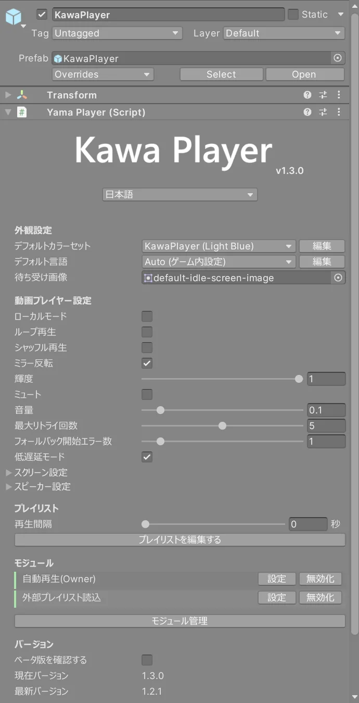

| 欄 | 決めること |
| --- | --- |
| 一番上の言語 | インスペクターの表示の言語 |
| 外観設定 | UI の色（カラーセット）、ワールドの中の言語の初期値、何も再生していないときの待ち受け画像 |
| 動画プレイヤー設定 | ループ・シャッフル・音量などの初期値 |
| プレイリスト | 最初から入れておくプレイリスト（**プレイリストを編集する**、次のステップ） |
| モジュール | 入っている機能（**モジュール管理**、ステップ 6） |

### 5. プレイリストを入れておく（なくてもよい）

[VHub Playlist](https://playlist.vrc-hub.com) で作ったプレイリストは、ワールドの中で URL を入れれば読み込めるので、何も用意しなくても使えます（[遊ぶ人向けの 3.](#3-vhub-のプレイリストを読み込む)）。最初から入れておきたいときは、次のようにします。

1. インスペクターの **プレイリストを編集する** を押して、プレイリストエディターを開きます。
2. 上の **URL から読み込み** を押し、**VHub プレイリスト** の欄に、VHub の共有 URL（`https://playlist.vrc-hub.com/r/default/…` の形）を貼ります。
3. 右の **URL から読み込み** を押すと、左の **プレイリスト** に入ります。
4. 右上の **保存** を押します。

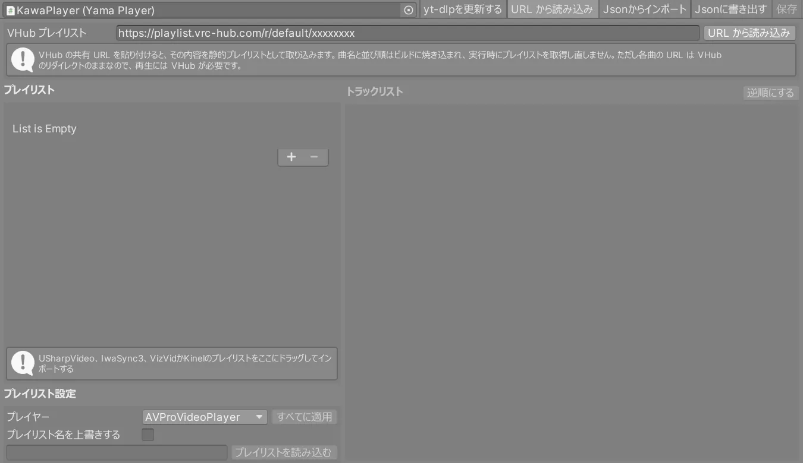

- **取り込みのしくみ:** 曲名と並び順は、ワールドをビルドしたときに焼き込まれます。曲の URL は VHub を通るので、再生には VHub が要ります。
- **ほかのプレイヤーから:** USharpVideo・IwaSync3・VizVid・Kinel のプレイリストは、左の一覧にドラッグして取り込めます。
- **聞く人の設定:** VHub の曲を聞く人は、取り込んだプレイリストでも、VRChat の設定で **Allow Untrusted URLs** をオンにしておく必要があります（[遊ぶ人向けの 3.](#3-vhub-のプレイリストを読み込む)）。

### 6. 自動再生を選ぶ（なくてもよい）

インスペクターの **モジュール管理** を押すと、入っている機能（モジュール）の一覧が出ます。

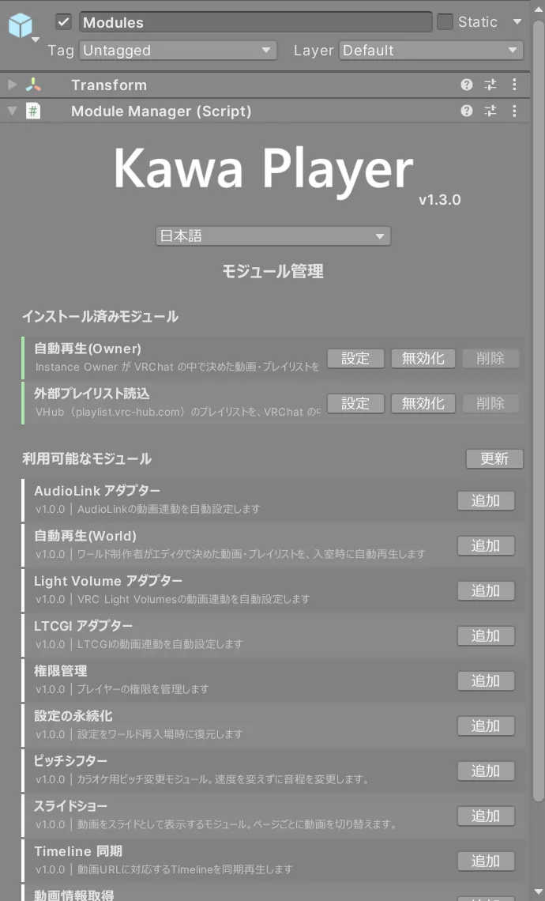

入室したときに自動で流す動画は、次のどちらかで決められます。両方を同時に使うとエラーになるので、どちらか一方にしてください。

| モジュール | 誰が決めるか |
| --- | --- |
| **自動再生(Owner)**（最初から入っている） | インスタンスを作った人（Instance Owner）が、VRChat の中で決める。自分で作った Invite・Friends などのインスタンスで使える |
| **自動再生(World)**（**追加** で入れる） | ワールド制作者が、Unity で決める。どのインスタンスでも流れる |

使わない機能は、**無効化** で切れます。

### 7. タブレットを置く（なくてもよい）

手に持って KawaPlayer を操作できるタブレットです。

1. メニューの **GameObject > KawaPlayer > Tablet** を選ぶと、シーンにタブレットが置かれます。何台置いてもかまいません。
2. インスペクターの **KawaPlayer** の欄に、操作する KawaPlayer を入れます。

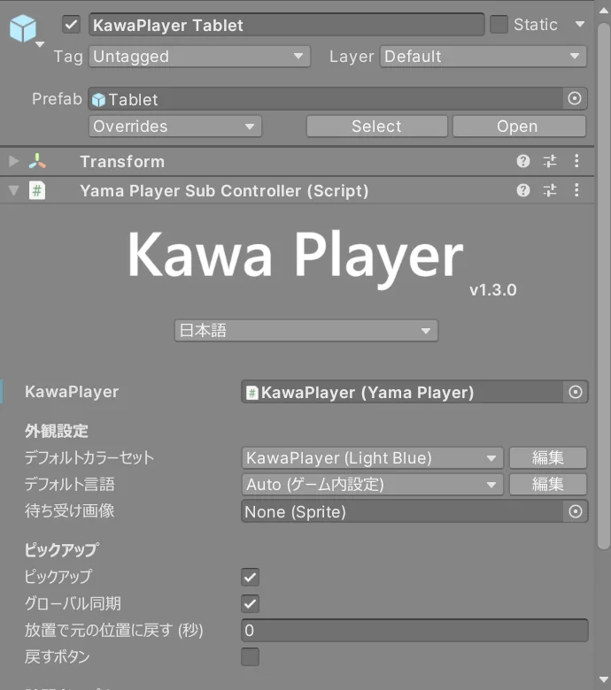

**ピックアップ** の欄では、持てるかどうかを決めます。置き忘れたタブレットを元の場所に戻すには、次の 2 つを使います。

- **放置で元の位置に戻す (秒)**: 秒数を入れると、その時間放っておかれたタブレットが戻る
- **戻すボタン**: オンにすると、タブレットに戻すボタンが付く

### 8. ビルドして確かめる

VRChat SDK の **Build & Test** やアップロードで、いつもどおりワールドをビルドします。ワールドの中での使い方は、次の章のとおりです。

**自動再生(Owner)** は Build & Test では試せません。Build & Test では、誰もインスタンスを作った人として扱われないためです。アップロードしたワールドで、自分で作った Invite・Friends などのインスタンスに入って確かめてください。自動再生や最初から入れたプレイリストに VHub の曲を使うときは、確かめる人の **Allow Untrusted URLs** もオンにしておいてください。

---

## ワールドの中で使う（遊ぶ人向け）

### 1. スクリーンを指す

スクリーンを指すと、操作バーが出ます。デスクトップでは視線（画面の中央）を、VR ではコントローラーのレーザーを向けてください。

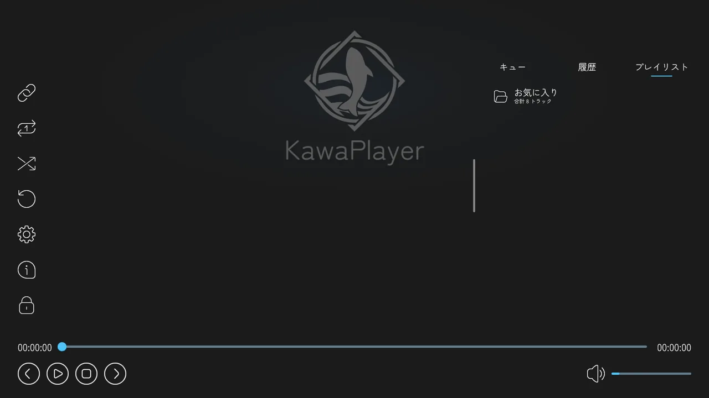

| 場所 | ボタン |
| --- | --- |
| 左の列（上から） | URL を入力、ループ再生、シャッフル再生、読み込み直し、設定、情報（バージョンと更新履歴）、UI ロック |
| 下 | 前の曲、再生・一時停止、停止、次の曲、シークバー、音量 |
| 右 | キュー、履歴、プレイリスト |

**UI ロック** を押すと、その人の画面ではスクリーンを触っても操作されなくなります。解除するには、スクリーンを指して、デスクトップでは左クリック、VR ではトリガーを長押しします。

### 2. 動画の URL を入れる

1. 左上の **URL を入力**（鎖のボタン）を押すと、VRChat の入力欄が開きます。
2. 動画の URL（YouTube など）を貼って、確定します。

止まっているときは、すぐに再生が始まります。ほかの動画を再生しているときは、**URL を再生する** の確認が出ます。

| ボタン | すること |
| --- | --- |
| **再生する** | 今の動画を止めて、入れた URL を再生する |
| **再生キューに追加する** | 再生キューの最後に足して、順番に流す |
| **キャンセル** | やめる |

### 3. VHub のプレイリストを読み込む

**先に、VRChat の設定で Allow Untrusted URLs（信頼されていない URL を許可する設定）をオンにしてください。** VHub（`playlist.vrc-hub.com`）は、VRChat が初めから信頼しているサイトではありません。そのため、オフのままでは、プレイリストの読み込みも曲の再生もできません。この設定は一人ひとりのもので、ほかの人がオンにしても、自分には効きません。

[VHub Playlist](https://playlist.vrc-hub.com) のプレイリストは、共有 URL（`https://playlist.vrc-hub.com/r/default/…` の形）を、動画と同じ **URL を入力** の欄に入れると読み込めます。

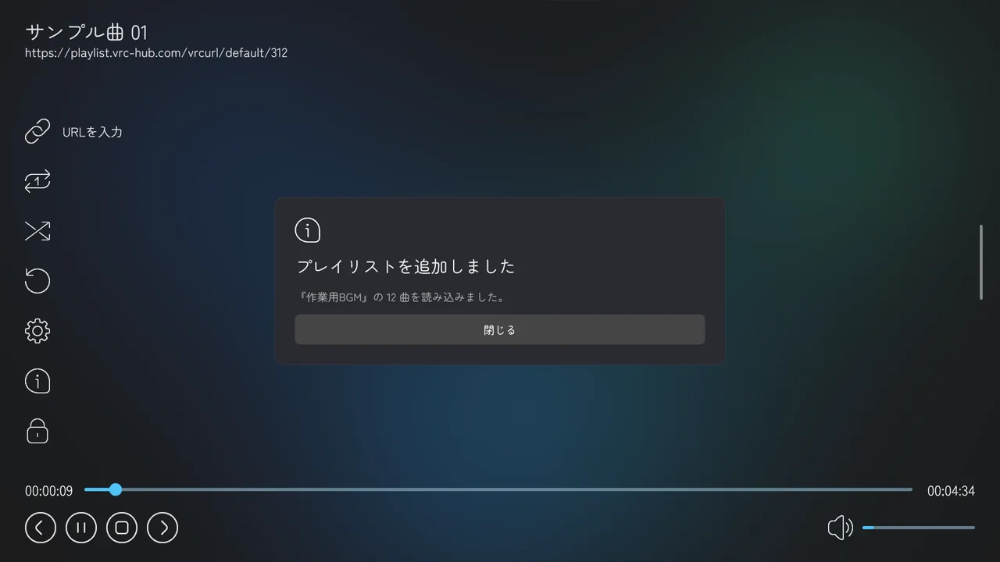

- **読み込める数:** VHub から読み込む枠は、標準で 5 件です（ワールドに最初から入っているプレイリストは別）。いっぱいのときに新しく読み込むと、一番古いものを消してよいか聞かれます。
- **入れる URL:** VHub の Web ページの URL（`/playlists/…`）では読み込めません。共有の URL を入れてください。

### 4. プレイリストから選ぶ

右の **プレイリスト** でプレイリストを選ぶと、曲の一覧が出ます。曲を押すと、そこから再生します。

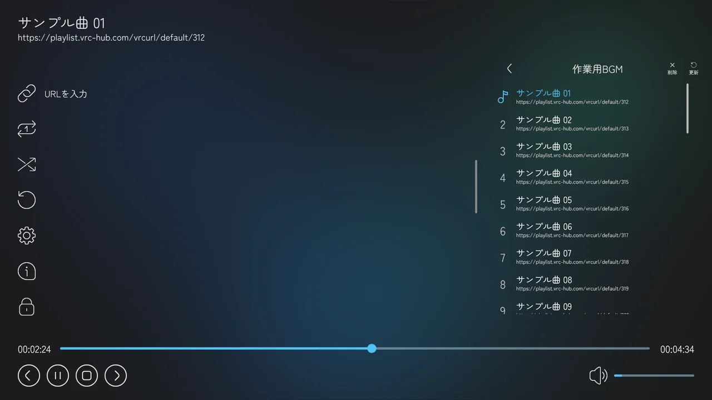

読み込んだ VHub のプレイリストは、右上の **更新** で最新の内容に、**削除** で一覧から外せます。

### 5. 設定を変える

左の列の **設定**（歯車）を押すと、設定の画面が出ます。左の **再生**・**映像・音声**・**その他** で切り替えます。

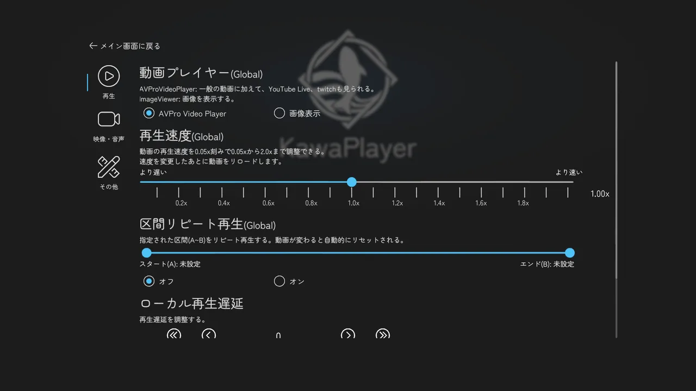

- **(Global) が付いた設定:** そのインスタンスの全員に反映されます。
- **付いていない設定:** 明るさ・ミラー反転・ローカル再生遅延などは、自分にだけ反映されます。
- **自動再生（インスタンスを作った人だけ）:** ワールドに自動再生(Owner) が入っていると、**再生** の最後に、入室時に流す **自動再生** の URL を決める欄が出ます。(Global) は付いていませんが、**そのインスタンスの全員に反映されます**。止まっているときに決めると、すぐに全員で再生が始まります。

### 6. 再生できないとき

再生できないと、スクリーンに理由と **詳細** ボタンが出ます。

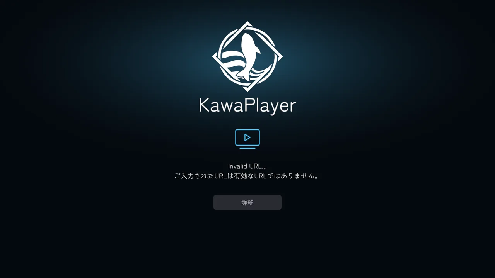

**詳細** を押すと、直近のエラーの内容と、問い合わせ先の Discord の URL が出ます。この画面のスクリーンショットを添えて Discord で聞いてもらえると、原因を探しやすくなります。VRChat ではワールドからリンクを開けないので、Discord の URL は欄からコピーして、ブラウザに貼ってください。

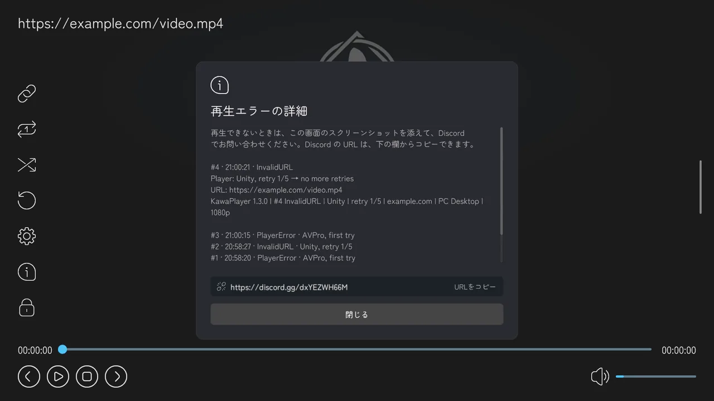

### 7. タブレットを使う（ワールドに置いてあれば）

タブレットの画面は、見ている全員に同じものが映ります。ほかの人がアプリを開いていたら、手に取ってもそのアプリのままです。画面の下の白い □（ホームボタン）を押すとホーム画面に戻り、アプリのアイコンを押すと開きます。アプリを開いているあいだは、ホームボタンの周りが青く光ります。

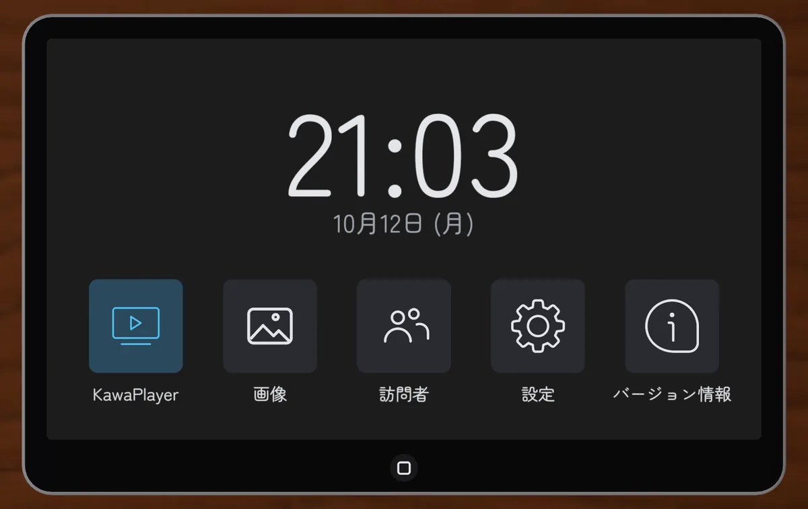

| アプリ | できること |
| --- | --- |
| **KawaPlayer** | スクリーンと同じ操作（再生、URL、プレイリスト）を手元でできる |
| **画像** | 画像の URL を入れると、タブレットを見ている全員に同じ画像が映る |
| **訪問者** | 今いる人と前にいた人、入退室のログを見られる |
| **設定** | 明るさ・ミラー反転・最大解像度・音声・言語など、自分だけの設定。インスタンスを作った人には、全員に反映される自動再生の欄も出る |
| **バージョン情報** | KawaPlayer の版と更新履歴 |

タブレットを縦に持つと、画面も縦向きになります（KawaPlayer アプリは横向きのまま）。

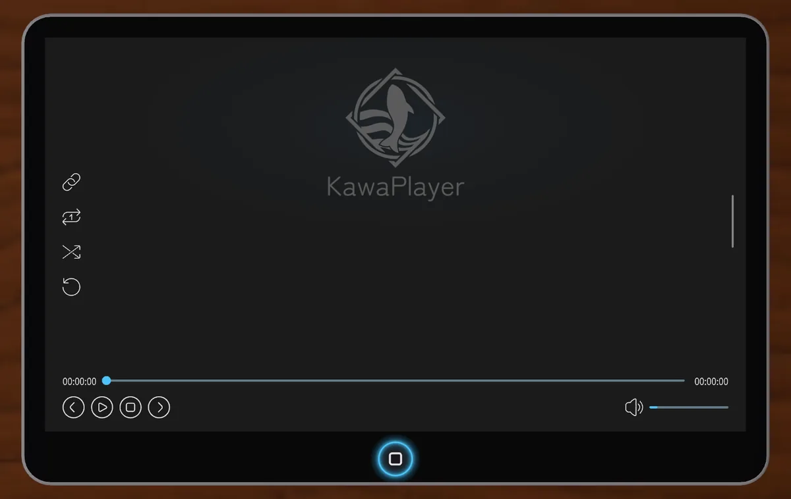

**画像アプリ**

- **一覧:** 表示した画像は、最大 5 枚まで並び、あとから選び直せます。
- **KawaPlayer に送る:** 開いた画像を、大きなスクリーンにも映せます。
- **出ないとき:** 画像が出ないときは、理由と次にすることが出ます。

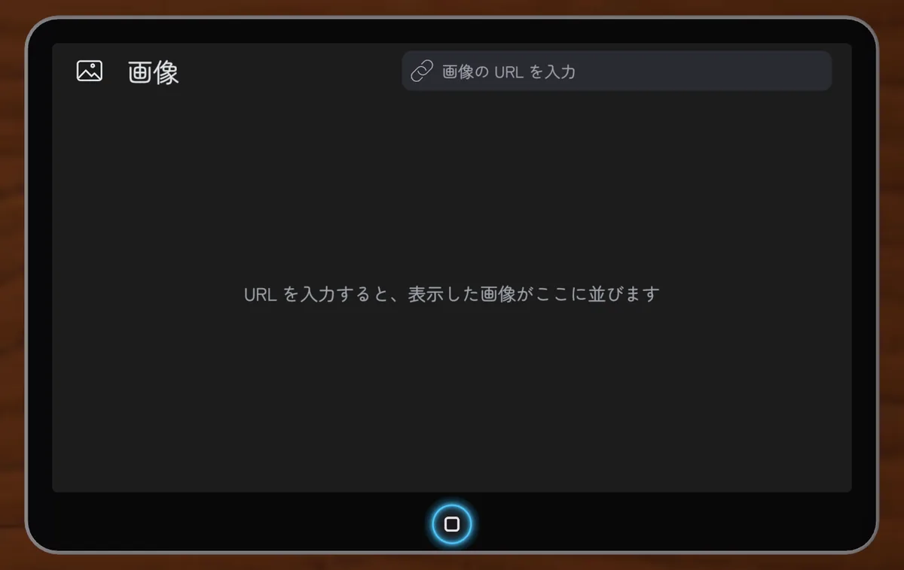

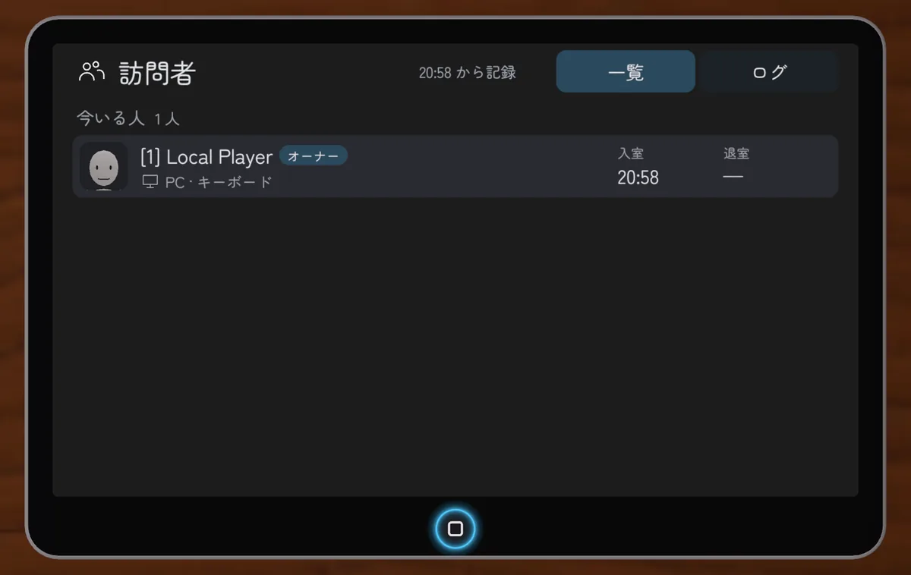

**設定アプリ** で変えた設定は、その人にだけ反映されます。ただし、インスタンスを作った人に出る **再生** の **自動再生** の欄だけは、スクリーンの設定と同じく、そのインスタンスの全員に反映されます。

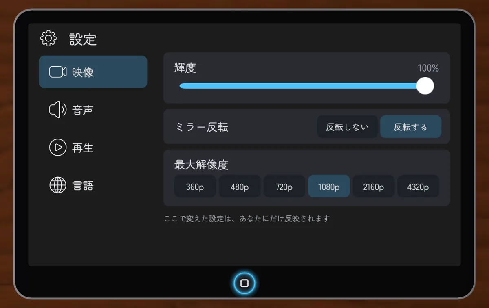
