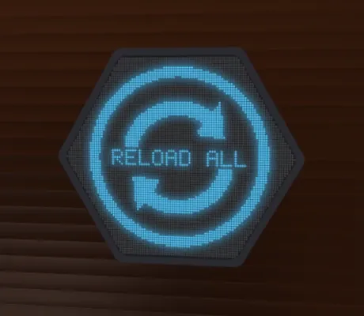
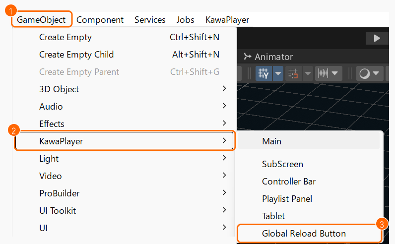

# 全員の読み込み直しボタン

ライブ配信のイベントなどで、インスタンスの全員の画面を一度に読み込み直すボタンです。六角形の LED 表示のような見た目です。前半はワールド制作者向けの置き方、後半はワールドの中での使い方です。

ライブ配信は再生位置を合わせないので、遅れが人によってばらばらにたまります。このボタンを押すと、全員がそれぞれの画面で読み込み直し、配信の今の位置から取り直します。普段は使わないので、スクリーンとタブレットの画面にはありません。要るワールドにだけ置いてください。

## 置く

1. Hierarchy の何もないところを押して、何も選んでいない状態にします。オブジェクトが選ばれたままだと、ボタンがその中に置かれます。
2. Unity のメニューの **GameObject**（①）> **KawaPlayer**（②）> **Global Reload Button**（③）を選びます。

   

3. 置かれたボタンを選び、インスペクターの **KawaPlayer** に、読み込み直すプレイヤーを入れます。
4. ステージや配信卓の近くなど、主催者が押せる所に動かします。

表示は英語だけです（**RELOAD ALL** など）。

## 押せる人

[権限管理](modules.md#権限管理) のモジュールが入っていれば、Editor 以上の人だけが押せます。Editor 以上でない人には、ボタンに赤い × と **NO ACCESS** が出て、押せません。権限が変わると、1 秒ほどで表示も変わります。

権限管理が入っていなければ、ボタンに手が届く人は誰でも押せます。押しても確認は出ないので、関係者しか行けない所に置いてください。

## 使う

押すと、インスタンスの全員が、それぞれの画面で今の動画を読み込み直します。一人ひとりがスクリーンの **読み込み直し**（[ワールドの中で使う](playing.md#左の列) の ④）を押したのと同じで、読み込めた人から、ほかの人と同じ位置に戻ります（一時停止中なら、一時停止のまま）。ライブ配信は、配信の今の位置から取り直します。全員の再生が数秒止まるので、全員の映像が止まったときや、ライブ配信で遅れがばらばらにたまったときに使ってください。

- **押し方:** 1 回押すと、全員に送られます。確認は出ません。送ったあと 15 秒は押せません。
- **表示:** 真ん中の文字で、押せるかが分かります。押せないあいだは、アイコンが薄くなります。

  | 表示 | とき | 押せるか |
  | --- | --- | --- |
  | **RELOAD ALL** | 動画が流れている（一時停止を含む） | 押せる |
  | **RELOADING** | 自分が送ってから 15 秒のあいだ | 押せない |
  | **NO VIDEO** | 全員が止まっている | 押せない |
  | 赤い × と **NO ACCESS** | 権限管理のモジュールが入っていて、自分が Editor 以上でない | 押せない |

- **受けた人の画面:** 自分の **読み込み直し** と同じく、読み込みを始めて 15 秒たっていない人は、その読み込みを続けます。
