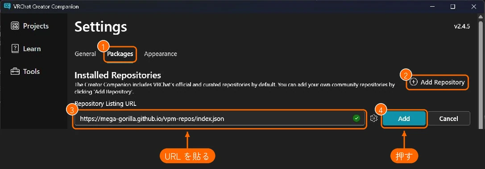
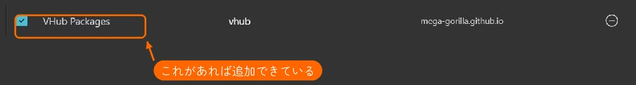
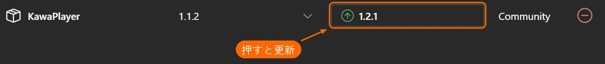
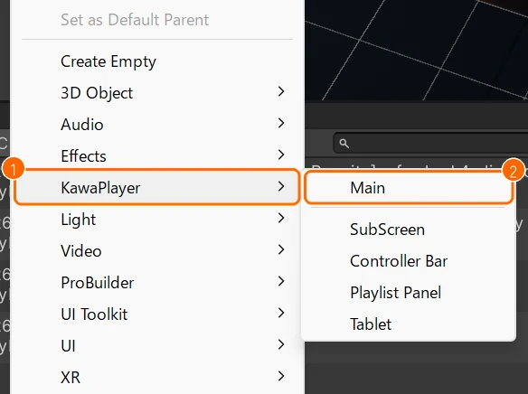

# インストールと更新

KawaPlayer は VCC で入れます。いちばん簡単な手順は [クイックスタート](quickstart.md) にあります。このページでは、ほかの方法と、更新のしかたを説明します。

YamaPlayer を使っていたプロジェクトは、先に [README の移行手順](../../README.md#yamaplayer-からの移行) を見てください。KawaPlayer と YamaPlayer は、同じプロジェクトに一緒には入れられません。

## 用意するもの

- VRChat Creator Companion（VCC）で作った、ワールドのプロジェクト
- VRChat SDK - Worlds 3.10.2 以上。古いときは、先に VCC の **Manage Project** で SDK を新しくしてください。

## リポジトリを追加する

追加のしかたは A・B・C の 3 つあり、どれで追加しても同じです。

**A. VCC 用のページから（いちばん簡単）:** [KawaPlayer の VCC 用のページ](https://mega-gorilla.github.io/vpm-repos/) で **Add to VCC** を押すと、VCC が開いてリポジトリを追加できます（[クイックスタートの 1.](quickstart.md#1-vcc-に-kawaplayer-のリポジトリを追加する)）。GitHub では VCC を開くリンク（`vcc://`）を直接押せないので、いったんこのページを開きます。

### リポジトリを追加するほかの方法

**B. URL をブラウザに貼る:** 次の URL をブラウザのアドレスバーに貼って Enter を押すと、A と同じように VCC が開きます。

```
vcc://vpm/addRepo?url=https://mega-gorilla.github.io/vpm-repos/index.json
```

**C. VCC の設定で追加する:** A でも B でも VCC が開かないときは、VCC の **Settings** で追加します。

1. **Packages**（①）を開いて、**Add Repository**（②）を押します。
2. **Repository Listing URL** の欄（③）に、次の URL を貼ります。

   ```
   https://mega-gorilla.github.io/vpm-repos/index.json
   ```

3. 右の **Add**（④）を押します。



### 追加できたか確かめる

どの方法でも、追加できると **Settings > Packages** の一覧に **VHub Packages**（URL は `mega-gorilla.github.io`）の行が出ます。左にチェックが入っていれば、次へ進めます。



## プロジェクトに入れる

VCC の **Manage Project** でワールドのプロジェクトを開き、パッケージの一覧の **KawaPlayer** の行で、右端の **＋**（Add）を押します。


## 更新する

新しい版が出ると、VCC の **Manage Project** の **KawaPlayer** の行に、↑ の付いた版の番号のボタンが出ます。このボタンを押すと、その版に更新されます。



画像の版の数字は、撮ったときのものです。

Unity の中からも確かめられます。KawaPlayer のインスペクターの一番下の **バージョン** で **アップデート確認** を押すと、新しい版があるか調べ、あれば **アップデート** で更新できます（[KawaPlayer の設定](settings.md#バージョン)）。この機能は、VCC で入れたプロジェクトでだけ動きます。

## シーンに置く

置き方は A・B・C の 3 つあり、どれでも同じものが置かれます。

- **A. メニューから:** Hierarchy の何もないところを押して、何も選んでいない状態にしてから、Unity のメニューの **GameObject > KawaPlayer > Main** を選びます（[クイックスタートの 3.](quickstart.md#3-シーンに-kawaplayer-を置く)）。オブジェクトが選ばれたままだと、その中に置かれます。
- **B. Hierarchy の右クリックから:** Hierarchy の何もないところを右クリックして、**KawaPlayer**（①）> **Main**（②）を選びます。

  

- **C. プレハブから:** Project の **Packages > KawaPlayer** にある `KawaPlayer.prefab` を、シーンにドラッグします。

同じメニューには、タブレット（**Tablet**、[タブレット](tablet.md)）のほかに、スクリーンや操作パネルを足すための部品（**SubScreen**・**Controller Bar**・**Playlist Panel**）もあります。
