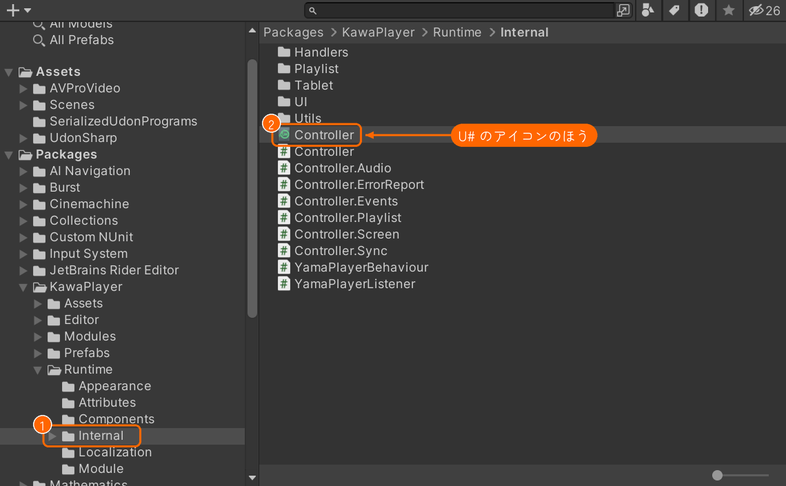
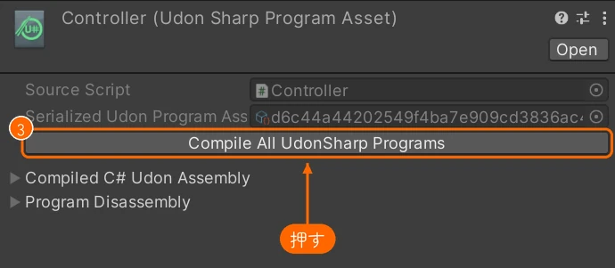

# インストールと更新

KawaPlayer は VCC で入れます。いちばん簡単な手順は [クイックスタート](quickstart.md) にあります。このページでは、ほかの方法と、更新のしかたを説明します。

YamaPlayer を使っていたプロジェクトは、先に [README の移行手順](../../README.md#yamaplayer-からの移行) を見てください。KawaPlayer と YamaPlayer は、同じプロジェクトに一緒には入れられません。

## 用意するもの

- VRChat Creator Companion（VCC）で作った、ワールドのプロジェクト
- VRChat SDK - Worlds 3.10.2 以上。古いときは、先に VCC の **Manage Project** で SDK を新しくしてください。

## リポジトリを追加する

追加のしかたは A・B・C の 3 つあり、どれで追加しても同じです。

**A. VCC 用のページから（いちばん簡単）:** GitHub では VCC を開くリンク（`vcc://`）を直接押せないので、いったん VCC 用のページを開きます。

1. 次のリンクを開きます: **[KawaPlayer の VCC 用のページ（mega-gorilla.github.io/vpm-repos）](https://mega-gorilla.github.io/vpm-repos/)**
2. ページの上のほう、**Copy** の左にある **Add to VCC** を押します。

   

3. VCC が開いてリポジトリの追加を聞かれるので、**I Understand, Add Repository** を押します。

### リポジトリを追加するほかの方法

**B. URL をブラウザに貼る:** 次の URL をブラウザのアドレスバーに貼って Enter を押すと、A と同じように VCC が開きます。

```
vcc://vpm/addRepo?url=https://mega-gorilla.github.io/vpm-repos/index.json
```

**C. VCC の設定で追加する:** A でも B でも VCC が開かないときは、VCC の **Settings** で追加します。

1. **Packages**（①）を開いて、**Add Repository**（②）を押します。
2. **Repository Listing URL** の欄（③）に、次の URL を貼ります。

   ```
   https://mega-gorilla.github.io/vpm-repos/index.json
   ```

3. 右の **Add**（④）を押します。


### 追加できたか確かめる

どの方法でも、追加できると **Settings > Packages** の一覧に **VHub Packages**（URL は `mega-gorilla.github.io`）の行が出ます。左にチェックが入っていれば、次へ進めます。


## プロジェクトに入れる

VCC の **Manage Project** でワールドのプロジェクトを開き、パッケージの一覧の **KawaPlayer** の行で、右端の **＋**（Add）を押します。


## 更新する

新しい版が出ると、VCC の **Manage Project** の **KawaPlayer** の行に、↑ の付いた版の番号のボタンが出ます。このボタンを押すと、その版に更新されます。


画像の版の数字は、撮ったときのものです。

Unity の中からも確かめられます。KawaPlayer のインスペクターの一番下の **バージョン** で **アップデート確認** を押すと、新しい版があるか調べ、あれば **アップデート** で更新できます（[KawaPlayer の設定](settings.md#バージョン)）。この機能は、VCC で入れたプロジェクトでだけ動きます。

KawaPlayer の更新をワールドに反映するには、Unity で **Build & Publish Your World Online** を実行してください（[クイックスタートの 5.](quickstart.md#5-ビルドして確かめる)）。PC と Quest の両方に公開しているときは、両方で実行します。

### 更新したあと、Play でタブレットなどが動かないとき

更新したあと、Unity の Play でタブレットや全員リロードボタンが動かず、Console に次のような行が出ることがあります。

```
[UdonBehaviour] Could not load the program; the UdonBehaviour on 'Canvas' will not run.
```

KawaPlayer の動きを書いた U#（UdonSharp）のプログラムが、新しい版に作り直されていないためです。Library フォルダーを消したあとや、プロジェクトを別の場所に写したあとに開くと、起きることがあります。KawaPlayer は Unity を開いたときにこれを調べ、見つけると自動で作り直します（Console に `[KawaPlayer]` で始まる行が出ます）。それでも直らないときは、次の手順で作り直してください。

1. Project ウィンドウで、**Packages** > **KawaPlayer** > **Runtime** > **Internal**（①）を開きます。
2. **Controller** が 2 つ並んでいます。U# のアイコンのほう（②）を選びます。**#** のアイコンのほうは、C# のスクリプトです。

   

3. Inspector の **Compile All UdonSharp Programs**（③）を押します。

   

4. Console に次の行が出れば終わりです。もう一度 Play してください。

   ![Console の、[UdonSharp] Compile of 57 scripts finished の行に印がある](images/unity/console-compile-finished.webp)

- **数は変わる:** 「57」は、プロジェクトに入っている U# のプログラムの数です。プロジェクトによって変わります。
- **赤いエラーが出るとき:** Console に赤いエラーが出て、この行が出ないときは、エラーを直してから、もう一度押してください。KawaPlayer のエラーなら、その画面を撮って [Discord サーバー](https://discord.gg/tkrHek6PvN) で聞いてください。
- **公開するワールド:** ワールドのビルドでは、VRChat SDK が U# のプログラムを作り直します（初めの設定のとき）。この手順は、Unity の Play で確かめるためのものです。

## シーンに置く

置き方は A・B・C の 3 つあり、どれでも同じものが置かれます。

- **A. メニューから:** Hierarchy の何もないところを押して、何も選んでいない状態にしてから、Unity のメニューの **GameObject > KawaPlayer > Main** を選びます（[クイックスタートの 3.](quickstart.md#3-シーンに-kawaplayer-を置く)）。オブジェクトが選ばれたままだと、その中に置かれます。
- **B. Hierarchy の右クリックから:** Hierarchy の何もないところを右クリックして、**KawaPlayer**（①）> **Main**（②）を選びます。

  

- **C. プレハブから:** Project の **Packages > KawaPlayer** にある `KawaPlayer.prefab` を、シーンにドラッグします。

同じメニューには、タブレット（**Tablet**、[タブレット](tablet.md)）のほかに、スクリーンや操作パネルを足すための部品（**SubScreen**・**Controller Bar**・**Playlist Panel**）と、全員リロードボタン（**Global Reload Button**、[全員リロードボタン](global-reload.md)。同じ名前のモジュールと一緒に使います）もあります。

これらの部品は、操作する KawaPlayer をインスペクターの **KawaPlayer** の欄で選びます。メニューで置くと、次の KawaPlayer が、もう入っています。

- KawaPlayer の中に置いたときは、その KawaPlayer。
- そうでなく、シーンに KawaPlayer が 1 つだけなら、その KawaPlayer。

シーンに KawaPlayer がないときや 2 つ以上あるときと、プレハブをドラッグして置いたときは、欄が空なので、自分で選びます。
