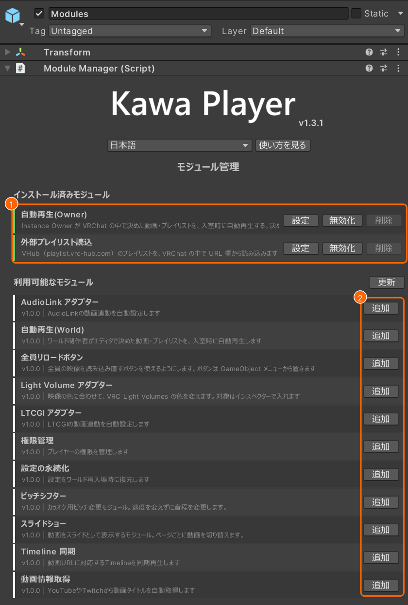
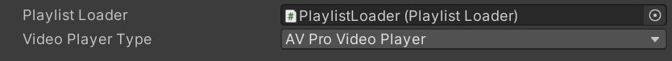
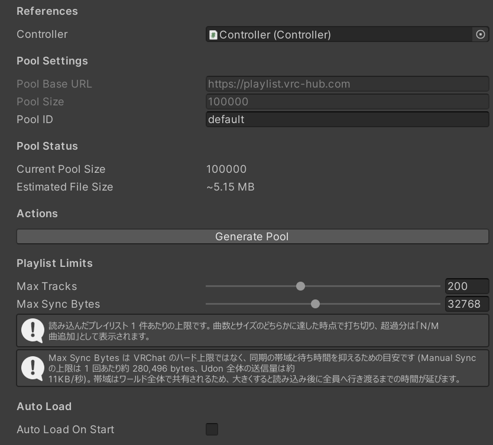
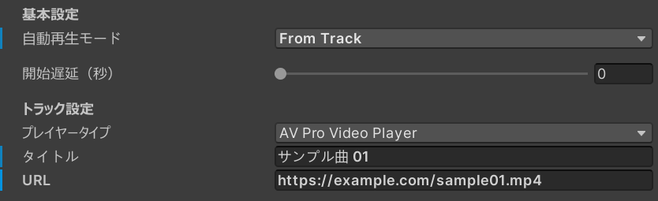
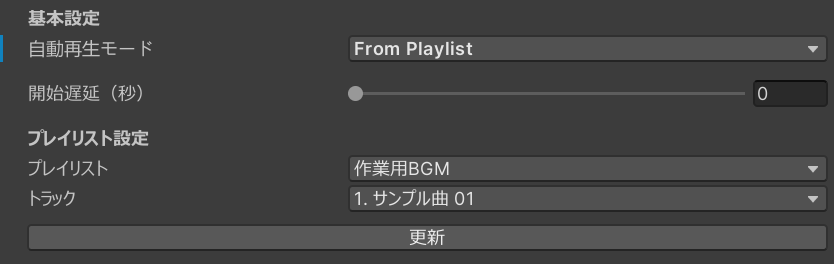
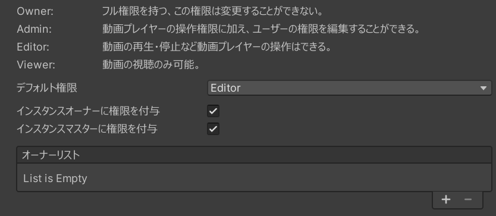
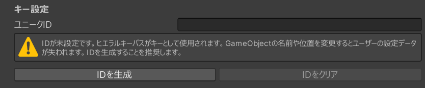
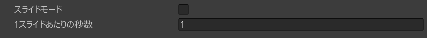
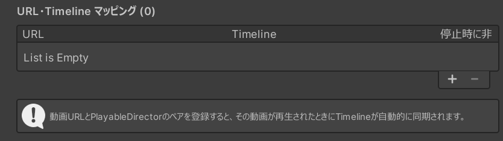

# モジュール

KawaPlayer の機能の一部は、モジュールとして分かれていて、足したり切ったりできます。インスペクターの **モジュール管理** を押すと、モジュールの一覧が出ます。

上の **インストール済みモジュール**（①）に入っているモジュール、下の **利用可能なモジュール**（②）に足せるモジュールが並びます。各行のボタンは次のとおりです。

| ボタン | すること |
| --- | --- |
| **設定** | そのモジュールを選び、インスペクターに設定を出す。設定のないモジュールには出ない |
| **無効化**・**有効化** | モジュールを切る、戻す。無効にしたモジュールは、ワールドに入らない |
| **削除** | モジュールを消す。最初から入っている 2 つは消せないので、使わないときは無効化する |
| **追加** | 利用可能なモジュールを、インストール済みに足す |

同じモジュールが 2 つ入っているときや、自動再生の 2 つが両方とも有効なときは、一覧の上にエラーが出ます。KawaPlayer のインスペクターの **モジュール** の欄と、ビルドのログにも出ます。

ここからは、モジュール管理に並んでいる順に、モジュールを 1 つずつ説明します。

## 最初から入っているモジュール

### 自動再生(Owner)

インスタンスを作った人（Instance Owner）が、VRChat の中で、入室したときに流す動画やプレイリストを決めるモジュールです。

- **必要なもの:** インスタンスを作った人。Public・Group のインスタンスと、SDK の Build & Test では、インスタンスを作った人がいないので使えません。VHub のプレイリストを流すには、[外部プレイリスト読込](#外部プレイリスト読込) も要ります。
- **設定:** **設定** を押すと、次の欄が出ます。中の部品のつながりなので、ふつうは変えません。

  

  | 欄 | 中身 |
  | --- | --- |
  | **Playlist Loader** | VHub のプレイリストを読み込む部品。初めからつながっている |
  | **Video Player Type** | 動画の URL を流すときの動画プレイヤー。初めは AV Pro Video Player |

- **ワールドの中:** スクリーンの設定の **再生** と、タブレットの設定アプリの **再生** に、**自動再生** の欄が出ます（見る人ごとの画面は [ワールドの中で使う](playing.md#自動再生)）。
  - **インスタンスを作った人:** 決めた URL（**設定値**）と、**URLを入力**・**クリア** のボタンが出ます。**URLを入力** で動画か VHub のプレイリストの URL を入れると、決まります。
  - **ほかの人:** 欄は見えますが、「✕ 本機能は利用できません」と理由だけが出て、操作はできません。
- **流れるとき:** 決めた URL は、そのインスタンスの全員に反映されます。
  - **決めたとき:** 止まっていれば、すぐに全員で再生が始まります。
  - **次のインスタンス:** 決めた URL はその人のアカウントに残ります。次に自分でインスタンスを作って入ったとき、止まっていれば流れます。
- **注意:**
  - 何かを再生しているあいだに決めても、そのインスタンスでは、あとから流れません。
  - **クリア** しても、いま流れているものは止まりません。
  - VHub のプレイリストを決めるとき、読み込める枠（5 件）がいっぱいなら、一番古いものを消してよいか聞かれます。
  - [自動再生(World)](#自動再生world) と一緒には使えません。どちらか一方を無効化してください。

### 外部プレイリスト読込

[VHub Playlist](https://playlist.vrc-hub.com) のプレイリストを、ワールドの中の URL の欄から読み込むモジュールです。使い方は [プレイリスト](playlists.md#ワールドの中で-vhub-のプレイリストを読み込む) にあります。

- **必要なもの:** VHub（`playlist.vrc-hub.com`）。ワールドの中でプレイリストを読み込む人と、曲を聞く人それぞれが、VRChat の設定で Allow Untrusted URLs をオンにしておく必要があります（[クイックスタートの 7.](quickstart.md#7-allow-untrusted-urls-をオンにする)）。Public・Group Public のインスタンスでは、そのうえで、ワールドの Video Player Allowed Domains に `playlist.vrc-hub.com` を足しておく必要があります（[クイックスタートの 6.](quickstart.md#6-vrchatcom-で-vhub-を許可する)）。
- **設定:** **設定** を押すと、次の欄が出ます。**値は変えないでください。** 今の VHub は、初めの値（特に **Pool ID** と、そこから作ったプール）で動くように作られています。値を変えると、VHub のプレイリストを読み込めなくなります。

  

  | 欄 | 中身 |
  | --- | --- |
  | **Controller** | KawaPlayer の本体。初めからつながっている |
  | **Pool Base URL**・**Pool Size** | VHub の URL を読み込むための、URL の束（プール）の設定。変えられない |
  | **Pool ID** | VHub 側のプールの名前。`default` から変えない |
  | **Current Pool Size**・**Estimated File Size** | 入っているプールの件数と、およその大きさ |
  | **Generate Pool** | プールを作り直すボタン。押さない（**Pool ID** を変えたときに使うもので、今の VHub では使わない） |
  | **Max Tracks** | 1 つのプレイリストから読み込む曲の上限（1〜500、初めは 200） |
  | **Max Sync Bytes** | 1 つのプレイリストで全員に送るデータの上限（4096〜65536、初めは 32768）。大きくすると、全員に行き渡るまでの時間が延びる |
  | **Auto Load On Start** | オンにすると、インスタンスができたときに、決めたプレイリストを読み込む。オンにすると **Resolve URL**（読み込む URL）と **Delay (sec)**（待つ秒数）が出る |

- **ワールドの中:** スクリーンとタブレットの **URL を入力** に VHub の VRChat用URL を入れると、プレイリストの一覧に 1 つ足されます。読み込めたときと読み込めなかったときは、結果が画面に出ます。読み込んだプレイリストは、一覧の **更新** で最新にし、**削除** で外せます。
- **読み込める数:** 枠は 5 件です。同じプレイリストを読み込み直すと、同じ枠が更新されます。いっぱいのときに新しく読み込むと、一番古いものを消してよいか聞かれます。
- **曲数の上限:** 1 つのプレイリストは、**Max Tracks** か **Max Sync Bytes** のどちらかに達したところで打ち切られ、「N/M 曲追加」と出ます。
- **注意:**
  - 一度に読み込めるのは 1 つです。読み込んでいるあいだは、ほかのプレイリストを読み込めません。
  - **Auto Load On Start** は、自動再生(Owner)・自動再生(World) と同じく、入ったときに再生を始めます。一緒に使うときは、どれが流れるかに気をつけてください（エラーは出ません）。

## 追加できるモジュール

### AudioLink アダプター

KawaPlayer の音を、AudioLink に送るモジュールです。

- **必要なもの:** AudioLink のパッケージ。入っていないときは、設定に「AudioLinkが導入されていません」とだけ出ます。
- **設定:**

  | 欄 | 中身 |
  | --- | --- |
  | **Audio Link** | 使う AudioLink。空のままでよい。ビルドのとき、シーンで最初に見つかった AudioLink が入る |
  | **AudioLinkをシーンに追加** | **Audio Link** が空のときに出る。シーンに AudioLink を置いて、つなぐ |
  | **デフォルトでAudioLinkを有効にする** | 入ったときに、KawaPlayer の音を AudioLink につないでおくか。初めはオフで、オフのときは AudioLink に何もしない |

- **ワールドの中:** スクリーンの設定の **映像・音声** に **AudioLink 連携**、タブレットの設定アプリの **音声** に同じ欄が出ます。**無効**・**有効** で切り替えます。効くのは、切り替えた人だけです。
- **ほかの音で AudioLink を使うワールド:** **無効** に切り替えたときに外すのは、AudioLink が KawaPlayer の音につながっているときだけです。DJ ブースなど、ほかの音につないだ AudioLink は止めません。

### 自動再生(World)

ワールド制作者が Unity で決めた動画やプレイリストを、入室したときに流すモジュールです。どのインスタンスでも流れます。

- **必要なもの:** ありません。
- **設定:** **自動再生モード** で、流すものを選びます。

  | 欄 | 中身 |
  | --- | --- |
  | **自動再生モード** | **Off**（流さない）、**From Track**（1 曲を決めて流す）、**From Playlist**（プレイリストから流す）。初めは Off |
  | **開始遅延（秒）** | 入ってから流し始めるまでの秒数（0〜60） |

  **From Track** のときは、流す曲の **プレイヤータイプ**（動画プレイヤー）、**タイトル**、**URL** を入れます。

  

  **From Playlist** のときは、**プレイリスト** と **トラック** を選びます。**トラック** で **ランダム再生** を選ぶと、そのプレイリストのどれかの曲から流れます。プレイリストを足したり名前を変えたりしたら、**更新** を押すと選び直せます。

  

- **流れるとき:** インスタンスのマスター（ふつうは、インスタンスに最初に入った人）の KawaPlayer が動き出したときに、**開始遅延** の秒数のあと、一度だけ流します。そのとき何かを再生していれば、流しません。あとから人が入っても、もう一度は流れません（流れている動画は、同期して見えます）。インスタンスを作った人かどうかは関係ありません（それは [自動再生(Owner)](#自動再生owner)）。ローカルモードの KawaPlayer では、入った人それぞれの画面で流れます。
- **注意:**
  - [自動再生(Owner)](#自動再生owner) と一緒には使えません。自動再生(World) を使うときは、自動再生(Owner) を無効化してください。両方が有効だと、モジュール管理・KawaPlayer のインスペクター・ビルドのログにエラーが出ます。
  - **From Playlist** で選ぶプレイリストより前に、無効のプレイリストや曲のないプレイリストがあると、別のプレイリストが流れることがあります。ワールドに入るプレイリストを、上に並べてください。

### Light Volume アダプター

映像の色に合わせて、VRC Light Volumes の光の色を変えるモジュールです。

- **必要なもの:** VRC Light Volumes のパッケージ。入っていないときは、設定に「VRC Light Volumesが導入されていません」とだけ出ます。
- **設定:**

  | 欄 | 中身 |
  | --- | --- |
  | **Light Volumes** | 色を変える Light Volume |
  | **Point Light Volumes** | 色を変える Point Light Volume |

  どちらも、自分で入れます。ビルドのときに自動では入りません。
- **ワールドの中:** 再生中は、入れた Light Volume の色が、映像の平均の色になります。止まると黒になります。効くのは、見ている人それぞれの画面です。
- **注意:** 入れた Light Volume の色は、このモジュールが上書きします。

### LTCGI アダプター

映像を、LTCGI の光として使うモジュールです。

- **必要なもの:** LTCGI のパッケージ。入っていないときは、設定に「LTCGIが導入されていません」とだけ出ます。
- **設定:** **対象スクリーン** に、この KawaPlayer のスクリーン（Renderer のもの）が並びます。
  - **有効:** そのスクリーンを LTCGI の光にします。シーンに LTCGI の Controller がなければ、置きます。
  - **無効:** LTCGI の光にするのをやめます。
  - **設定:** そのスクリーンを選びます。
  - **更新:** 一覧を作り直します。スクリーンが出ないときは、先に KawaPlayer のスクリーンを置いてください。
- **ワールドの中:** 再生中の映像が、LTCGI の光になります。止まると黒になります。ビルドのとき、シーンの LTCGI の Controller に自動でつながります。

### 権限管理

動画プレイヤーを操作できる人を、4 段階の権限で決めるモジュールです。

- **必要なもの:** ありません。
- **設定:**

  

  | 欄 | 中身 |
  | --- | --- |
  | 権限の説明 | **Owner**（すべてでき、権限を変えられない）、**Admin**（操作に加えて、ほかの人の権限を変えられる）、**Editor**（再生・停止などの操作ができる）、**Viewer**（見るだけ） |
  | **デフォルト権限** | 入った人の権限。初めは **Editor**（全員が操作できる） |
  | **インスタンスオーナーに権限を付与** | オンにすると、インスタンスを作った人を Owner にする。初めはオン |
  | **インスタンスマスターに権限を付与** | オンにすると、インスタンスのマスターを Owner にする。初めはオン |
  | **オーナーリスト** | ここに表示名を書いた人を Owner にする。表示名がちょうど同じ人だけ |

- **ワールドの中:** スクリーンの設定に **権限** のタブが出ます。見えるのは Admin 以上の人だけです。入っている人の一覧で、自分より下の人の権限を **Admin**・**Editor**・**Viewer** から選べます。
  - **Viewer ができないこと:** 再生・一時停止・停止、前の曲・次の曲、シーク、URL を入れて再生、プレイリストの読み込みと削除、キューの操作、ループ・シャッフル・再生速度・区間リピート・動画プレイヤーの切り替えをしようとすると、「権限がありません」と出て止まります。
  - **誰でもできること:** 音量・ミュート・明るさ・ミラー反転・最大解像度・言語のように、自分にだけ効く設定は、権限に関係なく変えられます。**ReSync**（読み込み直し）も、押した人の画面だけを読み込み直すので、権限に関係なく使えます。
- **注意:**
  - 操作できる人を絞るには、**デフォルト権限** を **Viewer** にしてください。初めの **Editor** のままだと、全員が操作できます。
  - ワールドの中で変えた権限は、その人が抜けると消えます。入り直すと、**デフォルト権限** に戻ります。
  - タブレットには **権限** のタブはありませんが、タブレットでの操作にも権限が効きます。
  - [全員リロードボタン](global-reload.md#押せる人) にも権限が効きます。Editor 以上でない人には、ボタンに赤い × と **NO ACCESS** が出て、押せません。

### 設定の永続化

遊ぶ人それぞれの設定を、ワールドに入り直したときに戻すモジュールです。戻すのは、音量・ミュート・ミラー反転・明るさの 4 つです。

- **必要なもの:** VRChat の Player Persistence（KawaPlayer が求める SDK 3.10.2 以上なら使えます）。
- **設定:**

  

  | 欄 | 中身 |
  | --- | --- |
  | **ユニークID** | 保存する設定の名前に使う ID。空のときは、KawaPlayer の Hierarchy の場所が使われる |
  | **IDを生成** | ID を作る。すでにあるときは、作り直すか聞かれる |
  | **IDをクリア** | ID を消す |

  ID があると、保存に使う名前（**音量キー**・**ミュートキー**・**ミラー反転キー**・**輝度キー**）も出ます。
- **ワールドの中:** 画面には何も出ません。遊ぶ人が音量などを変えるたびに保存され、次に入ったときに戻ります。
- **注意:**
  - 置いたら、まず **IDを生成** を押してください。ID が空のままだと、KawaPlayer の名前や Hierarchy の場所を変えたときに、遊ぶ人の保存した設定が読めなくなります。
  - ID を作り直したり消したりしても、保存した設定は読めなくなります。

### ピッチシフター

再生速度を変えずに、音程（キー）を変えるモジュールです。カラオケで使えます。

- **必要なもの:** ありません。
- **設定:** モジュール管理に **設定** ボタンはありません。追加するだけで使えます。
- **ワールドの中:** スクリーンの設定の **映像・音声** に **ピッチシフター** の欄が出ます。スライダーで、-6 から +6 まで半音ずつ変えられます。変えた音程は、全員に反映されます。
- **注意:** 権限管理を入れていても、誰でも変えられます。

### スライドショー

動画を、スライドのようにページ単位で送るモジュールです。決めた秒数ごとに 1 ページとして、動画を止めたまま、前と次のボタンでページを送ります。

- **必要なもの:** ありません。
- **設定:**

  

  | 欄 | 中身 |
  | --- | --- |
  | **スライドモード** | 初めからスライドとして表示するか。初めはオフ |
  | **1スライドあたりの秒数** | 1 ページにする動画の秒数。初めは 1 |

- **ワールドの中:** スクリーンの設定の **再生** に、**スライドモード**（オン・オフ）と **スライド秒数**（1 秒・2 秒・3 秒）の欄が出ます。オンにすると、動画が止まり、時間の表示が「ページ / ページ数」に、シークバーがページの選択になります。切り替えは、全員に反映されます。
- **注意:**
  - **1スライドあたりの秒数** を 1・2・3 以外にすると、ワールドの中の **スライド秒数** は、どれも選ばれていない表示になります。
  - 権限管理を入れていても、スライドの切り替えは誰でもできます。

### Timeline 同期

決めた動画が流れたときに、その動画に合わせて Timeline を再生するモジュールです。照明や演出を動画に合わせるときに使います。

- **必要なもの:** Unity の Timeline（PlayableDirector）。
- **設定:** **URL・Timeline マッピング** の一覧に、**＋** で組み合わせを足します。

  

  | 欄 | 中身 |
  | --- | --- |
  | **URL** | 合わせる動画の URL |
  | **Timeline** | 動かす PlayableDirector |
  | **停止時に非表示** | オンにすると、その動画が流れていないあいだ、Timeline のオブジェクトを隠す |

- **ワールドの中:** 一覧の URL の動画が流れると、Timeline も一緒に再生・一時停止・シーク・停止します。効くのは、見ている人それぞれの画面です。
- **注意:**
  - URL は、流れる動画の URL と 1 文字も違わずに同じでないと動きません。
  - VHub のプレイリストの曲は、VHub を通る URL（`https://playlist.vrc-hub.com/vrcurl/…`）で流れます。元の動画の URL を書いても動きません。

### 動画情報取得

YouTube と Twitch の動画のタイトルを、自動で取ってくるモジュールです。

- **必要なもの:** ありません。
- **設定:** モジュール管理に **設定** ボタンはありません。追加するだけで使えます。
- **ワールドの中:** タイトルのない YouTube や Twitch の動画を流したり、キューに入れたりすると、タイトルが出ます。効くのは、見ている人それぞれの画面です。
- **注意:**
  - タイトルがすでにある曲と、VHub のプレイリストの曲には働きません。
  - タイトルを取れなかった URL は、ワールドにいるあいだ、もう試しません。
