# ワールドの中で使う

KawaPlayer が置かれたワールドで、スクリーンを操作する方法です。

## スクリーンを指す

スクリーンを指すと、操作バーが出ます。デスクトップでは視線（画面の中央）を、VR ではコントローラーのレーザーを向けてください。ボタンは、左の列、右、下の 3 か所にあります。

下の表の「反映」は、押したことがインスタンスの全員に反映されるか、自分にだけ反映されるかです。ワールドに権限管理のモジュールが入っているときは、権限のない人が押しても動かないボタンがあります（[権限管理](modules.md#権限管理)）。

### 左の列

| | ボタン | すること | 反映 |
| --- | --- | --- | --- |
| ① | **URL を入力**（鎖） | 動画やプレイリストの URL を入れる（[動画の URL を入れる](#動画の-url-を入れる)） | 全員 |
| ② | **ループ再生** | 今の動画を、終わったら最初から繰り返す。もう一度押すとやめる | 全員 |
| ③ | **シャッフル再生** | プレイリストの次の曲を、順番ではなくランダムに選ぶ。もう一度押すとやめる | 全員 |
| ④ | **ReSync** | 今の動画を、自分の画面で読み込み直す。読み込めたら、ほかの人と同じ位置から再生する。映像や音が止まったとき、自分の画面だけエラーで止まったとき、ずれが直らないとき、ライブ配信でほかの人より遅れているときに使う | 自分だけ |
| ⑤ | **設定**（歯車） | 設定の画面を開く（[設定を変える](#設定を変える)） | ― |
| ⑥ | **情報** | KawaPlayer の版と、更新履歴を出す | ― |
| ⑦ | **UI ロック**（鍵） | 自分の画面で、スクリーンを触っても操作されないようにする | 自分だけ |

**ReSync** は、全員が止まっているときと、読み込み中のしばらくのあいだは押せません。読み込み中で押せないときは、少し待ってください。自分の画面だけエラーで止まったときは、すぐに押せます。

全員の画面をまとめて読み込み直すには、主催者などがワールドに置いた [全員リロードボタン](global-reload.md) を使います（置いてあるワールドだけ）。**ReSync** との違いは、[そのページ](global-reload.md#resync-との違い) にあります。

**UI ロック** を解除するには、スクリーンを指して、デスクトップでは左クリック、VR ではトリガーを長押しします。

**ほかの人とずれたとき:** ふつうの動画は、ずれても自動で合わせ直すので、まず数秒待ってください。直らないときや、映像が止まったままのときは、**ReSync**（④）を押します。ライブ配信は自動では合わせないので、遅れたときは **ReSync** で今の位置から取り直します。いつも自分だけ早い・遅いときは、設定の **ローカル再生遅延** で、自分の再生位置を前後にずらせます。

### 右（キュー・履歴・プレイリスト）

| | タブ | 出るもの |
| --- | --- | --- |
| ① | **キュー** | 次に流す曲の列。URL を入れたときの **再生キューに追加する** や、曲の **キューに追加** で足した曲が並ぶ。次の曲に進むときは、プレイリストより先に、キューの曲を上から流す |
| ② | **履歴** | これまでに流した曲 |
| ③ | **プレイリスト** | ワールドに最初から入っているプレイリストと、VHub から読み込んだプレイリストの一覧。プレイリストを押すと、その曲の一覧が出る（[下の手順](#プレイリストから曲を流す)） |

#### キュー

**キュー**（①）を押すと、次に流す曲（②）が並びます。

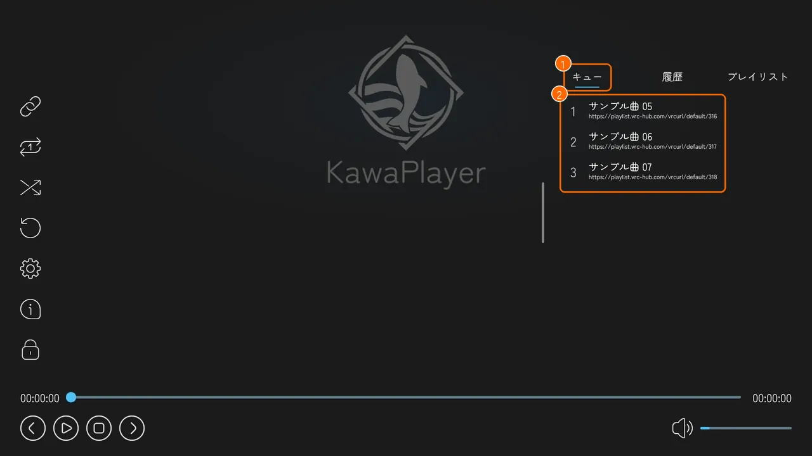

- **足し方:** URL を入れたときの確認で **再生キューに追加する** を押すか、履歴やプレイリストの曲の **キューに追加** を押します。
- **流れ方:** 曲が終わったときや **次の曲** を押したとき、キューの一番上の曲が流れ、キューから消えます。シャッフル再生のときは、キューの中からランダムに選びます。
- **プレイリストとの関係:** キューの曲を流すと、プレイリストの続けての再生から離れます。キューを流し終えても、元のプレイリストの続きは流れません。続けたいときは、プレイリストの曲を選んで **再生する** を押してください。キューが空で、プレイリストから流しているときは、プレイリストの次の曲に進みます。

キューの曲を押すと、その行が **戻る**（①）・**上へ移動**（②）・**下へ移動**（③）・**削除**（④）に変わります。上へ移動・下へ移動で流す順番を入れ替え、削除でキューから外します。

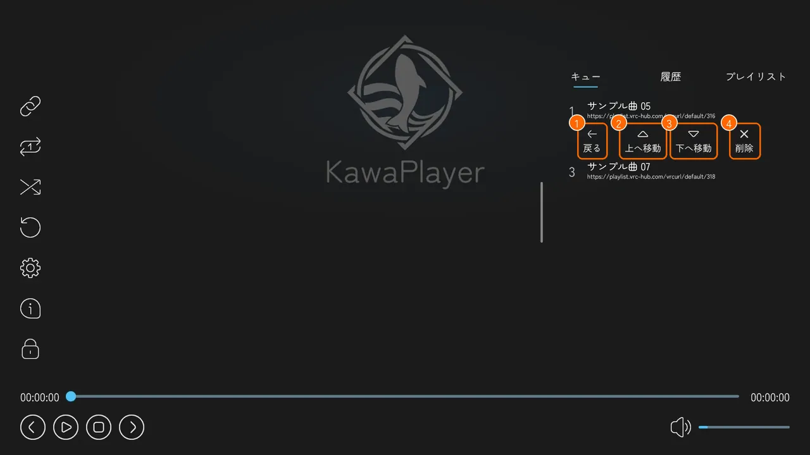

#### 履歴

**履歴**（①）を押すと、これまでに流した曲（②）が、流した順に上から並びます（一番下が、最後に流した曲）。曲を押すと、プレイリストの曲と同じ操作ボタン（戻る・URLをコピー・キューに追加・再生する）が出ます。もう一度流したい曲を探すときに使います。

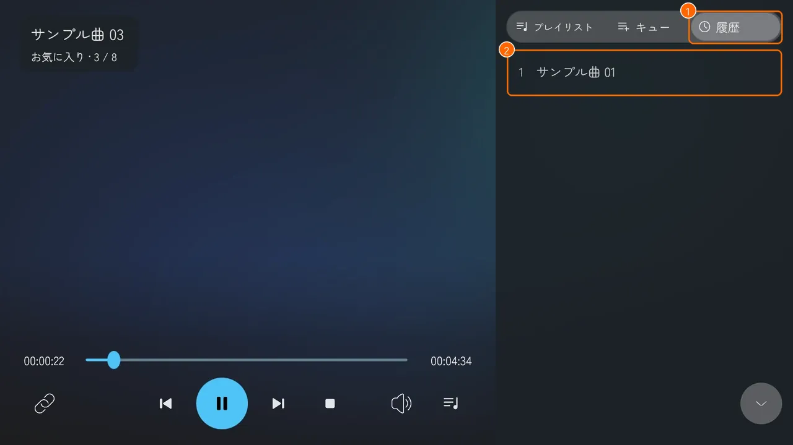

#### プレイリストから曲を流す

1. 右の **プレイリスト**（①）を押すと、プレイリストの一覧が出ます。流したいプレイリスト（②）を押します。

   

2. そのプレイリストの曲の一覧に変わります。上には、プレイリストの名前が出ます。流したい曲（①）を押します。左上の **<**（②）を押すと、プレイリストの一覧に戻ります。

   

3. 押した曲の行が、その曲の操作ボタンに変わります。**再生する**（④）を押すと、その曲から再生します。

   

#### 曲の操作ボタン

曲を押したときに出るボタンを、まとめておきます。タブによって、出るボタンが違います。

| ボタン | すること | 出るタブ |
| --- | --- | --- |
| **戻る**（①） | 操作ボタンを閉じて、曲の行に戻す | すべて |
| **URLをコピー**（②） | 曲の URL が入った欄を出す。欄からコピーできる | 履歴・プレイリスト |
| **キューに追加**（③） | その曲を、キューの最後に足す | 履歴・プレイリスト |
| **再生する**（④） | その曲から再生する | 履歴・プレイリスト |
| **上へ移動**・**下へ移動** | キューの中で、順番を入れ替える | キュー |
| **削除** | キューから外す | キュー |

#### VHub から読み込んだプレイリスト

VHub から読み込んだプレイリストの曲の一覧には、右上に **削除** と **更新**（①）が出ます。**更新** で VHub の今の内容に変わり、**削除** でプレイリストの一覧から外せます（外す前に確認が出ます）。

### 下

| | ボタン | すること | 反映 |
| --- | --- | --- | --- |
| ① | **前の曲** | 再生中のプレイリストの、1 つ前の曲を流す（最初の曲なら最後の曲へ） | 全員 |
| ② | **再生**・**一時停止** | 再生と一時停止を切り替える | 全員 |
| ③ | **停止** | 再生をやめる | 全員 |
| ④ | **次の曲** | キューに曲があればその曲を、なければ再生中のプレイリストの次の曲を流す（最後の曲なら最初の曲へ。シャッフル再生ならランダム）。キューの曲を流したあとは、プレイリストの続きには戻らない | 全員 |
| ⑤ | **シークバー** | つまみを動かすと、その位置から再生する。左は今の位置、右は動画の長さ | 全員 |
| ⑥ | **音量** | スピーカーのボタンで、消音と解除を切り替える。右のバーで音の大きさを変える | 自分だけ |

**前の曲** と **次の曲** は、プレイリストから流しているときに使えます。URL を入れて流した動画や、キューから流した曲のあとは、キューに曲があるときだけ **次の曲** が働きます。

## 動画の URL を入れる

1. 左上の **URL を入力**（①、鎖のボタン）を押すと、VRChat の入力欄が開きます。

   

2. 動画の URL（YouTube など）を貼って、確定します。

止まっているときは、すぐに再生が始まります。ほかの動画を再生しているときは、**URL を再生する** の確認が出ます。

| ボタン | すること |
| --- | --- |
| **再生する** | 今の動画を止めて、入れた URL を再生する |
| **再生キューに追加する** | 再生キューの最後に足して、順番に流す |
| **キャンセル** | やめる |

### VHub のプレイリストを読み込む

[VHub Playlist](https://playlist.vrc-hub.com) のプレイリストも、同じ **URL を入力** で、まるごと読み込めます。

**先に、VRChat の設定で Allow Untrusted URLs をオンにしてください**（[オンにする手順](quickstart.md#7-allow-untrusted-urls-をオンにする)）。オフのままでは読み込めず、VHub の曲も流れません。Public・Group Public のインスタンスでは、ワールドが VHub を許可している必要もあります（ワールドの作者が設定します）。

1. VHub で、プレイリストの **VRChat用URL** をコピーします（[コピーのしかた](vhub.md#vrchat用url-をコピーする)）。
2. **URL を入力**（①）に貼って、確定します。**プレイリストを追加しました** と出れば、プレイリストの一覧に 1 つ足されています。止まっているときは、そのまま再生が始まります。

   

3. 右の **プレイリスト** で、読み込んだプレイリストを選びます。曲（①）を押して、出てきた **再生する** を押すと、その曲から再生します。右上の **更新**（②）で VHub の今の内容に変わり、**削除** で一覧から外せます。

   

- **入れる URL:** VHub のページのアドレス（`/playlists/…`）や、**シェア** でコピーした URL では読み込めません。**VRChat用URLをコピー** でコピーした URL（`https://playlist.vrc-hub.com/r/default/…`）を入れます。
- **読み込める数:** 標準で 5 件までです。いっぱいのときに新しく読み込むと、一番古いものを消してよいか聞かれます（[プレイリスト](playlists.md#ワールドの中で-vhub-のプレイリストを読み込む)）。

## 設定を変える

左の列の **設定**（歯車）を押すと、設定の画面が出ます。左の **再生**・**映像・音声**・**その他**（①）でタブを切り替え、左上の **メイン画面に戻る**（②）で元の画面に戻ります。

名前に **(Global)** が付いた設定は、インスタンスの全員に反映されます。付いていない設定は、自分にだけ反映されます。

### 再生

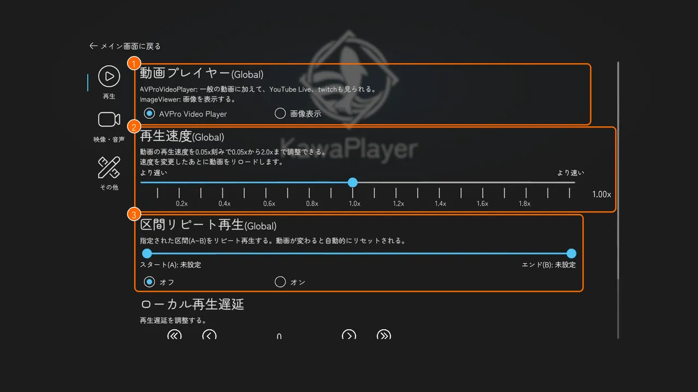

下へ送ると、④ と ⑤ が出ます。

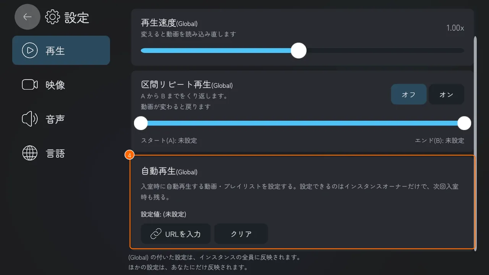

| | 設定 | すること | 反映 |
| --- | --- | --- | --- |
| ① | **動画プレイヤー** | 次に入れる URL を流すプレイヤー。**AVPro Video Player**（動画。YouTube Live や Twitch の配信も見られる）か、**画像表示**（画像）。動画を流すときは AVPro のままにする | 全員 |
| ② | **再生速度** | 0.05 倍きざみで、0.05〜2.0 倍。真ん中が 1.0 倍。AVPro では、変えると動画を読み込み直す | 全員 |
| ③ | **区間リピート再生** | バーの左右のつまみで区間（A〜B）を決めて **オン** にすると、その区間を繰り返す。動画が変わると、自動でオフに戻る。ライブ配信では使えない | 全員 |
| ④ | **ローカル再生遅延** | 自分の再生位置だけを、ほかの人から前後にずらす。≪・≫ で 0.1 秒、＜・＞ で 0.05 秒ずつ。真ん中の数字が今のずらし（秒）で、大きくすると自分の映像が先へ進む | 自分だけ |
| ⑤ | **自動再生** | 入室時に流す動画・プレイリストの URL。決められるのはインスタンスを作った人だけ（[自動再生](#自動再生)） | 全員 |

### 自動再生

**再生** のタブの一番下（⑤）にある、インスタンスを作った人（インスタンスオーナー）が、入室したときに流す動画やプレイリストを決める機能です。タブレットの設定アプリの **再生** にも、同じ欄があります。

#### 見る人ごとの表示

自動再生の欄は、見る人によって表示が変わります。

| 見る人 | 表示 |
| --- | --- |
| インスタンスを作った人 | 決めた URL（設定値）と、**URLを入力**・**クリア** のボタン |
| ほかの人 | 「✕ 本機能は利用できません」と理由だけ。操作はできない |
| Public・Group のインスタンスと、SDK の Build & Test | インスタンスを作った人がいないので、全員が「✕ 本機能は利用できません」 |

**インスタンスを作った人の画面:**

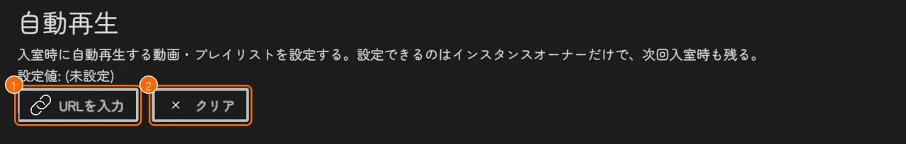

**ほかの人の画面**（Public・Group のインスタンスでは全員）:

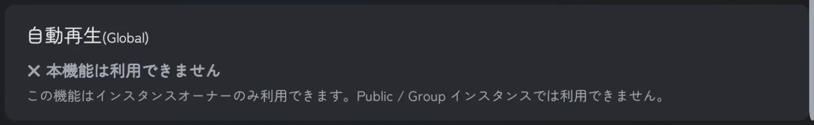

#### 自動再生の URL を設定する

1. **URLを入力**（上の画像の ①）を押し、動画の URL か、VHub のプレイリストの VRChat用URL（[コピーのしかた](vhub.md#vrchat用url-をコピーする)）を貼って、確定します。
2. 設定値（①）に、決めた URL が出ます。

   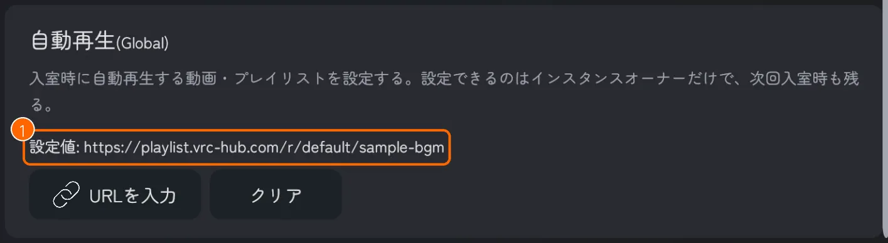

- **全員に反映:** 名前の (Global) のとおり、決めた URL はインスタンスの全員に反映されます。
- **すぐ流れるとき:** 止まっているときに決めると、すぐに全員で再生が始まります。何かを再生しているときは止めず、そのインスタンスでは、あとから流れることもありません。
- **VHub のプレイリスト:** プレイリストの一覧に読み込みます。読み込める枠（標準で 5 件）がいっぱいのときは、一番古いものを消してよいか聞かれます。

#### 自動再生の URL を消す

**クリア**（上の画像の ②）を押すと、決めた URL が消え、設定値が **(未設定)** に戻ります。いま流れているものは止まりません。

#### 次のインスタンスでも流れる

決めた URL は、決めた人の VRChat のアカウントに残ります。同じワールドで次に自分でインスタンスを作って入ると、その URL が設定値に戻り、止まっていれば自動で流れます。流したくなくなったら、**クリア** で消してください。

ワールドの作者が Unity で決める自動再生（自動再生(World)）とは別の機能で、同じ KawaPlayer で両方は使えません（[モジュール](modules.md#自動再生owner)）。

### 映像・音声

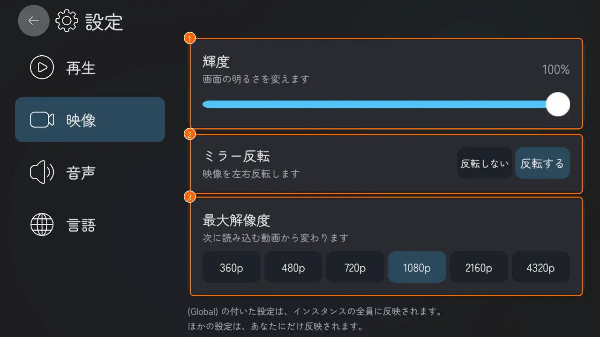

| | 設定 | すること | 反映 |
| --- | --- | --- | --- |
| ① | **ミラー反転** | ミラーに映ったスクリーンを左右反転して、文字を読めるようにする | 自分だけ |
| ② | **輝度** | スクリーンの明るさ | 自分だけ |
| ③ | **最大解像度** | 動画を読み込むときの画質の上限（360p〜4320p）。下げると軽くなる。変えると、今の動画を読み込み直す | 自分だけ |

ミラー反転と輝度の初めの値は、ワールドの作者がインスペクターで決めます（置いたままなら **反転する** と 100%。[KawaPlayer の設定](settings.md#動画プレイヤー設定)）。音量は、操作バーの下の右で変えます（[下](#下)）。

### その他

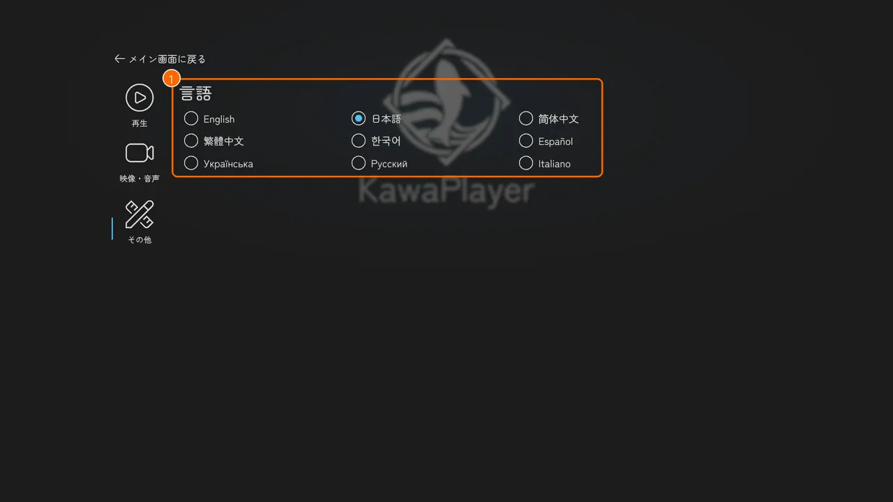

| | 設定 | すること | 反映 |
| --- | --- | --- | --- |
| ① | **言語** | KawaPlayer の画面の言語。English・日本語・简体中文・繁體中文・한국어・Español・Українська・Русский・Italiano から選ぶ | 自分だけ |

### モジュールで増える欄

ワールドに入っているモジュールによって、設定の画面に欄やタブが増えます（[モジュール](modules.md)）。

| モジュール | 増えるところ |
| --- | --- |
| スライドショー | **再生** に、スライドモードとスライド秒数 |
| AudioLink アダプター | **映像・音声** に、AudioLink 連携 |
| ピッチシフター | **映像・音声** に、ピッチシフター |
| 権限管理 | **権限** のタブ（Admin 以上の人だけに見える） |

設定の永続化のモジュールが入っていると、音量・ミュート・ミラー反転・輝度は、次に入ったときも残ります。

## 再生できないとき

**自分の画面だけ止まったとき:** ほかの人には映っているのに、自分の画面だけエラーで止まったり、読み込み中のまま進まなかったりするときは、まず **ReSync**（[④](#左の列)）を押してください。押した人の画面だけが読み込み直し、ほかの人と同じ位置に戻ります（一時停止中なら、一時停止のまま）。それでも再生できないときや、全員が再生できないときは、下の **詳細** と、原因ごとの案内を見てください。

再生できないと、スクリーンに理由と **詳細** ボタンが出ます。

**詳細** を押すと、直近のエラーの内容と、問い合わせ先の Discord の URL が出ます。この画面のスクリーンショットを添えて Discord で聞いてもらえると、原因を探しやすくなります。VRChat ではワールドからリンクを開けないので、Discord の URL は欄（①）からコピーして、ブラウザに貼ってください。**閉じる**（②）で元の画面に戻ります。

### Access Denied と出たとき

VRChat が初めから信頼していないサイトの動画は、見る人それぞれが VRChat の設定で **Allow Untrusted URLs** をオンにしていないと流れません（[オンにする手順](quickstart.md#7-allow-untrusted-urls-をオンにする)）。

- **遊ぶ人:** まず Allow Untrusted URLs をオンにしてください。それでも再生できないときは、ワールドの制作者に伝えてください。Public・Group Public のインスタンスでは、ワールドが許可したサイトの動画しか流せず、その許可を変えられるのはワールドの制作者だけです。**詳細** の画面を撮って見せると、制作者は何をすればよいか分かります。
- **ワールドの制作者:** **詳細** の直近のエラーの下に、Video Player Allowed Domains に足すドメインが出ます（スクロールした先にあります）。[クイックスタートの 6.](quickstart.md#6-vrchatcom-で-vhub-を許可する) と同じ手順で、そのドメインを足してください。Public・Group Public 以外のインスタンスでは、この一覧は要りません。
- **画像のとき:** 画像を映しているときの Access Denied は、Allow Untrusted URLs だけで直ります。ワールドの許可は要らないので、**詳細** に制作者向けの案内は出ません。

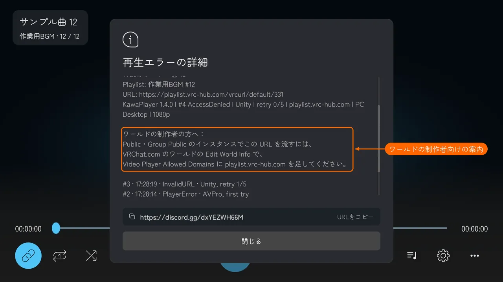

## タブレット

ワールドにタブレットが置いてあれば、手元でも操作できます（[タブレット](tablet.md#使う)）。
