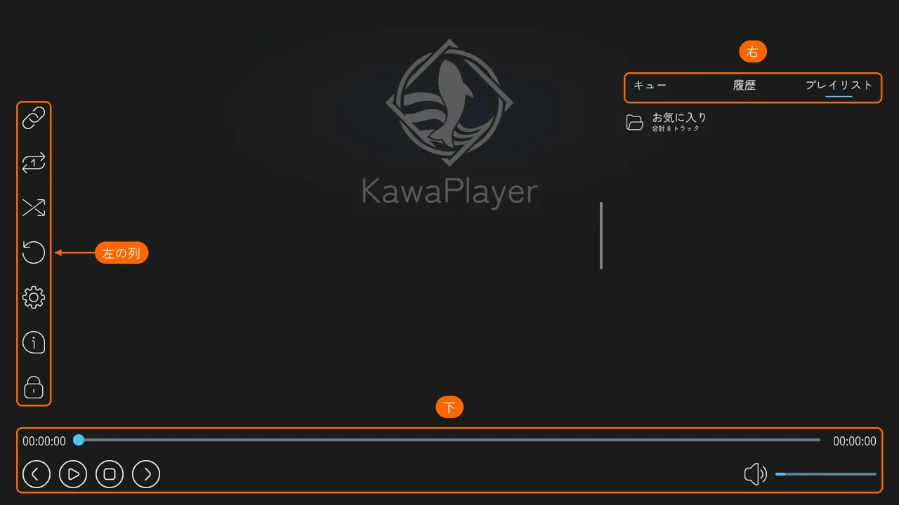
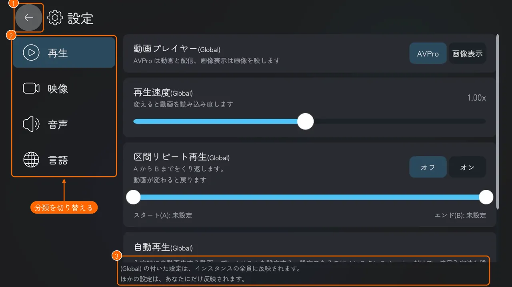
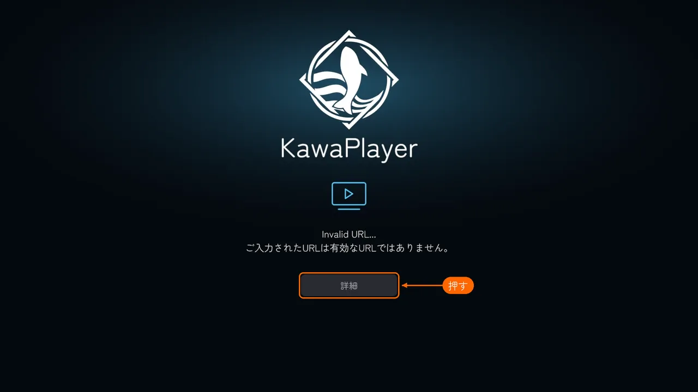
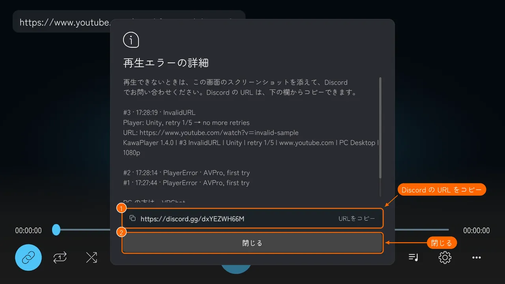

# ワールドの中で使う

KawaPlayer が置かれたワールドで、スクリーンを操作する方法です。

## スクリーンを指す

スクリーンを指すと、操作バーが出ます。デスクトップでは視線（画面の中央）を、VR ではコントローラーのレーザーを向けてください。

| 場所 | ボタン |
| --- | --- |
| 左の列（上から） | URL を入力、ループ再生、シャッフル再生、読み込み直し、設定、情報（バージョンと更新履歴）、UI ロック |
| 下 | 前の曲、再生・一時停止、停止、次の曲、シークバー、音量 |
| 右 | キュー、履歴、プレイリスト |

**UI ロック** を押すと、その人の画面ではスクリーンを触っても操作されなくなります。解除するには、スクリーンを指して、デスクトップでは左クリック、VR ではトリガーを長押しします。

## 動画の URL を入れる

1. 左上の **URL を入力**（鎖のボタン）を押すと、VRChat の入力欄が開きます。
2. 動画の URL（YouTube など）を貼って、確定します。

止まっているときは、すぐに再生が始まります。ほかの動画を再生しているときは、**URL を再生する** の確認が出ます。

| ボタン | すること |
| --- | --- |
| **再生する** | 今の動画を止めて、入れた URL を再生する |
| **再生キューに追加する** | 再生キューの最後に足して、順番に流す |
| **キャンセル** | やめる |

VHub のプレイリストの共有 URL も、同じ欄で読み込めます（[プレイリスト](playlists.md#ワールドの中で-vhub-のプレイリストを読み込む)）。

## 設定を変える

左の列の **設定**（歯車）を押すと、設定の画面が出ます。左の **再生**・**映像・音声**・**その他**（①）で切り替え、左上の **メイン画面に戻る**（②）で元の画面に戻ります。

- **(Global) が付いた設定:** そのインスタンスの全員に反映されます。
- **付いていない設定:** 明るさ・ミラー反転・ローカル再生遅延などは、自分にだけ反映されます。
- **自動再生（インスタンスを作った人だけ）:** **再生** の最後に、入室時に流す **自動再生** の URL を決める欄が出ます。(Global) は付いていませんが、**そのインスタンスの全員に反映されます**。止まっているときに決めると、すぐに全員で再生が始まります（[モジュール](modules.md#自動再生owner-のしくみ)）。

## 再生できないとき

再生できないと、スクリーンに理由と **詳細** ボタンが出ます。

**詳細** を押すと、直近のエラーの内容と、問い合わせ先の Discord の URL が出ます。この画面のスクリーンショットを添えて Discord で聞いてもらえると、原因を探しやすくなります。VRChat ではワールドからリンクを開けないので、Discord の URL は欄（①）からコピーして、ブラウザに貼ってください。**閉じる**（②）で元の画面に戻ります。

## タブレット

ワールドにタブレットが置いてあれば、手元でも操作できます（[タブレット](tablet.md#使う)）。
