# ワールドの中で使う

KawaPlayer が置かれたワールドで、スクリーンを操作する方法です。

## スクリーンを押す

スクリーンを押すと、操作が出ます。デスクトップでは視線（画面の中央）を向けて左クリック、VR ではコントローラーのレーザーを向けてトリガーを押してください。もう一度押すと隠れます。

最後にスクリーンを押してから 10 秒たつと、操作が自分で隠れます。動画を流していないとき（止まっているとき、一時停止中、読み込み中）も同じです。ボタンを押したり、一覧をスクロールしたり、シークバーをつかんで動かしたりしているあいだは隠れません。ダイアログや設定のページ、URL の入力欄が開いているあいだも隠れません。手を離したときや、閉じたときから、改めて 10 秒数えます。秒数はワールドによって違うことがあります（ワールドの作成者が [KawaPlayer の設定](settings.md#外観設定) で決めます）。

操作は、右に [プレイリスト・キュー・履歴の一覧](#プレイリストキュー履歴の一覧) を開いた状態で出ます。下の画像は、その一覧を閉じたところです。左上に今の曲（①）、下にシークバー（②）と、3 つに分かれたボタン（③ 左・④ 真ん中・⑤ 右）が出ます。

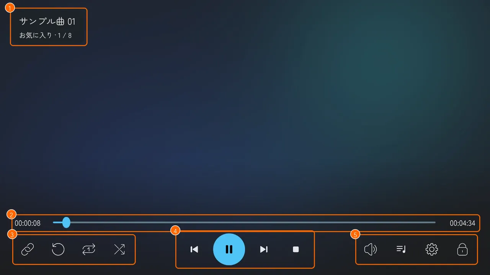

- **左上（①）:** 流れている曲の名前です。その下に、プレイリストの曲ならプレイリストの名前と何曲目か（「お気に入り · 1 / 8」）が、URL を入れて流した動画なら URL が出ます。止まっているときは、KawaPlayer のロゴと、入れられる URL の案内が出ます。
- **押せないボタン:** 押しても何も起きないボタンは、薄く出ます。たとえば、止まっているときの再生と停止や、プレイリストから流していないときの前の曲です。
- **ボタンの名前:** 左のボタンと、設定・UI ロックは、指すと名前が出ます。

下の表の「反映」は、押したことがインスタンスの全員に反映されるか、自分にだけ反映されるかです。ワールドに権限管理のモジュールが入っているときは、権限のない人が押しても動かないボタンがあります（[権限管理](modules.md#権限管理)）。

### 左のボタン

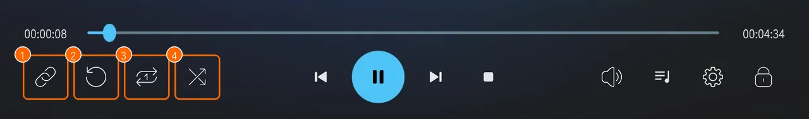

| | ボタン | すること | 反映 |
| --- | --- | --- | --- |
| ① | **URL を入力**（鎖） | 動画やプレイリストの URL を入れる（[動画の URL を入れる](#動画の-url-を入れる)） | 全員 |
| ② | **ReSync** | 今の動画を、自分の画面で読み込み直す。読み込めたら、ほかの人と同じ位置から再生する。映像や音が止まったとき、自分の画面だけエラーで止まったとき、ずれが直らないとき、ライブ配信でほかの人より遅れているときに使う | 自分だけ |
| ③ | **ループ再生** | 今の動画を、終わったら最初から繰り返す。もう一度押すとやめる | 全員 |
| ④ | **シャッフル再生** | プレイリストの次の曲を、順番ではなくランダムに選ぶ。もう一度押すとやめる | 全員 |

一覧が開いているあいだは、**URL を入力**（①）と **ReSync**（②）だけが出ます。③・④ は、一覧を閉じると出ます。

**ReSync** は、全員が止まっているときと、読み込み中のしばらくのあいだは押せません。読み込み中で押せないときは、少し待ってください。自分の画面だけエラーで止まったときは、すぐに押せます。

全員の画面をまとめて読み込み直すには、主催者などがワールドに置いた [全員リロードボタン](global-reload.md) を使います（置いてあるワールドだけ）。**ReSync** との違いは、[そのページ](global-reload.md#resync-との違い) にあります。

**ほかの人とずれたとき:** ふつうの動画は、ずれても自動で合わせ直すので、まず数秒待ってください。直らないときや、映像が止まったままのときは、**ReSync**（②）を押します。ライブ配信は自動では合わせないので、遅れたときは **ReSync** で今の位置から取り直します。いつも自分だけ早い・遅いときは、設定の **音声** の **ローカル再生遅延** で、自分の再生位置を前後にずらせます。くわしいしくみは [再生の同期のしくみ](technical/sync.md) にあります。

### 真ん中のボタンとシークバー

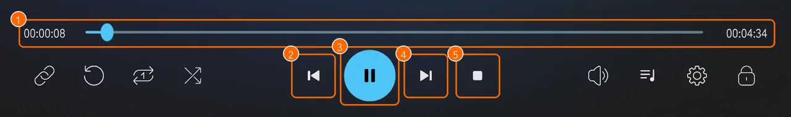

| | ボタン | すること | 反映 |
| --- | --- | --- | --- |
| ① | **シークバー** | つまみを動かすと、その位置から再生する。左は今の位置、右は動画の長さ | 全員 |
| ② | **前の曲** | 再生中のプレイリストの、1 つ前の曲を流す（最初の曲なら最後の曲へ） | 全員 |
| ③ | **再生**・**一時停止** | 再生と一時停止を切り替える | 全員 |
| ④ | **次の曲** | キューに曲があればその曲を、なければ再生中のプレイリストの次の曲を流す（最後の曲なら最初の曲へ。シャッフル再生ならランダム）。キューの曲を流したあとは、プレイリストの続きには戻らない | 全員 |
| ⑤ | **停止** | 再生をやめる。エラーで止まったときの表示も消える | 全員 |

**前の曲** と **次の曲** は、プレイリストから流しているときに使えます。URL を入れて流した動画や、キューから流した曲のあとは、キューに曲があるときだけ **次の曲** が働きます。

### 右のボタン

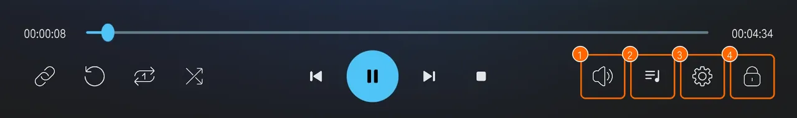

| | ボタン | すること | 反映 |
| --- | --- | --- | --- |
| ① | **音量**（スピーカー） | 上に、音量の板を開く（[下](#音量)）。もう一度押すと閉じる | 自分だけ |
| ② | **一覧** | プレイリスト・キュー・履歴の一覧を、右に出す（[一覧](#プレイリストキュー履歴の一覧)）。もう一度押すと閉じる | ― |
| ③ | **設定**（歯車） | 設定の画面を開く（[設定を変える](#設定を変える)）。KawaPlayer の版と更新履歴も、ここの **情報** にある | ― |
| ④ | **UI ロック**（鍵） | 自分の画面で、スクリーンを触っても操作されないようにする（[下](#ui-ロック)） | 自分だけ |

**設定** と **UI ロック** は、一覧を閉じると出ます。

#### 音量

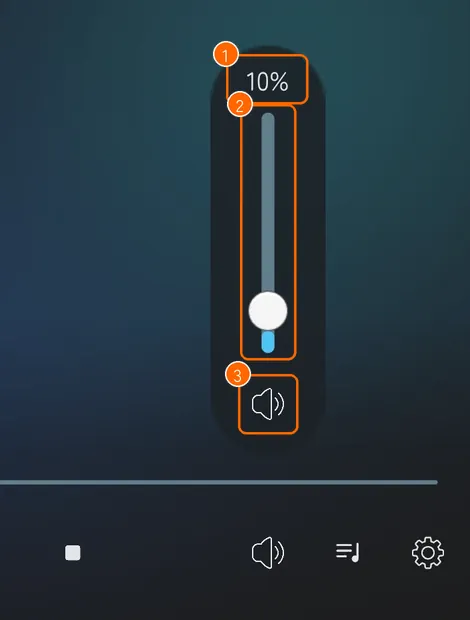

| | 部分 | すること |
| --- | --- | --- |
| ① | **今の音量** | 今の音の大きさ（%） |
| ② | **バー** | つまみを上下に動かして、音の大きさを変える |
| ③ | **消音**（スピーカー） | 消音と解除を切り替える。消音中は、下の帯の **音量** の印も変わる |

音量は、自分にだけ反映されます。板は、**音量** をもう一度押すか、**一覧**・**設定** を押すと閉じます。

#### UI ロック

**UI ロック** を押すと、操作が隠れ、自分の画面ではスクリーンを押しても操作が出なくなります。ほかの人の画面は変わりません。

解除するには、スクリーンを指して、1.5 秒のうちに 3 回押します（デスクトップでは左クリック、VR ではトリガー）。スクリーンを指すと、下に解除の案内（①）が出て、押した回数が丸（②）で増えます。1.5 秒たったときや、スクリーンの外を指したときは、1 回目から数え直します。

## プレイリスト・キュー・履歴の一覧

スクリーンを押して操作を出すと、スクリーンの右に一覧が出ています。上のタブ（①〜③）で、出すものを切り替えます。最初は **プレイリスト** のタブです。

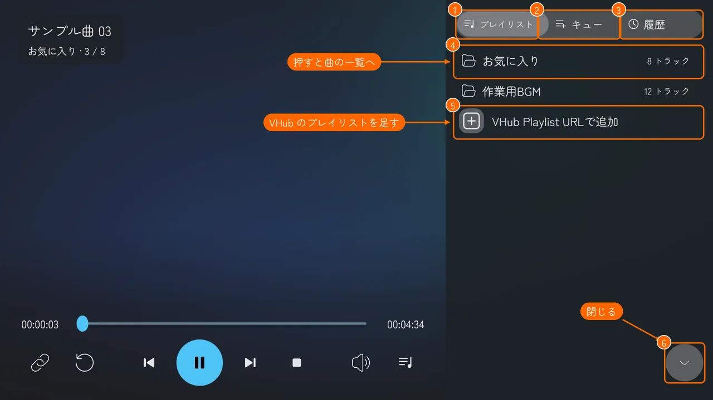

| | タブ | 出るもの |
| --- | --- | --- |
| ① | **プレイリスト** | ワールドに最初から入っているプレイリストと、VHub から読み込んだプレイリストの一覧。プレイリスト（④）を押すと、その曲の一覧が出る（[下の手順](#プレイリストから曲を流す)） |
| ② | **キュー** | 次に流す曲の列。URL を入れたときの **再生キューに追加する** や、曲の **キューに追加** で足した曲が並ぶ。次の曲に進むときは、プレイリストより先に、キューの曲を上から流す |
| ③ | **履歴** | これまでに流した曲 |

- **＋（⑤）:** VHub のプレイリストを、一覧に足します。＋ の行を指すと、＋ が左に寄り、その右に **VHub Playlist URLで追加** と出ます。行のどこを押しても、VHub の VRChat用URL を入れる欄が開きます。貼って確定すると、プレイリストの一覧の最後に 1 つ足されます。止まっていても再生は始まらず、足せたことも表示しません（読み込めなかったときだけ、理由が出ます）。動画の URL は入れられないので、下の帯の **URL を入力** から入れてください。Playlist Panel には出ません（[VHub のプレイリストを読み込む](#vhub-のプレイリストを読み込む)）。
- **閉じる:** もう一度 **一覧** を押すか、右下の **∨**（⑥）を押すか、一覧の外を押します。次に操作を出すと、また開いています。
- **下の帯:** 一覧が出ているあいだ、帯は一覧の左に縮みます。左のボタンは **URL を入力** と **ReSync** が残り、**ループ再生**・**シャッフル再生** と、**設定**・**UI ロック** は隠れます。
- **曲を指す:** 曲の行を指すと（VR ではビーム、デスクトップでは画面の中央）、その行の右端にだけ、その曲の操作ボタンが出ます（[曲の操作ボタン](#曲の操作ボタン)）。外すと消えます。
- **長い曲名:** 一覧に入りきらない曲名は、一覧の右端で切れて出ます。その曲を指すと、操作ボタンの手前で切れ、1 秒ほどして左へゆっくり流れ、最後まで読めます。指しているあいだはくり返し、外すと元に戻ります。キュー・履歴・プレイリストの曲で同じです。

### キュー

**キュー**（①）を押すと、次に流す曲（②）が並びます。

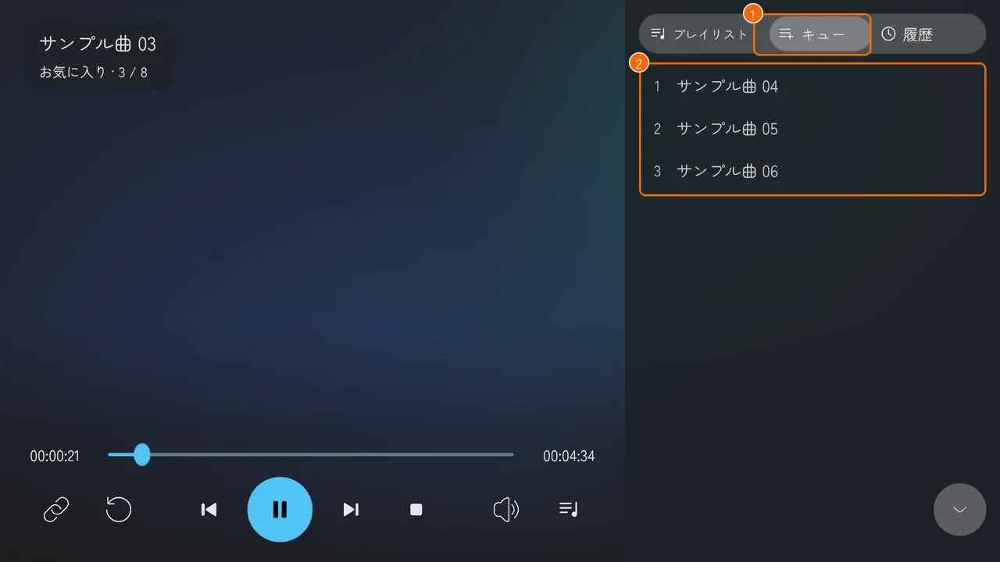

- **足し方:** URL を入れたときの確認で **再生キューに追加する** を押すか、履歴やプレイリストの曲の **キューに追加** を押します。
- **流れ方:** 曲が終わったときや **次の曲** を押したとき、キューの一番上の曲が流れ、キューから消えます。シャッフル再生のときは、キューの中からランダムに選びます。
- **プレイリストとの関係:** キューの曲を流すと、プレイリストの続けての再生から離れます。キューを流し終えても、元のプレイリストの続きは流れません。続けたいときは、プレイリストの曲を押してください。キューが空で、プレイリストから流しているときは、プレイリストの次の曲に進みます。

キューの曲を押すと、その曲をすぐ流し、キューから外します。キューの順番を飛ばすので、ほかの人が入れた曲より先に流れます。

キューの曲を指すと、その行の右に **URL**（①）・**上へ移動**（②）・**下へ移動**（③）・**削除**（④）が出ます。上へ移動・下へ移動で流す順番を入れ替え、削除でキューから外します。

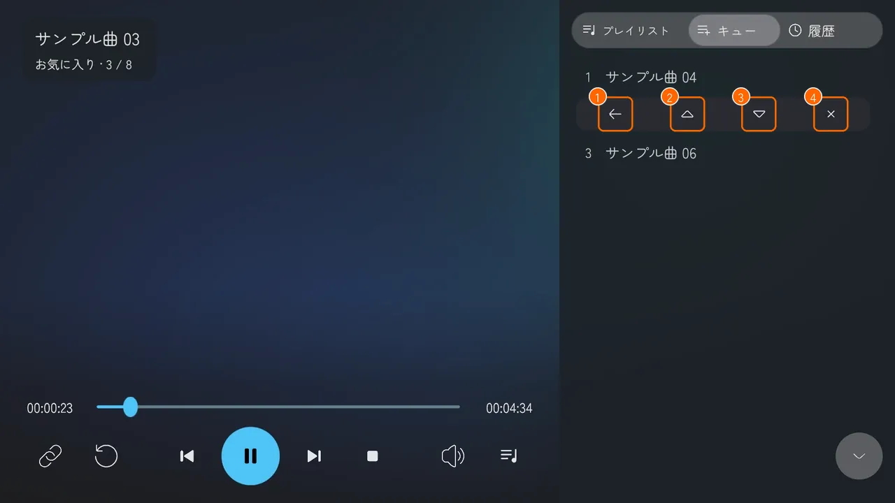

### 履歴

**履歴**（①）を押すと、これまでに流した曲（②）が、流した順に上から並びます（一番下が、最後に流した曲）。曲を押すと、その曲をもう一度流します。指すと、プレイリストの曲と同じ操作ボタン（URL・キューに追加）が出ます。

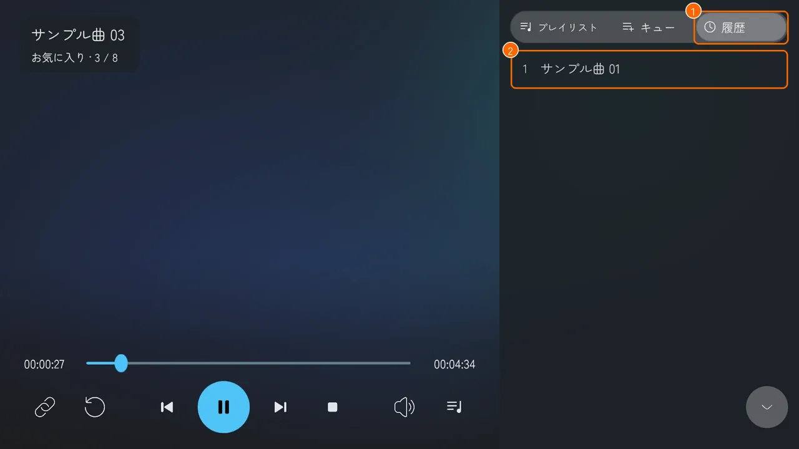

### プレイリストから曲を流す

1. **プレイリスト** のタブで、流したいプレイリストを押します（[上の画像](#プレイリストキュー履歴の一覧) の ④）。
2. そのプレイリストの曲の一覧に変わります。上には、**<**（①）と、プレイリストの名前と曲数（②）が出ます。流したい曲（③）を押すと、その曲から再生します。**<** を押すと、プレイリストの一覧に戻ります。流れている曲は、番号の代わりに音符が付き、名前が色付きで出ます（④）。流れている曲（読み込み中・一時停止中も）を押しても、最初から流し直しはしません。

   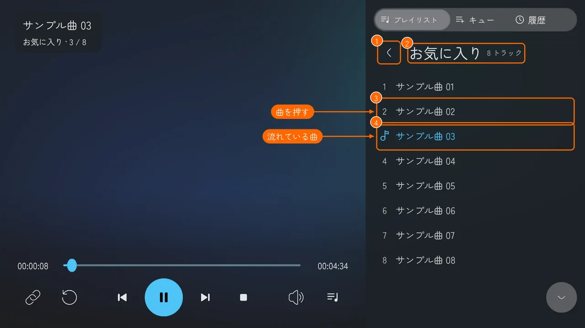

#### 曲の操作ボタン

曲を指すと、その行の右に操作ボタンが出ます。行のほかの所を押すと、その曲を流します。プレイリストと履歴では **URL**（①）と **キューに追加**（②）が出ます。

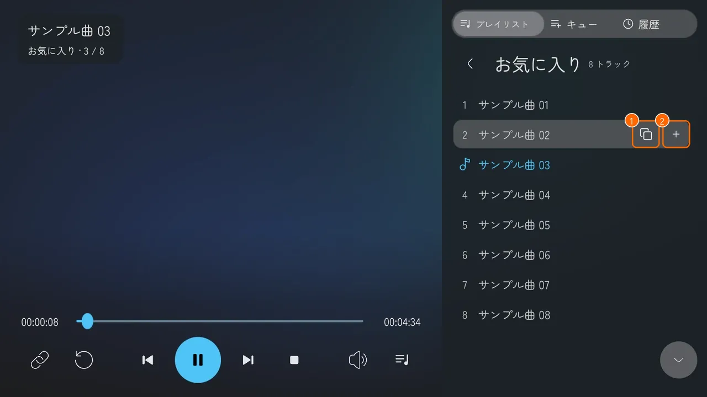

タブによって、出るボタンが違います。

| ボタン | すること | 出るタブ |
| --- | --- | --- |
| **URL**（2 枚の紙） | 曲名と URL の画面を出す。URL は欄からコピーできる（Playlist Panel には出ない） | すべて |
| **キューに追加**（＋） | その曲を、キューの最後に足す | 履歴・プレイリスト |
| **上へ移動**（△）・**下へ移動**（▽） | キューの中で、順番を入れ替える | キュー |
| **削除**（✕） | キューから外す | キュー |

#### VHub から読み込んだプレイリスト

VHub から読み込んだプレイリストの曲の一覧には、名前の右に **…**（①）が出ます。押すと、その下に **更新**（②）・**URL**（③）・**削除**（④）が並びます。

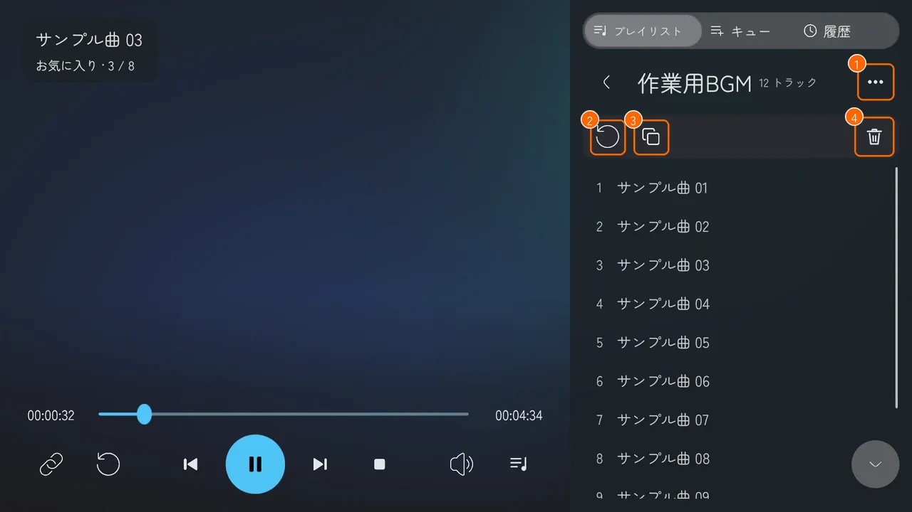

| | ボタン | すること |
| --- | --- | --- |
| ① | **…** | ②〜④ のボタンを出す。もう一度押すと隠す |
| ② | **更新** | VHub の今の内容に変える |
| ③ | **URL** | 読み込んだ VRChat用URL の画面を出す。URL は欄からコピーできる |
| ④ | **削除** | プレイリストの一覧から外す（外す前に確認が出る） |

ワールドに最初から入っているプレイリストには、**…** は出ません。Playlist Panel にも出ないので、更新や削除はスクリーンかタブレットでします。

## 動画の URL を入れる

1. 左のボタンの **URL を入力**（②、鎖のボタン）を押すと、VRChat の入力欄が開きます。止まっているときは、このボタンが色の付いた丸で出ます。左上には、入れられる URL の案内（①）が出ます。

   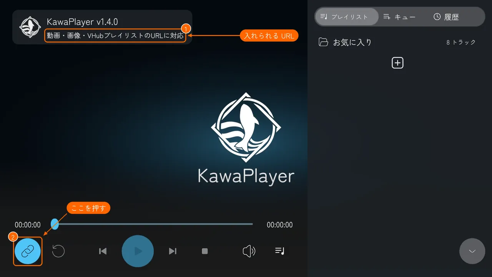

2. 動画の URL（YouTube など）を貼って、確定します。

止まっているときは、すぐに再生が始まります。ほかの動画を再生しているときは、**URLを再生する** の確認が出ます。

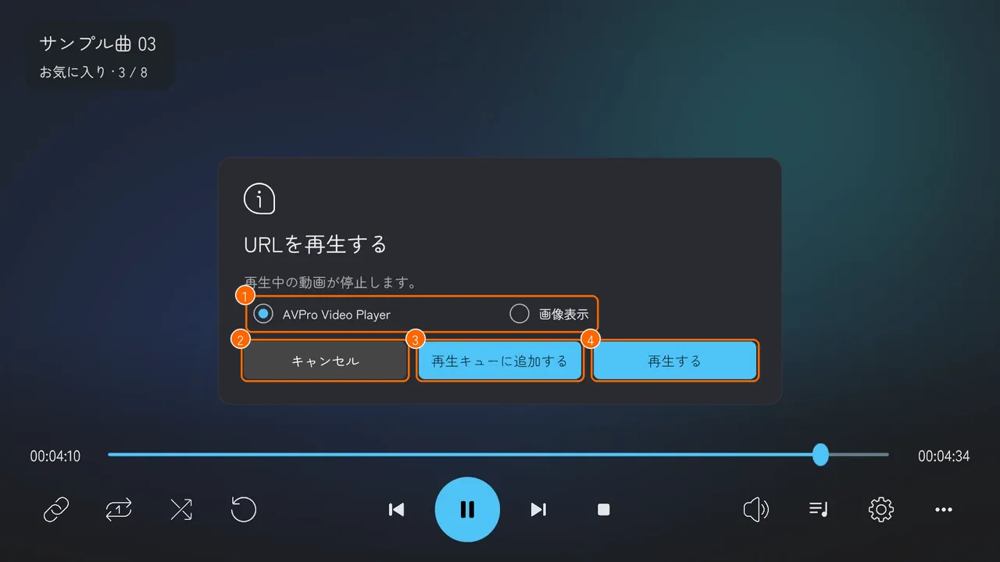

| | 部分 | すること |
| --- | --- | --- |
| ① | **AVPro Video Player**・**画像表示** | この URL を流すプレイヤー。動画はそのまま AVPro で、画像の URL なら **画像表示** を選ぶ。選んだプレイヤーは、この URL にだけ使う |
| ② | **キャンセル** | やめる |
| ③ | **再生キューに追加する** | 再生キューの最後に足して、順番に流す |
| ④ | **再生する** | 今の動画を止めて、入れた URL を再生する |

### 再生できるサイト

次のサイトの動画を流せます。

- **YouTube:** 動画とライブ配信。確かめた動画とライブ配信は、360p または 1080p で流れました。**最大解像度** は画質の上限を決める設定で、上げても、VRChat や YouTube の状況によって低い画質のままになることがあります。
- **Twitch:** 配信、録画、クリップ。
- **ツイキャス（TwitCasting）:** ライブ配信。
- **Facebook:** 動画。
- **X:** 投稿の動画。
- **SoundCloud・Mixcloud:** 音声。スクリーンには映像の代わりに、大きく **SOUND ONLY** と出ます。
- **ファイルや配信の直接の URL:** mp4・webm のファイルと、HLS（m3u8）。

どのサイトを流せるかは、VRChat や各サイトの都合で、KawaPlayer を更新しなくても変わります。この一覧は、2026 年 11 月に PC 版の VRChat で、Allow Untrusted URLs をオンにして確かめたものです。ここにないサイトでも流せることがあり、ここにあるサイトでも流せなくなることがあります。流せないときは [再生できないとき](#再生できないとき) を見てください。

### VHub のプレイリストを読み込む

[VHub Playlist](https://playlist.vrc-hub.com) のプレイリストも、同じ **URL を入力** で、まるごと読み込めます。一覧の **＋** からも足せます（下の 2.）。

**先に、VRChat の設定で Allow Untrusted URLs をオンにしてください**（[オンにする手順](quickstart.md#7-allow-untrusted-urls-をオンにする)）。オフのままでは読み込めず、VHub の曲も流れません。Public・Group Public のインスタンスでは、ワールドが VHub を許可している必要もあります（ワールドの作者が設定します）。

1. VHub で、プレイリストの **VRChat用URL** をコピーします（[コピーのしかた](vhub.md#vrchat用url-をコピーする)）。
2. **URL を入力**（①）に貼って、確定します。**プレイリストを追加しました** と出れば、プレイリストの一覧に 1 つ足されています。止まっているときは、そのまま再生が始まります。

   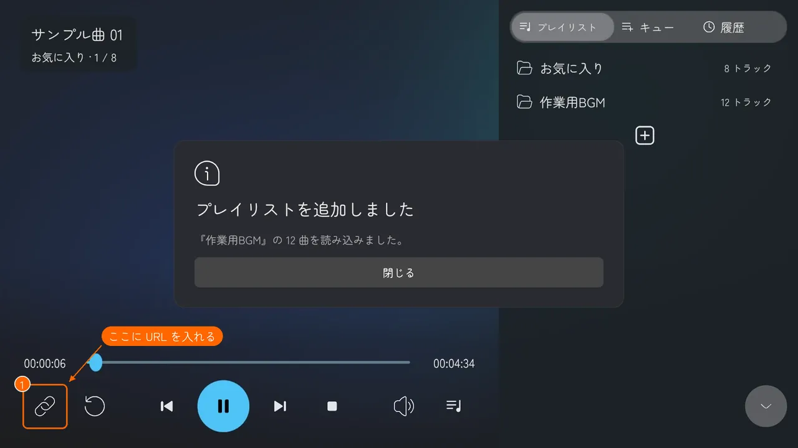

   一覧の **プレイリスト** のタブの下にある **＋** に貼っても、同じように足せます。こちらは止まっていても再生が始まらず、**プレイリストを追加しました** も出ません。読み込めたプレイリストが、一覧の最後に出ます（[一覧](#プレイリストキュー履歴の一覧) の ⑤）。

3. 一覧の **プレイリスト** のタブで、読み込んだプレイリストを選びます。曲（①）を押すと、その曲から再生します。名前の右の **…**（②）から、**更新** で VHub の今の内容に変え、**削除** で一覧から外せます（[VHub から読み込んだプレイリスト](#vhub-から読み込んだプレイリスト)）。

   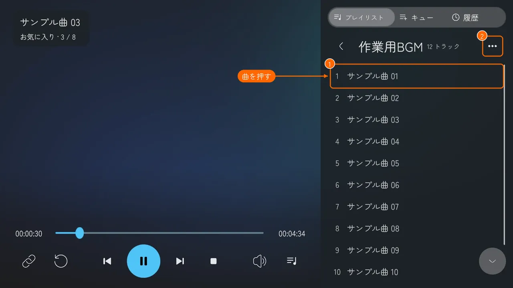

- **入れる URL:** VHub のページのアドレス（`/playlists/…`）や、**シェア** でコピーした URL では読み込めません。**VRChat用URLをコピー** でコピーした URL（`https://playlist.vrc-hub.com/r/default/…`）を入れます。
- **読み込める数:** 標準で 5 件までです。いっぱいのときに新しく読み込むと、一番古いものを消してよいか聞かれます（[プレイリスト](playlists.md#ワールドの中で-vhub-のプレイリストを読み込む)）。

### VHub のプレイリストを検索する

URL をコピーしてこなくても、ワールドの中で VHub Playlist のプレイリストを探し、中身を見てから一覧に追加できます。

**先に、VRChat の設定で Allow Untrusted URLs をオンにしてください**（[オンにする手順](quickstart.md#7-allow-untrusted-urls-をオンにする)）。

1. 一覧の **プレイリスト** のタブで、プレイリストの下にある **VHub Playlist を検索**（①）を押します。画面いっぱいに、検索のページが出ます。

   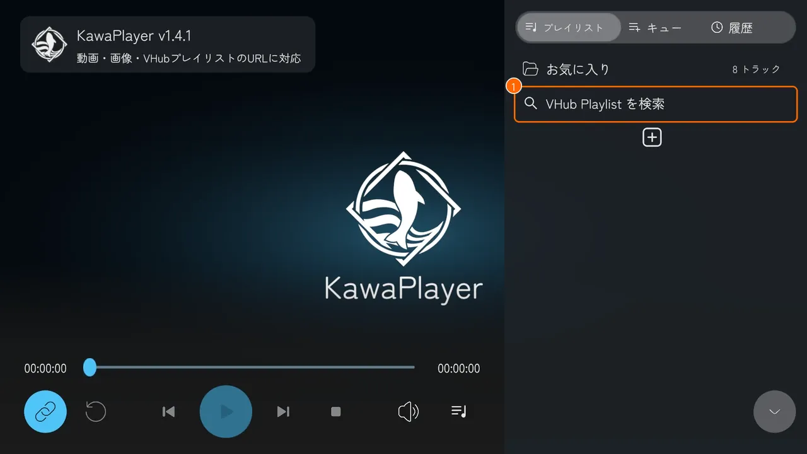

2. 上の箱（②）を押します。VRChat の入力の画面が開き、URL が入っています。**URL は消さずに、その後ろに**検索語を入力して確定します。
3. 見つかったプレイリストが、よく読み込まれている順に、番号つきで並びます。名前の下には、曲数と作った人が出ます。行（③）にレーザーを向けると、右に 2 つのボタンが出ます。左上の **←**（①）で、元の画面に戻ります。
   - **曲の一覧**のボタン（④）か、行そのものを押すと、そのプレイリストの中身が出ます（次の手順）。
   - **＋**（⑤）を押すと、中身を見ずに、そのまま一覧に追加します。再生は始まりません。
   - すでに一覧にあるプレイリストには、行の右端に、水色の丸に **✓** の印が出ます。**＋** は出ません。

   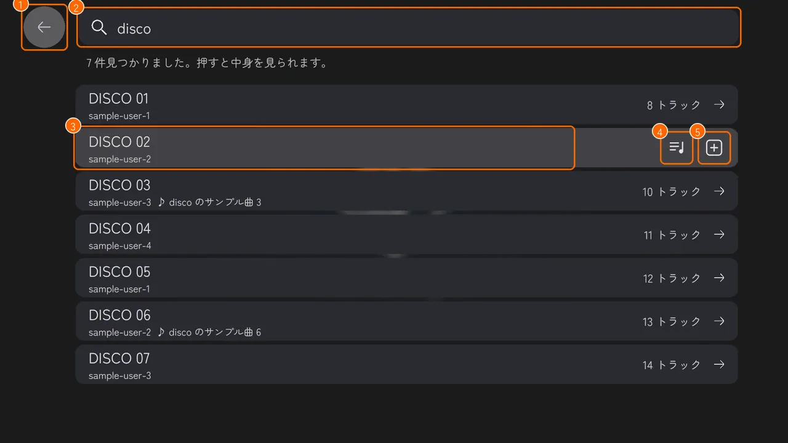

4. 左にプレイリストの名前と、曲数・作った人、右に入っている曲が並びます。**＋**（①）を押すと、このプレイリストが一覧に入り、ボタンが **✓** に変わります。再生は始まらないので、一覧から曲を選んでください。**＜**（②）で検索の結果に戻り、続けてほかのプレイリストを見られます。

   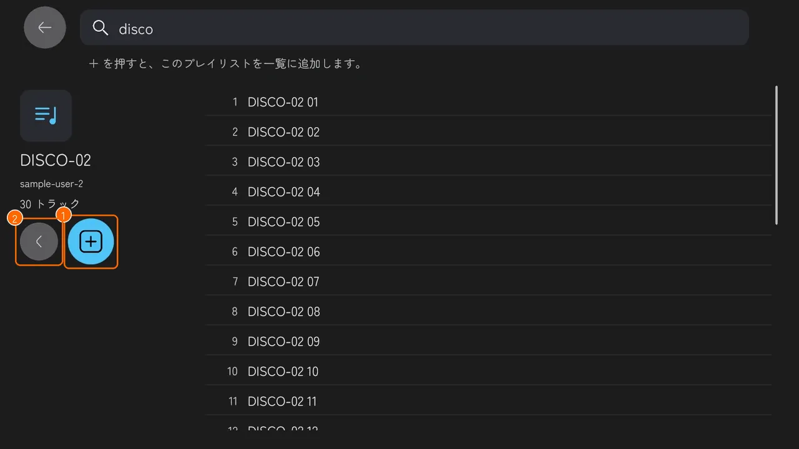

- **探せるもの:** 公開されているプレイリストの、名前と曲名です。曲名で見つかったプレイリストは、名前の下に ♪ と、その曲名が出ます。
- **件数:** 一度に出るのは 60 件までです。多すぎるときは、検索語を足して絞ってください。
- **待ち時間:** 検索のあとや、続けてプレイリストを開くときは、波が流れて少し待つことがあります（VRChat は、こうした読み込みを 5 秒に 1 回に抑えています）。
- **使えない文字:** `#` と `%` は検索に使えません。
- **URL を貼る:** 箱に、VHub の **VRChat用URL** を貼っても読み込めます。
- **出る場所:** スクリーンと、タブレットの KawaPlayer アプリです。Playlist Panel には出ません。

## 設定を変える

右のボタンの **設定**（歯車）を押すと、設定の画面が出ます。左の分類（②）の **再生**・**映像**・**音声**・**言語**・**情報** を切り替え、左上の **←**（①）で元の画面に戻ります。

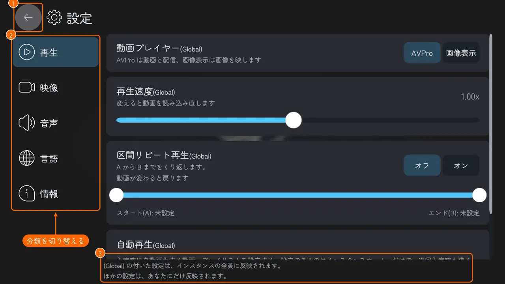

名前に **(Global)** が付いた設定は、インスタンスの全員に反映されます。付いていない設定は、自分にだけ反映されます（下の ③ にも書いてあります）。

### 再生

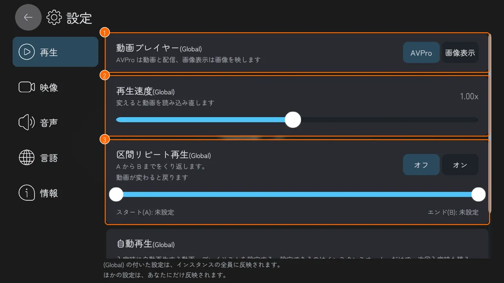

下へ送ると、④ が出ます。

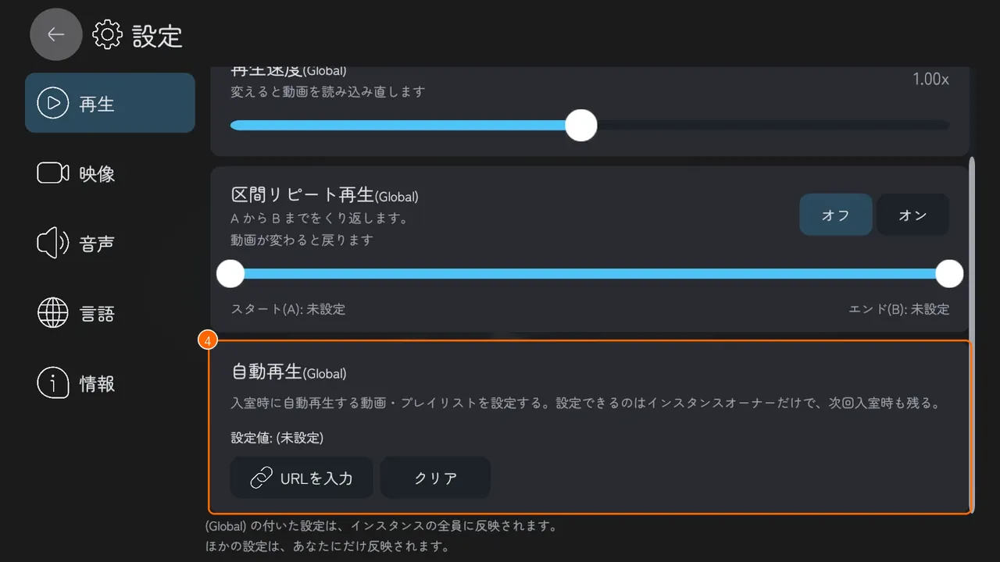

| | 設定 | すること | 反映 |
| --- | --- | --- | --- |
| ① | **動画プレイヤー** | 次に入れる URL を流すプレイヤー。**AVPro**（動画。YouTube Live や Twitch の配信も見られる）か、**画像表示**（画像）。動画を流すときは AVPro のままにする | 全員 |
| ② | **再生速度** | 0.05 倍きざみで、0.05〜2.0 倍。真ん中が 1.0 倍。AVPro では、変えると動画を読み込み直す | 全員 |
| ③ | **区間リピート再生** | バーの左右のつまみで区間（A〜B）を決めて **オン** にすると、その区間を繰り返す。決めた区間は、バーの下のスタート(A)・エンド(B) に出る。動画が変わると、自動でオフに戻る。ライブ配信では使えない | 全員 |
| ④ | **自動再生** | 入室時に流す動画・プレイリストの URL。決められるのはインスタンスを作った人だけ（[自動再生](#自動再生)） | 全員 |

### 自動再生

**再生** の分類の一番下（④）にある、インスタンスを作った人（インスタンスオーナー）が、入室したときに流す動画やプレイリストを決める機能です。タブレットの設定アプリの **再生** にも、同じ欄があります。

#### 見る人ごとの表示

自動再生の欄は、見る人によって表示が変わります。

| 見る人 | 表示 |
| --- | --- |
| インスタンスを作った人 | 決めた URL（設定値）と、**URLを入力**・**クリア** のボタン |
| ほかの人 | 「✕ 本機能は利用できません」と理由だけ。操作はできない |
| Public・Group のインスタンスと、SDK の Build & Test | インスタンスを作った人がいないので、全員が「✕ 本機能は利用できません」 |

**インスタンスを作った人の画面:**

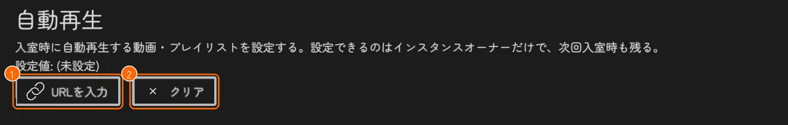

**ほかの人の画面**（Public・Group のインスタンスでは全員）:

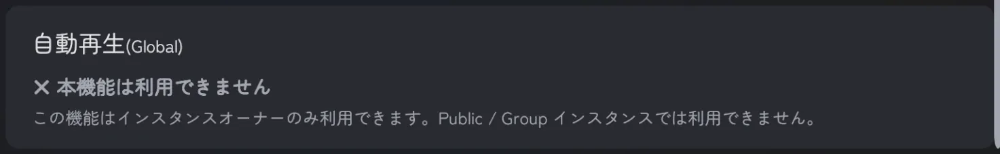

#### 自動再生の URL を設定する

1. **URLを入力**（上の画像の ①）を押し、動画の URL か、VHub のプレイリストの VRChat用URL（[コピーのしかた](vhub.md#vrchat用url-をコピーする)）を貼って、確定します。
2. 設定値（①）に、決めた URL が出ます。

   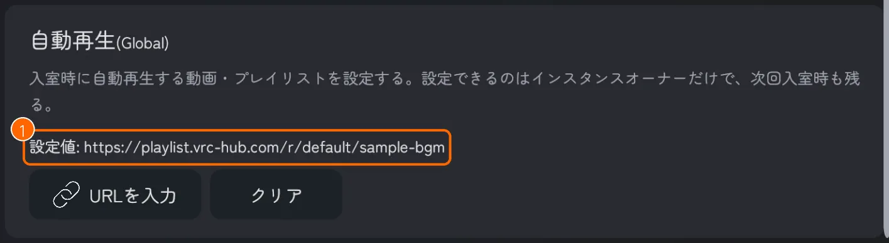

- **全員に反映:** 名前の (Global) のとおり、決めた URL はインスタンスの全員に反映されます。
- **すぐ流れるとき:** 止まっているときに決めると、すぐに全員で再生が始まります。何かを再生しているときは止めず、そのインスタンスでは、あとから流れることもありません。
- **VHub のプレイリスト:** プレイリストの一覧に読み込みます。読み込める枠（標準で 5 件）がいっぱいのときは、一番古いものを消してよいか聞かれます。

#### 自動再生の URL を消す

**クリア**（上の画像の ②）を押すと、決めた URL が消え、設定値が **(未設定)** に戻ります。いま流れているものは止まりません。

#### 次のインスタンスでも流れる

決めた URL は、決めた人の VRChat のアカウントに残ります。同じワールドで次に自分でインスタンスを作って入ると、その URL が設定値に戻り、止まっていれば自動で流れます。流したくなくなったら、**クリア** で消してください。

ワールドの作者が Unity で決める自動再生（自動再生(World)）とは別の機能で、同じ KawaPlayer で両方は使えません（[モジュール](modules.md#自動再生owner)）。

### 映像

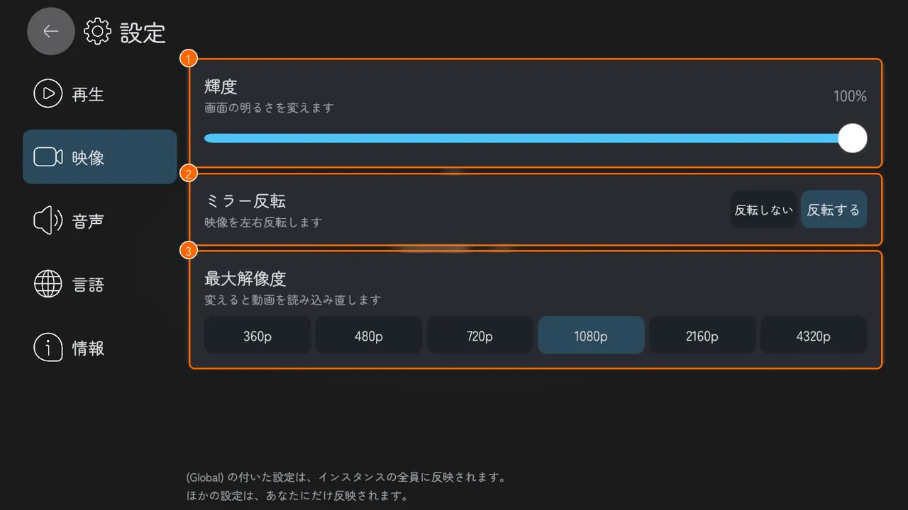

| | 設定 | すること | 反映 |
| --- | --- | --- | --- |
| ① | **輝度** | スクリーンの明るさ | 自分だけ |
| ② | **ミラー反転** | ミラーに映ったスクリーンを左右反転して、文字を読めるようにする | 自分だけ |
| ③ | **最大解像度** | 動画を読み込むときの画質の上限（360p〜4320p）。下げると軽くなる。上げても、動画によっては低い画質のまま（[再生できるサイト](#再生できるサイト)）。変えると、今の動画を読み込み直す | 自分だけ |

ミラー反転と輝度の初めの値は、ワールドの作者がインスペクターで決めます（置いたままなら **反転する** と 100%。[KawaPlayer の設定](settings.md#動画プレイヤー設定)）。

### 音声

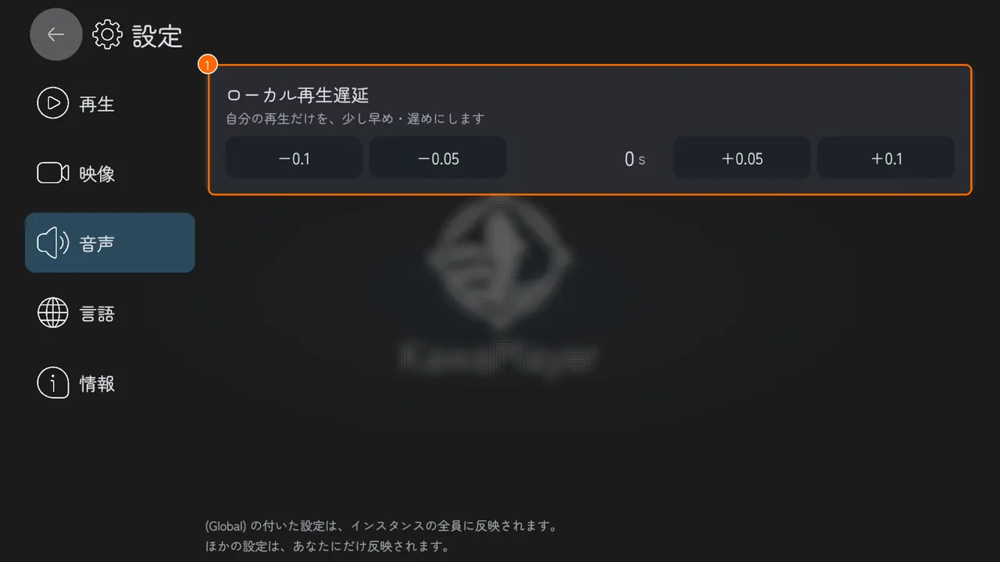

| | 設定 | すること | 反映 |
| --- | --- | --- | --- |
| ① | **ローカル再生遅延** | 自分の再生位置だけを、ほかの人から前後にずらす。**−0.1**・**＋0.1** で 0.1 秒、**−0.05**・**＋0.05** で 0.05 秒ずつ。真ん中の数字が今のずらし（秒）で、大きくすると自分の映像が先へ進む | 自分だけ |

音量は、下の帯の **音量** で変えます（[音量](#音量)）。

### 言語

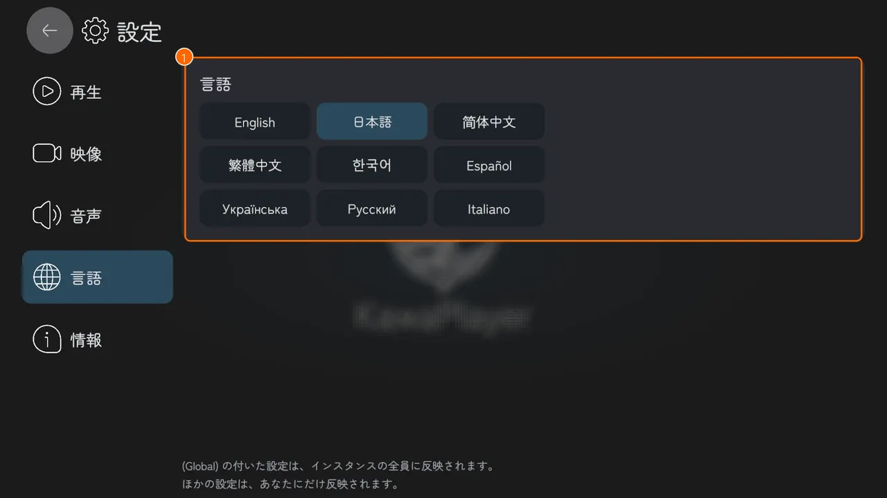

| | 設定 | すること | 反映 |
| --- | --- | --- | --- |
| ① | **言語** | KawaPlayer の画面の言語。English・日本語・简体中文・繁體中文・한국어・Español・Українська・Русский・Italiano から選ぶ | 自分だけ |

### 情報

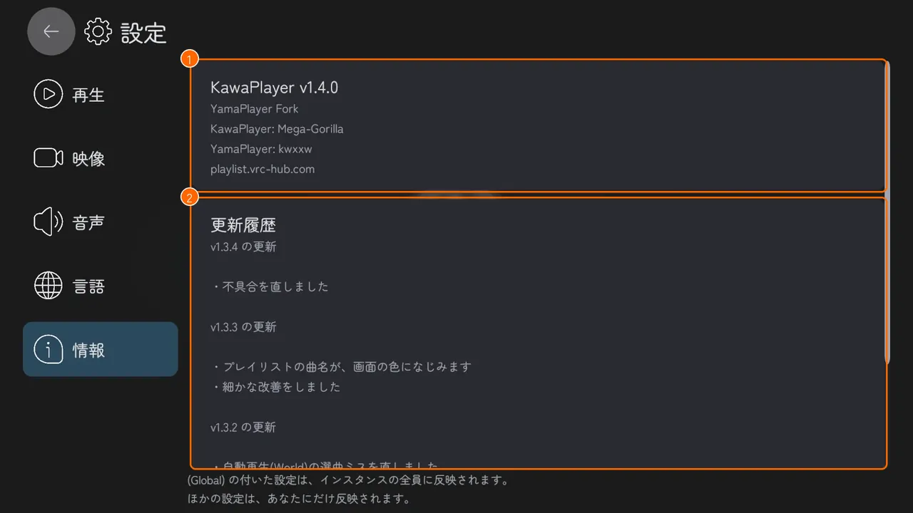

| | 欄 | 出ること |
| --- | --- | --- |
| ① | **KawaPlayer の版** | ワールドに入っている KawaPlayer の版と、作った人 |
| ② | **更新履歴** | 最近の版で変わったこと。下へ送ると続きが出る |

ワールドに入っている KawaPlayer は、ワールドを作ったときの版です。新しい版が出ても、ワールドの作者が作り直すまでは変わりません。

### モジュールで増える欄

ワールドに入っているモジュールによって、設定の画面に欄や分類が増えます（[モジュール](modules.md)）。

| モジュール | 増えるところ |
| --- | --- |
| スライドショー | **再生** に、スライドモードとスライド秒数 |
| AudioLink アダプター | **音声** に、AudioLink 連携 |
| ピッチシフター | **音声** に、ピッチシフター |
| 権限管理 | **権限** の分類（**情報** の上。Admin 以上の人だけに見える。タブレットの設定アプリにも出る） |

設定の永続化のモジュールが入っていると、音量・ミュート・ミラー反転・輝度は、次に入ったときも残ります。

## 再生できないとき

**自分の画面だけ止まったとき:** ほかの人には映っているのに、自分の画面だけエラーで止まったり、読み込み中のまま進まなかったりするときは、まず **ReSync**（[左のボタンの ②](#左のボタン)）を押してください。押した人の画面だけが読み込み直し、ほかの人と同じ位置に戻ります（一時停止中なら、一時停止のまま）。それでも再生できないときや、全員が再生できないときは、下の **詳細** と、原因ごとの案内を見てください。

再生できないと、スクリーンに理由と **詳細** ボタンが出ます。サイトによっては、対応していないという案内が出ます。

**Vimeo の動画:** `https://vimeo.com/番号` の URL には対応していませんが、次のどちらかで入れ直すと、再生できることがあります。動画によっては再生できず、映像だけで音が出ないこともあります。

- **A. スクリーンのコピー欄から:** スクリーンの案内のコピー欄から URL をコピーして、**URL を入力** に貼ります。
- **B. Vimeo の「共有」から:** 動画のページの「共有」（Share）で「埋め込み」（Embed）を開いてコードをコピーし、**URL を入力** に貼ります。埋め込みコードのままでは再生できず、スクリーンのコピー欄に URL が出るので、その URL をコピーして、もう一度貼ります。

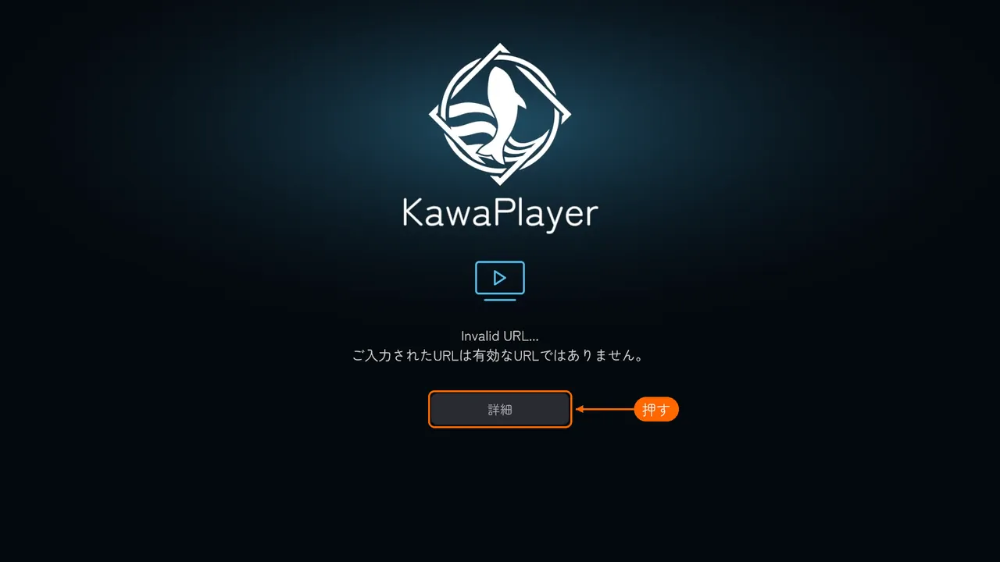

**詳細** を押すと、直近のエラーの内容と、問い合わせ先の Discord の URL が出ます。この画面のスクリーンショットを添えて Discord で聞いてもらえると、原因を探しやすくなります。VRChat ではワールドからリンクを開けないので、Discord の URL は欄（①）からコピーして、ブラウザに貼ってください。**閉じる**（②）で元の画面に戻ります。

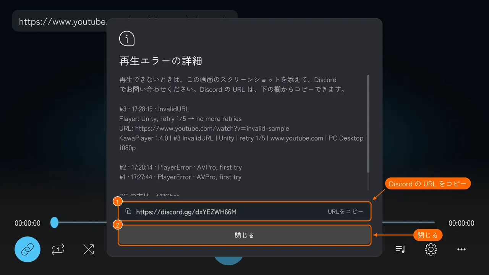

### Access Denied と出たとき

VRChat が初めから信頼していないサイトの動画は、見る人それぞれが VRChat の設定で **Allow Untrusted URLs** をオンにしていないと流れません（[オンにする手順](quickstart.md#7-allow-untrusted-urls-をオンにする)）。

- **遊ぶ人:** まず Allow Untrusted URLs をオンにしてください。それでも再生できないときは、ワールドの制作者に伝えてください。Public・Group Public のインスタンスでは、ワールドが許可したサイトの動画しか流せず、その許可を変えられるのはワールドの制作者だけです。**詳細** の画面を撮って見せると、制作者は何をすればよいか分かります。
- **ワールドの制作者:** **詳細** の直近のエラーの下に、Video Player Allowed Domains に足すドメインが出ます（スクロールした先にあります）。[クイックスタートの 6.](quickstart.md#6-vrchatcom-で-vhub-を許可する) と同じ手順で、そのドメインを足してください。Public・Group Public 以外のインスタンスでは、この一覧は要りません。
- **画像のとき:** 画像を映しているときの Access Denied は、Allow Untrusted URLs だけで直ります。ワールドの許可は要らないので、**詳細** に制作者向けの案内は出ません。

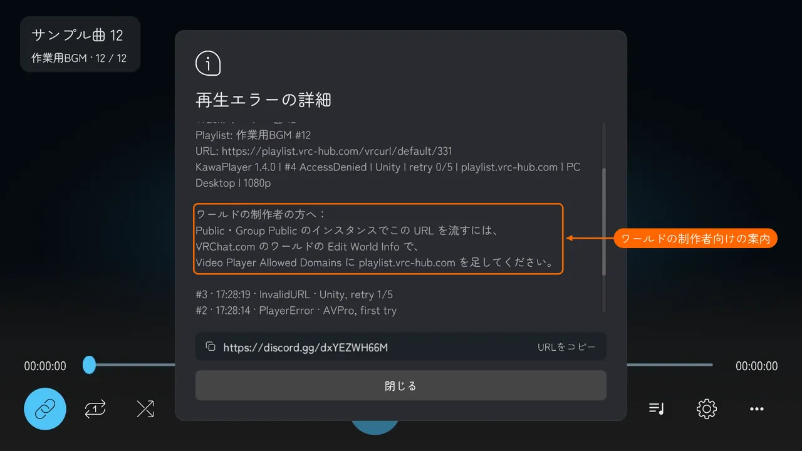

## タブレット

ワールドにタブレットが置いてあれば、手元でも操作できます（[タブレット](tablet.md#使う)）。
