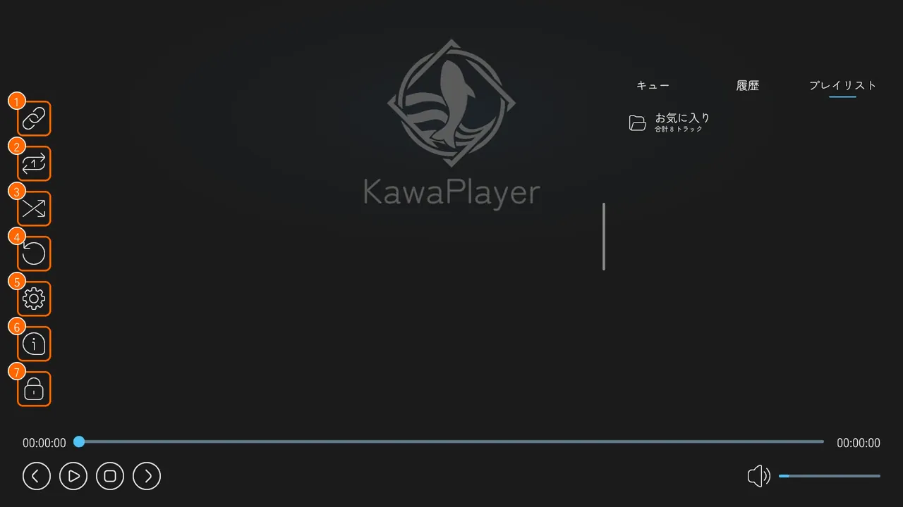
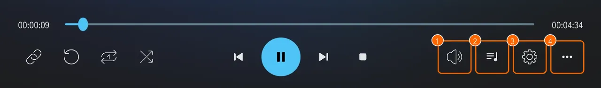
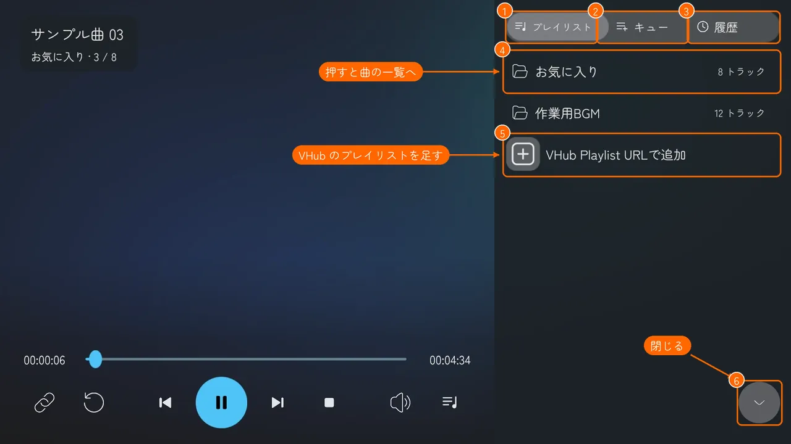
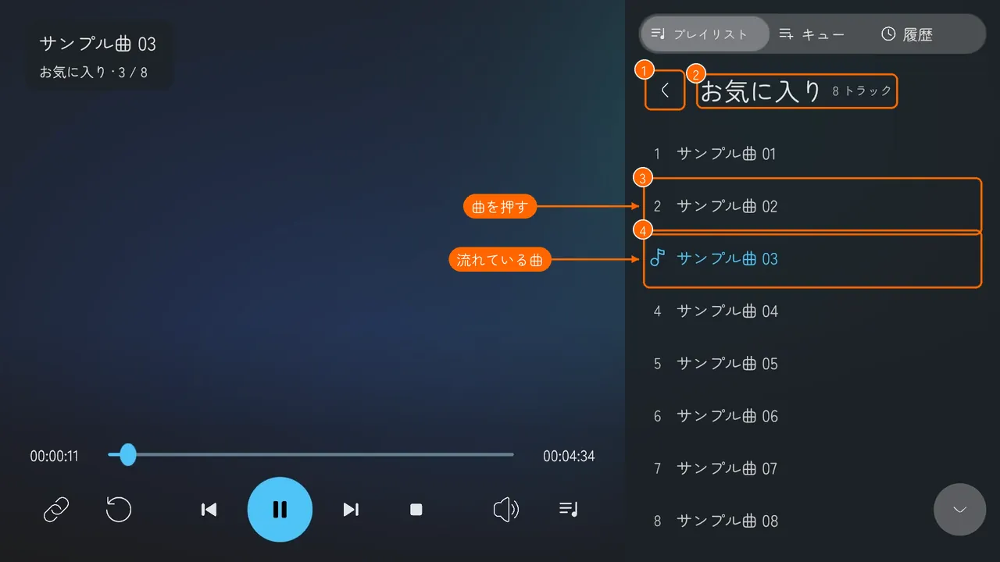
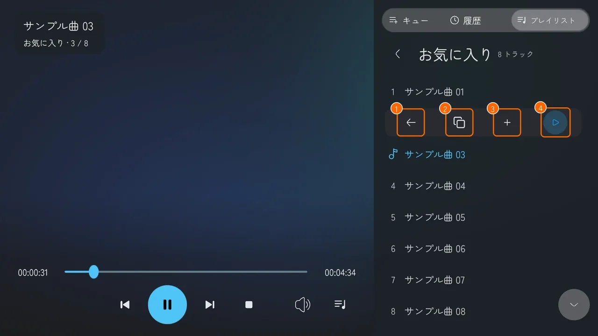
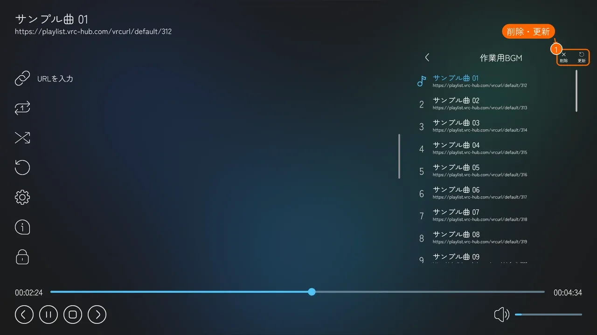
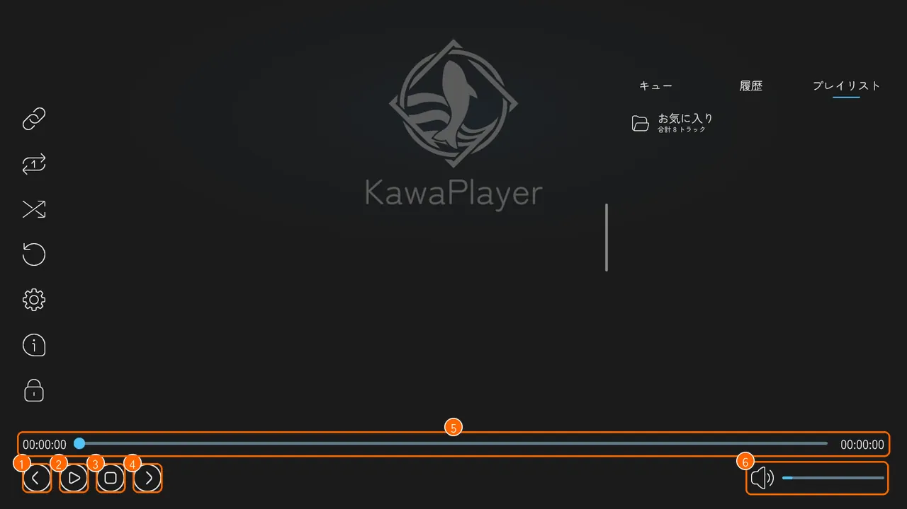
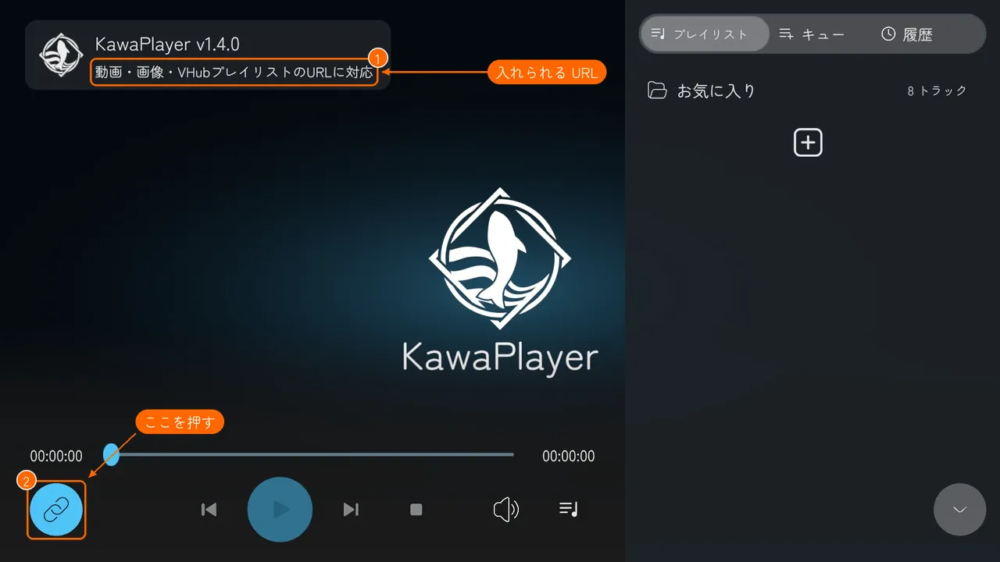
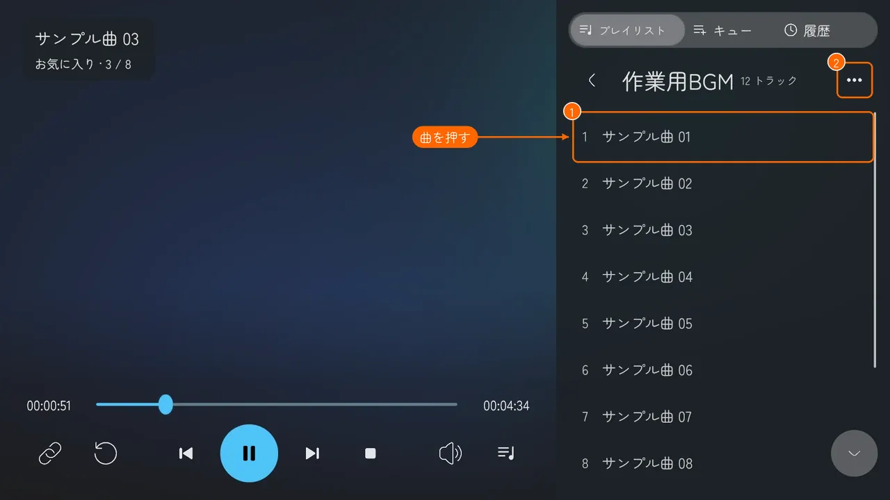

# ワールドの中で使う

KawaPlayer が置かれたワールドで、スクリーンを操作する方法です。

## スクリーンを指す

スクリーンを指すと、操作バーが出ます。デスクトップでは視線（画面の中央）を、VR ではコントローラーのレーザーを向けてください。ボタンは、左の列、右、下の 3 か所にあります。

下の表の「反映」は、押したことがインスタンスの全員に反映されるか、自分にだけ反映されるかです。ワールドに権限管理のモジュールが入っているときは、権限のない人が押しても動かないボタンがあります（[権限管理](modules.md#権限管理)）。

### 左の列

| | ボタン | すること | 反映 |
| --- | --- | --- | --- |
| ① | **URL を入力**（鎖） | 動画やプレイリストの URL を入れる（[動画の URL を入れる](#動画の-url-を入れる)） | 全員 |
| ② | **ループ再生** | 今の動画を、終わったら最初から繰り返す。もう一度押すとやめる | 全員 |
| ③ | **シャッフル再生** | プレイリストの次の曲を、順番ではなくランダムに選ぶ。もう一度押すとやめる | 全員 |
| ④ | **読み込み直し** | 今の動画を、自分の画面で読み込み直す。読み込めたら、ほかの人と同じ位置から再生する。映像や音が止まったとき、ずれが直らないとき、ライブ配信でほかの人より遅れているときに使う | 自分だけ |
| ⑤ | **設定**（歯車） | 設定の画面を開く（[設定を変える](#設定を変える)） | ― |
| ⑥ | **情報** | KawaPlayer の版と、更新履歴を出す | ― |
| ⑦ | **UI ロック**（鍵） | 自分の画面で、スクリーンを触っても操作されないようにする | 自分だけ |

**UI ロック** を解除するには、スクリーンを指して、デスクトップでは左クリック、VR ではトリガーを長押しします。

**ほかの人とずれたとき:** ふつうの動画は、5 秒ごとにほかの人の再生位置と比べ、0.3 秒以上ずれていれば自動で合わせ直します。ライブ配信は位置を合わせないので、遅れたときは **読み込み直し**（④）で配信の今の位置から取り直します。いつも自分だけ早い・遅いときは、設定の **ローカル再生遅延** で、自分の再生位置を前後にずらせます。

### 右（キュー・履歴・プレイリスト）

| | タブ | 出るもの |
| --- | --- | --- |
| ① | **キュー** | 次に流す曲の列。URL を入れたときの **再生キューに追加する** や、曲の **キューに追加** で足した曲が並ぶ。次の曲に進むときは、プレイリストより先に、キューの曲を上から流す |
| ② | **履歴** | これまでに流した曲 |
| ③ | **プレイリスト** | ワールドに最初から入っているプレイリストと、VHub から読み込んだプレイリストの一覧。プレイリストを押すと、その曲の一覧が出る（[下の手順](#プレイリストから曲を流す)） |

#### プレイリストから曲を流す

1. 右の **プレイリスト**（①）を押すと、プレイリストの一覧が出ます。流したいプレイリスト（②）を押します。

   

2. そのプレイリストの曲の一覧に変わります。上には、プレイリストの名前が出ます。流したい曲（①）を押します。左上の **<**（②）を押すと、プレイリストの一覧に戻ります。

   

3. 押した曲の行が、その曲の操作ボタンに変わります。**再生する**（④）を押すと、その曲から再生します。

   

#### 曲の操作ボタン

キューと履歴も、曲の一覧は同じ画面で、曲を押すと操作ボタンが出ます。タブによって、出るボタンが違います。

| ボタン | すること | 出るタブ |
| --- | --- | --- |
| **戻る**（①） | 操作ボタンを閉じて、曲の行に戻す | すべて |
| **URLをコピー**（②） | 曲の URL が入った欄を出す。欄からコピーできる | 履歴・プレイリスト |
| **キューに追加**（③） | その曲を、キューの最後に足す | 履歴・プレイリスト |
| **再生する**（④） | その曲から再生する | 履歴・プレイリスト |
| **上へ移動**・**下へ移動** | キューの中で、順番を入れ替える | キュー |
| **削除** | キューから外す | キュー |

#### VHub から読み込んだプレイリスト

VHub から読み込んだプレイリストの曲の一覧には、右上に **削除** と **更新**（①）が出ます。**更新** で VHub の今の内容に変わり、**削除** でプレイリストの一覧から外せます（外す前に確認が出ます）。

### 下

| | ボタン | すること | 反映 |
| --- | --- | --- | --- |
| ① | **前の曲** | 再生中のプレイリストの、1 つ前の曲を流す（最初の曲なら最後の曲へ） | 全員 |
| ② | **再生**・**一時停止** | 再生と一時停止を切り替える | 全員 |
| ③ | **停止** | 再生をやめる | 全員 |
| ④ | **次の曲** | キューに曲があればその曲を、なければ再生中のプレイリストの次の曲を流す（最後の曲なら最初の曲へ。シャッフル再生ならランダム） | 全員 |
| ⑤ | **シークバー** | つまみを動かすと、その位置から再生する。左は今の位置、右は動画の長さ | 全員 |
| ⑥ | **音量** | スピーカーのボタンで、消音と解除を切り替える。右のバーで音の大きさを変える | 自分だけ |

**前の曲** と **次の曲** は、プレイリストから流しているときに使えます。URL を入れて流した動画では、キューに曲があるときだけ **次の曲** が働きます。

## 動画の URL を入れる

1. 左上の **URL を入力**（①、鎖のボタン）を押すと、VRChat の入力欄が開きます。

   

2. 動画の URL（YouTube など）を貼って、確定します。

止まっているときは、すぐに再生が始まります。ほかの動画を再生しているときは、**URL を再生する** の確認が出ます。

| ボタン | すること |
| --- | --- |
| **再生する** | 今の動画を止めて、入れた URL を再生する |
| **再生キューに追加する** | 再生キューの最後に足して、順番に流す |
| **キャンセル** | やめる |

### VHub のプレイリストを読み込む

[VHub Playlist](https://playlist.vrc-hub.com) のプレイリストも、同じ **URL を入力** で、まるごと読み込めます。

**先に、VRChat の設定で Allow Untrusted URLs をオンにしてください**（[オンにする手順](quickstart.md#7-allow-untrusted-urls-をオンにする)）。オフのままでは読み込めません。

1. VHub で、プレイリストの **VRChat用URL** をコピーします（[コピーのしかた](vhub.md#vrchat用url-をコピーする)）。
2. **URL を入力**（①）に貼って、確定します。**プレイリストを追加しました** と出れば、プレイリストの一覧に 1 つ足されています。止まっているときは、そのまま再生が始まります。

   

3. 右の **プレイリスト** で、読み込んだプレイリストを選びます。曲（①）を押して、出てきた **再生する** を押すと、その曲から再生します。右上の **更新**（②）で VHub の今の内容に変わり、**削除** で一覧から外せます。

   

- **入れる URL:** VHub のページのアドレス（`/playlists/…`）や、**シェア** でコピーした URL では読み込めません。**VRChat用URLをコピー** でコピーした URL（`https://playlist.vrc-hub.com/r/default/…`）を入れます。
- **読み込める数:** 標準で 5 件までです。いっぱいのときに新しく読み込むと、一番古いものを消してよいか聞かれます（[プレイリスト](playlists.md#ワールドの中で-vhub-のプレイリストを読み込む)）。

## 設定を変える

左の列の **設定**（歯車）を押すと、設定の画面が出ます。左の **再生**・**映像・音声**・**その他**（①）で切り替え、左上の **メイン画面に戻る**（②）で元の画面に戻ります。

- **(Global) が付いた設定:** そのインスタンスの全員に反映されます。
- **付いていない設定:** 明るさ・ミラー反転・ローカル再生遅延などは、自分にだけ反映されます。
- **自動再生:** **再生** の最後に、入室時に流す動画やプレイリストの URL を決める **自動再生** の欄があります。決められるのはインスタンスを作った人だけで、ほかの人には「✕ 本機能は利用できません」と出ます。(Global) は付いていませんが、決めた URL は **そのインスタンスの全員に反映されます**。止まっているときに決めると、すぐに全員で再生が始まります（[モジュール](modules.md#自動再生owner)）。

## 再生できないとき

再生できないと、スクリーンに理由と **詳細** ボタンが出ます。

**詳細** を押すと、直近のエラーの内容と、問い合わせ先の Discord の URL が出ます。この画面のスクリーンショットを添えて Discord で聞いてもらえると、原因を探しやすくなります。VRChat ではワールドからリンクを開けないので、Discord の URL は欄（①）からコピーして、ブラウザに貼ってください。**閉じる**（②）で元の画面に戻ります。

## タブレット

ワールドにタブレットが置いてあれば、手元でも操作できます（[タブレット](tablet.md#使う)）。
