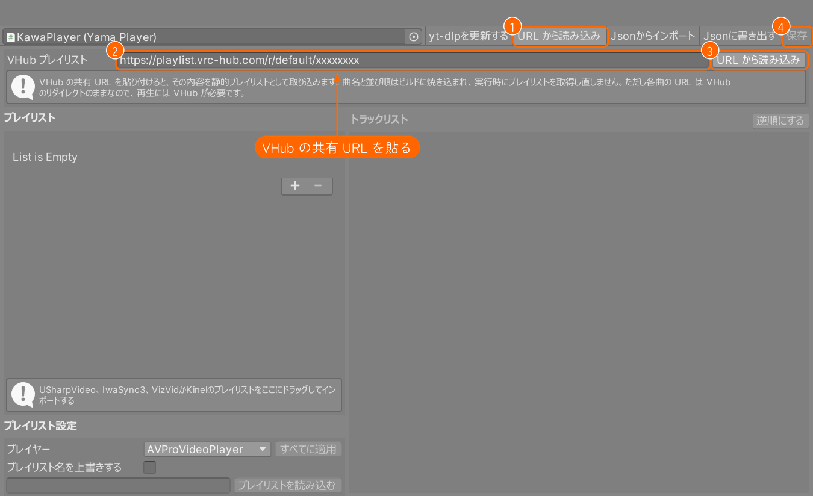
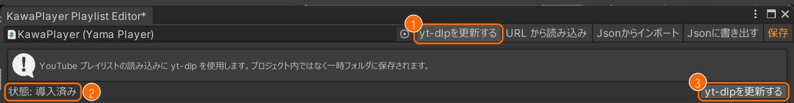
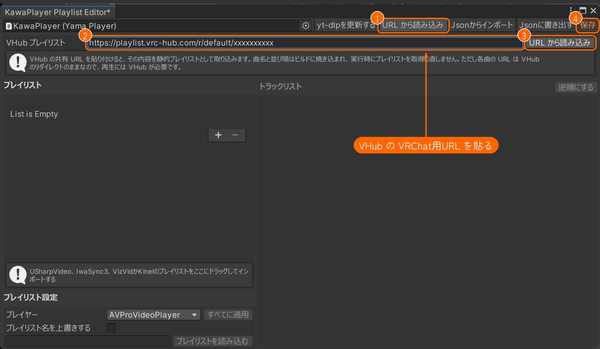
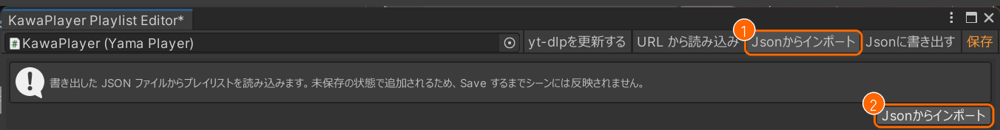
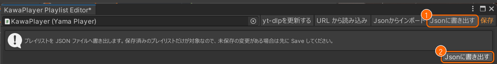
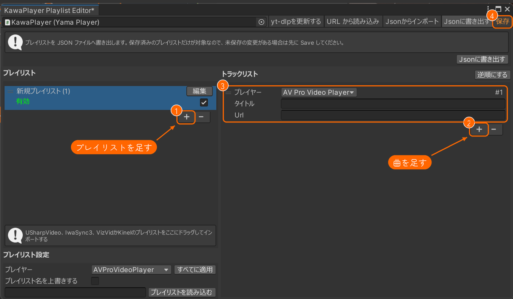
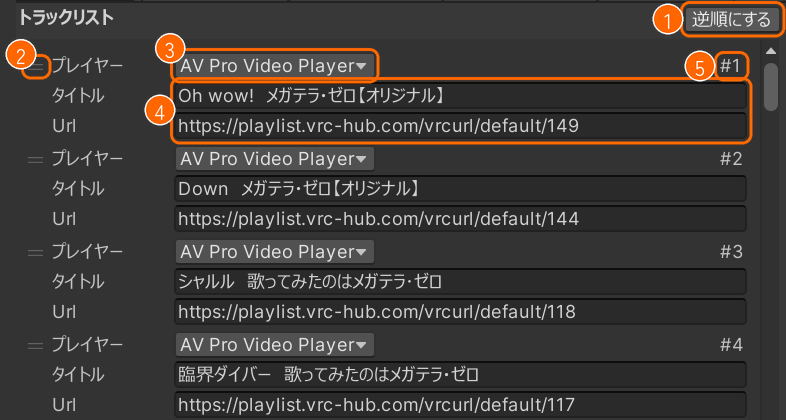

# プレイリスト

KawaPlayer のプレイリストは、2 つの方法で用意できます。

| 方法 | 誰が | いつ |
| --- | --- | --- |
| [ワールドに入れておく](#ワールドに入れておく) | ワールド制作者 | Unity で、ワールドをビルドする前に |
| [ワールドの中で VHub のプレイリストを読み込む](#ワールドの中で-vhub-のプレイリストを読み込む) | ワールドにいる人 | VRChat の中で、いつでも |

どちらのプレイリストも、スクリーンの右の **プレイリスト** に並びます（[プレイリストから選ぶ](#プレイリストから選ぶ)）。

## ワールドに入れておく

インスペクターの **プレイリストを編集する** を押すと、プレイリストエディターが開きます。メニューの **KawaPlayer > Edit Playlist** からも開けます。左に **プレイリスト** の一覧、右に選んだプレイリストの曲（**トラックリスト**）、左下に **プレイリスト設定** が並びます。作ったり変えたりしたら、右上の **保存** を押してください。保存するまで、シーンには入りません。



ここからは、エディターの上の欄とボタン、プレイリスト、トラックリスト、プレイリスト設定の順に説明します。上のボタンは、**保存** のほかは、押すとその下に欄が開き、もう一度押すと閉じます。

### 編集する KawaPlayer

左上の欄には、プレイリストを編集している KawaPlayer が入っています。インスペクターから開くと、その KawaPlayer が入ります。ほかの KawaPlayer を入れると、そのプレイリストに切り替わります。保存していない変更があるときは、先に保存するか聞かれます。

### yt-dlpを更新する

YouTube のプレイリストを読み込むのに使う、yt-dlp の欄を開きます（①）。欄には、yt-dlp が入っているかどうか（**状態: 導入済み**・**未導入**、②）と、ボタン（③）が出ます。



- **入っていないとき:** ③ のボタンが **yt-dlpをダウンロードする** になります。押すと、yt-dlp を入れます。
- **入っているとき:** ③ の **yt-dlpを更新する** で、最新にします。YouTube から読み込めなくなったときは、まず更新してみてください。
- **置き場所:** yt-dlp は、プロジェクトではなく一時フォルダーに置かれます。ワールドやパッケージには入りません。

YouTube のプレイリストの読み込みは、左下の [プレイリスト設定](#プレイリスト設定) で行います。

### URL から読み込み

[VHub Playlist](https://playlist.vrc-hub.com) で作ったプレイリストを、そのまま取り込みます。

1. 上の **URL から読み込み**（①）を押します。
2. **VHub プレイリスト** の欄（②）に、VHub の共有 URL（`https://playlist.vrc-hub.com/r/default/…` の形）を貼ります。
3. 右の **URL から読み込み**（③）を押すと、左の **プレイリスト** に入ります。
4. 右上の **保存**（④）を押します。



- **取り込みのしくみ:** 曲名と並び順は、ワールドをビルドしたときに焼き込まれます。曲の URL は VHub を通るので、再生には VHub が要ります。聞く人は、VRChat の設定で **Allow Untrusted URLs** をオンにしておく必要があります（[オンにする手順](quickstart.md#6-allow-untrusted-urls-をオンにする)）。
- **取り込み直す:** 同じ URL をもう一度取り込むと、今のプレイリストを更新するか、新しいプレイリストとして足すかを聞かれます。
- **動画プレイヤー:** VHub から取り込んだプレイリストでは、Unity を指定した曲も、ワールドでは AVPro で再生します。Unity で再生したい曲は、VHub から取り込んでいないプレイリストに入れてください。

### Jsonからインポート

JSON ファイルから、プレイリストを読み込む欄を開きます（①）。欄の **Jsonからインポート**（②）を押してファイルを選ぶと、中のプレイリストが一覧の最後に足されます。



- **読めるファイル:** **Jsonに書き出す** で書き出したファイルと、YamaPlayer で書き出したファイル、同じ形で手動で書いたファイルです。形は、この節の下の [JSON の形式](#json-の形式) にあります。
- **今あるプレイリスト:** 消えません。読み込んだ分が足されるだけです。
- **読み込めないとき:** 理由がダイアログに出て、プレイリストは 1 つも足されません。
- **保存:** 足したプレイリストは、**保存** するまでシーンに入りません。

ほかのプロジェクトに移すときは、移す元の **Jsonに書き出す** で書き出したファイルを、ここで読み込みます。

#### JSON の形式

**Jsonからインポート** で読めるのは、次の形の JSON です。**Jsonに書き出す** で書き出すと、この形になります。

```json
{
  "playlists": [
    {
      "name": "作業用BGM",
      "active": true,
      "tracks": [
        { "playerType": 1, "title": "サンプル曲 01", "url": "https://example.com/sample01.mp4" },
        { "playerType": 1, "title": "サンプル曲 02", "url": "https://example.com/sample02.mp4" }
      ],
      "youtubeListId": "",
      "vhubPlaylistUrl": ""
    }
  ]
}
```

一番上の `playlists` に、プレイリストを並べます。1 つのファイルに、いくつ入れてもかまいません。

**プレイリスト**（`playlists` の中の 1 つ）

| キー | 中身 | 省いたとき |
| --- | --- | --- |
| `name` | プレイリストの名前（文字列） | 名前なし |
| `active` | 有効かどうか（`true`・`false`）。`false` だとワールドに入らない | `true` |
| `tracks` | 曲の一覧（配列） | 曲なし |
| `youtubeListId` | プレイリスト設定の、YouTube のプレイリストの欄の中身（文字列） | 空 |
| `vhubPlaylistUrl` | VHub から取り込んだときの共有 URL（文字列）。入っていると、Unity を指定した曲もワールドでは AVPro で再生する | 空 |

**曲**（`tracks` の中の 1 つ）

| キー | 中身 | 省いたとき |
| --- | --- | --- |
| `playerType` | 再生する動画プレイヤー。数字か名前で書く（下の表） | AV Pro Video Player |
| `title` | 曲の名前（文字列） | 空 |
| `url` | 動画の URL（文字列） | 空 |

| `playerType` | 動画プレイヤー |
| --- | --- |
| `1` か `"AVProVideoPlayer"` | AV Pro Video Player |
| `0` か `"UnityVideoPlayer"` | Unity Video Player |
| `2` か `"ImageViewer"` | Image Viewer（画像） |

- **YamaPlayer の JSON:** YamaPlayer で書き出した JSON は、曲の動画プレイヤーのキーが `mode` です。これもそのまま読めます。
- **キーの大文字:** `Name`・`Tracks`・`Title` のように、大文字で始まるキーも読めます。
- **読み込めないとき:** 次のようなときは、理由がダイアログに出て、プレイリストは 1 つも足されません。
  - JSON として読めない
  - 一番上に `playlists` がない
  - 値の型が違う（例: `active` が文字列）

### Jsonに書き出す

プレイリストを、1 つの JSON ファイルに書き出す欄を開きます（①）。欄の **Jsonに書き出す**（②）を押して、保存先を選びます。



- **書き出すもの:** シーンに保存済みのプレイリストを、全部書き出します。変えたあとは、先に **保存** を押してください。
- **ファイルの形:** [JSON の形式](#json-の形式) のとおりです。
- **無効のプレイリスト:** **有効** を外したプレイリストも、`"active": false` で書き出されます。
- **使いどころ:** ほかのプロジェクトに移すときや、控えを取っておくときに使います。

### 保存

変えた内容をシーンに入れます。

- **保存していない変更があるとき:** 文字がオレンジになり、ウィンドウの名前に * が付きます。
- **閉じるとき:** 保存しないままウィンドウを閉じようとすると、保存するか聞かれます。

### プレイリスト

左に、ワールドに入れておくプレイリストが並びます。

- **名前（数）:** プレイリストの名前と、入っている曲の数です。
- **編集:** 名前を変えます。変えたら、同じ場所の **保存** を押します。
- **有効:** チェックを外すと **無効** になり、そのプレイリストはワールドに入りません。消さずに外しておきたいときに使います。曲が 1 つもないプレイリストも、ワールドには入りません。
- **並べ替え:** 左端の **=** をつかんで動かすと、並びを変えられます。
- **＋**・**－:** プレイリストを足したり、選んだプレイリストを消したりします。
- **ほかの動画プレイヤーから:** USharpVideo・IwaSync3・VizVid・Kinel のプレイリストは、この一覧にドラッグすると取り込めます。

プレイリストを手動で作るときは、次のようにします。

1. **＋**（①）で、プレイリストを足します。**新規プレイリスト** という名前で足されるので、名前は **編集** で変えます。
2. 足したプレイリストを選び、右の **トラックリスト** の **＋**（②）で曲を足します。
3. 曲ごとに、**プレイヤー**（動画プレイヤー）、**タイトル**、**Url** を入れます（③）。
4. 右上の **保存**（④）を押します。



### トラックリスト

右に、左で選んだプレイリストの曲が並びます。



- **逆順にする**（①）: 曲の並びを逆にします。
- **並べ替え**（②）: 曲の左端の **=** をつかんで動かすと、並びを変えられます。
- **プレイヤー**（③）: その曲を再生する動画プレイヤーです（AV Pro Video Player・Unity Video Player・Image Viewer など）。
- **タイトル**・**Url**（④）: 曲の名前と、動画の URL です。
- **#1, #2…**（⑤）: 曲の順番です。
- **＋**・**－:** 一覧の一番下にあり、曲を足したり、選んだ曲を消したりします。

### プレイリスト設定

左下の欄は、左で選んだプレイリストに使います。

| 欄 | すること |
| --- | --- |
| **プレイヤー** | 新しく足す曲の動画プレイヤー。**すべてに適用** で、そのプレイリストの全曲に当てる |
| URL の欄と **プレイリストを読み込む** | YouTube のプレイリストの URL か ID を入れて、曲をまとめて読み込む。読み込みには yt-dlp を使う（[yt-dlpを更新する](#yt-dlpを更新する)） |
| **プレイリスト名を上書きする** | オンにすると、YouTube から読み込んだときに、プレイリストの名前を YouTube のものにする |
| **取得元 URL** | VHub から取り込んだプレイリストにだけ出る、取り込んだ URL。変えられない |

曲が終わってから次の曲までの秒数と、シャッフル再生の初期値は、インスペクターで決めます（[KawaPlayer の設定](settings.md)）。

## ワールドの中で VHub のプレイリストを読み込む

**先に、VRChat の設定で Allow Untrusted URLs（信頼されていない URL を許可する設定）をオンにしてください。** VHub（`playlist.vrc-hub.com`）は、VRChat が初めから信頼しているサイトではありません。そのため、オフのままでは、プレイリストの読み込みも曲の再生もできません。この設定は一人ひとりのもので、ほかの人がオンにしても、自分には効きません。

オンにする手順は、画像付きで [クイックスタートの 6.](quickstart.md#6-allow-untrusted-urls-をオンにする) にあります。

### プレイリストの URL を入れる

[VHub Playlist](https://playlist.vrc-hub.com) のプレイリストは、共有 URL（`https://playlist.vrc-hub.com/r/default/…` の形）を、動画と同じ **URL を入力**（①）の欄に入れると読み込めます。


- **入り方:** 読み込んだプレイリストは、プレイリストの一覧に 1 つ足されます。再生キューには入りません。止まっているときに読み込むと、そのまま再生が始まります。
- **読み込める数:** VHub から読み込む枠は、標準で 5 件です（ワールドに最初から入っているプレイリストは別）。いっぱいのときに新しく読み込むと、一番古いものを消してよいか聞かれます。
- **入れる URL:** VHub の Web ページの URL（`/playlists/…`）では読み込めません。共有の URL を入れてください。
- **読み込める人:** ワールドに権限管理のモジュールが入っているときは、再生できる権限のある人だけが読み込めます。

この機能は、最初から入っている **外部プレイリスト読込** のモジュールのものです（[モジュール](modules.md)）。

## プレイリストから選ぶ

スクリーンの右の **プレイリスト** でプレイリストを選ぶと、曲の一覧が出ます。曲（①）を押すと、そこから再生します。


読み込んだ VHub のプレイリストは、右上の **更新** で最新の内容に、**削除** で一覧から外せます（②）。
