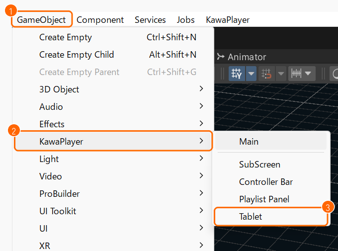
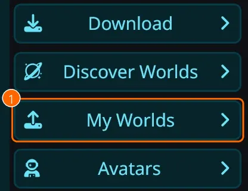
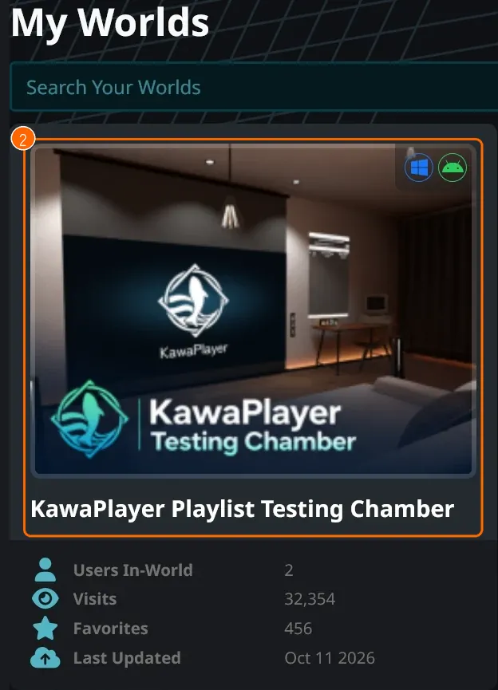
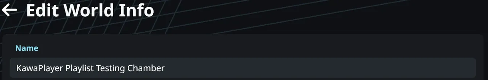
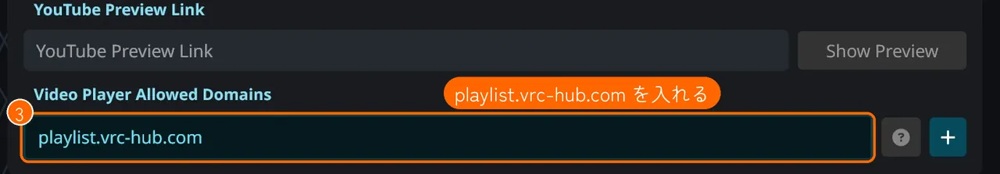

# クイックスタート

KawaPlayer をワールドに置いて、ワールドの中で動画を流すまでを、いちばん短い手順で説明します。細かい設定は、[使い方ガイドの目次](README.md) から、カテゴリーごとのページを開いてください。

## 用意するもの

- VRChat Creator Companion（VCC）で作った、ワールドのプロジェクト
- VRChat SDK - Worlds 3.10.2 以上。古いときは、先に VCC の **Manage Project** で SDK を新しくしてください。

## 1. VCC に KawaPlayer のリポジトリを追加する

1. 次のリンクを開きます: **[KawaPlayer の VCC 用のページ（mega-gorilla.github.io/vpm-repos）](https://mega-gorilla.github.io/vpm-repos/)**
2. ページの上のほう、**Copy** の左にある **Add to VCC** を押します。

   

3. VCC が開いてリポジトリの追加を聞かれるので、**I Understand, Add Repository** を押します。

VCC が開かないときは、[インストールと更新](install.md#リポジトリを追加するほかの方法) のほかの方法（B・C）で追加してください。

## 2. プロジェクトに KawaPlayer を入れる

VCC の **Manage Project** でワールドのプロジェクトを開きます。パッケージの一覧で **KawaPlayer** の行を探し、右端の **＋**（Add）を押します。


画像の版の数字は、撮ったときのものです。

## 3. シーンに KawaPlayer を置く

1. Hierarchy の何もないところを押して、何も選んでいない状態にします。
2. Unity のメニューの **GameObject**（①）> **KawaPlayer**（②）> **Main**（③）を選びます。

   

3. 置かれた KawaPlayer を、Scene で好きな場所に動かします。

## 4. タブレットを置く

手に持って KawaPlayer を操作できるタブレットです。

1. もう一度、Hierarchy の何もないところを押します。置いたばかりの KawaPlayer が選ばれたままだと、タブレットがその中に置かれてしまいます。
2. メニューの **GameObject**（①）> **KawaPlayer**（②）> **Tablet**（③）を選びます。何台置いてもかまいません。

   

3. インスペクターの **KawaPlayer** の欄（①）に、3. で置いた KawaPlayer を入れます。

   

## 5. ビルドして確かめる

メニューの **VRChat SDK > Show Control Panel** で開くパネルの **Builder** で、**Build Type**（①）を選んで、その下のボタン（②）を押します。上の **Review Any Alerts** に問題が出ているときは、先に直してください。


| Build Type（①） | すること |
| --- | --- |
| **Build & Test Your World** | 自分の PC だけで、ワールドを試す |
| **Build & Publish Your World Online** | ワールドをアップロードする |

## 6. VRChat.com で VHub を許可する

Public・Group Public のインスタンスでは、ワールドが許可したサイトの動画しか流れません。遊ぶ人が Allow Untrusted URLs をオンにしていても同じです。VHub の曲は `playlist.vrc-hub.com` の URL で流れるので、ワールドに VHub を許可しておきます。

1. **Build & Publish Your World Online** で、ワールドをアップロードします。
2. VRChat のサイト **[https://vrchat.com/home](https://vrchat.com/home)** を開いてログインし、左のメニューの **My Worlds**（①）を押します。

   

3. 一覧から、KawaPlayer を置いたワールド（②）を選びます。

   

4. ワールドの **Edit World Info** を開きます。

   

5. ページの下のほうの **Video Player Allowed Domains**（③）に、次のアドレスをコピーして貼り、保存します。

   ```
   playlist.vrc-hub.com
   ```

   

Friends・Invite などのインスタンスでは、この設定がなくても、遊ぶ人が次の 7. の設定をオンにしていれば流れます。

## 7. Allow Untrusted URLs をオンにする

ワールドの中で VHub のプレイリストを読み込むには、VRChat の設定で **Allow Untrusted URLs**（信頼されていない URL を許可）をオンにする必要があります。VHub（`playlist.vrc-hub.com`）は、VRChat が初めから信頼しているサイトではないためです。Friends・Invite などのインスタンスでは、VHub の曲を流すのにも、この設定が要ります。この設定は一人ひとりのもので、遊ぶ人それぞれがオンにします。

1. クイックメニューを開き、下の並びの右端の **歯車**（①）を押します。

   

2. 設定が開いたら、右上の **全画面** のアイコン（②）を押して、設定を大きく開きます。

   

3. 左の **快適性とセーフティ**（Comfort & Safety、③）を選びます。
4. **セーフティ** の **信頼されていない URL を許可**（Allow Untrusted URLs、④）をオンにします。

   

5. ワールドに入り直します。

オンにすると、VRChat が信頼していないサイトからも、ワールドが動画や画像を読み込めるようになります。気になるときは、使い終わったらオフに戻してください。

## 8. ワールドの中で動画を流す

1. スクリーンを指して、左上の **URL を入力**（①）を押します。デスクトップでは視線（画面の中央）を、VR ではコントローラーのレーザーを向けてください。
2. 動画の URL（YouTube など）か、[VHub Playlist](https://playlist.vrc-hub.com) のプレイリストの **VRChat用URL** を貼って、確定します。VRChat用URL のコピーのしかたは、[VHub Playlist の使い方](vhub.md#vrchat用url-をコピーする) にあります。


## 次に読むページ

| 知りたいこと | ページ |
| --- | --- |
| 色・言語・音量などの初期値を変えたい | [KawaPlayer の設定](settings.md) |
| 最初からプレイリストを入れておきたい | [プレイリスト](playlists.md) |
| VHub でプレイリストを探したい、作りたい | [VHub Playlist の使い方](vhub.md) |
| 入室時に動画を自動で流したい、機能を足したい | [モジュール](modules.md) |
| ワールドの中での操作を知りたい | [ワールドの中で使う](playing.md) |

困ったときは、気軽に [Discord サーバー](https://discord.gg/tkrHek6PvN) で聞いてください。
