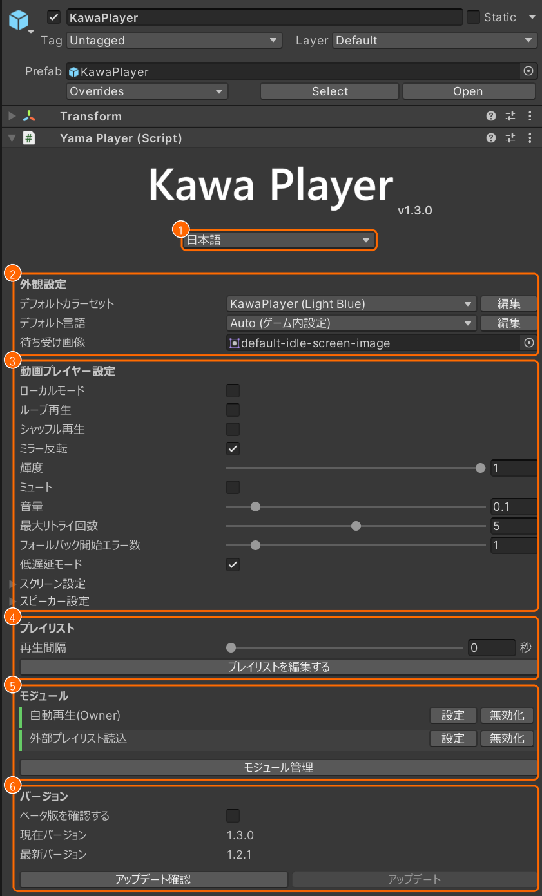
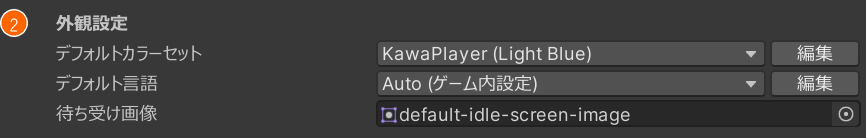
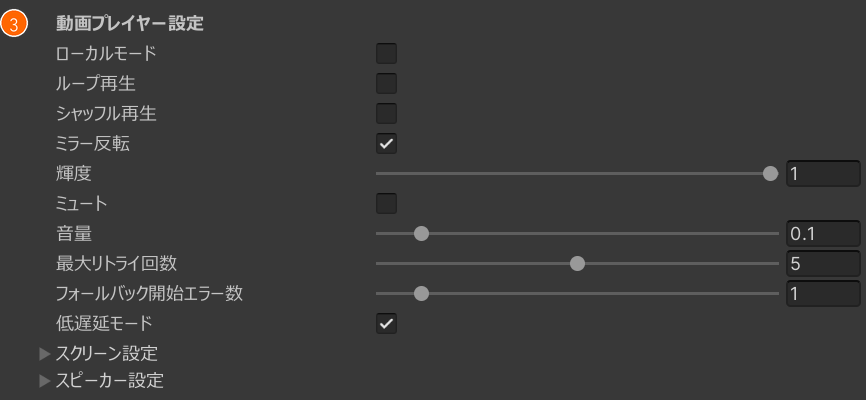
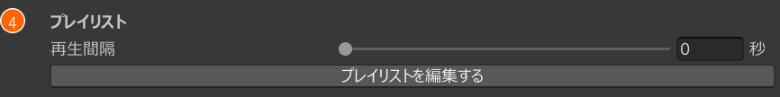
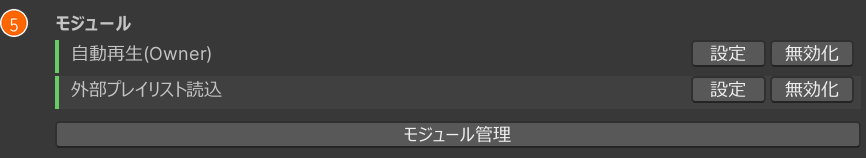
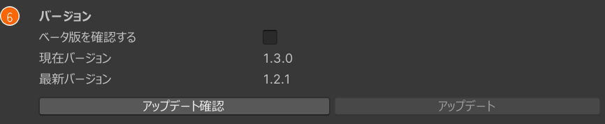

# KawaPlayer の設定

シーンに置いた KawaPlayer を選ぶと、インスペクターに設定が出ます。どの欄も、置いたままで使える値になっているので、変えたいところだけ変えてください。

欄は、上から 6 つのまとまりに分かれています。番号は、下の各節の画像の番号と同じです。

## 言語

インスペクターの表示の言語を選びます。ワールドの中の言語は、[外観設定](#外観設定) の **デフォルト言語** で決めます。

## 外観設定

| 欄 | 決めること |
| --- | --- |
| **デフォルトカラーセット** | UI の色の組み合わせ（カラーセット）。KawaPlayer の青のほか、YamaPlayer の色も選べる |
| **デフォルト言語** | ワールドの中の言語の初期値。**Auto (ゲーム内設定)** なら、見る人の VRChat の言語に合わせる |
| **待ち受け画像** | 動画を流していないとき（止まっているときと、読み込み中）に、スクリーンに映す画像 |

- **カラーセットの編集:** **デフォルトカラーセット** の **編集** を押すと、外観設定のアセットが開き、カラーセットを足せます。色はワールドをビルドしたときに UI に入ります。シーンですぐ確かめるときは、そのアセットの **今すぐ反映** を押してください。
- **言語の編集:** **デフォルト言語** の **編集** を押すと、言語の設定のアセットが開き、言語ごとの翻訳ファイルやフォントを決められます。
- **待ち受け画像の差し替え:** 初めの画像（`default-idle-screen-image`）のままなら、その上に KawaPlayer のロゴと名前が出ます。自分の画像に差し替えると、その画像だけが出て、ロゴと名前は出ません。画像は縦横の比を保ったまま、スクリーンに収まる大きさで出るので、スクリーンと同じ 16:9 の画像がおすすめです。初めの画像に戻すときは、`default-idle-screen-image` を選び直します。

## 動画プレイヤー設定

| 欄 | 決めること |
| --- | --- |
| **ローカルモード** | オンにすると、再生の状態をほかの人と同期せず、一人ひとりが別々に再生する |
| **ループ再生** | 動画が終わったら、最初から再生し直す |
| **シャッフル再生** | プレイリストの曲を、ランダムな順に再生する |
| **ミラー反転** | ミラーに映った映像を左右反転して、文字を読めるようにする |
| **輝度** | 映像の明るさ |
| **ミュート**・**音量** | 音を消すかどうかと、音の大きさ |
| **最大リトライ回数** | 動画の読み込みに失敗したとき、やり直す回数 |
| **フォールバック開始エラー数** | この回数エラーが続いたら、もう一方の動画プレイヤー（AVPro と Unity）に切り替える。0 なら切り替えない |
| **低遅延モード** | ライブ配信などで、遅れを小さくする |

ループ再生から音量までは、ワールドに入ったときの初期値です。ワールドの中でも、スクリーンの操作や設定で変えられます（[ワールドの中で使う](playing.md)）。

**スクリーン設定** と **スピーカー設定** は、押すと開きます。置いたままの KawaPlayer では、変える必要はありません。

- **スクリーン設定:** 映像を映す先の一覧です。自分で用意したオブジェクトにも映したいときに、**スクリーン**（Renderer・RawImage・Material）を足します。シェーダーによっては、映像を入れるテクスチャのプロパティ名（**メインテクスチャプロパティ名**）も指定します。
- **スピーカー設定:** 音を出す AudioSource の一覧です。Unity Video Player で再生するときは、一覧の最初の 1 つからしか音が出ません。

## プレイリスト

- **再生間隔:** 曲が終わってから、次の曲を始めるまでの秒数（0〜60）です。0 なら、すぐ次の曲に進みます。
- **プレイリストを編集する:** プレイリストエディターを開き、ワールドに最初から入れておくプレイリストを作ります（[プレイリスト](playlists.md)）。

## モジュール

入っている機能（モジュール）が並び、**設定** と **無効化** をここからも押せます。**モジュール管理** で、モジュールを足したり外したりします（[モジュール](modules.md)）。

## バージョン

- **現在バージョン**・**最新バージョン:** 入っている版と、出ている最新の版です。
- **アップデート確認**・**アップデート:** 新しい版があるか調べ、あれば更新します。VCC で入れたプロジェクトでだけ動きます。
- **ベータ版を確認する:** オンにすると、ベータ版も更新の対象にします。
