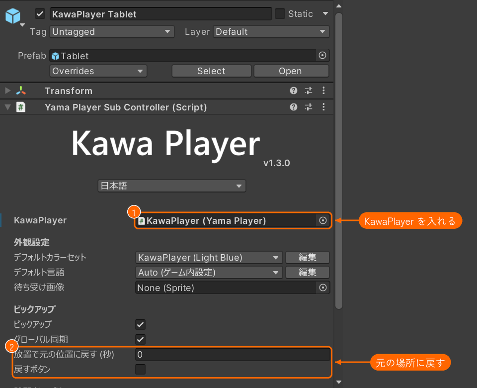
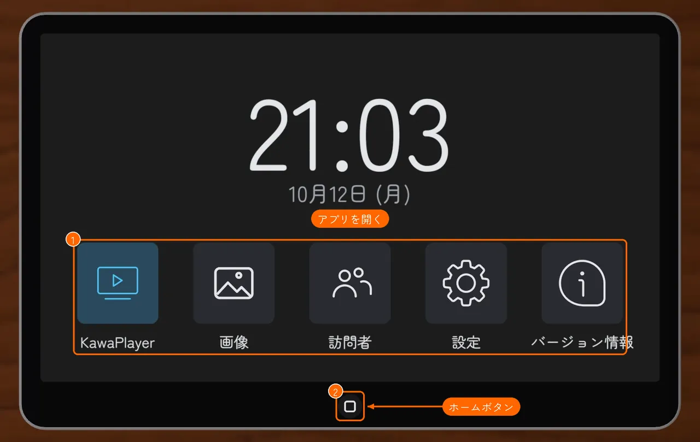
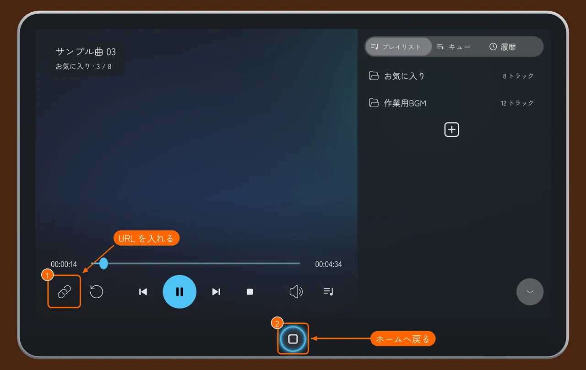
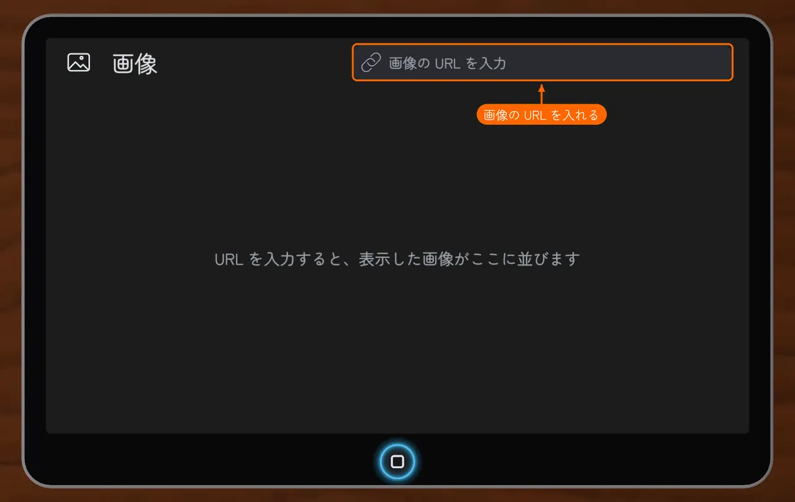
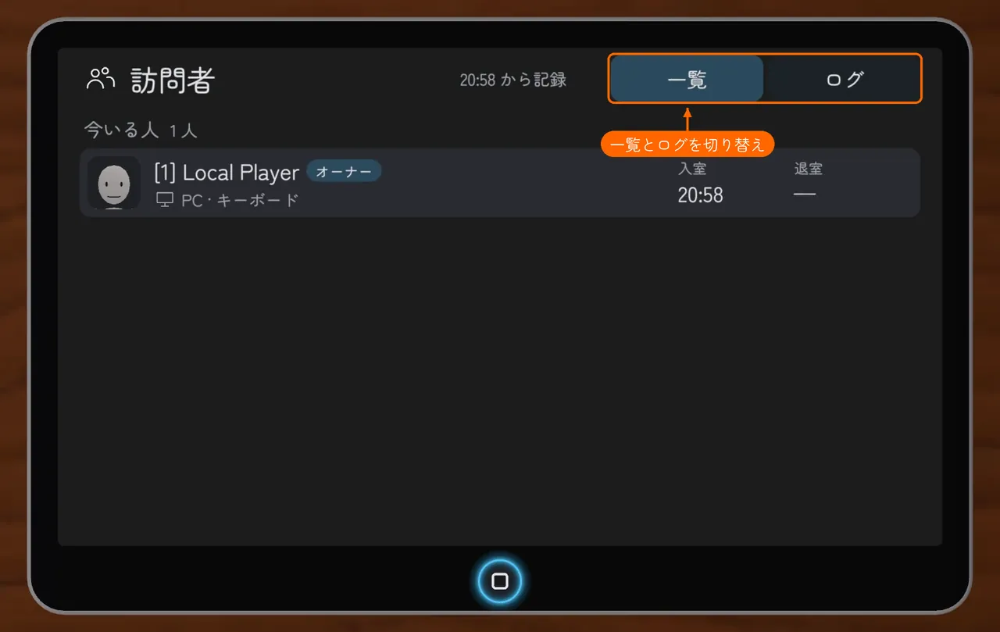
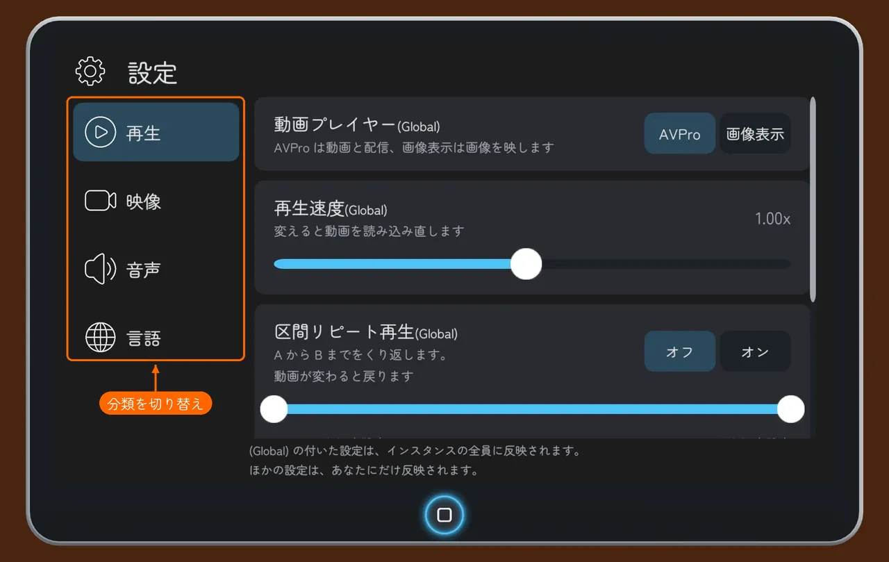

# タブレット

手に持って KawaPlayer を操作できるタブレットです。前半はワールド制作者向けの置き方と設定、後半はワールドの中での使い方です。

## 置く

1. Unity のメニューの **GameObject > KawaPlayer > Tablet** を選ぶと、シーンにタブレットが置かれます。何台置いてもかまいません。
2. インスペクターの **KawaPlayer** の欄（①）に、操作する KawaPlayer を入れます。

Hierarchy で KawaPlayer を選んだままメニューを選ぶと、タブレットは KawaPlayer の子として置かれます。別の場所に置くときは、先に選択を外してください。

## インスペクターの設定

| 欄 | 決めること |
| --- | --- |
| **KawaPlayer**（①） | 操作する KawaPlayer |
| **外観設定** | タブレットの UI の色（カラーセット）と言語の初期値。KawaPlayer の外観設定と同じように選ぶ（[KawaPlayer の設定](settings.md#外観設定)） |
| **ピックアップ** | 手に持てるようにする |
| **グローバル同期** | 持って動かした位置を、ほかの人にも同期する |
| **放置で元の位置に戻す (秒)**（②） | 誰も持たず、画面も切り替えないまま、この秒数が過ぎると、置いた位置に戻る。0 なら戻さない |
| **戻すボタン**（②） | オンにすると、置き去りのタブレットを元の位置に戻すボタンが付く。ボタンは、Hierarchy の **ReturnButton** を動かして、好きな場所に置ける |
| **アバターの顔写真**（訪問者アプリ） | 訪問者アプリで、アバターの顔写真を撮って出す。オフにすると、代わりの画像を出す |

- **ピックアップの下の欄:** **グローバル同期** から **戻すボタン** までは、**ピックアップ** がオンのときに出ます。
- **顔写真の記録:** 訪問者の記録はワールドの全タブレットで 1 つです。どれか 1 台で **アバターの顔写真** をオフにすると、すべてのタブレットで撮りません。

## 使う

タブレットの画面は、見ている全員に同じものが映ります。ほかの人がアプリを開いていたら、手に取ってもそのアプリのままです。画面の下の白い □（ホームボタン、②）を押すとホーム画面に戻り、アプリのアイコン（①）を押すと開きます。アプリを開いているあいだは、ホームボタンの周りが青く光ります。

| アプリ | できること |
| --- | --- |
| **KawaPlayer** | スクリーンと同じ操作（再生、URL、プレイリスト）を手元でできる |
| **画像** | 画像の URL を入れると、タブレットを見ている全員に同じ画像が映る |
| **訪問者** | 今いる人と前にいた人、入退室のログを見られる |
| **設定** | 明るさ・ミラー反転・最大解像度・音声・言語など、自分だけの設定。インスタンスを作った人には、全員に反映される自動再生の欄も出る |
| **バージョン情報** | KawaPlayer の版と更新履歴 |

タブレットを縦に持つと、画面も縦向きになります（KawaPlayer アプリは横向きのまま）。

### KawaPlayer アプリ

スクリーンと同じ操作バーが出ます。**URL を入力**（①）で動画やプレイリストの URL を入れられます。ホームボタン（②）で、ホーム画面に戻ります。

### 画像アプリ

上の欄に、画像の URL を入れます。

- **一覧:** 表示した画像は、最大 5 枚まで並び、あとから選び直せます。
- **KawaPlayer に送る:** 開いた画像を、大きなスクリーンにも映せます。
- **出ないとき:** 画像が出ないときは、理由と次にすることが出ます。

### 訪問者アプリ

今いる人の一覧と、入退室のログを、右上で切り替えます。

### 設定アプリ

左の分類（映像・音声・再生・言語）を切り替えて、設定を変えます。ここで変えた設定は、その人にだけ反映されます。ただし、インスタンスを作った人に出る **再生** の **自動再生** の欄だけは、スクリーンの設定と同じく、そのインスタンスの全員に反映されます（[モジュール](modules.md#自動再生owner-のしくみ)）。

