# タブレット

手に持って KawaPlayer を操作できるタブレットです。前半はワールド制作者向けの置き方と設定、後半はワールドの中での使い方です。

## 置く

1. Hierarchy の一覧の下の、何もないところを押して、何も選んでいない状態にします。KawaPlayer などが選ばれたままだと、タブレットがその中に置かれてしまいます。一覧が長いときは、一番下までスクロールした、その下を押します。

   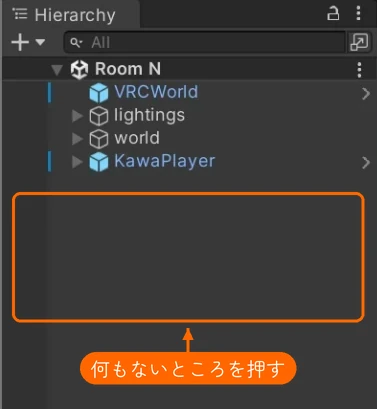

2. Unity のメニューの **GameObject**（①）> **KawaPlayer**（②）> **Tablet**（③）を選びます。タブレットは、スタンドに立った姿で入ります。机などの上に、スタンドの底を合わせて置いてください。何台置いてもかまいません。

   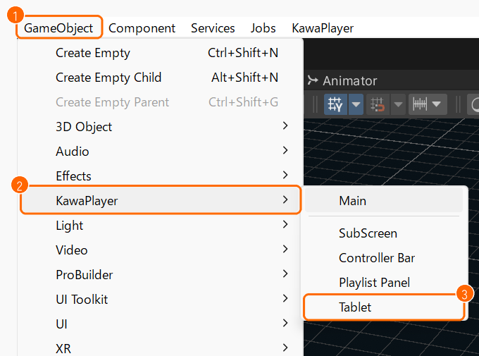

3. インスペクターの **KawaPlayer** の欄を見ます。シーンに KawaPlayer が 1 つだけなら、置いたときに、その KawaPlayer が入っています。2 つ以上あるときは空なので、操作する KawaPlayer を入れます。

   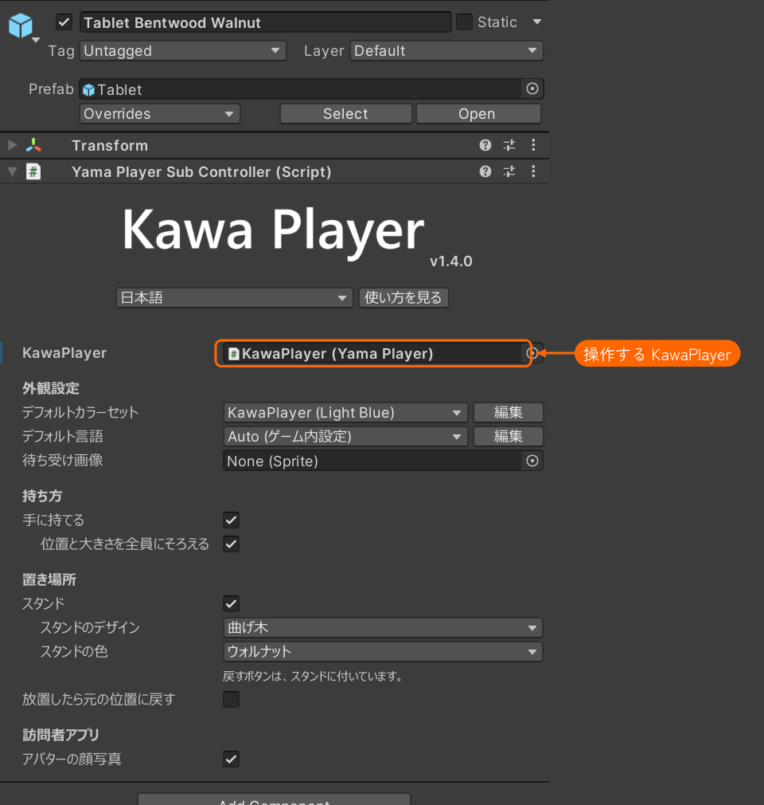

## インスペクターの設定

インスペクターは、上から順に、次の欄が並びます。

| 見出し | 欄 | 決めること |
| --- | --- | --- |
| — | **KawaPlayer** | 操作する KawaPlayer |
| **外観設定** | **デフォルトカラーセット**・**デフォルト言語**・**待ち受け画像** | タブレットの UI の色（カラーセット）と言語の初期値、KawaPlayer アプリの待ち受け画像。KawaPlayer の外観設定と同じように選ぶ（[KawaPlayer の設定](settings.md#外観設定)） |
| **持ち方** | **手に持てる** | プレイヤーが手に持って動かせるようにする。初めはオン |
| | **位置と大きさを全員にそろえる** | **手に持てる** がオンのときに出る。持って動かした位置と、変えた大きさ（[大きさを変える](#大きさを変える)）を、インスタンスの全員に同じに見せる。オフにすると、各自のタブレットが別々に動く。初めはオン |
| **置き場所** | **スタンド** | タブレットをスタンドに立てて置く。初めはオン（[スタンド](#スタンド)） |
| | **スタンドのデザイン**・**スタンドの色** | **スタンド** がオンのときに出る。スタンドの形と色を選ぶ |
| | **戻すボタン** | **スタンド** がオフで、**手に持てる** がオンのときに出る。オンにすると、置き去りのタブレットを元の位置に戻すボタンが付く。初めはオフ。ボタンは、Hierarchy の **ReturnButton** を動かして、好きな場所に置ける。スタンドがあるときは、スタンドに戻すボタンが付いている |
| | **放置したら元の位置に戻す** | **手に持てる** がオンのときに出る。オンにすると、置き忘れたタブレットが、しばらくしたら元の位置（スタンドがあるときはスタンド）に戻る。初めはオフ |
| | **戻すまでの時間 (分)** | **放置したら元の位置に戻す** がオンのときに出る。誰も持たず、画面も切り替えないまま、この分数が過ぎると戻る。オンにしたときは 5 分で、1 分以上にできる |
| **訪問者アプリ** | **アバターの顔写真** | 訪問者アプリで、アバターの顔写真を撮って出す。オフにすると、代わりの画像を出す |

- **スタンドがあれば戻せる:** スタンドがあるときは、近くで離すとスタンドに収まり、スタンドの戻すボタンでも帰ってきます。スタンドがなく、**放置したら元の位置に戻す** と **戻すボタン** がどちらもオフのときは、置き忘れたタブレットは元の場所に戻りません。
- **顔写真の記録:** 訪問者の記録はワールドの全タブレットで 1 つです。どれか 1 台で **アバターの顔写真** をオフにすると、すべてのタブレットで撮りません。

### スタンド

タブレットには、置き場所になるスタンドが付いています。インスペクターの **置き場所** の **スタンド**（①）でありなしを、**スタンドのデザイン** と **スタンドの色**（②）で見た目を選びます。

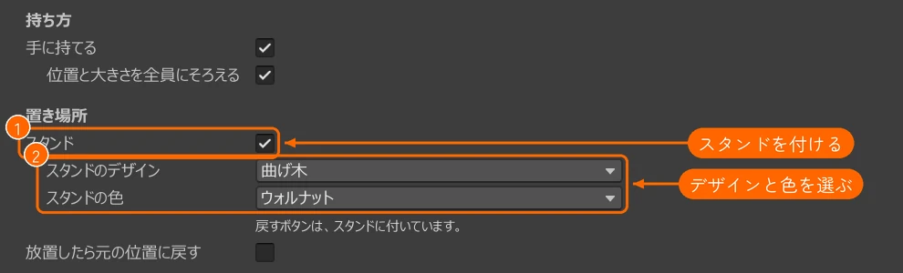

デザインは 4 つです。左から、曲げ木・マグネットスタンド・クッション・フロアスタンドです。

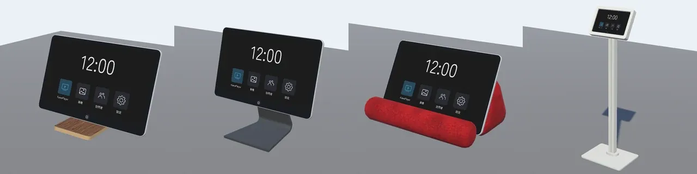

| デザイン | 形 | 色 |
| --- | --- | --- |
| **曲げ木** | 1 枚の曲げ木。机に置く | ウォルナット・ホワイトオーク・スモークウォルナット・ブラック |
| **マグネットスタンド** | アルミの台に、板で貼り付ける。机に置く | スペースグレー |
| **クッション** | 三角のクッションと、手前の丸い枕。机に置く | レッド・グレー |
| **フロアスタンド** | 支柱の上の枠に収める。床に置く（高さ 約 1.2 m） | ホワイト |

上の段は曲げ木の 4 色、下の段は左から、マグネットスタンド・クッションの 2 色・フロアスタンドです。真ん中の丸いボタンが、戻すボタンです。

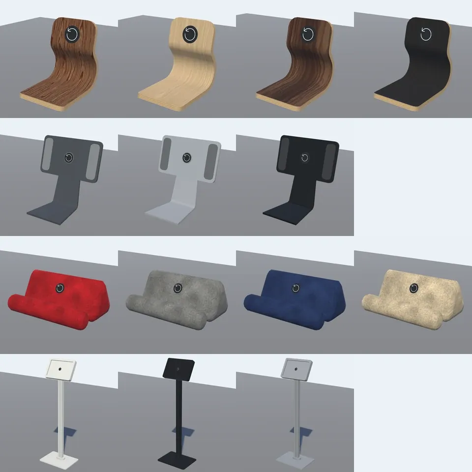

- **置く場所:** タブレットのいちばん上の物（`Tablet`）の位置が、スタンドの底です。机の上や床に合わせて置いてください。スタンドだけを動かしても、タブレットはワールドを作るときにスタンドの上に移ります。
- **スタンドなし:** **スタンド** をオフにすると、タブレットだけが置かれます。戻すボタンは、別に置く **戻すボタン** を使います。

## 使う

タブレットの画面は、見ている全員に同じものが映ります。ほかの人がアプリを開いていたら、手に取ってもそのアプリのままです。画面の下の白い □（ホームボタン、②）を押すとホーム画面に戻り、アプリのアイコン（①）を押すと開きます。アプリを開いているあいだは、ホームボタンの周りが青く光ります。

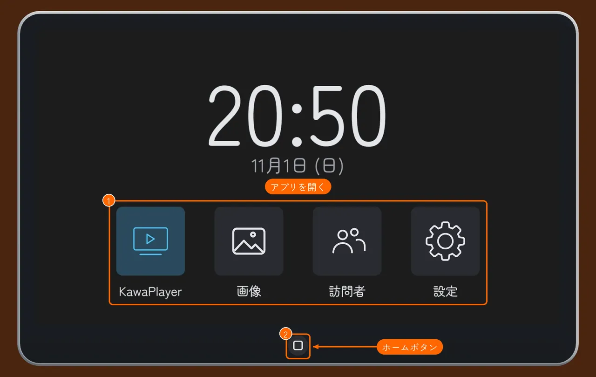

| アプリ | できること |
| --- | --- |
| **KawaPlayer** | スクリーンと同じ操作（再生、URL、プレイリスト）を手元でできる |
| **画像** | 画像の URL を入れると、タブレットを見ている全員に同じ画像が映る |
| **訪問者** | 今いる人と前にいた人、入退室のログを見られる |
| **設定** | スクリーンの設定と同じ設定（再生・映像・音声・言語）。KawaPlayer の版と更新履歴も、ここの **情報** で見られる |

### 縦に持つ

タブレットは、縦に持つと画面も縦向きになります。左が横に持ったとき、右が縦に持ったときのホーム画面です。

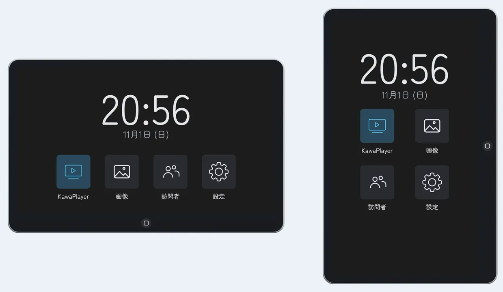

- **変わるところ:** 縦にすると、ホーム画面のアプリは 2 つずつ並び、設定アプリの分類は上のタブになります。訪問者アプリの一覧も、縦向き用の並びになります。
- **向きが変わるとき:** 今の向きから 55° より大きく傾けると変わります。机に寝かせたとき（平らなとき）は、向きを変えません。
- **KawaPlayer アプリ:** 横向きのままです。上下を逆さにしたときだけ、180° 回ります。

### 大きさを変える

持っているあいだ、タブレットを大きくしたり小さくしたりできます。最初の大きさ（幅 30 cm）から、その 5 倍（幅 1.5 m）まで変えられます。

| 使っているもの | すること |
| --- | --- |
| **VR** | 持っている手のトリガーを押したまま、同じ手のスティックを上に倒すと大きく、下に倒すと小さくなる |
| **デスクトップ** | 持っているあいだ、左クリックを押したまま、マウスのホイールを奥に回すと大きく、手前に回すと小さくなる |

- **広がり方:** VR では、持っている手の位置はずれず、そこから広がります。デスクトップでは、真ん中から広がります。
- **歩かない:** トリガー（デスクトップでは左クリック）を押しているあいだは、歩けません。左手で持っているときは、左のスティックで大きさを変えるためです。
- **離したあと:** 手を離しても、その大きさのままです。**放置したら元の位置に戻す** や **戻すボタン** で元の位置に戻ると、大きさも元に戻ります。
- **ほかの人の見え方:** インスペクターの **位置と大きさを全員にそろえる** がオンなら、ほかの人にも同じ大きさで見えます。オフなら、大きさは自分のタブレットだけで変わります。

### スタンドに置く

スタンドのあるタブレットは、使い終わったらスタンドに戻せます。

- **近くで離す:** スタンドの近く（約 30 cm 以内）で手を離すと、吸い付くようにスタンドに収まります。大きくしていたら、元の大きさに戻ります。遠くで離したときは、その場に残ります。
- **戻すボタン:** スタンドの置き場にある丸いボタン（更新のアイコン）を押すと、タブレットがスタンドに帰ってきます。タブレットを置き去りにしてしまったときに使います。ほかの人が持っているあいだは帰りません。

### KawaPlayer アプリ

画面を押すと、スクリーンと同じ操作の帯が、プレイリストの一覧を開いた状態で出ます（[スクリーンを押す](playing.md#スクリーンを押す)）。最後に押してから 10 秒で、操作が自分で隠れます。**URL を入力**（①）で動画やプレイリストの URL を入れられます。右のボタンは **音量** と **一覧** だけで、設定は設定アプリで変えます。ホームボタン（②）で、ホーム画面に戻ります。

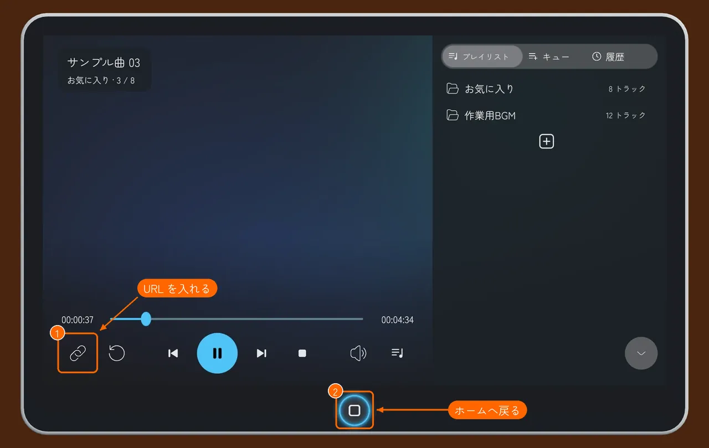

### 画像アプリ

上の欄に、画像の URL を入れます。

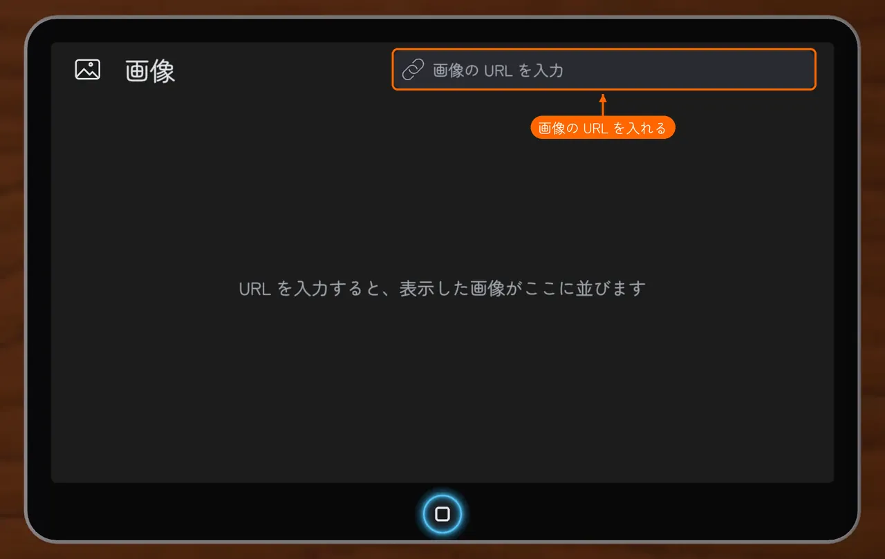

- **一覧:** 表示した画像は、最大 5 枚まで並び、あとから選び直せます。
- **KawaPlayer に送る:** 開いた画像を、大きなスクリーンにも映せます。
- **出ないとき:** 画像を読み込めないと、理由と次にすることが出ます（[画像が出ないとき](#画像が出ないとき)）。

#### 画像が出ないとき

画像を読み込めないと、画面に「画像を読み込めませんでした。」と出て、その下に理由と次にすることが出ます。理由は、次のどれかです。

| 出る文（はじめ） | 起きるとき | すること | もう一度読み込む |
| --- | --- | --- | --- |
| このサイトの画像を見るには、VRChat の設定で、信頼されていない URL を許可する設定（Allow Untrusted URLs）を… | VRChat が初めから信頼していないサイトの画像で、Allow Untrusted URLs がオフ | 設定をオンにして（[オンにする手順](quickstart.md#7-allow-untrusted-urls-をオンにする)）、**もう一度読み込む** を押す。それでも出ないときは、別のサイトの画像を使う | 出る |
| URL の形式が正しくありません。 | URL として読めない | `https://` で始まる、画像の URL を入れる | 出ない |
| ページの URL ではなく、画像そのものの URL を入れてください。 | 画像ではないもの（Web のページなど）、対応していない形式、2048 × 2048 より大きい画像 | ブラウザーで画像を右クリックし、**画像アドレスをコピー** で取った URL を入れる | 出ない |
| この URL は、別の場所へ転送されます。 | URL が別の場所へ転送される（短縮 URL など）。画像の読み込みは、転送先をたどらない | 画像そのものの URL を入れる | 出ない |
| このサイトは、VRChat からの画像の読み込みを断っています。 | サイトが断った（HTTP 401・403）。ブラウザーでは見えても、ブラウザー以外からの読み込みを断るサイトは多い | 別のサイトに置いた画像を使う | 出ない |
| 画像が見つかりませんでした。 | 画像がない（HTTP 404・410） | URL が正しいか、画像が消されていないかを確かめる | 出ない |
| サイトが混み合っているか、一時的に使えません。 | サイトが混んでいるか、止まっている（HTTP 429・500 番台） | 少し待ってから、**もう一度読み込む** を押す | 出る |
| 画像を取得できませんでした。 | そのほかの理由で、サイトから取得できなかった | URL を確かめてから、**もう一度読み込む** を押す | 出る |
| 画像の読み込みが混み合っています。 | 短いあいだに、画像を読み込みすぎた | 少し待ってから、**もう一度読み込む** を押す | 出る |
| 原因は分かりませんでした。 | 上のどれにも当たらない | **もう一度読み込む** を押すか、別の画像を試す | 出る |

- **もう一度読み込む:** 読み込み直して出る見込みがあるときだけ出ます。URL が違う、画像ではない、サイトが断っているときは、同じ URL では何度試しても出ないので、出ません。
- **一人ひとりの読み込み:** 画像は、見る人がそれぞれ読み込みます。ほかの人に見えていても、自分の設定（Allow Untrusted URLs など）で出ないことがあります。**もう一度読み込む** も、押した人の画面でだけ読み込み直します。
- **エラーの詳細:** **エラーの詳細** を押すと、VRChat が返したエラー（Error・Message）、URL、機種（PC・Android・iOS）、時刻が出ます。困ったときは、その画面を撮って [Discord サーバー](https://discord.gg/tkrHek6PvN) で聞いてください。

### 訪問者アプリ

今いる人の一覧と、入退室のログを、右上で切り替えます。

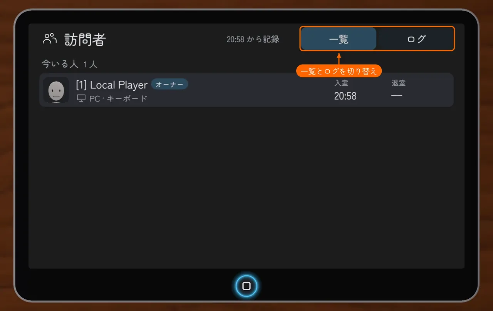

### 設定アプリ

スクリーンの設定と同じ画面です（[設定を変える](playing.md#設定を変える)）。左の分類（再生・映像・音声・言語）を切り替えて、設定を変えます。最後の分類の **情報** には、KawaPlayer の版と更新履歴が出ます（[情報](playing.md#情報)）。名前に **(Global)** が付いた設定はインスタンスの全員に、付いていない設定は自分にだけ反映されます。**再生** の **自動再生** を決められるのは、インスタンスを作った人だけです（[自動再生](playing.md#自動再生)）。

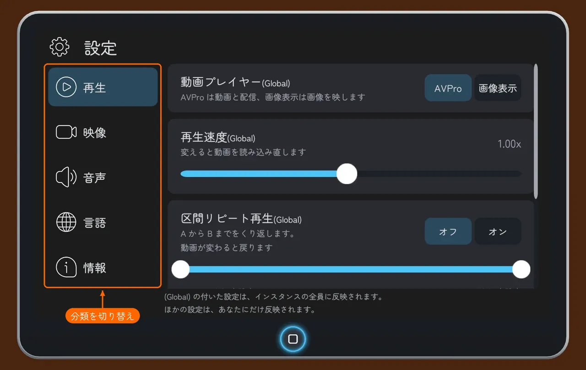
