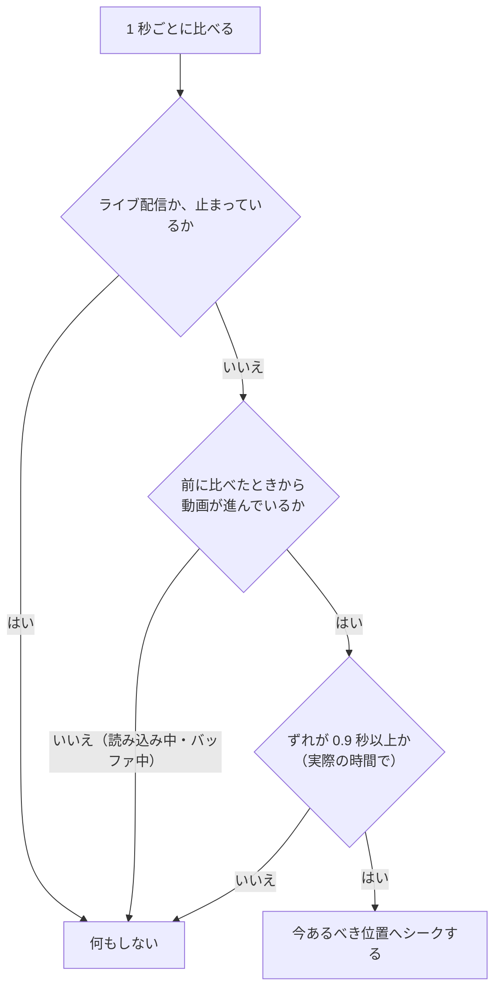

# 再生の同期のしくみ

インスタンスの全員が、同じ動画の同じ位置を見られるように、KawaPlayer がどう合わせているかを説明します。ワールドの制作者や、イベントの主催者向けのページです。

ワールドの中でずれたときにどうすればよいかは、[ワールドの中で使う](../playing.md#左の列) の「ほかの人とずれたとき」にあります。開発者向けのくわしい仕様は [再生の同期（実装後の仕様）](../../analysis/playback-sync.md) にあります。

## 全員で共有するもの

曲を流す・再生・一時停止・シークなどの操作をした人が、その KawaPlayer の **オーナー** になります。オーナーが、次のものを全員に送ります。オーナーがインスタンスを抜けると、VRChat が別の人をオーナーにします。

| 共有するもの | 中身 |
| --- | --- |
| 曲 | 流している動画の URL と、使う動画プレイヤー（AVPro・Unity・画像） |
| 状態 | 止まっている・再生・一時停止 |
| 位置 | 再生位置と、その位置だった時刻 |
| 再生のしかた | 再生速度、ループ、区間リピート |

音量・ミュート・輝度・最大解像度・**ローカル再生遅延** などは、見ている人それぞれのもので、共有しません。設定の画面では、名前に **(Global)** が付いたものが全員に反映されます（[設定を変える](../playing.md#設定を変える)）。

## 位置の決め方

全員が、同じ計算で「今あるべき位置」を出します。

> 今あるべき位置 ＝ 共有の位置 ＋ その位置だった時刻から過ぎた時間 × 再生速度

一時停止のあいだは、時間を足しません。**ローカル再生遅延** を決めた人は、その秒数をさらに足します（自分の画面だけ）。

過ぎた時間は、**VRChat のサーバーの時刻** で測ります。見ている人のパソコンの時計がずれていても、位置はずれません。

## ずれの直し方

再生中は **1 秒ごと** に、自分の動画の位置と、今あるべき位置を比べます。

| 項目 | 値 | 理由 |
| --- | --- | --- |
| 比べる間隔 | 1 秒 | ずれに早く気づけるように |
| 合わせ直す境目 | ずれが 0.9 秒（実際の時間で） | シークそのものに時間がかかるので、小さなずれまで直すと、直すたびにまたずれて、シークを繰り返すため |
| 読み込み中・バッファ中 | 待つ | シークすると、読み込んだ分を捨てて、かえって遅れるため |

境目は実際の時間で数えます。再生速度が 2 倍なら、位置で 1.8 秒ずれたときに合わせ直します。0.9 秒より小さなずれは、そのまま残ります。回線がよいときは、もともと大きくはずれません。

次のときは、ずれの大きさにかかわらず、すぐに合わせます。

- 動画の準備ができたとき。あとからインスタンスに入ったとき、読み込み直したとき、エラーのあとに読み込めたときも同じで、最初からではなく、今あるべき位置から始まります。
- オーナーが、再生・一時停止・シーク・再生速度の変更をしたとき。

**ライブ配信** は、全員で共有できる位置がないので、合わせません。遅れは人ごとにたまります。そろえたいときは、自分の画面を **ReSync** で、全員の画面を [全員リロードボタン](../global-reload.md) で取り直します。

## オーナーが替わったとき

オーナーが抜けても、共有の位置はそのまま残り、新しいオーナーもその位置から続けます。動画を読み込んでいる途中でオーナーを引き継いだ人がいても、全員が先頭に戻ることはありません。

## 自分の画面の読み込み直し（ReSync）

スクリーンの左の列と、タブレットの KawaPlayer アプリにある **ReSync** は、押した人の画面だけを読み込み直します。ほかの人には何も送らないので、[権限管理](../modules.md#権限管理) を入れたワールドでも、誰でも押せます。

- **戻る位置:** 読み込めたら、共有の状態（再生・一時停止）と、今あるべき位置に戻ります。最初からにはなりません。
- **戻せるもの:** エラーで止まった画面、読み込みが進まない画面、ずれたままの画面。
- **押せないとき:** 全員が止まっているとき（読み込み直すものがない）と、読み込みを始めて **15 秒** たっていないとき（遅いだけの読み込みを、最初からやり直さないため）。
- **読み込みの間隔:** VRChat は、5 秒以内の 2 回目の読み込みを断ります。そのため、前の読み込みから **5.1 秒** あけてから読み込みます。待っているあいだに何回押しても、1 回にまとめます。

### エラーのとき

動画の読み込みに失敗すると、KawaPlayer は自分で読み込み直します。

- 初めは最大 **5 回** まで、それぞれ前の読み込みから 5.1 秒あけて試します。
- 動画プレイヤーのエラー（Player Error）のときは、初めは 1 回目で、AVPro と Unity の動画プレイヤーのもう一方に切り替えて試します。
- Access Denied と Invalid URL は、試しても直らないので、やり直しません（[再生できないとき](../playing.md#再生できないとき)）。
- 試し切っても読み込めないときは、その人の画面だけが止まったままになります。**ReSync** で戻せます。

回数と切り替えは、KawaPlayer のインスペクターの **最大リトライ回数** と **フォールバック開始エラー数** で変えられます（[KawaPlayer の設定](../settings.md)）。

## 全員リロードボタン

ワールドに [全員リロードボタン](../global-reload.md) が置いてあれば、押すとインスタンスの全員が、それぞれの画面で **ReSync** を押したのと同じになります。送るのは「読み込み直して」という合図だけで、共有の位置や状態は変えません。

- **受けた人の画面:** ReSync と同じ決まりで読み込み直します。読み込みを始めて 15 秒たっていない人は、その読み込みを続けます。
- **ライブ配信では:** 全員が配信の今の位置から取り直すので、人ごとにたまった遅れがそろいます。
- **送ったあと 15 秒は押せない:** 受けた人は、読み込みを始めて 15 秒は読み直しません。それより早い 2 回目は、読み込みを終えた人だけを、また読み直させてしまうためです。
- **押せる人:** 権限管理を入れたワールドでは、Editor 以上の人だけです。

## KawaPlayer を更新したとき

PC と Quest で KawaPlayer の版が違うと、同じインスタンスで再生がそろわないことがあります。KawaPlayer を更新したら、PC と Quest の両方を公開し直してください（[インストールと更新](../install.md#更新する)）。
