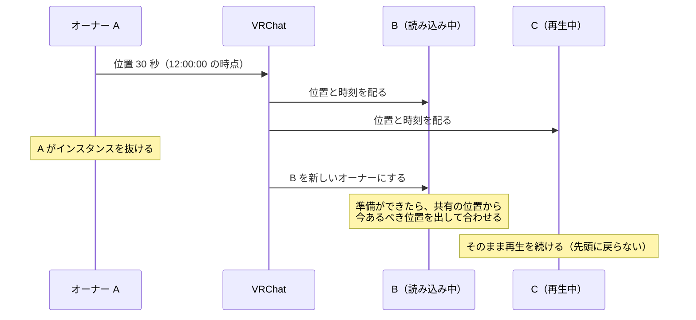
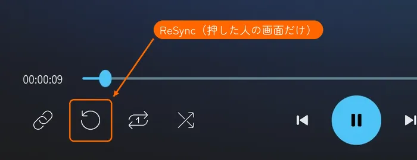
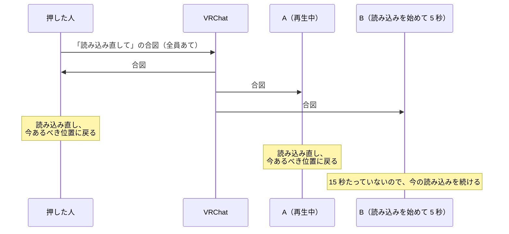

# 再生の同期のしくみ

| 項目 | 内容 |
| --- | --- |
| 文書の種類 | しくみの説明（使い方ガイドの技術のページ） |
| 読む人 | ワールドの制作者、イベントの主催者、しくみを知りたい人 |
| 遊ぶ人向けの対処 | [ワールドの中で使う](../playing.md#左の列) の「ほかの人とずれたとき」 |
| 開発者向けの仕様 | [再生の同期（実装後の仕様）](../../analysis/playback-sync.md)。コードの名前と、共有する値の一つひとつを書いている |
| 関連する issue | #228（同期の見直し）、#232〜#237、#248 |

## 要旨

KawaPlayer は、インスタンスの全員が、同じ動画の同じ位置を見られるようにしている。共有するのは曲・状態・位置などの値だけで、動画そのものは一人ひとりが読み込む。そのため、読み込みの速さや回線によって、人ごとにずれが生まれる。このページは、そのずれを KawaPlayer がどう扱うかを、コードの名前を使わずに、数値と図で説明する。全員は、オーナーが送った「位置とその時刻」から、VRChat のサーバーの時刻を使って、今あるべき位置を同じ計算で出す。再生中は 1 秒ごとに自分の動画と比べ、0.9 秒以上ずれたときだけ合わせ直し、読み込み中は待つ。止まった自分の画面は **ReSync** で、全員の画面は **全員リロードボタン** で読み込み直せる。

**キーワード：** 再生の同期、オーナー、サーバーの時刻、時刻合わせ、ReSync、全員リロードボタン

## 目次

1. はじめに
2. 前提：VRChat で動画をそろえるしくみ
3. 全員で共有するもの
4. 位置の決め方
5. ずれの直し方
6. オーナーが替わったとき
7. 自分の画面の読み込み直し（ReSync）
8. 全員リロードボタン
9. KawaPlayer を更新したとき
10. まとめ
11. 参考文献

---

## 1. はじめに

### 1.1 このページの目的

VRChat の動画プレイヤーでは、同じ動画を見ていても、人によって少し早かったり遅かったりする。KawaPlayer を置いたワールドの制作者や、イベントの主催者が、「どのくらいずれるのか」「いつ直るのか」「止まったらどうなるのか」を知って、見る人に案内したり、全員リロードボタンを置くかを決めたりできるように、そのしくみをまとめる。

### 1.2 読み方

- ワールドの中で困ったときの対処だけを知りたいときは、[ワールドの中で使う](../playing.md#左の列) の「ほかの人とずれたとき」を読めば足りる。
- 急ぐときは、§4（位置の決め方）、§5（ずれの直し方）、§10（まとめ）を読む。
- コードの名前や、共有する値の型は、開発者向けの [再生の同期（実装後の仕様）](../../analysis/playback-sync.md) にある。どう決めたかの経緯は、[再生の同期：直す方針](../../design/228-playback-sync/README.md) にある。

---

## 2. 前提：VRChat で動画をそろえるしくみ

- **オーナー：** 曲を流す・再生・一時停止・シークなどの操作をした人が、その KawaPlayer の **オーナー** になる。全員に値を送れるのは、オーナーだけである。オーナーがインスタンスを抜けると、VRChat が別の人をオーナーにする。
- **共有するのは値だけ：** オーナーが送るのは、曲の URL・状態・位置などの値である。後から入った人にも、最後に送られた値が届く。
- **動画は一人ひとりが読み込む：** 動画そのものは、見る人がそれぞれ動画のサイトから読み込む。読み込みにかかる時間、エラー、通信が止まったときの遅れは、人によって違う。「自分の画面だけ止まる」「自分だけ遅れる」のは、このためである。
- **読み込みの回数の制限：** VRChat は、1 人が新しく動画を読み込めるのを、ワールドのすべての動画プレイヤーを合わせて 5 秒に 1 回に限る [4]。
- **サーバーの時刻：** VRChat は、全員に共通のサーバーの時刻を配っている。KawaPlayer は、時間をこの時刻で測る。

**図 1** 同期の全体像。共有するのは値だけで、動画は一人ひとりが読み込み、位置はサーバーの時刻から一人ひとりが出す。

---

## 3. 全員で共有するもの

**表 1** 共有するものと、共有しないもの

| 分け方 | もの | 中身 |
| --- | --- | --- |
| 全員で共有する | 曲 | 流している動画の URL と、使う動画プレイヤー（AVPro・Unity・画像） |
| 全員で共有する | 状態 | 止まっている・再生・一時停止 |
| 全員で共有する | 位置 | 再生位置と、その位置だった時刻（サーバーの時刻） |
| 全員で共有する | 再生のしかた | 再生速度、ループ、区間リピート |
| 一人ひとりのもの | 見え方・聞こえ方 | 音量、ミュート、輝度、ミラー反転、最大解像度、言語 |
| 一人ひとりのもの | ローカル再生遅延 | 自分の再生位置だけを前後にずらす秒数 |

スクリーンの設定の画面では、名前に **(Global)** が付いたものが全員に反映される（[設定を変える](../playing.md#設定を変える)）。

---

## 4. 位置の決め方

### 4.1 今あるべき位置

全員が、同じ計算で「今あるべき位置」を出す。オーナーも同じ計算に従う。

> 今あるべき位置 ＝ 共有の位置 ＋ その位置だった時刻から過ぎた時間 × 再生速度

- 一時停止のあいだは、時間を足さない（位置は進まない）。
- **ローカル再生遅延** を決めた人は、その秒数をさらに足す。その人の画面だけに効く。

**図 2** 共有の位置と時刻から、今あるべき位置を出す。オーナーが 2 秒に再生、10 秒に一時停止、14 秒に再生、20 秒に速度を 2 倍にした例。橙の点は、オーナーが送った位置と時刻である。26 秒には、最後に送られた「20 秒に 14 秒の位置」から、過ぎた 6 秒 × 速度 2 を足して 26 秒の位置になる。

オーナーが値を送るのは、操作したとき（曲を始めた、再生・一時停止・停止・シーク・速度の変更）と、ループで先頭に戻ったとき、始めた曲の準備ができたときだけである。そのあいだは、誰も値を送らず、全員が図 2 の線を、それぞれの手元で計算し続ける。

### 4.2 サーバーの時刻を使う理由

過ぎた時間は、見る人のパソコンの時計ではなく、**VRChat のサーバーの時刻** で測る。パソコンの時計がずれていても、位置はずれない。

以前は、VRChat の別の時計（ネットワークの日時）を使っていた。この時計は、VRChat が合わせるのに失敗すると、その人のパソコンの時計のままになる。そうなった人だけが、時計のずれの分だけずれ続けた（#237）。サーバーの時刻には、この問題がない。

---

## 5. ずれの直し方

### 5.1 1 秒ごとの確かめ

再生中は **1 秒ごと** に、自分の動画の位置と、今あるべき位置（§4）を比べる。

**図 3** 1 秒ごとの確かめ。合わせ直すのは、動画が進んでいて、0.9 秒以上ずれているときだけである。

**表 2** 時刻合わせの値と、その理由

| 項目 | 値 | 理由 |
| --- | --- | --- |
| 比べる間隔 | 1 秒 | ずれに早く気づけるように |
| 合わせ直す境目 | ずれが 0.9 秒（実際の時間で） | シークそのものに時間がかかるので、小さなずれまで直すと、直すたびにまたずれて、シークを繰り返すため |
| 読み込み中・バッファ中 | 待つ | シークすると、読み込んだ分を捨てて、かえって遅れるため |
| 合わせ直したことを送るか | 送らない | 自分の画面のずれを直しただけで、共有の位置は正しいため |

境目は実際の時間で数える。再生速度が 2 倍なら、位置で 1.8 秒ずれたときに合わせ直す。0.9 秒より小さなずれは、そのまま残る。回線がよいときは、もともと大きくはずれない（VRChat の Build & Test の 2 台では、0.1 秒以内だった）。

### 5.2 通信が止まったとき

通信が止まると、動画は進まないのに、今あるべき位置は進み続けるので、ずれが大きくなる（図 4 の 8〜12 秒）。KawaPlayer は、そのあいだは確かめても待ち、動画が動き出してから 1 回だけ合わせ直す。

**図 4** 通信が止まったあとの時刻合わせ（モデル。実測ではない）。通信が 8〜12 秒で止まり、シーク 1 回ごとに 0.6 秒の読み直しがかかると仮定した、1 人の見る人のずれ。白い丸は、確かめたが動画が進んでいないので待ったところである。シークのあとに残る 0.6 秒の遅れは境目より小さいので、シークを繰り返さない。

以前は、5 秒ごとに確かめ、0.3 秒以上ずれていればシークしていた。通信が止まったあとは、シークのたびに読み直しで遅れ、5 秒ごとにシークして止まる繰り返しになるおそれがあった（#235）。

### 5.3 すぐに合わせるとき

次のときは、ずれの大きさにかかわらず、すぐに今あるべき位置に合わせる。

- **動画の準備ができたとき：** あとからインスタンスに入ったとき、読み込み直したとき、エラーのあとに読み込めたときも同じである。最初からではなく、今あるべき位置から始まる。
- **オーナーが操作したとき：** 再生・一時停止・シーク・再生速度の変更で、新しい位置と時刻が届いたとき。

### 5.4 ライブ配信

ライブ配信は、全員で共有できる位置がないので、時刻合わせをしない。遅れは、人ごとにたまる。そろえたいときは、自分の画面を **ReSync**（§7）で、全員の画面を **全員リロードボタン**（§8）で読み込み直す。どちらも、配信の今の位置から取り直す。

---

## 6. オーナーが替わったとき

オーナーがインスタンスを抜けても、共有の位置と時刻はそのまま残る。新しいオーナーも、その位置から続ける。動画を読み込んでいる途中でオーナーを引き継いだ人がいても、準備ができたら共有の位置に合わせるだけで、全員が先頭に戻ることはない。

**図 5** オーナーが替わるとき。共有の位置と時刻はそのまま使われ、読み込み中に引き継いだ人も、先頭からではなく今あるべき位置から始める。

以前は、読み込みが終わったオーナーが「位置 0」を送ることがあり、読み込み中の人にオーナーが替わると、全員が先頭に戻っていた（#234）。

---

## 7. 自分の画面の読み込み直し（ReSync）

### 7.1 ReSync のボタン

スクリーンの左の列と、タブレットの KawaPlayer アプリにある **ReSync** は、押した人の画面だけを読み込み直すボタンである（図 6）。ほかの人には何も送らないので、[権限管理](../modules.md#権限管理) を入れたワールドでも、誰でも押せる（#233）。

**図 6** スクリーンの左の列の ReSync。押した人の画面だけを読み込み直す。

### 7.2 押したときの動き

**表 3** ReSync を押したときの動き

| 自分の画面 | 動き |
| --- | --- |
| 全員が止まっている | 何もしない。ボタンは押せない（読み込み直すものがない） |
| 読み込み中で、始めてから 15 秒たっていない | 何もしない。ボタンは押せない（遅いだけの読み込みを、最初からやり直さないため） |
| 読み込み中で、15 秒たった | 読み込み直す |
| エラーで止まっている | 読み込み直す |
| 再生中・一時停止中 | 読み込み直す |

読み込めたら、共有の状態（再生・一時停止）と、今あるべき位置（§4）に戻る。最初からにはならない。エラーで止まった画面や、読み込みが進まない画面も、これで戻せる（#232）。

### 7.3 読み込みの間隔

VRChat は、5 秒以内の 2 回目の読み込みを断る（§2）。そのため、KawaPlayer は前の読み込みから **5.1 秒** あけてから読み込む。待っているあいだに何回押しても、1 回にまとめる（図 7 (a)）。読み込み中は、始めてから 15 秒たつまでボタンを押せない（図 7 (b)）。

**図 7** ReSync を押したときに、いつ読み込むか。(a) 読み込みの間隔。(b) 読み込み中の 15 秒。

### 7.4 エラーのとき

動画の読み込みに失敗すると、KawaPlayer は ReSync を待たずに、自分で読み込み直す。

**表 4** エラーのときのやり直し（初期値）

| 項目 | 動き |
| --- | --- |
| やり直す回数 | 最大 5 回。それぞれ、前の読み込みから 5.1 秒あける |
| 動画プレイヤーの切り替え | 動画プレイヤーのエラー（Player Error）が 1 回出たら、AVPro と Unity の動画プレイヤーのもう一方に切り替えて試す |
| やり直さないエラー | Access Denied と Invalid URL。試しても直らないため（[再生できないとき](../playing.md#再生できないとき)） |
| 試し切ったとき | その人の画面だけが止まったままになる。ReSync で戻せる |

回数と切り替えは、KawaPlayer のインスペクターの **最大リトライ回数** と **フォールバック開始エラー数** で変えられる（[KawaPlayer の設定](../settings.md)）。

---

## 8. 全員リロードボタン

### 8.1 どんなボタンか

[全員リロードボタン](../global-reload.md) は、ワールドの制作者が置く、ライブ配信のイベントなどのためのボタンである（図 8）。押すと、インスタンスの全員が、それぞれの画面で ReSync を押したのと同じになる。スクリーンとタブレットにはなく、置いたワールドだけにある。

**図 8** 全員リロードボタン。真ん中の文字が、押せるか（RELOAD ALL）、送ったあとか（RELOADING）、全員が止まっているか（NO VIDEO）、権限がないか（NO ACCESS）を示す。

### 8.2 押したときの動き

送るのは「読み込み直して」という合図だけで、共有の位置や状態は変えない。受けた人は、ReSync と同じ決まり（表 3）で、自分の画面を読み込み直す。

**図 9** 全員リロードボタンを押したとき。合図は押した人にも届く。受けた人は、それぞれ ReSync と同じ決まりで読み込み直す。

- **ライブ配信では：** 全員が配信の今の位置から取り直すので、人ごとにたまった遅れがそろう。
- **送ったあと 15 秒は押せない：** 受けた人は、読み込みを始めて 15 秒は読み直さない（表 3）。それより早い 2 回目は、読み込みを終えた人だけを、また読み直させてしまうためである。
- **押せる人：** 権限管理を入れたワールドでは、Editor 以上の人だけである。入れていなければ、ボタンに手が届く人は誰でも押せる。確認は出ない。

**表 5** ReSync と全員リロードボタン

| | ReSync | 全員リロードボタン |
| --- | --- | --- |
| 読み込み直す画面 | 押した人の画面だけ | インスタンスの全員の画面 |
| 押せる人 | 誰でも | 権限管理があれば Editor 以上 |
| ある場所 | スクリーンとタブレット | ワールドの制作者が置いた所だけ |
| 押したあと | 読み込み中のしばらく（15 秒）は押せない | 送ってから 15 秒は押せない |
| 戻る位置 | 今あるべき位置（ライブ配信は配信の今の位置） | 同じ |

---

## 9. KawaPlayer を更新したとき

PC と Quest で KawaPlayer の版が違うと、同じインスタンスで再生がそろわないことがある。KawaPlayer を更新したら、PC と Quest の両方を公開し直す（[インストールと更新](../install.md#更新する)）。

---

## 10. まとめ

KawaPlayer は、オーナーが送った「位置とその時刻」から、全員が同じ計算で今あるべき位置を出す。時間は VRChat のサーバーの時刻で測るので、パソコンの時計のずれには左右されない。再生中は 1 秒ごとに比べ、0.9 秒以上ずれたときだけ合わせ直し、読み込み中やバッファ中は待つ。動画の準備ができたときと、オーナーが操作したときは、すぐに合わせる。ライブ配信は合わせない。

止まった画面やずれたままの画面は、押した人の画面だけの **ReSync** で、共有の位置に戻せる。ライブ配信の遅れを全員でそろえたいときは、ワールドに置いた **全員リロードボタン** を使う。どちらも、VRChat の読み込みの制限に合わせて 5.1 秒あけ、遅いだけの読み込みは 15 秒待つ。

---

## 11. 参考文献

1. [再生の同期（実装後の仕様）](../../analysis/playback-sync.md)：開発者向けの、今の同期の仕様。
2. [再生の同期：直す方針](../../design/228-playback-sync/README.md)：同期を見直したときの方針と、決めた理由（#228）。
3. [再生の同期の仕様：KawaPlayer と VizVid（VVMW）の機能ごとの比較](../../design/228-playback-sync/comparison.md)：見直す前の動きと、VizVid との比較。
4. VRChat, “Video Players — Rate Limiting”. <https://creators.vrchat.com/worlds/udon/video-players/#rate-limiting>
5. VRChat, “VRChat API — Networking”（UdonSharp）. <https://udonsharp.docs.vrchat.com/vrchat-api/#networking>
6. 使い方ガイド：[ワールドの中で使う](../playing.md)、[全員リロードボタン](../global-reload.md)、[KawaPlayer の設定](../settings.md)、[モジュール](../modules.md)。
7. #232〜#237（同期の見直しの実装）、#248（全員リロードボタンのモジュール化）。
