# VHub Playlist の使い方

[VHub Playlist](https://playlist.vrc-hub.com)（VHub）は、VRChat で流すプレイリストを作って共有するサイトです。VHub のプレイリストの **VRChat用URL** を KawaPlayer の URL の欄に入れると、プレイリストをまるごと読み込めます。

| やりたいこと | 節 | VHub へのログイン |
| --- | --- | --- |
| プレイリストを探して、URL をコピーする | [VRChat用URL をコピーする](#vrchat用url-をコピーする) | いらない |
| コピーしたプレイリストを、ワールドの中で流す | [ワールドの中で読み込む](#ワールドの中で読み込む) | いらない |
| ワールドに最初から入れておく（ワールドを作る人） | [ワールドに最初から入れておく](#ワールドに最初から入れておく) | いらない |
| 自分でプレイリストを作る | [プレイリストを作る](#プレイリストを作る) | 要る |
| 作ったプレイリストを直す・消す | [作ったプレイリストを直す](#作ったプレイリストを直す) | 要る |

## VRChat用URL をコピーする

1. [VHub Playlist](https://playlist.vrc-hub.com) を開き、検索の欄（①）に曲名、アーティスト名、プレイリスト名などを入れて探します。下に並ぶタグや、ページの下のランキングからも探せます。

   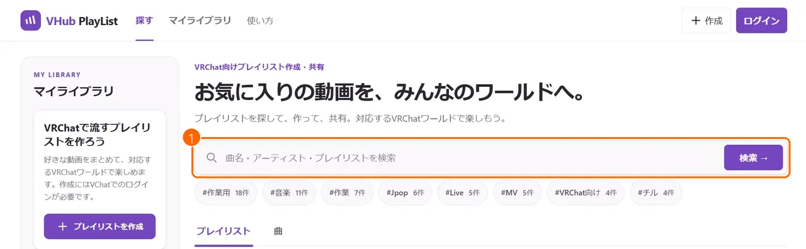

2. 流したいプレイリストを開き、**VRChat用URLをコピー**（①）を押します。

   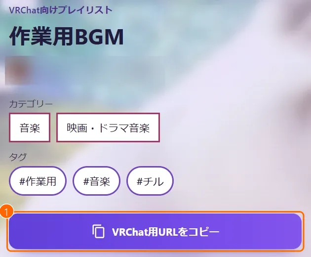

3. ボタンが **コピーしました** に変われば、コピーできています。

   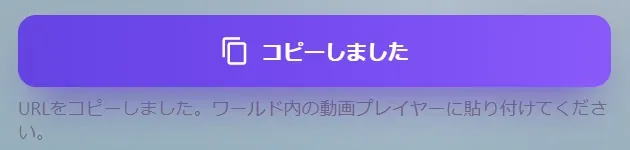

KawaPlayer で読み込めるのは、この VRChat用URL（`https://playlist.vrc-hub.com/r/default/…` の形）です。ブラウザーのアドレス欄の URL と、**シェア** の **リンクをコピー** でコピーされる URL（どちらも `/playlists/…` の形）は、Web のページを開くためのもので、KawaPlayer では読み込めません。

## ワールドの中で読み込む

**先に、VRChat の設定で Allow Untrusted URLs をオンにしてください**（[オンにする手順](quickstart.md#7-allow-untrusted-urls-をオンにする)）。オフのままでは、VHub のプレイリストを読み込めず、曲も流れません。Public・Group Public のインスタンスでは、ワールドが VHub を許可している必要もあります（ワールドの作者が設定します。[クイックスタートの 6.](quickstart.md#6-vrchatcom-で-vhub-を許可する)）。

1. スクリーンの左下の **URL を入力**（①）を押し、コピーした VRChat用URL を貼って確定します。**プレイリストを追加しました** と出れば、プレイリストの一覧に 1 つ足されています。止まっているときに読み込むと、そのまま再生が始まります。

   

   一覧の **プレイリスト** のタブの下にある **＋** に貼っても、足せます。こちらは止まっていても再生が始まらず、読み込めたときは何も表示しません（[ワールドの中で使う](playing.md#プレイリストキュー履歴の一覧)）。

2. スクリーンの **一覧** の **プレイリスト** で、読み込んだプレイリストを選びます。曲（①）を押して、出てきた **再生する** を押すと、その曲から再生します。名前の右の **…**（②）から、**更新** で VHub の今の内容に変え、**削除** で一覧から外せます。

   

タブレットの KawaPlayer アプリでも、同じように読み込めます（[タブレット](tablet.md#kawaplayer-アプリ)）。読み込める数や、インスタンスの種類ごとの決まりは、[プレイリスト](playlists.md#ワールドの中で-vhub-のプレイリストを読み込む) にあります。

## ワールドに最初から入れておく

ワールドを作る人は、VHub のプレイリストを、ワールドに最初から入れておけます。

1. Unity で KawaPlayer を選び、インスペクターの **プレイリストを編集する** を押して、プレイリストエディターを開きます。
2. 上の **URL から読み込み**（①）を押します。
3. **VHub プレイリスト** の欄（②）に VRChat用URL を貼り、右の **URL から読み込み**（③）を押します。左の **プレイリスト** に入ります。
4. 右上の **保存**（④）を押します。

Public・Group Public のインスタンスで流すには、ワールドの Video Player Allowed Domains に `playlist.vrc-hub.com` を足しておきます（[クイックスタートの 6.](quickstart.md#6-vrchatcom-で-vhub-を許可する)）。どのインスタンスでも、聞く人それぞれが Allow Untrusted URLs をオンにしておく必要もあります。取り込み直し方などは、[URL から読み込み](playlists.md#url-から読み込み) にあります。

## プレイリストを作る

プレイリストを作るには、VHub にログインします。ログインには、VChat（`sns.vrc-hub.com`）のアカウントを使います。

1. 右上の **ログイン**（①）を押し、**既存アカウントでログイン** を選んで、VChat でログインします。VChat のアカウントがなければ、**アカウントを新規作成** から作ります。ログインできたら、**作成**（②）を押します。

   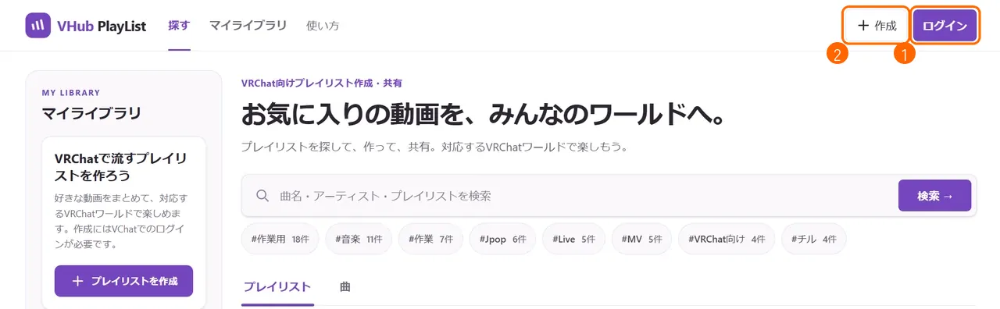

2. **プレイリスト名**（①）を入れます。**公開する**（②）をオンにすると、VHub の一覧や検索に出て、誰でも Web で見られます。オフにすると、Web では自分だけが見られます。

   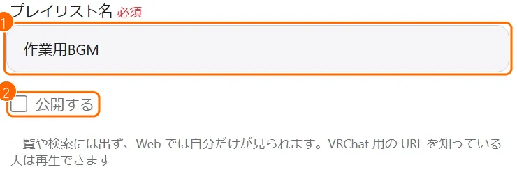

   **公開しなくても、VRChat用URL を知っている人は再生できます。** URL は、人に渡すものだけに使ってください。

3. 動画を足します。**動画を追加** のタブで、YouTube の動画の URL を欄（①）に貼り、**追加**（②）を押します。足した動画は下に並び、**外す** で外せます。

   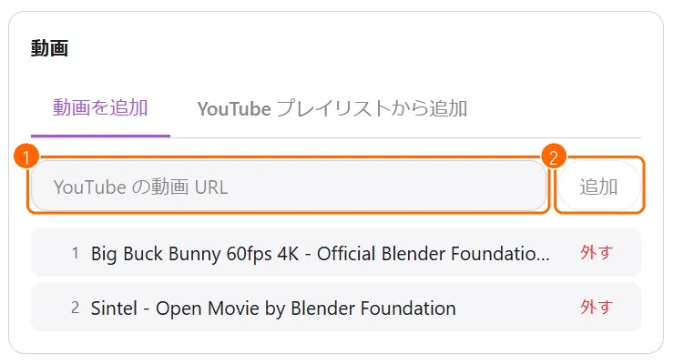

   - **数:** 動画は 1〜100 本です。同じ動画は 2 回足せません。
   - **YouTube のプレイリストから:** **YouTube プレイリストから追加** のタブに YouTube のプレイリストの URL を貼ると、まとめて足せます（100 本まで、1 日 5 回まで）。非公開のプレイリストとミックスリストには使えません。

4. **分類** を決めます。
   - **カテゴリー**（①）を 1 つ選びます。
   - **ジャンル**（②）を、押して 1〜3 つ選びます。ジャンルのないカテゴリーでは選びません。
   - **タグ**（③）を、欄に入れて **追加** を押し、3〜10 個つけます。1 つ 20 文字までです。

   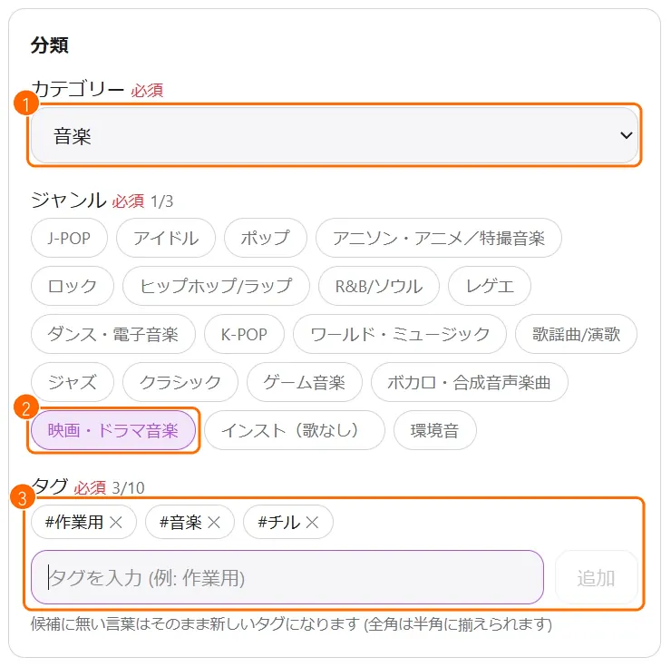

5. 一番下の **作成**（①）を押します。足りないところがあると、画面に出るので、直してからもう一度押します。

   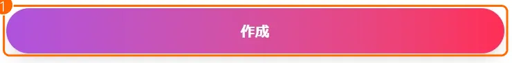

6. 作れると、そのプレイリストの編集の画面が開きます。**VRChat用URL**（①）が、KawaPlayer に入れる URL です。**URLをコピー**（②）でコピーできます。

   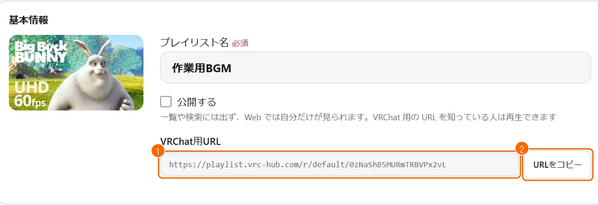

## 作ったプレイリストを直す

1. 上の **マイライブラリ**（①）から、自分のプレイリストを開きます。

   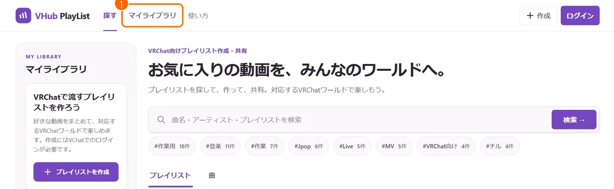

2. **編集**（①）を押します。編集のボタンは、自分のプレイリストにだけ出ます。

   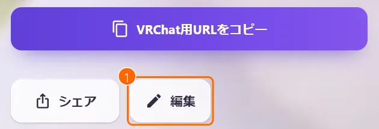

3. 名前、公開するかどうか、動画、分類を直します。動画は、作るときと同じように足せます。並び替えは ▲▼ か番号の欄（①）で、動画を外すときは **削除**（②）を押します。

   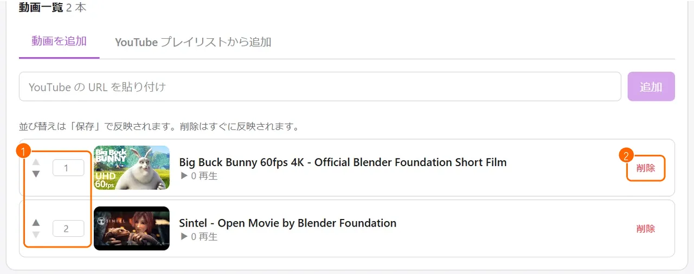

   - **並び替え:** **保存** を押したときに反映されます。
   - **削除:** 押したときに、すぐ反映されます。最後の 1 本は消せません。

4. 画面の下の **保存**（①）を押します。

   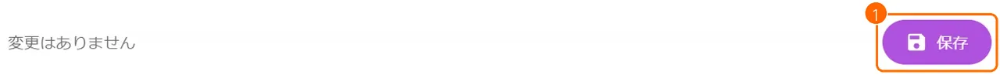

- **読み込んだあと:** ワールドの中で読み込んだプレイリストは、一覧の **更新** を押すと、VHub の今の内容に変わります（[プレイリストから選ぶ](playlists.md#プレイリストから選ぶ)）。Unity で取り込んだプレイリストは、取り込み直して、ワールドをビルドし直すまで変わりません（[URL から読み込み](playlists.md#url-から読み込み)）。

### プレイリストを消す

編集の画面の一番下の **このプレイリストを削除**（①）を押すと、プレイリストを消せます。**元に戻せません。** 消したプレイリストの VRChat用URL は、使えなくなります。

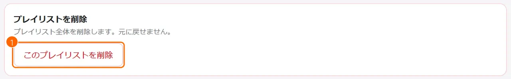

困ったときは、気軽に [Discord サーバー](https://discord.gg/tkrHek6PvN) で聞いてください。
