**KawaPlayer 1.4.0** — 2026-10-30

スクリーンの見た目と操作を、まるごと作り直しました。

YamaPlayer から受け継いだ画面（左の列・右のタブ・下のバー）を卒業して、KawaPlayer 独自の UI になりました。操作は下の帯にまとまり、一覧は右から出てきて、曲は押すだけで流れ、設定はスクリーンとタブレットで同じ画面です。押せる範囲も広げたので、VR でボタンを外すことが減るはずです（たぶん）。タブレットにはスタンドが付いて、ようやく帰る場所ができました。

| 1.3 | 1.4 |
| --- | --- |
| 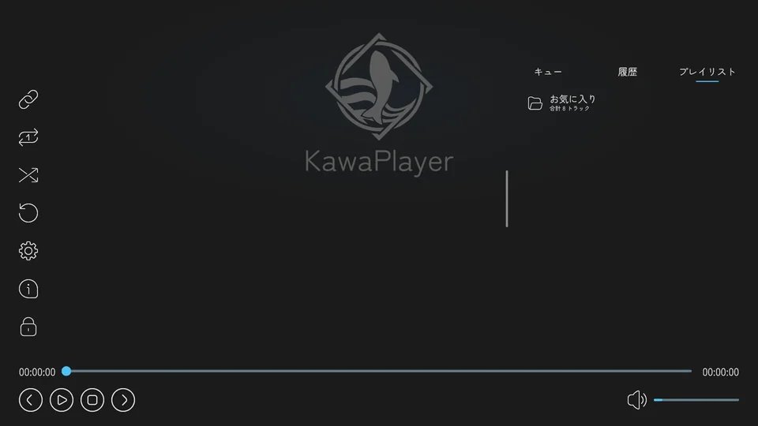 | 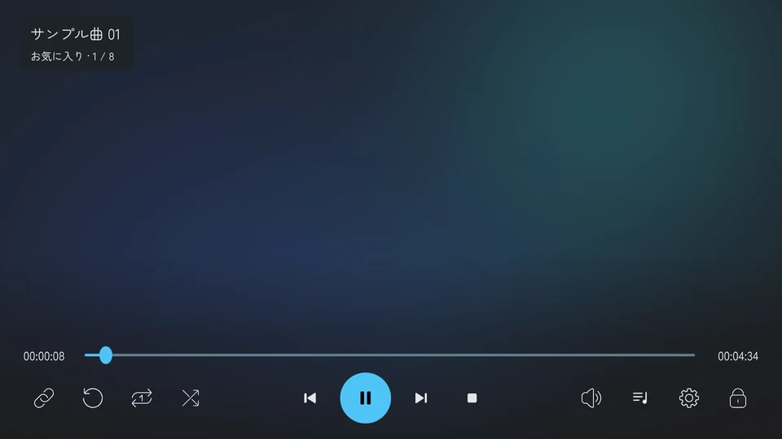 |

## 更新する前に、これだけは読んでね

* **PC と Quest の両方を、1.4.0 でビルドし直して公開してください。** スクリーン・タブレット・Playlist Panel の部品を作り直したので、Network ID の割り当てが変わります。タブレットは、開いているアプリの番号の意味が変わり（#347）、大きさを同期する部品も増えました（#348）。片方だけ古いと、アプリや大きさが食い違います。PC と Quest で版をそろえてください。（#258・#347・#348）
* **1.3 で作ったシーンも、そのままビルドできます。** なくなった部品の Network ID の記録は、ビルドが飛ばします。1.3.4 で KawaPlayer と機器を置いたシーンを 1.4.0 に上げてビルドし、VRChat で押せることを確かめました。（#310）
* **タブレットを置き直してください。** タブレットはスタンドに立った姿になり、プレハブの原点がスタンドの底の真ん中に変わりました。更新したら、机や床の上に置き直してください。スタンドがいらないときは、インスペクターでオフにすると、その場の姿のまま、今までの戻すボタンを使えます。（#350）
* **スクリーンやタブレットの UI を、シーンで書き換えていた人へ：** 作り直した部分への上書き（色・位置・文字など）は効かなくなります。更新したら、見た目を確かめてください。待ち受け画像の差し替えや配色の選択は、そのまま残ります。（#258）
* **自分の U# スクリプトから KawaPlayer を呼んでいる人は、下の「自分のスクリプトから KawaPlayer を呼んでいる人へ」を見てください。** API が 5 つ消えて、映像のテクスチャの知らせ方も変わりました。

## 新しいこと

### 操作は下の帯に

* 操作は、画面の下の帯にまとまりました。左は URL・ReSync・ループ・シャッフル、真ん中は前の曲・再生／一時停止・次の曲・停止、右は音量・一覧・設定・UI ロックです。（#305・#344・#347）
* 左上に、今の曲が出ます。プレイリストの曲なら、「お気に入り · 3 / 8」のように、どのプレイリストの何曲目かも出ます。止まっているときは、入れられる URL を案内します。（#305・#318）
* 押しても何も起きないボタンは、薄く出ます。止まっているときは URL のボタンだけが色付きになって、「次はここ」と主張します。（#305・#318）
* 左のボタンと設定は、指すと名前が出ます。
* **音量の板：** 音量のボタンを押すと、上に縦のバーが開きます。今の音量（%）と消音も、ここにあります。（#311）

  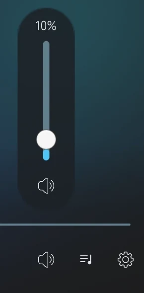

* **UI ロック：** 帯の右端のボタンでロックすると、操作が隠れて、スクリーンを押しても何も起きなくなります。外すときは、スクリーンを指して、トリガー（デスクトップでは左クリック）を 1.5 秒のうちに 3 回押します。押した回数は「●●○」で出ます。前は長押しでした。（#347）

  

### 操作は、しばらくすると自分で隠れる

* 最後にスクリーンを押してから 10 秒で、操作が自分で隠れます。動画を流していても、止まっていても同じです。画面は、すっきりが一番。（#345・#346）
* 次のあいだは隠れません。手を離したとき・閉じたときから、改めて 10 秒数えます。（#345）
  * 押したまま（シークバーやスライダーをつかんだまま）のとき。
  * ダイアログ・設定・URL の入力欄が開いているとき。
* 秒数は、KawaPlayer のインスペクターの外観設定「操作を自動で隠すまでの秒数」で変えられます。0 にすると、1.3 までと同じく自分では隠れません。タブレットの KawaPlayer アプリは 10 秒のままです。（#345）

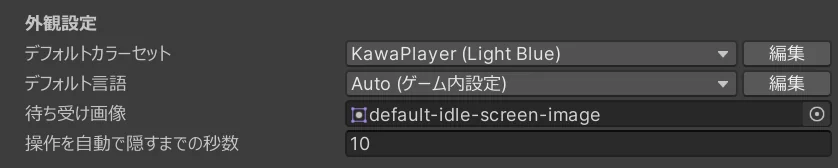

### 一覧は右から

* 操作を出すと、右から一覧の板も一緒に出ます。いちばんよく使うので。閉じるのは、帯の「一覧」か、右下の「∨」か、一覧の外を押すだけです。もう一度「一覧」を押せば開きます。（#312・#314・#336）
* 一覧が出ているあいだ、帯は一覧の左に縮みます。左の URL と ReSync、真ん中の再生の操作、右の音量と一覧は残ります。（#314・#344）
* タブはアイコン付きで、プレイリスト・キュー・履歴の順。初めはプレイリストです。プレイリストを開くと、上に名前と曲数が出ます。（#312・#336）
* プレイリストの一番下の「＋」から、VHub のプレイリストを足せます。VRChat用URL を入れると、再生はせずに一覧に足します。（#336）
* **曲は、押すとすぐ流れます。** 押して、出てきた ▷ をもう一度押す時代は終わりました。（#355）
  * キューの曲は、押すとすぐ流れて、キューから外れます。順番を飛ばすので、ほかの人が入れた曲より先に流れます。（#355）
  * 流れている曲の行を押しても、何も起きません。押し間違いで全員の動画が頭に戻らないように。読み込み中と一時停止中も同じで、止まっているときとエラーのときは流します。（#355）
* **曲を指すと、その行の右端に操作が出ます。** プレイリストと履歴では URL・キューに追加、キューでは URL・上へ・下へ・削除です。操作のボタンを押しても、一覧をドラッグしても、曲は流れません。（#355）
* 曲の「URL」を押すと、曲名と URL を、コピーできる欄に出します。（#318）
* 行の高さを 84 から 68 に詰めました。1 画面に入る曲が増えます。（#353）
* **長い曲名：** 1 行で出して、指しているあいだ左へ流します。操作が出ている行では、操作の手前で切れます。（#353・#355）
* VHub から読み込んだプレイリストは、名前の右の「…」から、更新・URL・削除ができます。URL は、読み込んだ VRChat用URL をコピーできる欄に出します。（#312・#317）
* Playlist Panel の一覧も、スクリーンと同じ部品になりました。Playlist Panel にはダイアログがないので、「…」と曲の URL、「＋」は出ません。更新や削除、プレイリストを足すのは、スクリーンかタブレットでどうぞ。（#317・#336）

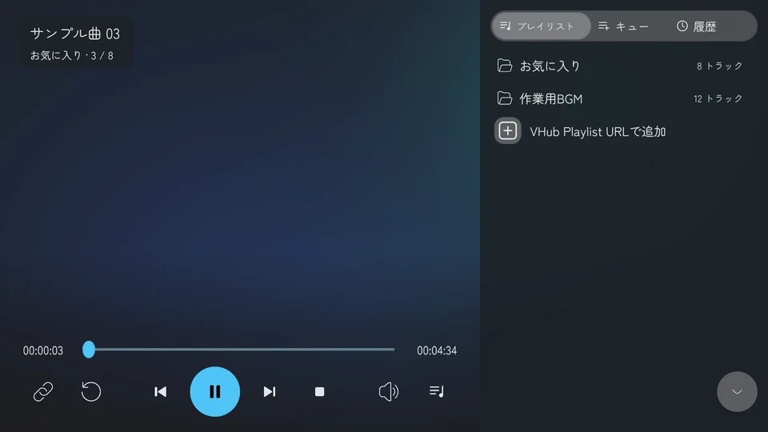

| プレイリストの曲を指したところ | キューの曲を指したところ |
| --- | --- |
| 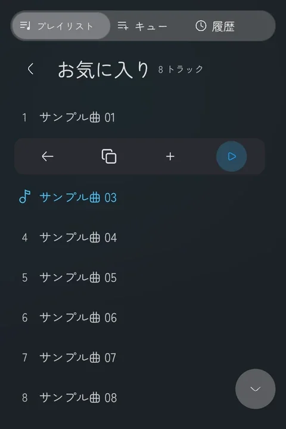 | 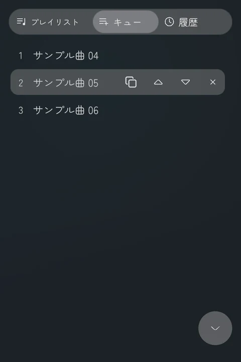 |

| 長い曲名を指したところ | VHub のプレイリストの「…」 |
| --- | --- |
| 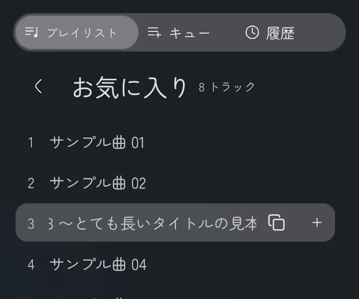 | 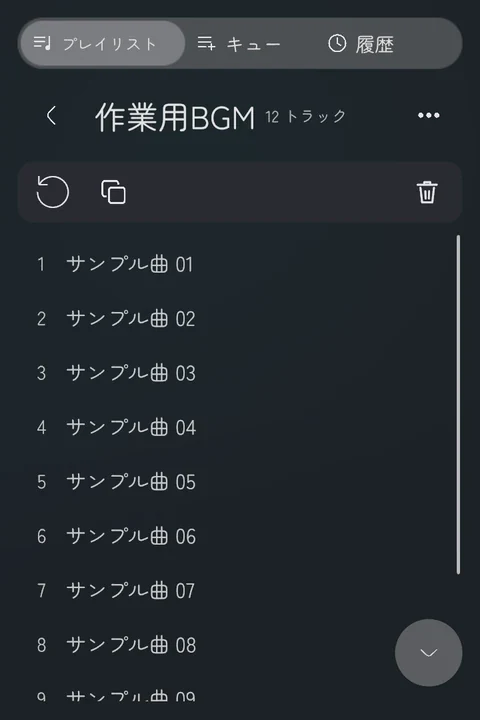 |

### 設定は、スクリーンとタブレットで同じ画面に

* スクリーンの設定と、タブレットの設定アプリが、同じ画面になりました。分類は「再生」「映像」「音声」「言語」「情報」で、権限管理を入れたワールドでは「情報」の上に「権限」も出ます。項目ごとに、何をするかの一言が付きます。（#313・#338・#347）
* タブレットでも、動画プレイヤー・再生速度・区間リピートなどの (Global) の設定を変えられます。（#313）
* 名前に (Global) が付いた設定は、インスタンスの全員に効きます。設定の画面の下にも、そう書いてあります。（#313）
* モジュールの欄（AudioLink・ピッチシフター・スライドショー・権限）も、スクリーンとタブレットの両方に出ます。（#313）
* **情報：** KawaPlayer の版・作った人・更新履歴は、設定の最後の分類「情報」で見られます。（#347）

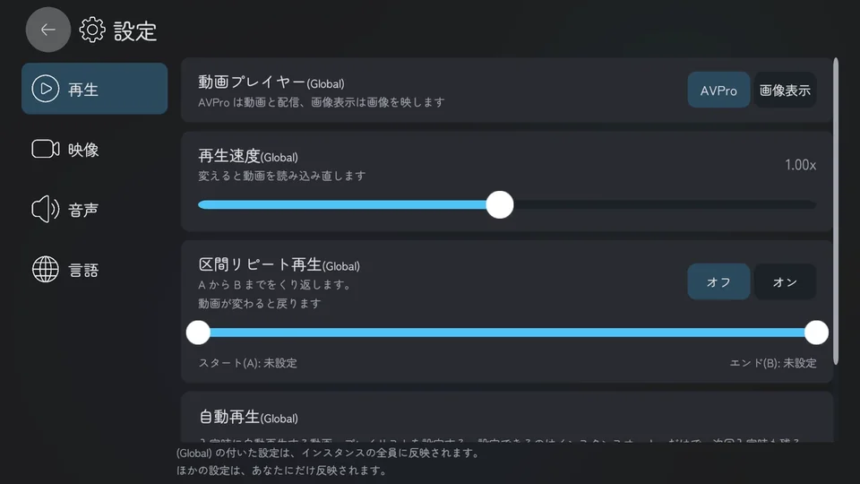

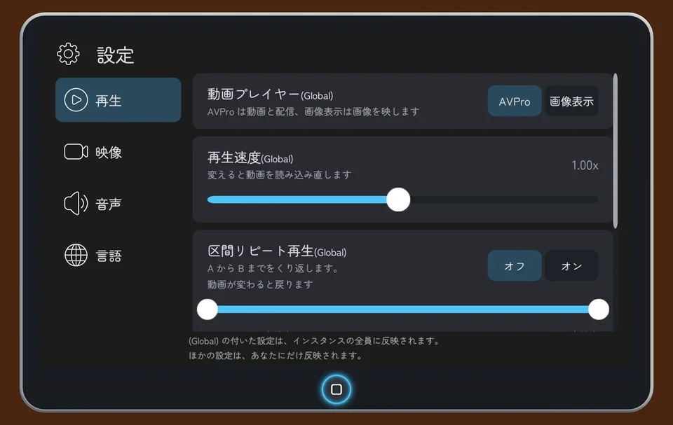

### タブレットを持ったまま、大きさを変えられる

* VR では、持っている手のトリガーを押したまま、同じ手のスティックを上に倒すと大きく、下に倒すと小さくなります。デスクトップでは、左クリックを押したまま、マウスのホイールを回します。（#348）
* 最初の大きさ（幅 30 cm）から、その 5 倍（幅 1.5 m）まで。1.5 m のタブレットは、もはやテレビです。（#348）
* VR では、持っている手の位置はずれずに、そこから広がります。（#348）
* トリガー（デスクトップでは左クリック）を押しているあいだは、歩けません。左手で持っているときは、左のスティックを大きさに使うので。（#348）
* 手を離しても、その大きさのままです。元の場所に戻ると（放置・戻すボタン）、最初の大きさに戻ります。（#348）
* インスペクターの **位置と大きさを全員にそろえる**（初めはオン）がオンなら、ほかの人にも同じ大きさで見えます。オフなら、位置と同じく、大きさも各自のタブレットだけで変わります。（#348）

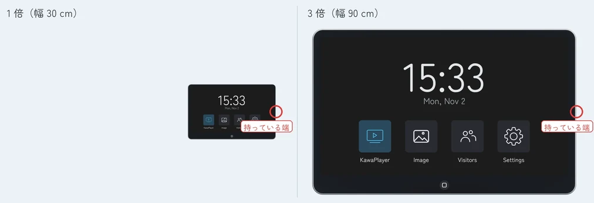

### タブレットにスタンド

* タブレットに、スタンドが付きました。デザインは曲げ木・アルミ・クッション・サイネージの 4 つで、色は全部で 14 色です。インスペクターで選びます。クッションは、見た目どおりのクッションです。（#350）
* スタンドの近く（30 cm 以内）で手を離すと、タブレットがスタンドに滑って収まります。大きくしていたら、元の大きさに戻ります。（#350）
* スタンドの手前に、丸い戻すボタンが付きます。押すと、タブレットが帰ってきます。（#350）
* **GameObject > KawaPlayer > Tablet** で置くと、スタンドに立った姿で入ります。サイネージだけは床に、ほかは机の上にどうぞ。（#350）
* スタンドがいらないときは、インスペクターでオフにできます。そのときは、今までの戻すボタンを使います。（#350）
* タブレットのインスペクターは、「持ち方」と「置き場所」に並べ直しました。「ピックアップ」は **手に持てる**、「グローバル同期」は **位置と大きさを全員にそろえる** になりました。（#350）

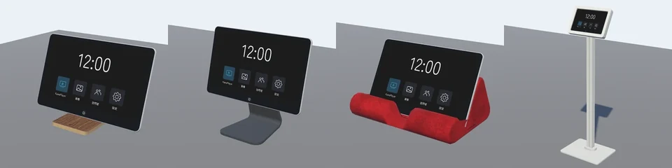

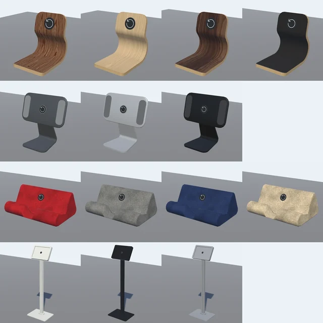

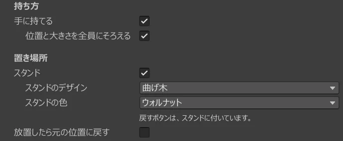

### 音声だけのサイトは、SOUND ONLY

* SoundCloud や Mixcloud のように映像がないものを流すと、スクリーンに大きく **SOUND ONLY** と出ます。音は出ているのに画面が真っ黒で、故障に見えていたので。（#365）
* 再生が始まって 1 秒たっても、映像の大きさもテクスチャもないときに出ます。サイト名では決めていないので、映像のある動画の上には出ません。あとから映像が来たら消えます。（#365）
* 文字はどの言語でも「SOUND ONLY」のままで、色はワールドのテーマカラーに合わせて変わります。（#365）
* タブレットの KawaPlayer アプリにも出ます。音声の途中で初めて開いても、1 秒ほどで出ます。（#365）
* 文字は Orbitron Black というフォントで、`Assets/Fonts/` に入っています。SIL Open Font License 1.1 のフォントなので、KawaPlayer の利用規約とは別のライセンスです。フォント単体では販売できません。（#365）

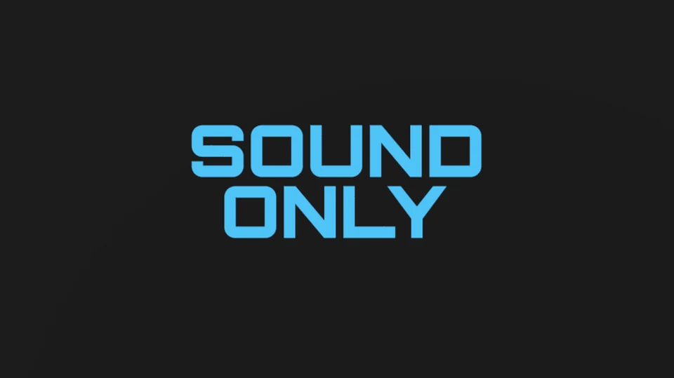

### 再生できないサイトは、そう言います

前はどのサイトでも「Player Error...」とだけ出て、KawaPlayer が壊れたように見えました。濡れ衣です（たいてい）。

* **サイトの名前を出します：** ニコニコ動画・TikTok・Dailymotion・Youku・ツイキャスの録画は、「ニコニコ動画には対応しておりません。」のように出ます。名前を出すのは、実際に試して再生できなかった形の URL だけです。（#364）

  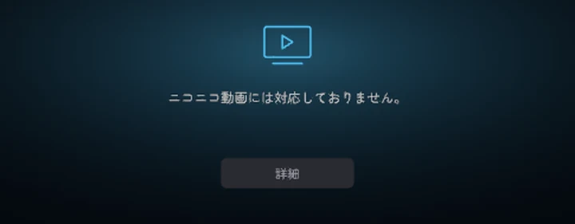

* **Vimeo：** `vimeo.com` の URL は再生できませんが、埋め込み用の URL なら再生できる動画があります。エラーの画面に、その URL をコピーできる欄を出すので、コピーして貼り直してください。それでも再生できない動画や、音が出ない動画もあります。（#364）

  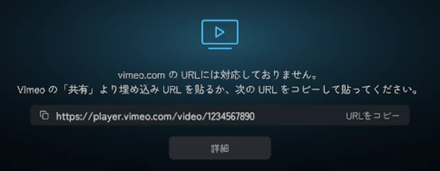

* **埋め込みコードを丸ごと貼ったとき：** コードのままでは再生できないので、中の URL を取り出して、同じ欄に出します。コピーして、もう一度貼ってください。ほかのエラーと同じく、全員の画面に出ます。（#364）

  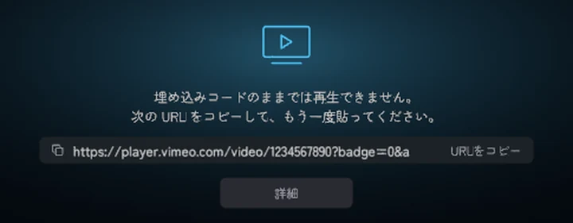

* **そのほかのサイト：** エラーに「このサイトの動画は、VRChat で再生できないことがあります。」と 1 行足しました。（#364）
* **再生できるサイト：** ガイドの「[再生できるサイト](https://github.com/Mega-Gorilla/KawaPlayer/blob/develop/docs/guide/playing.md#再生できるサイト)」に、実際に再生できたサイトを、試した月といっしょに載せました。VRChat の更新やサイトの都合で変わるので、月も見てください。（#360）

### 押しやすく

* 押せる範囲を、見た目より広げました。（#318）
  * スクリーンのボタンとスライダーのつまみは 84（約 14 cm 四方）。
  * Controller Bar のボタンは、となりのボタンとの間いっぱい。
* 設定は、左上の「←」でだけ閉じます。スライダーを動かしている途中で、うっかり閉じることがなくなりました。（#318）

## 変わったこと

* スクリーンの Info パネルにあった版と更新履歴は、設定の最後の分類「情報」に移りました。タブレットの「バージョン情報」アプリもなくなり、ホームのアプリは 4 つになりました。（#347）
* 読み込み中とエラーのときは、待ち受けのロゴと名前を隠します。文がロゴの「KawaPlayer」と重なって、読めなかったので。背景はそのままです。（#333）

  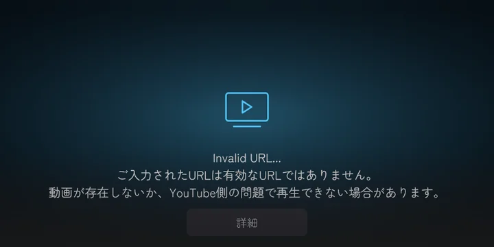

* 一覧のプレイリストの曲数は、「合計」を外して「8 トラック」にしました。日本語で 2 行に折り返していたので。（#333）
* 最大解像度の説明を「変えると動画を読み込み直します」にしました。前は「次に読み込む動画から変わります」と書いていましたが、実際は今の動画を読み込み直していました。説明のほうが間違っていました。（#331）
* ローカル再生遅延・AudioLink・ピッチシフターの欄は、設定の「音声」にあります。（#313）
* **Light Volume アダプターの光は、動画を流す前は黒です。** これまでは、シーンで付けた色（Point Light Volume の初期値は白）で、最初の動画まで光っていました。流す前も光らせたいワールドは、別の Light Volume を置いてください。（#359）
* 全員リロードボタンの NO VIDEO と RELOAD ALL の切り替わりは、最大 1 秒遅れます。押したときは、その場で確かめます。（#357）
* クイックスタートのポスター（`Media~/poster/`）の手順 3・4 を、新しいスクリーンの画面に差し替えました。（#351）

## 直したこと

* **再生エラーの「詳細」とコピー欄を押しても、開きませんでした。** 画面全体の押下を受ける部品が上に重なっていて、操作の帯と一覧が出るだけでした。「詳細の画面のスクリーンショットを送ってね」とお願いしておいて、開けなかったわけです。ごめんなさい。（#367）
  * コピー欄を押すと、VRChat の入力の画面が開いて、URL とコピーのボタンが出ます。
  * 一覧を開いているときは、最初の 1 回で一覧が閉じます。「詳細」が開くのは 2 回目です。
  * サイト名の出ないエラーでは、再試行のあいだ「詳細」が隠れます。

  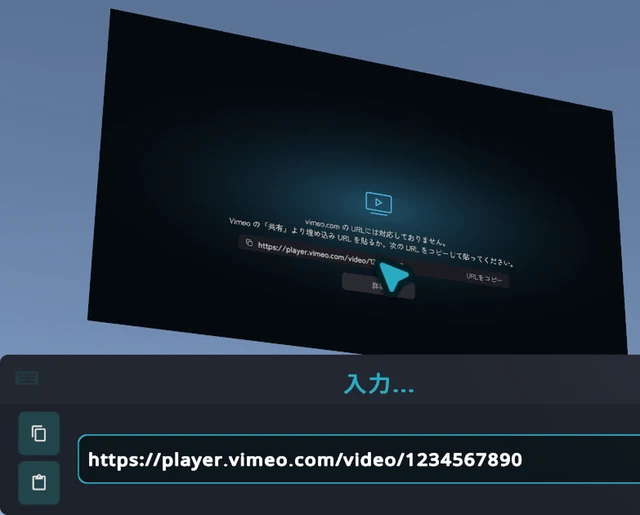

* 言語を変えても、プレイリストの曲数と、区間リピートの開始・終了の文が、前の言語のまま残っていた問題を直しました。（#331）
* ウクライナ語で、ダイアログのコピーの欄の名前が、欄に収まっていなかった問題を直しました。（#329）
* 一覧の長い曲名が、語の切れ目から先で消えていた問題を直しました。折り返した 2 行目を隠していたので、黙って消えていました。（#353）
* Light Volume アダプターで、動画を止めたあとも、光が最後の映像の色のまま残っていた問題を直しました。（#357）

## 中身の改善（見た目は変わりません）

* **動画を流しているあいだ、KawaPlayer の Udon は毎フレームのごみ（GC が回収するメモリ）を出さなくなりました。** 隠れている再生バーまで毎フレーム更新していたのをやめ、動画のテクスチャも替わったときだけ配ります。テスト用の部屋で、ワールド全体の Udon のごみは 1 フレーム 2,002 B から 808 B に、時間は 1.06 ms から 0.52 ms になりました（エディターで測った値）。GC のかくつきが減るはずです。Light Volume アダプターの分だけは、下のとおり残ります。（#357）
* **曲が替わるときの処理を軽くしました。** 何度も重なっていた画面の更新と一覧の描き直しを、1 回にまとめました。テスト用の部屋で、曲の終わりは 9.82 ms から 2.72 ms に、次の曲は 8.23 ms から 4.33 ms になりました（VRChat で 1 回ずつ測った値）。（#357）
* 再生が始まってから最初の同期の確認は、最大 1 秒あとになります。準備ができたときの位置合わせは、今までどおりその場で行います。（#357）
* **Light Volume アダプター：** GPU からの読み戻しを同時に 1 つにして（90 fps で毎秒 90 回から 45 回に）、色は変わったときだけ書き込みます。光が映像を追う速さは変わりません。ごみは 1 フレーム 413 B から 264 B になりました（エディターで測った値）。フレームレートがとても低いと、色の更新は少し粗くなります。（#359）
* 一覧を開く・戻る・スクロールするときの、無駄な描き直しと配列の作り直しをなくしました。プレイリストを開く時間は、16 ms から 5 ms ほどになりました（エディターで測った値）。（#324・#328）
* 操作を出しているあいだ毎フレームかかっていたマスクの切り抜きを、動いているあいだだけにしました。0.55 ms から 0.19 ms です。（#327）
* 一覧の 2 つのページ（プレイリストと曲）を、ページごとの Canvas で出し分けるようにしました。戻るときは 10.4 ms から 7.6 ms、もう一度開くときは 18.4 ms から 13.1 ms ほどです（エディターで測った値）。（#343）
* 使い方ガイドを、新しい画面に合わせて書き直し、画像も撮り直しました。（#330・#353・#355）

## 自分のスクリプトから KawaPlayer を呼んでいる人へ

消えた API があります。自分の U# スクリプトから呼んでいるときは、下の表のとおりに書き換えてください。

| 消えた API | 代わり |
| --- | --- |
| `UIController.PlayUrlTop` | `UIController.PlayUrl`。上の URL 欄をなくしたので、URL 欄は 1 つです（#305） |
| `TabletSettingsApp`（クラスごと） | なし。タブレットの設定アプリは、スクリーンと共通の設定（`Prefabs/UI/Settings.prefab`）になりました（#313） |
| `LoopScroll.ScrollToTop` | `LoopScroll.SetUpAtTop`。先頭から 1 回で描きます（#324） |
| `TabletScreen.OpenVersionApp` | なし。タブレットのバージョン情報アプリをなくしました。版と更新履歴は、設定の「情報」で見られます（#347） |
| `UIController.PlayPlaylistTrack` | `UIController.PressPlaylistTrack`。曲の行を押したときの処理で、流れている曲の行では何もしません（#355） |

* **映像を使うリスナーを作っている人へ：** `YamaPlayerListener.AfterTextureUpdated` は、毎フレームではなく、テクスチャが替わったとき、動画の準備ができたとき、受け手に加わったとき（映像が出ていれば）に呼ばれます。毎フレーム映像を読むスクリプトは、受け取ったテクスチャを持って、自分の `Update` で読んでください。Light Volume アダプターも、そうしています。（#357）
* キューの曲を番号で流す `Controller.PlayQueueTrack(int)` を足しました。そのあと、その曲はキューから外れます。（#355）
* **モジュールを作っている人へ：** 設定の中に行や分類を差し込むときは、差し込み口の `ModuleUISlot.inSettings` をオンにして、設定から見たパスを書きます。スクリーンとタブレットの両方に入ります。（#313）
* **`ScreenUI` を写して自分の UI を作っている人へ：** SOUND ONLY は `UIController` の `_soundOnlyText` に文字を入れた UI にだけ、エラーのコピー欄は `_errorCopyField` を入れた UI にだけ出ます。「詳細」とコピー欄は、`Canvas/User` の下で、全面の押下を受ける `Toggle` より後ろ、`Main` より前に置いてください。（#364・#365・#367）
* **設定に分類を足すモジュールを作っている人へ：** 分類の最後は「情報」です。分類の差し込み口の `siblingIndex` を -2 にすると、「情報」の上に入ります。KawaPlayer の権限管理も、そうしています。（#347）

## 困ったら

「こんなことが起きた！」があれば、気軽に [Discord サーバー](https://discord.gg/tkrHek6PvN) で教えてください。動画が再生できないときは、「詳細」の画面のスクリーンショットも添えてもらえると、とても助かります。あなたの報告が、次のリリースを作ります。

## 入手方法

VCC（VRChat Creator Companion）から入れます。更新の前に、上の「更新する前に、これだけは読んでね」を見てください。

KawaPlayer のリポジトリを追加済みなら、1.4.0 はもう更新候補に出ています。まだの人は、下の URL をブラウザのアドレスバーに貼って Enter を押してください。VCC が開き、リポジトリが追加されます。あとは **Manage Project** からプロジェクトに **Add** するだけです。

```
vcc://vpm/addRepo?url=https://mega-gorilla.github.io/vpm-repos/index.json
```

VCC が開かない場合は、**Settings > Packages > Add Repository** に `https://mega-gorilla.github.io/vpm-repos/index.json` を入力してください。

更新したら、ワールドをビルドし直してアップロードすると反映されます。

## 全部の変更

1.3.4 からの変更は、[1.3.4...1.4.0](https://github.com/Mega-Gorilla/KawaPlayer/compare/1.3.4...1.4.0) で見られます。

---

*English:*

The screen has a new look and new controls: KawaPlayer's own UI, no longer YamaPlayer's.

**Read this before you update:**

* Rebuild and publish both your PC and Quest builds with 1.4.0. The screen, tablet and Playlist Panel were rebuilt, so their Network IDs change; the tablet's apps are numbered anew and a part that syncs its size was added, so a PC and a Quest build of different versions disagree.
* Scenes made with 1.3 still build: the build skips the Network IDs of parts that are gone.
* The tablet now stands on a stand, and its prefab's origin is the stand's bottom. Place it on a table or the floor again after updating, or switch the stand off in its inspector to keep it where it is, with the return button as before.
* If you edited the screen's or the tablet's UI in your scene, those overrides on the rebuilt parts no longer apply. A custom idle image and the colour set carry over.
* If your own scripts call KawaPlayer, five APIs are gone, and `AfterTextureUpdated` no longer comes every frame. See above.

**What's new:**

* **All controls in one bar at the bottom:** URL, ReSync, loop and shuffle on the left; previous, play/pause, next and stop in the middle; volume, list, settings and the UI lock on the right. Buttons that would do nothing are dimmed.
* **The UI lock comes off with three presses** on the screen within 1.5 seconds, shown as ●●○ (a long press before).
* **The controls hide by themselves** 10 seconds after the screen was last used, whether a video plays or not, but not while a press is held or a dialog, the settings or a URL field is open. The time is set in the KawaPlayer inspector (0 keeps them up, as in 1.3).
* **Now playing, top left,** with the playlist and the track's place in it.
* **A list that slides in from the right** with the controls, with tabs for playlists, queue and history, a playlist header, refresh, URL and delete under "…" for VHub playlists, and a "+" under the playlists to add a VHub playlist by its VRChat URL. The Playlist Panel uses the same list.
* **A track plays when you press it.** Its actions show on the row you point at: URL and add to the queue, or URL, up, down and remove in the queue. A queued track pressed plays now and leaves the queue; the row of the track that plays does nothing unless it has stopped or failed.
* **Shorter rows, and long titles that scroll** while you point at them.
* **One settings screen for the screen and the tablet,** in Playback, Video, Audio, Language and About (and Permission with that module). About shows the version and the update log, so the screen's Info panel and the tablet's version app are gone. The tablet now has the (Global) settings too.
* **Resize the tablet while you hold it:** in VR, hold the trigger and push the holding hand's stick up or down; on desktop, hold the left button and turn the mouse wheel. From its own size up to 5 times; with its place and size shared (on at first), everyone sees the same size.
* **Stands for the tablet:** bentwood, aluminium, cushion and signage, in 14 colours, chosen in its inspector. Let go of the tablet within 30 cm and it slides onto its stand; the stand has its own return button.
* **Bigger hit areas** on buttons and slider handles.
* **SOUND ONLY on the screen** while a track with no picture plays (SoundCloud, Mixcloud), instead of a black screen that looks broken, on the tablet too. It follows the world's colour set, in Orbitron (SIL Open Font License 1.1, in `Assets/Fonts/`).
* **Errors say what is wrong:** a site that failed when tried is named as not supported. For Vimeo, the error shows the player's URL to copy and paste, though not every video plays or has sound; an embed code pasted whole shows the same, on everyone's screen. Any other site gets a line saying it may not play on VRChat.

**Also:**

* The idle logo gives way while loading and on an error, so the message is readable.
* The max resolution's description now says that changing it reloads the video, which it always did.
* The error's Details button and copy field can be pressed: the press over the whole screen used to take them, and only showed the controls.
* A language change no longer leaves the track count and the repeat range in the old language.
* Long track titles no longer lose everything after the first word break that did not fit.
* KawaPlayer's Udon makes no garbage each frame while a video plays, and a track change is drawn once. In a test world, Udon's garbage went from 2,002 B to 808 B a frame, and a track change's work from 9.82 and 8.23 ms to 2.72 and 4.33 ms.
* The Light Volume adapter keeps the volumes dark until a video shows and after it stops, asks for one GPU readback at a time, and writes a colour only when it changes.

Anything odd? Tell us on our [Discord server](https://discord.gg/tkrHek6PvN).
