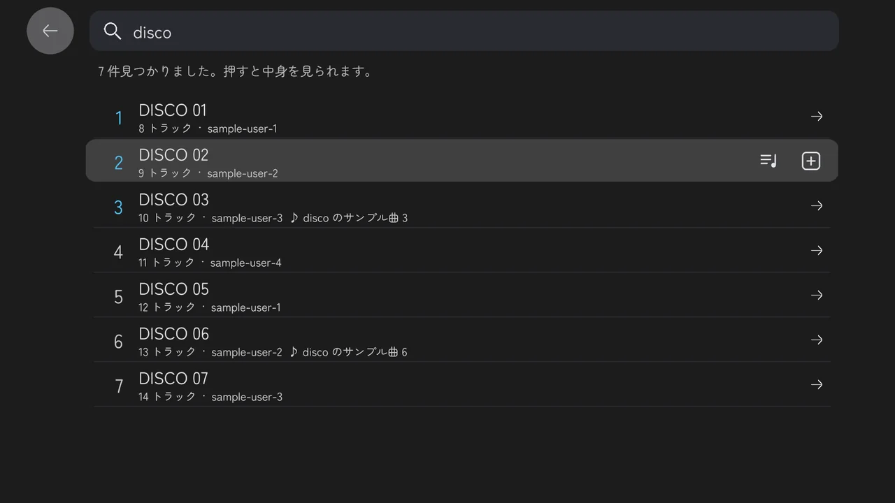
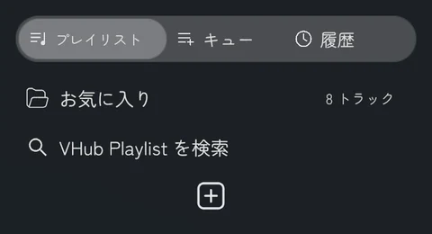
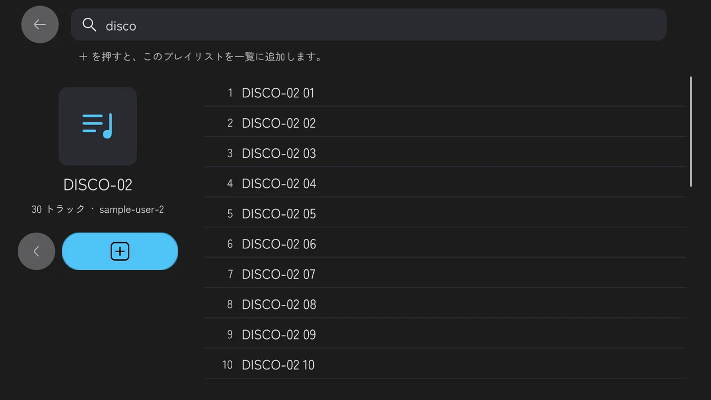
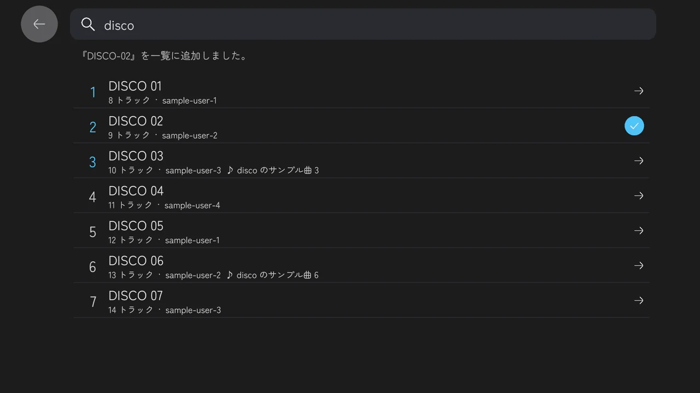
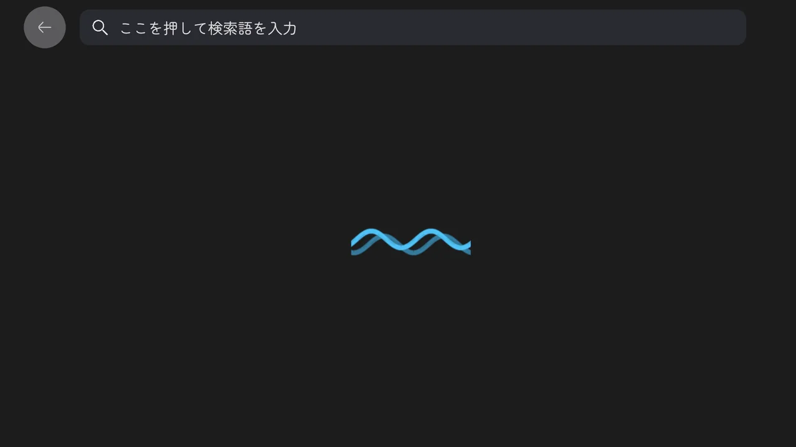

**KawaPlayer 1.5.0** — 2026-11-14

ワールドの中から、VHub Playlist のプレイリストを探せるようになりました。

これまでは、ブラウザで VHub を開いて、VRChat用URL をコピーして、ワールドに戻って貼る、という小旅行が必要でした。1.5.0 では、スクリーンの検索に語を打つだけです。見つかったプレイリストは、中身を見てから一覧に足せます。



## 更新する前に、これだけは読んでね

* **PC と Quest の両方を、1.5.0 でビルドし直して公開してください。** 読み込んだプレイリストが同期する項目を 1 つ増やしました（どのプレイリストかを示す識別）。同期する項目が違う版どうしは、同じインスタンスに入れません。片方だけ 1.5.0 にすると、PC と Quest が別々のインスタンスに分かれます。
* **検索を使うには、Allow Untrusted URLs をオンにしてください。** 検索も、プレイリストの読み込みも、VRChat の「文字列の読み込み」を使います。これは、遊ぶ人それぞれの設定でオンになっている必要があります（VHub のプレイリストを読み込むのと同じ条件です）。
* **設定・プレイリスト・シーンの配置は、そのまま引き継がれます。** 置き直す必要はありません。検索は、外部プレイリスト読込のモジュールが有効なら、ビルドのときに自動でつながります。
* **自分の U# スクリプトから KawaPlayer を呼んでいる人は、下の「自分のスクリプトから KawaPlayer を呼んでいる人へ」を見てください。** `PlaylistLoader` の読み込みのメソッドの名前と引数が変わりました。

## 新しいこと

### VHub Playlist を、ワールドの中で検索

* 一覧のプレイリストの下に、**VHub Playlist を検索** の行が増えました。押すと、画面いっぱいの検索のページが開きます。（#380）

  

* 上の箱を押すと、VRChat の入力の画面が開きます。**入っている URL は消さずに、その後ろに**検索語を打ってください。ワールドは文字から URL を作れないので、URL の後ろに書いてもらう作戦です。（#380）
* 探せるのは、公開されているプレイリストの名前と曲名です。曲名で見つかったプレイリストには、♪ と、その曲名が出ます。（#380）
* 結果は、よく読み込まれている順に、順位つきで並びます。上位 3 件の順位は水色です。一度に出るのは 60 件までなので、多すぎたら語を足して絞ってください。（#380）
* `#` と `%` は検索に使えません（VRChat が送ってくれないか、断られます）。箱に VHub の VRChat用URL を貼ると、そのプレイリストを読み込みます。（#380）
* 出るのは、スクリーンと、タブレットの KawaPlayer アプリです。Playlist Panel には出ません。

### 中身を見てから、足す

* 結果の行にレーザーを向けると、右に 2 つのボタンが出ます。（#380）
  * **曲の一覧**のボタン（または行そのもの）を押すと、そのプレイリストが開きます。
  * **＋** を押すと、中身を見ずに、そのまま一覧に足します。
* 開いたプレイリストは、左に名前・曲数・作った人、右に全部の曲が並びます。**＋** で一覧に足し、**＜** で検索の結果に戻ります。結果は残っているので、続けてほかのプレイリストも覗けます。（#380）

  

* 足しても、再生は始まりません。一覧から、好きな曲を選んでください。（#380）
* 足したプレイリストには、水色の丸に ✓ の印が付きます。もう一覧にあるプレイリストは、結果の行にも ✓ が出て、＋ は出ません。「これ、もう入れたっけ？」と悩まなくて済みます。（#380）

  

* 行に収まらない長い名前や曲名は、レーザーを向けているあいだ、左へ流れて最後まで読めます。開いたプレイリストの左の名前は 4 行までで、それより長いと「…」で終わります。（#380）
* 待つあいだは、水色の波が流れます。VRChat は、こうした読み込みを 1 人あたり 5 秒に 1 回に抑えているので、続けて検索したり開いたりすると、少し待つことがあります。川のプレイヤーなので、波です。（#380）

  

## 変わったこと

* **同じプレイリストは、どこから入れても同じ 1 つになります。** これまでは「読み込んだ URL」でプレイリストを見分けていました。1.5.0 からは、プレイリストそのものの識別で見分けます。URL を貼って入れたプレイリストを検索からもう一度足しても、2 つにはならず、同じ枠が更新されます。（#379）
* **一覧の「…」の URL のボタンは、人に渡せる URL のときだけ出ます。** 検索から足しただけのプレイリストは、取得に使った番号を VHub がほかのプレイリストに使い回すので、URL として渡せません。そのプレイリストでは、URL のボタンは出ません（更新と削除は、今までどおり使えます）。（#380）
* **外部プレイリスト読込のインスペクターに、Search Pool Size が増えました。** 検索の結果を読み込むための URL の数で、初めから 4,096 が入っています。VHub の設定と合わせてあるので、ふつうは触らなくて大丈夫です。（#379）
* **クイックスタートのポスターの手順 4 を、今の一覧の画面に撮り直しました。**（#377）

## 直したこと

* **識別のない応答は、読み込みません。** VHub 以外のサーバーや古い応答で、どのプレイリストかが分からないものは、読み込まずにエラーにします。（#379）
* **使い回された番号で、別のプレイリストが届いても、読み込みません。** 検索の結果を押してから読み込むまでのあいだに、番号が別のプレイリストを指すようになった場合は、「もう一度検索してください」と出ます。知らないプレイリストが勝手に入ることはありません。（#379・#380）

## ガイド

* 「遊ぶ」のページに、**VHub のプレイリストを検索する**を足しました。（#380）
* 再生できるサイトに、ツイキャスのライブ配信を足しました（2026 年 11 月に確認）。（#378）

## 自分のスクリプトから KawaPlayer を呼んでいる人へ

`PlaylistLoader`（外部プレイリスト読込）まわりの API が変わりました。`YamaPlayer` 本体の API は変わっていません。

**名前と引数が変わったもの：**

| 1.4 | 1.5 |
| --- | --- |
| `PlaylistLoader.LoadPlaylistFromUrlWithFeedback(url, ui, expectedReplaced, expectedReplacedSourceUrl, playWhenStopped)` | `PlaylistLoader.LoadPlaylistWithFeedback(url, expectedKey, ui, expectedReplaced, expectedReplacedKey, playWhenStopped)` |
| `PlaylistLoader.GetSlotToBeReplaced(VRCUrl url)` | `PlaylistLoader.GetSlotToBeReplaced(string expectedKey)` |
| `DynamicPlaylist.Fill(sourceUrl, playlistName, tracks, sequence, addedOrder)` | `DynamicPlaylist.Fill(sourceUrl, sourceKey, playlistName, tracks, sequence, addedOrder)` |

* `expectedKey` は、読み込むプレイリストの識別（`{pool}/{id}`）です。VHub の VRChat用URL なら、`PlaylistLoader.GetExpectedKey(url)` で得られます。応答が別のプレイリストだったときは、何も読み込まず、結果は `LoadResultIdentityChanged`（9）になります。
* フィードバックの要らない `PlaylistLoader.LoadPlaylistFromUrl(url)` は、そのまま使えます。

**増えたもの：**

* `PlaylistLoaderUI.LoadPlaylist(ui, url, fetched, expectedKey, addOnly)` — 識別の分かっているプレイリストを、URL 欄と同じ確認（権限・読み込み中・満杯のときの確認）を通して読み込みます。`fetched` に、もう読んである応答の文字列を渡すと、読み直しません（`null` なら読みます）。
* `PlaylistLoader.LoadFetchedWithFeedback(...)`、`ReadResponse(json, out name, out key, out titles)`、`HasPlaylist(key)`、`GetResolveUrl(index)` — 検索が使っている部品です。
* `DynamicPlaylist.SourceKey` — 枠が持っているプレイリストの識別です（同期します）。
* `UIController` は、プレイリストの一覧が変わったとき、自分に登録された部品（`AddListener`）にも `AfterPlaylistsUpdated` を送るようになりました。

## 困ったら

「こんなことが起きた！」があれば、気軽に [Discord サーバー](https://discord.gg/tkrHek6PvN) で教えてください。検索で見つからない・開けないときは、打った語と、画面のスクリーンショットを添えてもらえると、とても助かります。

## 入手方法

VCC（VRChat Creator Companion）から入れます。更新の前に、上の「更新する前に、これだけは読んでね」を見てください。

KawaPlayer のリポジトリを追加済みなら、1.5.0 はもう更新候補に出ています。まだの人は、下の URL をブラウザのアドレスバーに貼って Enter を押してください。VCC が開き、リポジトリが追加されます。あとは **Manage Project** から KawaPlayer を足すだけです。

```
vcc://vpm/addRepo?url=https://mega-gorilla.github.io/vpm-repos/index.json
```

VCC が開かない場合は、**Settings > Packages > Add Repository** に `https://mega-gorilla.github.io/vpm-repos/index.json` を入力してください。

更新したら、ワールドをビルドし直してアップロードすると反映されます。

## 全部の変更

1.4.1 からの変更は、[1.4.1...1.5.0](https://github.com/Mega-Gorilla/KawaPlayer/compare/1.4.1...1.5.0) で見られます。

---

*English:*

You can now search VHub Playlist from inside the world, look at a playlist's tracks, and add it to the list.

**Read this before you update:**

* Rebuild and publish both your PC and Quest builds with 1.5.0. A loaded playlist syncs one more field (the key that tells which playlist it is), and builds whose synced fields differ cannot share an instance.
* Searching needs each player's Allow Untrusted URLs, as loading a VHub playlist does: both are string downloads.
* Settings, playlists and scenes carry over. The search is wired at build when the PlaylistLoader module is on.
* If your own scripts call `PlaylistLoader`, its load methods were renamed and take a playlist key. See above.

**What's new:**

* **Search VHub Playlist in the world:** a row under the list's playlists opens a page over the whole screen. Press the box and type after the URL that is in VRChat's input window (a world cannot make a URL from text). It searches public playlists by name and by track title, and shows up to 60 results, the most loaded first, with their place.
* **Look before you add:** point at a result for two buttons, one that opens the playlist and one that adds it without opening. An opened playlist shows its name, track count and maker on the left and every track on the right; + adds it to the list, without starting playback, and < goes back to the results.
* **A check on what you already have:** an added playlist shows a check in a blue circle, on its result too, where + no longer shows.
* **Long names and titles scroll** while you point at their row. An opened playlist's name takes up to four lines and ends in "…" beyond that.
* **Waves while waiting:** VRChat allows one such download every five seconds per player.

**Also:**

* A playlist is now told by its own key, not by the URL that fetched it: the same playlist added by URL and from the search stays one, and a response that is another playlist, or names none, is not loaded.
* The list's URL button shows only for a playlist whose URL can be passed on; one added only from the search has none, as VHub reuses the number that fetched it.
* The PlaylistLoader inspector has a Search Pool Size (4,096 by default; leave it).
* The quick start poster's step 4 shows the current list.
* The guide lists TwitCasting live streams among the sites that play.
